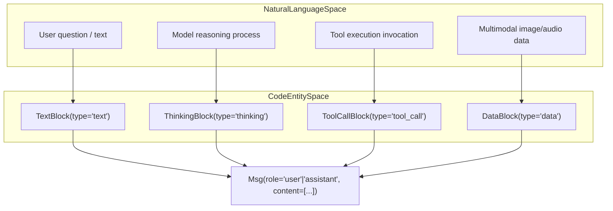
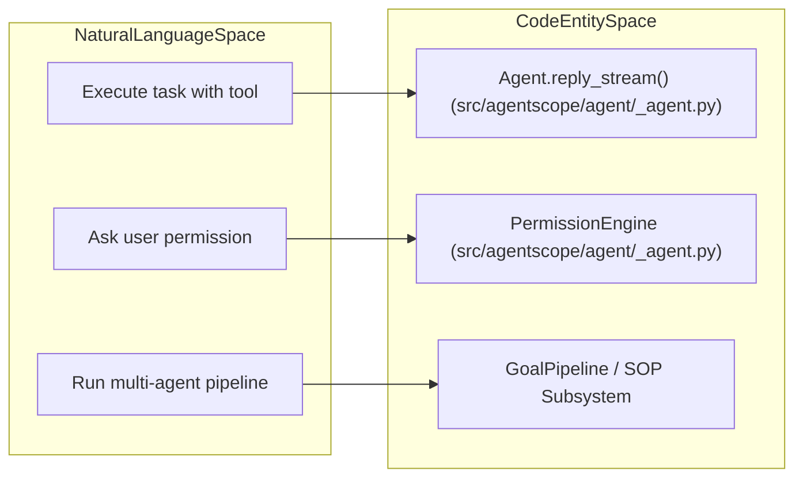

<!-- source: DeepWiki mcp.deepwiki.com · repo modelscope/agentscope · page 12 Glossary · fetched 2026-10-27 -->

# Glossary

Relevant source files

The following files were used as context for generating this wiki page:

- [.gemini/styleguide.md](.gemini/styleguide.md)
- [.github/copilot-instructions.md](.github/copilot-instructions.md)
- [.pre-commit-config.yaml](.pre-commit-config.yaml)
- [README.md](README.md)
- [README_zh.md](README_zh.md)
- [assets/images/agentscope.png](assets/images/agentscope.png)
- [docs/NEWS.md](docs/NEWS.md)
- [docs/NEWS_zh.md](docs/NEWS_zh.md)
- [examples/agent_service/README.md](examples/agent_service/README.md)
- [src/agentscope/_version.py](src/agentscope/_version.py)
- [src/agentscope/agent/_agent.py](src/agentscope/agent/_agent.py)
- [src/agentscope/agent/_config.py](src/agentscope/agent/_config.py)
- [src/agentscope/event/_event.py](src/agentscope/event/_event.py)
- [src/agentscope/message/_base.py](src/agentscope/message/_base.py)
- [src/agentscope/middleware/__init__.py](src/agentscope/middleware/__init__.py)
- [src/agentscope/middleware/_base.py](src/agentscope/middleware/_base.py)
- [src/agentscope/middleware/_longterm_memory/__init__.py](src/agentscope/middleware/_longterm_memory/__init__.py)
- [src/agentscope/middleware/_longterm_memory/_reme/__init__.py](src/agentscope/middleware/_longterm_memory/_reme/__init__.py)
- [src/agentscope/realtime/__init__.py](src/agentscope/realtime/__init__.py)
- [src/agentscope/realtime/_base.py](src/agentscope/realtime/_base.py)
- [src/agentscope/skill/_local_loader.py](src/agentscope/skill/_local_loader.py)
- [src/agentscope/tool/_toolkit.py](src/agentscope/tool/_toolkit.py)
- [src/agentscope/tool/_types.py](src/agentscope/tool/_types.py)
- [tests/agent_basic_test.py](tests/agent_basic_test.py)
- [tests/agent_injection_test.py](tests/agent_injection_test.py)
- [tests/agent_interrupt_test.py](tests/agent_interrupt_test.py)
- [tests/compress_context_test.py](tests/compress_context_test.py)
- [tests/event_test.py](tests/event_test.py)
- [tests/event_to_message_test.py](tests/event_to_message_test.py)
- [tests/hitl_external_execution_test.py](tests/hitl_external_execution_test.py)
- [tests/hitl_user_confirmation_test.py](tests/hitl_user_confirmation_test.py)
- [tests/message_test.py](tests/message_test.py)
- [tests/middleware_test.py](tests/middleware_test.py)
- [tests/skill_loader_test.py](tests/skill_loader_test.py)
- [tests/toolkit_skill_test.py](tests/toolkit_skill_test.py)

## Purpose and Scope

This wiki page defines codebase-specific terms, jargon, abbreviations, and domain concepts used across AgentScope 2.0. It provides technical definitions, architectural context, and code pointers for core components such as the ReAct loop, message protocol, toolkits, workspace environments, and realtime voice subsystems.

---

## 1. Core Abstractions & Tool System

### Msg and Content Blocks
`Msg` is the fundamental unit of data exchange between agents in AgentScope, encapsulating the sender's identity, role, and a structured sequence of content blocks [src/agentscope/message/_base.py:70-118](). Content blocks represent typed payloads within messages, including `TextBlock`, `ThinkingBlock`, `ToolCallBlock`, `ToolResultBlock`, `DataBlock` (for multimodal media via `Base64Source` or `URLSource`), and `HintBlock` [src/agentscope/message/_base.py:9-22]().

**Natural Language to Code Entity Mapping: Message and Block Protocol**

Sources: [src/agentscope/message/_base.py:70-118](), [src/agentscope/message/_base.py:9-22]()

### AgentEvent
An asynchronous streaming event emitted during agent execution (such as `ReplyStartEvent`, `TextBlockDeltaEvent`, `ToolCallStartEvent`, `RequireUserConfirmEvent`, etc.) that allows UIs and consumers to track fine-grained lifecycle steps [src/agentscope/agent/_agent.py:36-66]().

Sources: [src/agentscope/agent/_agent.py:36-66]()

### Toolkit & ToolGroup
`Toolkit` is the central orchestrator responsible for registering, validating, and executing tool functions, MCP clients, and skills [src/agentscope/tool/_toolkit.py:88-115](). `ToolGroup` allows tools to be organized into logical sets that can be dynamically activated or deactivated within the tool context [src/agentscope/state/_state.py:32-45]().

Sources: [src/agentscope/tool/_toolkit.py:88-115](), [src/agentscope/state/_state.py:32-45]()

### MCP (Model Context Protocol)
An open protocol enabling agents to securely connect to external tools, resources, and data sources via `MCPClient` instances supporting stdio or HTTP transports [src/agentscope/mcp/_mcp_client.py:1-10]().

Sources: [src/agentscope/mcp/_mcp_client.py:1-10]()

### Skill
Encapsulated domain knowledge packages or prompts (such as `agentscope-skill` or custom markdown instructions) that agents can dynamically discover and load into their workspace or execution context [README.md:81](). Skills are loaded via `SkillLoaderBase` [src/agentscope/skill/_local_loader.py:10-11]() and can be viewed using the `SkillViewer` tool [src/agentscope/tool/_toolkit.py:166-169]().

Sources: [README.md:81](), [src/agentscope/skill/_local_loader.py:10-11](), [src/agentscope/tool/_toolkit.py:166-169]()

### Classifier
The `agentscope.classifier` package and models like `JevClassifierModel` that provide structured intent and question classification (e.g., `BinaryQuestion`, `ChoiceQuestion`, `ScoreQuestion`) for agent decision-making workflows [README.md:81]().

Sources: [README.md:81]()

---

## 2. Agent Execution & Orchestration

### ReAct (Reason-Act) Loop
The core execution paradigm of the `Agent` class where the model alternates between generating reasoning/thinking blocks or tool calls (`Acting`), executing tools, and processing results until a final reply is formed [src/agentscope/agent/_agent.py:117-170](). The `ReActConfig` controls parameters like maximum iterations and execution timeouts [src/agentscope/agent/_config.py:409-442]().

Sources: [src/agentscope/agent/_agent.py:117-170](), [src/agentscope/agent/_config.py:409-442]()

### PermissionMode & PermissionEngine
`PermissionEngine` evaluates tool execution requests against the active permission context and rule sets, supporting modes such as read-only restrictions or requiring user confirmation (`PermissionBehavior.ASK`) [src/agentscope/agent/_agent.py:192-194](). `PermissionMode` is an enum defining these governance behaviors [src/agentscope/permission/_base.py:10-20]().

Sources: [src/agentscope/agent/_agent.py:192-194](), [src/agentscope/permission/_base.py:10-20]()

### GoalPipeline & SOP
Higher-level orchestration structures. `GoalPipeline` executes multi-agent sequences along fixed workflows, while the Standard Operating Procedure (`SOP`) subsystem defines structured multi-agent collaboration patterns [README.md:77](), [README_zh.md:75]().

Sources: [README.md:77](), [README_zh.md:75]()

### A2A (Agent-to-Agent)
A protocol and interop layer (`A2AAgent`) that enables local agents to converse with and delegate tasks to remote A2A-compliant agent instances [README.md:85]().

**Natural Language to Code Entity Mapping: Agent Execution and Governance**

Sources: [src/agentscope/agent/_agent.py:117-194](), [src/agentscope/agent/_config.py:409-442](), [src/agentscope/permission/_base.py:10-20](), [README.md:77](), [README.md:85](), [README_zh.md:75]()

---

## 3. Workspace, Environment & Infrastructure

### Workspace & IsolationPolicy
`WorkspaceBase` and its concrete implementations (such as `LocalWorkspace` or containerized backends like Docker, E2B, K8s, Daytona, OpenSandbox, Bubblewrap, and AppleContainer) provide sandboxed file systems and tool execution environments [src/agentscope/workspace/_base.py:10-20](). `IsolationPolicy` defines how workspaces are scoped across tenants, sessions, or agents [src/agentscope/workspace/_manager.py:10-20]().

Sources: [src/agentscope/workspace/_base.py:10-20](), [src/agentscope/workspace/_manager.py:10-20]()

### MessageBus
An application-layer messaging infrastructure that provides distributed session locking, event pub/sub, and inbox message delivery. Implementations include Redis storage backends [src/agentscope/server/storage/_redis_storage.py:10-20]().

Sources: [src/agentscope/server/storage/_redis_storage.py:10-20]()

### Hub & Channel
- **Hub**: Resource repositories like `GitHubMCPHub` and `ClawHub` that allow users to browse and install MCP tools and skills into the application [docs/NEWS_zh.md:20-21]().
- **Channel**: Integration gateways connecting agent service sessions to external instant messaging platforms (DingTalk, Feishu, Discord) [docs/NEWS_zh.md:16-18]().

Sources: [docs/NEWS_zh.md:16-18](), [docs/NEWS_zh.md:20-21]()

### ChatUsage
A data structure tracking token consumption metrics (prompt tokens, completion tokens, cache read tokens, cache creation tokens) across chat model invocations [src/agentscope/model/_base.py:10-20]().

Sources: [src/agentscope/model/_base.py:10-20]()

---

## 4. Realtime, Voice & Observability

### VAD (Voice Activity Detection)
A mechanism within speech-to-speech pipelines that detects user speech start/stop boundaries to control conversational turn-taking. This is a key component in `RealtimeAgent` [README.md:84]().

Sources: [README.md:84]()

### Realtime ModelEvent
Streaming event types specific to real-time multimodal voice models (such as audio delta events, transcription updates, and interruption signals) handled by `RealtimeAgent` [README.md:83](). These events are part of the unified event model for real-time agents.

Sources: [README.md:83]()

---

## 5. Abbreviations Table

| Abbreviation | Full Term | Description | Code Pointer |
| :--- | :--- | :--- | :--- |
| **MCP** | Model Context Protocol | Standard protocol for connecting LLMs to external tools and data sources. | [src/agentscope/mcp/_mcp_client.py:1-10]() |
| **OTEL** | OpenTelemetry | Observability framework for distributed tracing and metrics collection. | [src/agentscope/opentelemetry/_trace.py:1-10]() |
| **TTS** | Text-to-Speech | Subsystem converting text outputs into audio blocks or streams. | [src/agentscope/models/tts/_base.py:1-10]() |
| **RAG** | Retrieval-Augmented Generation | Framework for grounding agent responses using retrieved knowledge base documents. | [src/agentscope/rag/_base.py:1-10]() |
| **SSE** | Server-Sent Events | HTTP streaming protocol used to push agent events to the Web UI. | [src/agentscope/server/protocol.py:1-10]() |
| **HITL** | Human-in-the-Loop | Governance mechanism pausing execution for user confirmation or intervention. | [src/agentscope/agent/_agent.py:55-58]() |
| **VAD** | Voice Activity Detection | Audio processing technique for detecting speech segments in realtime voice sessions. | [README.md:84]() |
| **SOP** | Standard Operating Procedure | Structured workflow definition for multi-agent coordination. | [README.md:77]() |
| **A2A** | Agent-to-Agent | Protocol allowing agents to communicate with remote peer agents. | [README.md:85]() |

Sources: [src/agentscope/mcp/_mcp_client.py:1-10](), [src/agentscope/opentelemetry/_trace.py:1-10](), [src/agentscope/models/tts/_base.py:1-10](), [src/agentscope/rag/_base.py:1-10](), [src/agentscope/server/protocol.py:1-10](), [src/agentscope/agent/_agent.py:55-58](), [README.md:77](), [README.md:84](), [README.md:85]()