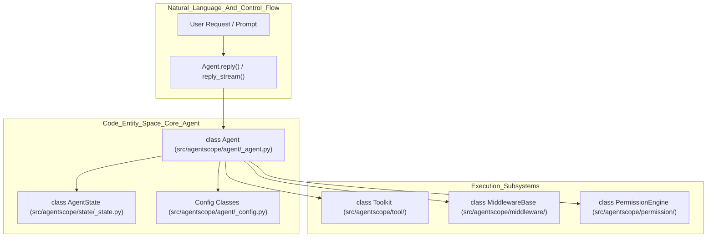
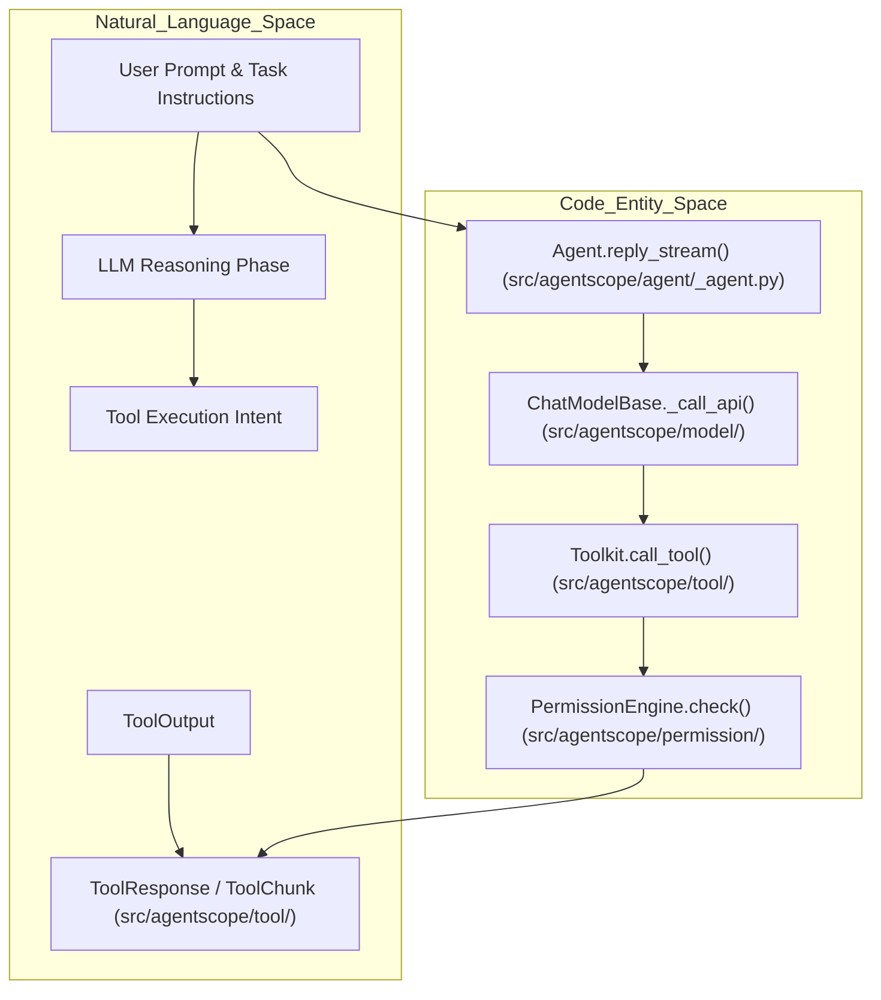

<!-- source: DeepWiki mcp.deepwiki.com · repo modelscope/agentscope · page 2 Agent System · fetched 2026-10-27 -->

# Agent System

Relevant source files

The following files were used as context for generating this wiki page:

- [.pre-commit-config.yaml](.pre-commit-config.yaml)
- [src/agentscope/agent/_agent.py](src/agentscope/agent/_agent.py)
- [src/agentscope/agent/_config.py](src/agentscope/agent/_config.py)
- [src/agentscope/event/_event.py](src/agentscope/event/_event.py)
- [src/agentscope/message/_base.py](src/agentscope/message/_base.py)
- [src/agentscope/middleware/_base.py](src/agentscope/middleware/_base.py)
- [tests/agent_basic_test.py](tests/agent_basic_test.py)
- [tests/agent_injection_test.py](tests/agent_injection_test.py)
- [tests/agent_interrupt_test.py](tests/agent_interrupt_test.py)
- [tests/compress_context_test.py](tests/compress_context_test.py)
- [tests/event_test.py](tests/event_test.py)
- [tests/event_to_message_test.py](tests/event_to_message_test.py)
- [tests/hitl_external_execution_test.py](tests/hitl_external_execution_test.py)
- [tests/hitl_user_confirmation_test.py](tests/hitl_user_confirmation_test.py)
- [tests/message_test.py](tests/message_test.py)
- [tests/middleware_test.py](tests/middleware_test.py)

## Purpose and Scope

The Agent System serves as the primary execution engine of AgentScope, coordinating reasoning, acting, tool orchestration, security permissions, and inter-agent communication. At its heart is the unified `Agent` class [src/agentscope/agent/_agent.py:117-118](), which executes a ReAct (Reasoning-Acting) loop, delegates tool invocations via `Toolkit` [src/agentscope/agent/_agent.py:201](), enforces permissions through `PermissionEngine` [src/agentscope/agent/_agent.py:193](), and streams execution telemetry using the `AgentEvent` protocol [src/agentscope/agent/_agent.py:36-66]().

As a parent page, this section provides a high-level architectural overview of the agent subsystem. For deep technical details on specific components, refer to the respective child pages:
- [Agent Class and ReAct Loop](#2.1) — Document the `Agent` class constructor parameters, the ReAct reasoning-acting loop, streaming via `reply_stream()`, and the `AgentEvent` stream (`EventType` enum, all event types including `HintBlockEvent` and `CustomEvent`).
- [Agent Configuration](#2.2) — Document `ContextConfig` (compression ratios, prompts), `ReActConfig` (max_iters, parallel tool calls, stop_on_reject, structured_output_grace_iters), `ModelConfig` (fallback model, retries), `InjectionConfig` (runtime state injection: current time, tasks, context warnings, repeated tool failures), `SummarySchema`, and `InviteConfig`.
- [Agent State and Context](#2.3) — Explain `AgentState`, `ToolContext` (activated_groups, read_file_cache, LRU eviction) [src/agentscope/state/_state.py:32-45](), `Task` model, and how state is passed through the agent lifecycle. Cover context compression workflow triggered by token ratio thresholds.
- [Message Protocol and Content Blocks](#2.4) — Document the `Msg` structure, all content block types (`TextBlock`, `DataBlock`, `ToolCallBlock`, `ToolResultBlock`, `ThinkingBlock`, `HintBlock`) [src/agentscope/agent/_agent.py:74-90](), source types (`URLSource`, `Base64Source`), message roles, and `append_event` accumulation.
- [Middleware System](#2.5) — Explain `MiddlewareBase`, the hook points (`on_reply`, `on_reasoning`, `on_acting`, `on_model_call`, `on_system_prompt`, `on_check_permission`, `on_compress_context`), the onion pattern, `ToolOffloadMiddleware`, and `ReplyBudgetControlMiddleware`.
- [Permission System](#2.6) — Document `PermissionEngine`, `PermissionContext`, `PermissionRule`, `PermissionDecision` (ALLOW/DENY/ASK), `PermissionMode` (EXPLORE/ACCEPT_EDITS/BYPASS/DONT_ASK), and how permissions are evaluated for Bash, Write, Read, and other tools.
- [Pipelines, SOP Engine, and A2A Agents](#2.7) — Document the pipeline abstraction (`PipelineProtocol`, `PipelineBase`), `GoalPipeline` (executor/verifier loop), the SOP subsystem (`SOP`/`SOPStep` definitions, `SOPEngine`, `SOPRunState`/`SOPPhase`, `VerificationResult`), and `A2AAgent`/`A2AState` for Agent-to-Agent protocol interop [tests/a2a_agent_test.py:18-20]().

Sources: [src/agentscope/agent/_agent.py:36-118](), [src/agentscope/state/_state.py:32-45](), [tests/a2a_agent_test.py:18-20]()

---

## Architecture and Subsystem Map

The agent architecture bridges natural language instructions and model outputs with concrete code subsystems, including state management, configuration schemas, toolkits, middleware interception, and permission evaluation.

### Diagram 1: High-Level Agent Composition

Sources: [src/agentscope/agent/_agent.py:117-195](), [src/agentscope/agent/_config.py:9-52](), [src/agentscope/state/__init__.py:4-6]()

### Diagram 2: ReAct Reasoning-Acting Loop to Code Mapping

Sources: [src/agentscope/agent/_agent.py:117-135](), [src/agentscope/tool/_response.py:28-50]()

---

## Subsystem Overview

### 1. Agent Class and ReAct Loop
The `Agent` class coordinates the multi-step ReAct reasoning-acting loop [src/agentscope/agent/_agent.py:117-118](). Through `reply()` and `reply_stream()`, it manages model interactions, processes tool calls, and yields real-time agent events (`AgentEvent`) such as `ThinkingBlockStart`, `ToolCallStart`, and `RequireUserConfirmEvent` [src/agentscope/agent/_agent.py:36-66](). For full details, see [Agent Class and ReAct Loop](#2.1).

Sources: [src/agentscope/agent/_agent.py:36-66](), [src/agentscope/agent/_agent.py:117-118]()

### 2. Agent Configuration
Agents are configured via dedicated Pydantic models [src/agentscope/agent/_config.py:4-52]():
- `ContextConfig`: Governs token compression thresholds (`trigger_ratio`, `reserve_ratio`) and summary schemas (`SummarySchema`) [src/agentscope/agent/_config.py:9-64](). It also includes `context_buffer_ratio` to warn the agent about upcoming compression [src/agentscope/agent/_config.py:66-77]().
- `ReActConfig`: Controls iteration limits and runtime behavior [src/agentscope/agent/_agent.py:178]().
- `ModelConfig`: Defines model parameters and fallback settings [src/agentscope/agent/_agent.py:176]().
- `InjectionConfig`: Manages runtime state injections like wall-clock time and task lists [src/agentscope/agent/_agent.py:179]().

For detailed configuration parameters, see [Agent Configuration](#2.2).

Sources: [src/agentscope/agent/_config.py:9-145](), [src/agentscope/agent/_agent.py:176-179]()

### 3. Agent State and Context
State management is handled by `AgentState` and related context containers (`ToolContext`, `TaskContext`, `ReplyContext`) [src/agentscope/state/__init__.py:4-6](). `ToolContext` maintains activated tool groups, file caches, and LRU eviction policies [src/agentscope/state/_state.py:32-45](). Context compression workflows are automatically triggered when token usage surpasses configured thresholds [src/agentscope/agent/_config.py:57-60]().

The `ReadCacheEntry` [src/agentscope/state/_state.py:23-29]() within `ToolContext` stores file content, modification times, and size for efficient access by tools like `Read`, `Write`, and `Edit` [tests/builtin_file_cache_test.py:21-23](). The `cache_file` and `get_cache` methods manage this LRU cache, ensuring that outdated or deleted files are handled correctly [src/agentscope/state/_state.py:90-154](). For details, see [Agent State and Context](#2.3).

Sources: [src/agentscope/state/__init__.py:4-6](), [src/agentscope/state/_state.py:23-45](), [src/agentscope/state/_state.py:90-154](), [src/agentscope/agent/_config.py:57-60](), [tests/builtin_file_cache_test.py:21-23]()

### 4. Message Protocol and Content Blocks
Conversation history relies on the `Msg` abstraction and rich content blocks including `TextBlock`, `ThinkingBlock`, `ToolCallBlock`, `ToolResultBlock`, `DataBlock` (with `URLSource` and `Base64Source`), and `HintBlock` [src/agentscope/agent/_agent.py:74-90](). These blocks allow granular tracking of model thoughts, tool inputs, and multimodal data. The `_json_loads_with_repair` utility [src/agentscope/_utils/_common.py:33]() is used to robustly parse and repair JSON arguments for tool calls, ensuring type correctness against the tool's schema [tests/tool_argument_repair_test.py:61-80](). For details, see [Message Protocol and Content Blocks](#2.4).

Sources: [src/agentscope/agent/_agent.py:74-90](), [src/agentscope/_utils/_common.py:33]()

### 5. Middleware System
The middleware architecture (`MiddlewareBase`) uses an onion pattern to wrap agent execution hooks (`on_reply`, `on_reasoning`, `on_acting`, `on_model_call`, `on_system_prompt`, `on_check_permission`, `on_compress_context`). Built-in middlewares include context offloading and reply budget control. Middlewares can intercept and modify events, even swallowing `ReplyEndEvent` to force additional reasoning rounds within a single reply [tests/middleware_test.py:125-147](). For details, see [Middleware System](#2.5).

Sources: [src/agentscope/middleware/_base.py:13-53](), [tests/middleware_test.py:125-147]()

### 6. Permission System
Security and safety are enforced via `PermissionEngine`, evaluating `PermissionRule` objects against `PermissionContext` to produce `PermissionDecision` outcomes (ALLOW, DENY, ASK) across various permission modes [src/agentscope/agent/_agent.py:99-104](). For details, see [Permission System](#2.6).

Sources: [src/agentscope/agent/_agent.py:99-104]()

### 7. Pipelines, SOP Engine, and A2A Agents
Advanced workflows utilize execution pipelines (`PipelineProtocol`, `PipelineBase`, and `GoalPipeline` for executor-verifier loops), the SOP subsystem (`SOPEngine`), as well as `A2AAgent` for Agent-to-Agent protocol interoperability [tests/a2a_agent_test.py:18-20](). For details, see [Pipelines, SOP Engine, and A2A Agents](#2.7).

Sources: [tests/a2a_agent_test.py:18-20]()

---

