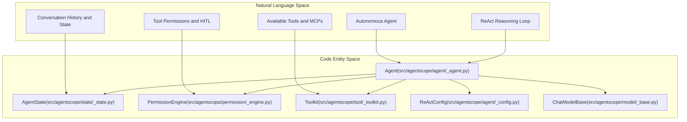
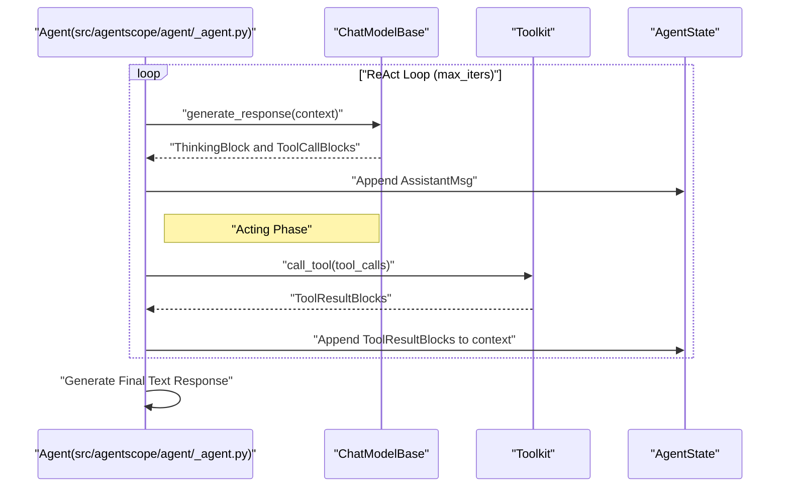
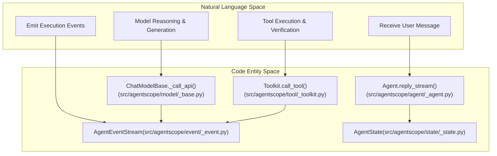
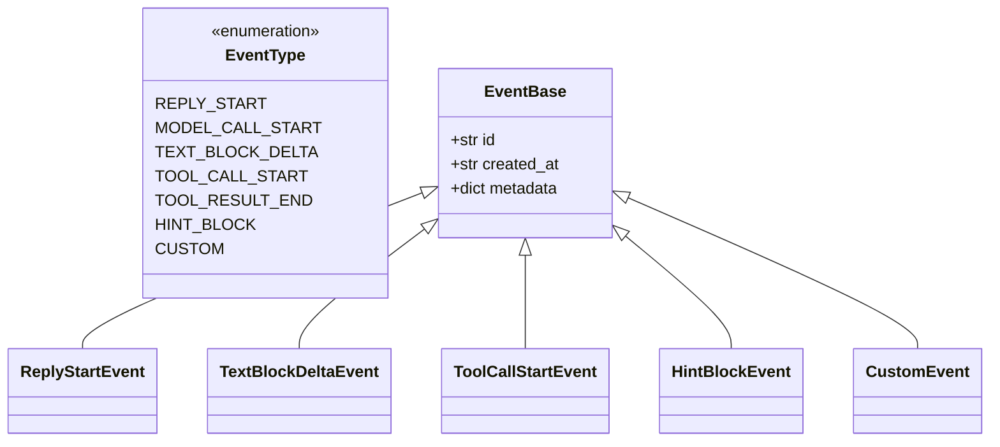

<!-- source: DeepWiki mcp.deepwiki.com · repo modelscope/agentscope · page 2.1 Agent Class and ReAct Loop · fetched 2026-10-27 -->

# Agent Class and ReAct Loop

Relevant source files

The following files were used as context for generating this wiki page:

- [.pre-commit-config.yaml](.pre-commit-config.yaml)
- [src/agentscope/agent/_agent.py](src/agentscope/agent/_agent.py)
- [src/agentscope/agent/_config.py](src/agentscope/agent/_config.py)
- [src/agentscope/event/_event.py](src/agentscope/event/_event.py)
- [src/agentscope/message/_base.py](src/agentscope/message/_base.py)
- [src/agentscope/middleware/_base.py](src/agentscope/middleware/_base.py)
- [tests/agent_basic_test.py](tests/agent_basic_test.py)
- [tests/agent_injection_test.py](tests/agent_injection_test.py)
- [tests/agent_interrupt_test.py](tests/agent_interrupt_test.py)
- [tests/compress_context_test.py](tests/compress_context_test.py)
- [tests/event_test.py](tests/event_test.py)
- [tests/event_to_message_test.py](tests/event_to_message_test.py)
- [tests/hitl_external_execution_test.py](tests/hitl_external_execution_test.py)
- [tests/hitl_user_confirmation_test.py](tests/hitl_user_confirmation_test.py)
- [tests/message_test.py](tests/message_test.py)
- [tests/middleware_test.py](tests/middleware_test.py)

## Purpose and Scope

This page provides full technical details on the unified `Agent` class architecture (`[src/agentscope/agent/_agent.py:117-197]`), its constructor parameters, configuration models (`[src/agentscope/agent/_config.py:51-165]`), state and tool context, the Reasoning-Acting (ReAct) loop executed via `reply()` and `reply_stream()`, and the event-driven `AgentEvent` stream (`[src/agentscope/event/_event.py:25-68]`).

Sources: `[src/agentscope/agent/_agent.py:117-197]`, `[src/agentscope/agent/_config.py:51-165]`

---

## Agent Class Architecture

The `Agent` class integrates model reasoning, tool execution via `Toolkit`, permissions via `PermissionEngine` (`[src/agentscope/agent/_agent.py:193-195]`), and state management via `AgentState` (`[src/agentscope/agent/_agent.py:174-175]`).

### Constructor Parameters

The agent constructor (`[src/agentscope/agent/_agent.py:121-135]`) accepts the following configuration parameters:

| Parameter | Type | Description |
| :--- | :--- | :--- |
| `name` | `str` | Unique agent identifier (`[src/agentscope/agent/_agent.py:172-172]`). |
| `system_prompt` | `str` | Base instructions for agent behavior (`[src/agentscope/agent/_agent.py:173-173]`). |
| `model` | `ChatModelBase` | Chat model/LLM instance used for generation (`[src/agentscope/agent/_agent.py:174-174]`). |
| `toolkit` | `Toolkit \| None` | Tool collection containing functions, MCPs, and skills (`[src/agentscope/agent/_agent.py:202-202]`). |
| `middlewares` | `list[MiddlewareBase] \| None` | Interceptors modifying agent execution hooks (`[src/agentscope/agent/_agent.py:127-127]`). |
| `state` | `AgentState \| None` | Persistent conversation memory and tool/permission state (`[src/agentscope/agent/_agent.py:175-175]`). |
| `offloader` | `Offloader \| None` | Context offloader for background persistence (`[src/agentscope/agent/_agent.py:197-197]`). |
| `model_config` | `ModelConfig \| None` | Fallback models and retry configurations (`[src/agentscope/agent/_agent.py:177-177]`). |
| `context_config` | `ContextConfig \| None` | Settings for context and tool result compression (`[src/agentscope/agent/_agent.py:178-178]`). |
| `react_config` | `ReActConfig \| None` | Settings for the reasoning-acting loop execution bounds (`[src/agentscope/agent/_agent.py:179-179]`). |
| `injection_config` | `InjectionConfig \| None` | Runtime state and context injection policies (`[src/agentscope/agent/_agent.py:180-180]`). |

Sources: `[src/agentscope/agent/_agent.py:121-197]`, `[src/agentscope/agent/_config.py:51-165]`

### Agent Entity and Logic Map

This diagram maps high-level agent architecture concepts to their concrete code entities in the codebase, bridging natural language spaces to code entity spaces.

Title: "Agent Entity and Logic Map"

Sources: `[src/agentscope/agent/_agent.py:118-197]`, `[src/agentscope/agent/_config.py:51-165]`

---

## The ReAct Reasoning-Acting Loop and `reply_stream()`

The `Agent` execution cycle follows a ReAct (Reasoning and Acting) loop, invoked via `reply()` or streamed via `reply_stream()`.

### Execution Flow

1.  **Input Reception**: Incoming messages (`Msg`) or control events are appended to `self.state.context`.
2.  **Runtime State Injection**: Injects wall-clock time, active tasks, and context boundaries based on `InjectionConfig` (`[src/agentscope/agent/_agent.py:180-180]`).
3.  **Context Check & Compression**: Compares token counts against `ContextConfig` thresholds, triggering context summarization or truncation (`[src/agentscope/agent/_config.py:57-65]`).
4.  **Model Reasoning Phase**: Calls the underlying LLM provider (`ChatModelBase`), streaming reasoning blocks (`ThinkingBlock`), text blocks (`TextBlock`), and tool call blocks (`ToolCallBlock`) (`[src/agentscope/message/_base.py:70-91]`).
5.  **Tool Execution & Permission Verification**: Processes tool invocations through `Toolkit`, validating actions via `PermissionEngine` (`[src/agentscope/agent/_agent.py:193-195]`) and handling human-in-the-loop confirmation or external execution interrupts.
6.  **Iteration Control**: Loops until model completion or until `max_iters` is exceeded, raising an `ExceedMaxItersEvent` (`[src/agentscope/event/_event.py:57-58]`).

Title: "ReAct Loop Sequence"

Sources: `[src/agentscope/agent/_agent.py:118-197]`, `[src/agentscope/agent/_config.py:51-165]`, `[src/agentscope/event/_event.py:25-68]`

### ReAct Loop to Code Space Mapping

This diagram maps the natural language execution phases of the ReAct loop to their implementing code methods and event structures.

Title: "ReAct Execution to Code Entity Mapping"

Sources: `[src/agentscope/agent/_agent.py:118-197]`, `[src/agentscope/event/_event.py:25-68]`

---

## Streaming and AgentEvents

`reply_stream()` exposes an asynchronous generator yielding items of type `AgentEvent` or `Msg` (`[src/agentscope/middleware/_base.py:68-95]`). This event-driven model decouples internal execution steps from downstream display renderers and APIs.

### Event Architecture and Code Space Mapping

This diagram maps event streaming entities to their underlying implementation classes in `[src/agentscope/event/_event.py:25-82]`.

Title: "Agent Event Hierarchy"

Sources: `[src/agentscope/event/_event.py:25-68]`, `[src/agentscope/event/_event.py:69-82]`

### Key Event Types

The `EventType` enumeration (`[src/agentscope/event/_event.py:25-68]`) defines the complete set of states emitted during agent execution:

| Event Category | Enum Values | Description |
| :--- | :--- | :--- |
| **Lifecycle** | `REPLY_START`, `REPLY_END` | Boundaries of a single reply turn (`[src/agentscope/event/_event.py:28-30]`). |
| **Model Interaction** | `MODEL_CALL_START`, `MODEL_CALL_END` | Tracks LLM calls, latency, and token metrics (`[src/agentscope/event/_event.py:31-33]`). |
| **Content Streams** | `TEXT_BLOCK_*`, `THINKING_BLOCK_*`, `DATA_BLOCK_*` | Incremental deltas for text, reasoning, and multimodal payloads (`[src/agentscope/event/_event.py:34-47]`). |
| **Tool Execution** | `TOOL_CALL_*`, `TOOL_RESULT_*` | Lifecycle and incremental outputs for tool calls and execution results (`[src/agentscope/event/_event.py:48-56]`). |
| **HITL & Control** | `REQUIRE_USER_CONFIRM`, `REQUIRE_EXTERNAL_EXECUTION`, `USER_CONFIRM_RESULT`, `USER_INTERRUPT` | Human-in-the-loop and external execution interrupts and responses (`[src/agentscope/event/_event.py:59-64]`). |
| **Specialized** | `HINT_BLOCK`, `CUSTOM`, `EXCEED_MAX_ITERS` | Injected system hints (`HintBlockEvent`), user-defined custom events (`CustomEvent`), and limits (`[src/agentscope/event/_event.py:46-67]`). |

Sources: `[src/agentscope/event/_event.py:25-68]`, `[src/agentscope/event/_event.py:69-126]`

---

