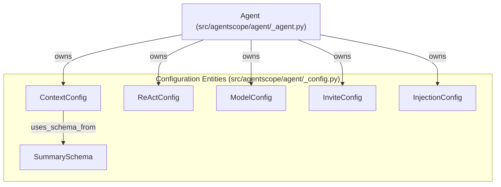
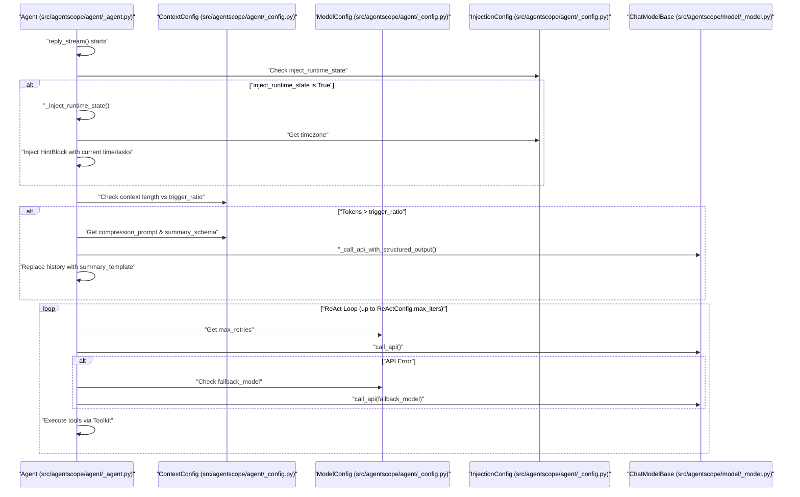

<!-- source: DeepWiki mcp.deepwiki.com · repo modelscope/agentscope · page 2.2 Agent Configuration · fetched 2026-10-27 -->

# Agent Configuration

Relevant source files

The following files were used as context for generating this wiki page:

- [.pre-commit-config.yaml](.pre-commit-config.yaml)
- [src/agentscope/agent/_agent.py](src/agentscope/agent/_agent.py)
- [src/agentscope/agent/_config.py](src/agentscope/agent/_config.py)
- [src/agentscope/event/_event.py](src/agentscope/event/_event.py)
- [src/agentscope/message/_base.py](src/agentscope/message/_base.py)
- [src/agentscope/middleware/_base.py](src/agentscope/middleware/_base.py)
- [tests/agent_basic_test.py](tests/agent_basic_test.py)
- [tests/agent_injection_test.py](tests/agent_injection_test.py)
- [tests/agent_interrupt_test.py](tests/agent_interrupt_test.py)
- [tests/compress_context_test.py](tests/compress_context_test.py)
- [tests/event_test.py](tests/event_test.py)
- [tests/event_to_message_test.py](tests/event_to_message_test.py)
- [tests/hitl_external_execution_test.py](tests/hitl_external_execution_test.py)
- [tests/hitl_user_confirmation_test.py](tests/hitl_user_confirmation_test.py)
- [tests/message_test.py](tests/message_test.py)
- [tests/middleware_test.py](tests/middleware_test.py)

## Purpose and Scope

This page documents the configuration systems for the `Agent` class in AgentScope 2.0 [src/agentscope/agent/_agent.py:117-189](). Configuration is structured into modular Pydantic models defined in `src/agentscope/agent/_config.py`: `ContextConfig` for memory management and compression, `ReActConfig` for reasoning-acting loop control, `ModelConfig` for execution resilience, `InjectionConfig` for runtime state awareness, `InviteConfig` for cross-team agent borrowing, and `SummarySchema` for structured memory summarization [src/agentscope/agent/_config.py:1-249]().

Sources: [src/agentscope/agent/_agent.py:117-189](), [src/agentscope/agent/_config.py:1-249]()

---

## Configuration Architecture and Initialization

The `Agent` class aggregates these configuration schemas during instantiation in `Agent.__init__()` [src/agentscope/agent/_agent.py:120-190](). This modular design ensures instance-level isolation so that parameters such as `max_iters` or `trigger_ratio` do not leak across global states [tests/agent_basic_test.py:143-184]().

Title: "AgentConfigurationComponentMap"

Sources: [src/agentscope/agent/_agent.py:120-190](), [src/agentscope/agent/_config.py:1-249](), [tests/agent_basic_test.py:143-184]()

---

## ContextConfig and SummarySchema

`ContextConfig` governs context window thresholds, compression triggers, and fallback mechanisms [src/agentscope/agent/_config.py:51-165]().

### Parameters

| Parameter | Type | Default | Description |
|-----------|------|---------|-------------|
| `trigger_ratio` | `float` | `0.8` | Token threshold ratio of maximum context length triggering compression ($0 < \text{trigger\_ratio} \le 0.9$) [src/agentscope/agent/_config.py:57-60](). |
| `reserve_ratio` | `float` | `0.1` | Target ratio of tokens to reserve after compression ($0 < \text{reserve\_ratio} < \text{trigger\_ratio}$) [src/agentscope/agent/_config.py:62-64](). |
| `context_buffer_ratio` | `float` | `0.2` | Buffer ahead of `trigger_ratio` warning the agent of upcoming compression [src/agentscope/agent/_config.py:66-77](). |
| `compression_prompt` | `str` | `<system-hint>...` | Prompt guiding the model to generate a structured continuation summary [src/agentscope/agent/_config.py:82-108](). |
| `summary_template` | `str` | `<system-info>...` | Template rendering the structured summary back into the agent context [src/agentscope/agent/_config.py:119-132](). |
| `summary_schema` | `dict` | `SummarySchema` | JSON schema derived from `SummarySchema` for structured output enforcement [src/agentscope/agent/_config.py:140-144](). |
| `tool_result_limit` | `int` | `50000` | Token limit for individual tool outputs to prevent context bursting [src/agentscope/agent/_config.py:146-154](). |
| `compression_fallback_to_truncation` | `bool` | `True` | Fallback behavior to truncate oldest context if summary generation fails [src/agentscope/agent/_config.py:156-164](). |

Sources: [src/agentscope/agent/_config.py:51-164]()

### SummarySchema Definition

`SummarySchema` enforces structured memory condensation via Pydantic [src/agentscope/agent/_config.py:9-50]().

| Field | Description |
|-------|-------------|
| `task_overview` | User's core request, constraints, and success criteria [src/agentscope/agent/_config.py:12-17](). |
| `current_state` | Completed actions, modified files, and produced artifacts [src/agentscope/agent/_config.py:18-24](). |
| `important_discoveries` | Technical constraints, decisions, and resolved errors [src/agentscope/agent/_config.py:25-32](). |
| `next_steps` | Specific remaining actions, blockers, and priorities [src/agentscope/agent/_config.py:33-38](). |
| `context_to_preserve` | User preferences, domain details, and promises made [src/agentscope/agent/_config.py:40-48](). |

Sources: [src/agentscope/agent/_config.py:9-50](), [tests/compress_context_test.py:108-160]()

---

## ReActConfig, ModelConfig, InjectionConfig, and InviteConfig

### ReActConfig
Controls parameters of the reasoning-acting execution loop in `Agent` [src/agentscope/agent/_agent.py:117-190]().
- `max_iters`: Maximum reasoning-acting iterations per reply execution (default `20`).
- `parallel_tool_calls`: Enables concurrent execution of multiple tool calls emitted in a single turn (default `True`).
- `stop_on_reject`: Halts the ReAct loop if the `PermissionEngine` rejects a tool call (default `False`).
- `structured_output_grace_iters`: Grace turns allowed to correct structural schema formatting errors (default `2`).

Sources: [src/agentscope/agent/_config.py:167-190]()

### ModelConfig
Defines execution parameters for model invocation resilience and error recovery [src/agentscope/model/_model.py:68-73]().
- `max_retries`: Number of retry attempts for primary model API calls before failing over (default `0`).
- `fallback_model`: Secondary `ChatModelBase` instance invoked if the primary model fails or exhausts retries (default `None`).

Sources: [src/agentscope/agent/_config.py:192-204]()

### InjectionConfig
Manages how environmental metadata (wall-clock time, active task list, context token pressure) is injected into the agent context stream [src/agentscope/agent/_agent.py:166-170]().
- `inject_runtime_state`: Enables automatic injection of time and task state (default `True`).
- `timezone`: Reference timezone used during time injections (default `UTC`).
- `context_buffer_ratio`: Maintained for legacy compatibility, superseded by `ContextConfig.context_buffer_ratio` [src/agentscope/agent/_agent.py:180-189]().

Sources: [src/agentscope/agent/_agent.py:166-189](), [src/agentscope/agent/_config.py:206-226]()

### InviteConfig
Controls whether an agent instance can be discovered and borrowed by other teams via the `AgentInvite` tool mechanism [6.5].
- `invitable`: Boolean flag indicating visibility in cross-agent sharing pools (default `False`).
- `invite_description`: Semantic text describing the agent's specific capabilities to team leaders (default `""`).

Sources: [src/agentscope/agent/_config.py:228-249]()

---

## Implementation and Data Flow

Configuration parameters dictate runtime control flow within `Agent.reply_stream()` and underlying helper functions [src/agentscope/agent/_agent.py:117-190]().

Title: "ConfigurationDrivenDataFlow"

Sources: [src/agentscope/agent/_agent.py:117-190](), [src/agentscope/agent/_config.py:51-164](), [src/agentscope/agent/_config.py:167-249](), [tests/agent_injection_test.py:141-156]()

### Validation Logic

Configuration consistency is verified during initialization via `self._validate_configs()` [src/agentscope/agent/_agent.py:190](). For example, `ContextConfig` validates that `reserve_ratio` is strictly less than `trigger_ratio` to prevent overlap in the compression window thresholds [src/agentscope/agent/_config.py:62-64](). Inconsistent ratio settings raise a `ValueError` [tests/agent_basic_test.py:185-199]().

Sources: [src/agentscope/agent/_agent.py:117-190](), [src/agentscope/agent/_config.py:51-165](), [tests/agent_basic_test.py:185-199]()

---

