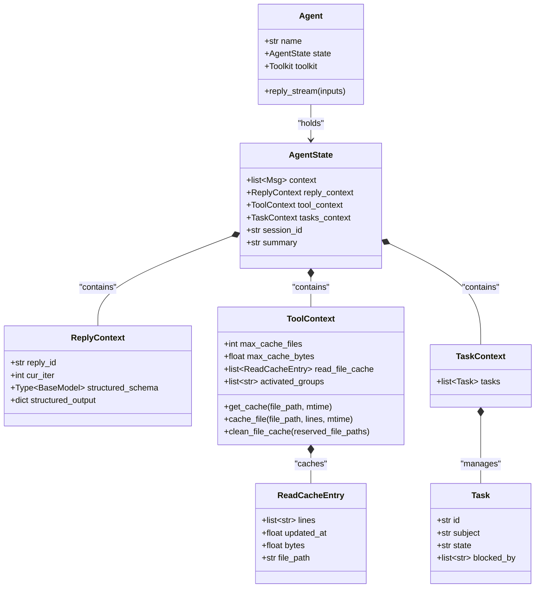
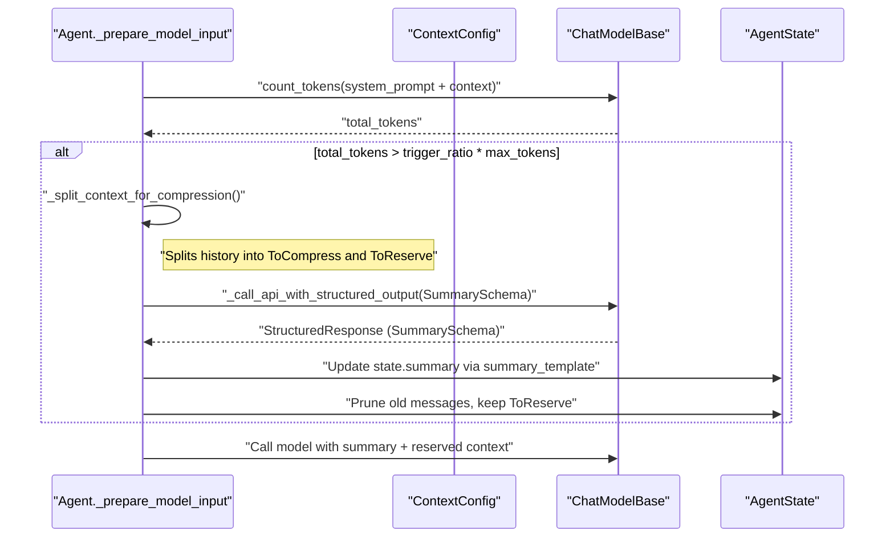

<!-- source: DeepWiki mcp.deepwiki.com · repo modelscope/agentscope · page 2.3 Agent State and Context · fetched 2026-10-27 -->

# Agent State and Context

Relevant source files

The following files were used as context for generating this wiki page:

- [examples/web_ui/frontend/src/components/dialog/MCPConfigForm.tsx](examples/web_ui/frontend/src/components/dialog/MCPConfigForm.tsx)
- [src/agentscope/_utils/_common.py](src/agentscope/_utils/_common.py)
- [src/agentscope/embedding/_embedding_response.py](src/agentscope/embedding/_embedding_response.py)
- [src/agentscope/state/_state.py](src/agentscope/state/_state.py)
- [src/agentscope/state/_task.py](src/agentscope/state/_task.py)
- [src/agentscope/tool/_response.py](src/agentscope/tool/_response.py)
- [src/agentscope/tts/_tts_base.py](src/agentscope/tts/_tts_base.py)
- [src/agentscope/tts/_tts_response.py](src/agentscope/tts/_tts_response.py)
- [tests/agent_structured_output_test.py](tests/agent_structured_output_test.py)
- [tests/builtin_file_cache_test.py](tests/builtin_file_cache_test.py)
- [tests/id_factory_test.py](tests/id_factory_test.py)
- [tests/tool_argument_repair_test.py](tests/tool_argument_repair_test.py)

This page details how AgentScope manages agent memory, tool execution state, task tracking, and context window optimization. It covers the `AgentState` data container, `ToolContext` (including activated tool groups and LRU file caching), the `Task` model, and the automated context compression workflow.

Sources: `[src/agentscope/state/_state.py:1-203]`, `[src/agentscope/state/_task.py:1-39]`, `[src/agentscope/agent/_config.py:1-165]`

---

## Agent State Architecture

The agent's state is encapsulated in the `AgentState` class (`[src/agentscope/state/_state.py:2-203]`), which acts as the primary data container for an agent's persistent information throughout its session lifecycle.

### AgentState Model
`AgentState` tracks conversation history, task progress, permissions, and file/tool contexts. When an `Agent` is initialized, it adopts an existing state or instantiates a new one. Each state object is tied to a session identifier.

| Attribute | Type | Description |
|-----------|------|-------------|
| `context` | `list[Msg]` | Sequential conversation history containing all message blocks. |
| `summary` | `str \| list` | Compressed summary of previous context, prepended to the LLM prompt. |
| `tasks_context` | `TaskContext` | Collection of `Task` objects tracking goals and execution status (`[src/agentscope/state/_state.py:175-180]`). |
| `tool_context` | `ToolContext` | Execution state for tools, including active groups and file caches (`[src/agentscope/state/_state.py:32-44]`). |
| `permission_context` | `PermissionContext` | State used by the permission engine to evaluate tool access (`[src/agentscope/state/_state.py:20-21]`). |
| `reply_context` | `ReplyContext` | Tracks state of the current active reply (ID, iteration count, structured schema) (`[src/agentscope/state/_state.py:182-196]`). |

**Diagram: State and Context Code Entity Mapping**

Sources: `[src/agentscope/state/_state.py:23-203]`, `[src/agentscope/agent/_agent.py:117-194]`

---

## ToolContext and LRU File Caching

The `ToolContext` model (`[src/agentscope/state/_state.py:32-44]`) maintains tool-related runtime states:

1.  **Activated Groups (`activated_groups`)**: Tracks which tool groups are currently enabled for the agent (`[src/agentscope/state/_state.py:42-44]`).
2.  **Read File Cache (`read_file_cache`)**: A cache designed for file-reading tools (`Read`, `Write`, `Edit`) to prevent redundant filesystem operations and token overhead (`[src/agentscope/state/_state.py:39-40]`).
3.  **LRU Eviction**: Implements Least Recently Used eviction when `max_cache_files` (default `100`) or `max_cache_bytes` (default `25000` KB) thresholds are breached (`[src/agentscope/state/_state.py:35-38]`, `[src/agentscope/state/_state.py:132-144]`).
4.  **Cache Validation**: The `get_cache` method validates file modification timestamps (`mtime`) via `aiofiles.os.path.getmtime` to ensure entries remain consistent with the underlying filesystem (`[src/agentscope/state/_state.py:46-88]`).

Sources: `[src/agentscope/state/_state.py:23-174]`, `[tests/builtin_file_cache_test.py:1-197]`

---

## Task Model

The task model tracks work items assigned to or created by agents. Managed via `TaskContext` (`[src/agentscope/state/_state.py:175-180]`) and `Task` definitions (`[src/agentscope/state/_task.py:10-39]`), tasks track metadata such as `subject`, `description`, `state` (`pending`, `in_progress`, `completed`), owners, and dependencies (`blocks`, `blocked_by`) (`[src/agentscope/state/_task.py:25-38]`).

Tools interact directly with `AgentState.tasks_context` during execution.

Sources: `[src/agentscope/state/_state.py:175-180]`, `[src/agentscope/state/_task.py:1-39]`

---

## Context Compression Workflow

When conversations grow too large for an LLM's context window, AgentScope triggers an automated compression workflow based on thresholds set in `ContextConfig`.

### Configuration Parameters
*   `trigger_ratio`: Token ratio (default `0.8`) that triggers compression.
*   `reserve_ratio`: Ratio of recent tokens to retain uncompressed (default `0.1`).
*   `context_buffer_ratio`: A buffer ahead of `trigger_ratio` (default `0.2`) where the agent is informed that compression is near, allowing it to self-compress if the `CompressContext` tool is enabled.
*   `compression_prompt`: The prompt used to guide the compression model to generate the summary.
*   `summary_template`: The string template to present the compressed summary to the agent.
*   `summary_schema`: Structured Pydantic schema (`SummarySchema`) enforcing generated summaries to cover `task_overview`, `current_state`, `important_discoveries`, `next_steps`, and `context_to_preserve`.
*   `compression_fallback_to_truncation`: If `True` (default), falls back to truncating the oldest context if summary generation fails.

**Diagram: Context Compression Data Flow**

Sources: `[src/agentscope/agent/_config.py:1-165]`, `[src/agentscope/agent/_agent.py:1-1500]`

---

## Tool Result Truncation and Offloading

Large tool outputs can overwhelm context windows. AgentScope addresses this via size limits and offloaders:
*   `ContextConfig.tool_result_limit` (default `50000` tokens) caps individual tool result sizes.
*   Overflow results are intercepted, pushed to an offloader (e.g., workspace-backed storage), and replaced with pointer markers in the message context.

Sources: `[src/agentscope/agent/_config.py:1-165]`, `[src/agentscope/agent/_agent.py:1280-1320]`

---

