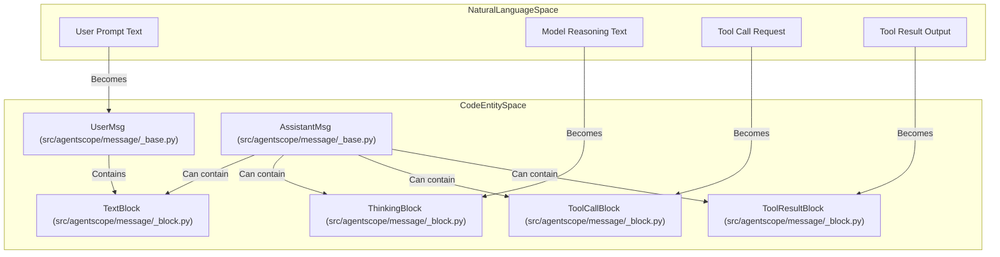
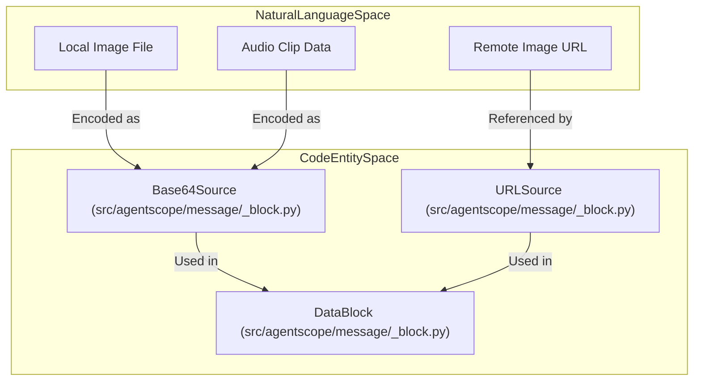
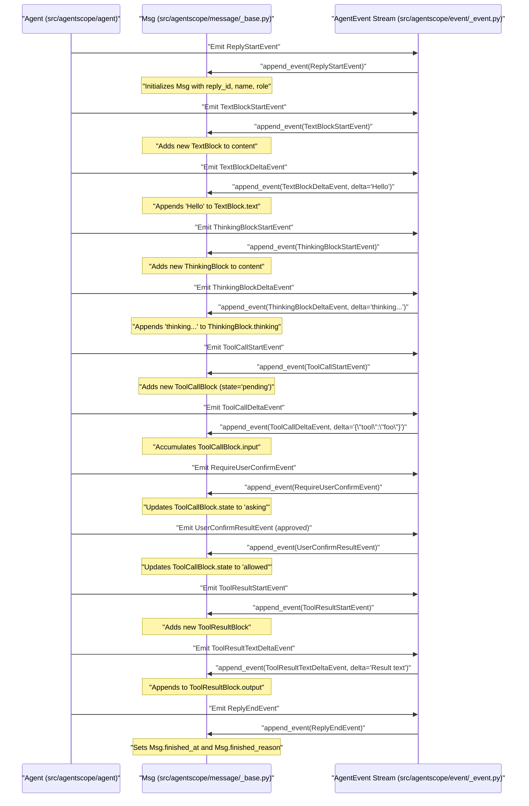

<!-- source: DeepWiki mcp.deepwiki.com · repo modelscope/agentscope · page 2.4 Message Protocol and Content Blocks · fetched 2026-10-27 -->

# Message Protocol and Content Blocks

Relevant source files

The following files were used as context for generating this wiki page:

- [.pre-commit-config.yaml](.pre-commit-config.yaml)
- [src/agentscope/agent/_agent.py](src/agentscope/agent/_agent.py)
- [src/agentscope/agent/_config.py](src/agentscope/agent/_config.py)
- [src/agentscope/event/_event.py](src/agentscope/event/_event.py)
- [src/agentscope/message/_base.py](src/agentscope/message/_base.py)
- [src/agentscope/message/_block.py](src/agentscope/message/_block.py)
- [src/agentscope/middleware/_base.py](src/agentscope/middleware/_base.py)
- [tests/agent_basic_test.py](tests/agent_basic_test.py)
- [tests/agent_injection_test.py](tests/agent_injection_test.py)
- [tests/agent_interrupt_test.py](tests/agent_interrupt_test.py)
- [tests/compress_context_test.py](tests/compress_context_test.py)
- [tests/event_test.py](tests/event_test.py)
- [tests/event_to_message_test.py](tests/event_to_message_test.py)
- [tests/hitl_external_execution_test.py](tests/hitl_external_execution_test.py)
- [tests/hitl_user_confirmation_test.py](tests/hitl_user_confirmation_test.py)
- [tests/message_test.py](tests/message_test.py)
- [tests/middleware_test.py](tests/middleware_test.py)
- [tests/utils.py](tests/utils.py)

This page details the message protocol and content block system in AgentScope 2.0. It covers the structural definition of `Msg`, all available `ContentBlock` types, source types, role-based constraints, and event-driven accumulation via `append_event`.

## Overview

AgentScope uses a block-based architecture where every message is a collection of structured `ContentBlock` objects. This design enables:

- **Type-Safe Communication**: Each block has a strictly defined schema using Pydantic [src/agentscope/message/_block.py:11-184]().
- **Streaming Granularity**: Messages can be updated incrementally via events that target specific blocks [src/agentscope/message/_base.py:211-224]().
- **Agentic Reasoning**: Explicit support for "Thinking" and "Tool Call" states within the message lifecycle [src/agentscope/message/_block.py:26-53](), [src/agentscope/message/_block.py:138-183]().
- **Role-based Validation**: Messages enforce constraints based on the sender's role (`user`, `assistant`, or `system`) [src/agentscope/message/_base.py:120-130]().

Sources: [src/agentscope/message/_block.py:11-184](), [src/agentscope/message/_base.py:120-224]()

## The Msg Structure

The `Msg` class is the fundamental unit of information exchange, inheriting from Pydantic's `BaseModel` [src/agentscope/message/_base.py:70]().

### Message Roles and Constraints
AgentScope enforces strict validation on content blocks based on the message role via `validate_role_content` [src/agentscope/message/_base.py:120-130]():

| Role | Allowed Block Types | Logic / Citation |
| :--- | :--- | :--- |
| `user` | `TextBlock`, `DataBlock` | `_assert_user_content_blocks` [src/agentscope/message/_base.py:32-40]() |
| `system` | `TextBlock` | `_assert_system_content_blocks` [src/agentscope/message/_base.py:41-48]() |
| `assistant` | All Types (`text`, `thinking`, `tool_call`, `tool_result`, `data`, `hint`) | No strict restrictions [src/agentscope/message/_base.py:127-128]() |

Sources: [src/agentscope/message/_base.py:32-130]()

### Core Attributes
| Attribute | Type | Description |
| :--- | :--- | :--- |
| `name` | `str` | The name of the sender [src/agentscope/message/_base.py:78](). |
| `content` | `list[ContentBlock]` | A sequence of structured blocks [src/agentscope/message/_base.py:80](). |
| `role` | `Literal` | One of `user`, `assistant`, or `system` [src/agentscope/message/_base.py:82](). |
| `id` | `str` | Unique message identifier, generated by `_generate_id` [src/agentscope/message/_base.py:84](). |
| `usage` | `Usage \| None` | Token consumption details (input/output) [src/agentscope/message/_base.py:96](). |
| `metadata` | `dict` | Arbitrary key-value pairs for extension [src/agentscope/message/_base.py:92](). |
| `created_at` | `str` | ISO timestamp of message creation [src/agentscope/message/_base.py:94](). |
| `finished_at` | `str \| None` | The finished time of the message [src/agentscope/message/_base.py:104](). |
| `finished_reason` | `ReplyFinishedReason \| None` | Terminal reason for the reply (e.g., `COMPLETED`, `INTERRUPTED`, `EXCEED_MAX_ITERS`) [src/agentscope/message/_base.py:106-108](). |
| `structured_output` | `dict \| None` | Structured output if requested and successfully generated [src/agentscope/message/_base.py:109-114](). |
| `error` | `ErrorInfo \| None` | Structured error information if `finished_reason` is `ERROR` [src/agentscope/message/_base.py:115-117](). |

Sources: [src/agentscope/message/_base.py:70-117]()

## Content Block Types

The content block types define the building blocks of any message [src/agentscope/message/_block.py:11-184]().

### Text and Reasoning Blocks
- **TextBlock**: Represents standard textual content [src/agentscope/message/_block.py:11-24]().
- **ThinkingBlock**: Captures internal reasoning or "chain-of-thought". It allows extra provider-specific fields via `ConfigDict(extra="allow")` [src/agentscope/message/_block.py:26-53]().
- **HintBlock**: Used to provide instructions or hints to the LLM during the reasoning-acting loop. When passed to the LLM API, the hint block is converted into a user message [src/agentscope/message/_block.py:101-126]().

Sources: [src/agentscope/message/_block.py:11-126]()

### Multimodal Data Blocks
`DataBlock` handles binary content like images, audio, and video [src/agentscope/message/_block.py:83-99](). It uses a `source` field:
- **URLSource**: A valid URI string and its MIME `media_type` [src/agentscope/message/_block.py:67-81]().
- **Base64Source**: Inline base64-encoded data string and its MIME `media_type` [src/agentscope/message/_block.py:56-65]().

Sources: [src/agentscope/message/_block.py:56-99]()

### Tool Interaction Blocks
Tool interactions track execution state:
- **ToolCallBlock**: Tracks tool invocations with fields `id`, `name`, `input`, and `state` (`ToolCallState`) [src/agentscope/message/_block.py:138-151](). The `state` field transitions through `PENDING`, `ASKING`, `ALLOWED`, `SUBMITTED`, and `FINISHED` [src/agentscope/message/_block.py:151-175]().
- **ToolResultBlock**: Represents the outcome of tool execution, including its `output` and `state` (`ToolResultState`) [src/agentscope/message/_block.py:186-235]().

Sources: [src/agentscope/message/_block.py:138-235]()

## Data Flow: From Code to Protocol

### Diagram: Natural Language Space to Message and Block Entities

Sources: [src/agentscope/message/_base.py:70-130](), [src/agentscope/message/_block.py:11-235]()

### Diagram: Multimodal Source to DataBlock Mapping

Sources: [src/agentscope/message/_block.py:56-99]()

## Streaming and Event Accumulation

The `Msg` object is reactive. During streaming execution, agents emit `AgentEvent` objects. The `Msg.append_event(event)` method mutates message state in real-time [src/agentscope/message/_base.py:211-224](). This method is crucial for building up a complete `Msg` object from a stream of granular events, as demonstrated in `tests/event_to_message_test.py` [tests/event_to_message_test.py:186-219]().

Sources: [src/agentscope/message/_base.py:211-224](), [tests/event_to_message_test.py:186-219]()

### Diagram: Message Lifecycle via Event Stream

Sources: [src/agentscope/message/_base.py:211-224](), [src/agentscope/event/_event.py:25-68](), [tests/event_to_message_test.py:186-219]()

### Key Event-to-Block Mappings
- **TextBlockStartEvent**, **TextBlockDeltaEvent**, **TextBlockEndEvent**: Manage the lifecycle and content accumulation of a `TextBlock` [src/agentscope/event/_event.py:160-196]().
- **ThinkingBlockStartEvent**, **ThinkingBlockDeltaEvent**, **ThinkingBlockEndEvent**: Manage the lifecycle and content accumulation of a `ThinkingBlock` [src/agentscope/event/_event.py:42-45]().
- **DataBlockStartEvent**, **DataBlockDeltaEvent**, **DataBlockEndEvent**: Manage the lifecycle and content accumulation of a `DataBlock` [src/agentscope/event/_event.py:197-214]().
- **ToolCallStartEvent**, **ToolCallDeltaEvent**, **ToolCallEndEvent**: Manage the lifecycle and input accumulation of a `ToolCallBlock` [src/agentscope/event/_event.py:48-51]().
- **ToolResultStartEvent**, **ToolResultTextDeltaEvent**, **ToolResultDataDeltaEvent**, **ToolResultEndEvent**: Manage the lifecycle and output accumulation (text or data) of a `ToolResultBlock` [src/agentscope/event/_event.py:52-56]().
- **RequireUserConfirmEvent**: Changes the state of a `ToolCallBlock` to `ASKING` [src/agentscope/event/_event.py:59]().
- **UserConfirmResultEvent**: Updates the `ToolCallBlock` state based on user confirmation (e.g., `ALLOWED` or `FINISHED`) [src/agentscope/event/_event.py:62]().
- **RequireExternalExecutionEvent**: Changes the state of a `ToolCallBlock` to `SUBMITTED` [src/agentscope/event/_event.py:60]().
- **ExternalExecutionResultEvent**: Directly appends a `ToolResultBlock` to the message content [src/agentscope/event/_event.py:64]().
- **ModelCallEndEvent**: Updates the `usage` field of the `Msg` object [src/agentscope/event/_event.py:138-157]().
- **ReplyEndEvent**: Sets the `finished_at` timestamp and `finished_reason` for the `Msg` [src/agentscope/event/_event.py:111-125]().

Sources: [src/agentscope/event/_event.py:25-68](), [src/agentscope/event/_event.py:111-214](), [tests/event_to_message_test.py:30-63]()

## Helper Methods

The `Msg` class provides utility methods for accessing and filtering content:
- `get_text_content(separator)`: Concatenates all `TextBlock` contents into a single string [src/agentscope/message/_base.py:155-159]().
- `get_content_blocks(block_type)`: Returns a filtered sequence of blocks matching specified types [src/agentscope/message/_base.py:160-197]().
- `has_content_blocks(block_type)`: Checks if the message contains blocks of given types [src/agentscope/message/_base.py:131-154]().

Sources: [src/agentscope/message/_base.py:131-197]()

---

