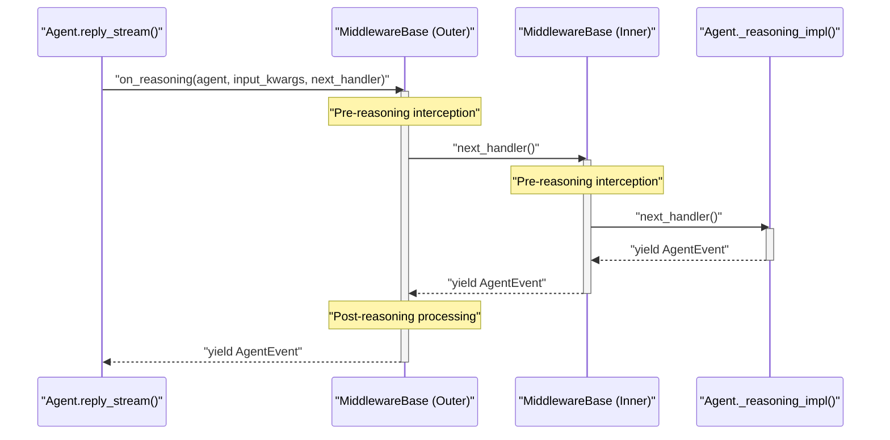
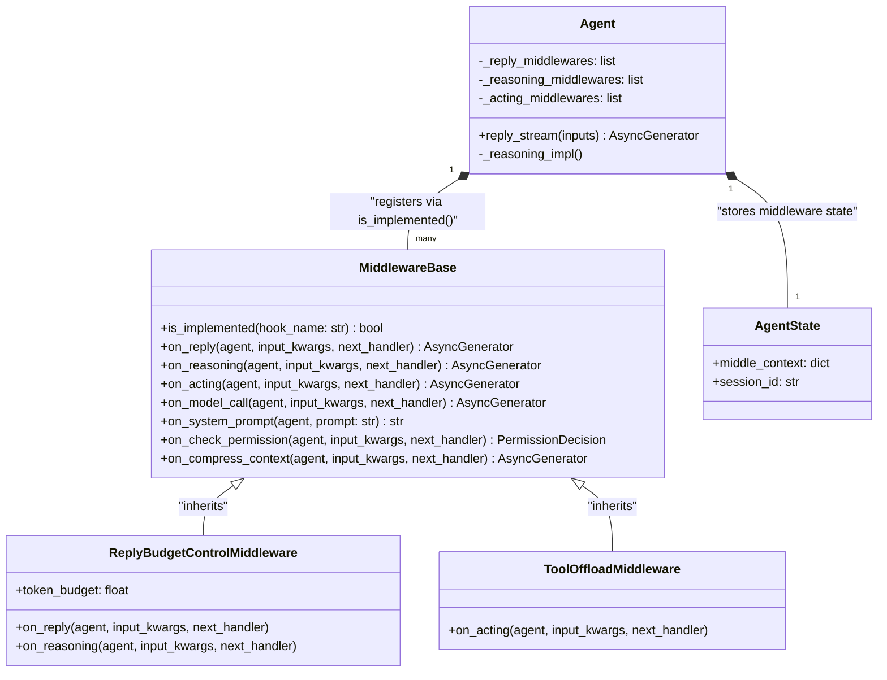

<!-- source: DeepWiki mcp.deepwiki.com · repo modelscope/agentscope · page 2.5 Middleware System · fetched 2026-10-27 -->

# Middleware System

Relevant source files

The following files were used as context for generating this wiki page:

- [.pre-commit-config.yaml](.pre-commit-config.yaml)
- [src/agentscope/agent/_agent.py](src/agentscope/agent/_agent.py)
- [src/agentscope/agent/_config.py](src/agentscope/agent/_config.py)
- [src/agentscope/app/_bus_ops.py](src/agentscope/app/_bus_ops.py)
- [src/agentscope/app/_manager/_wakeup_dispatcher.py](src/agentscope/app/_manager/_wakeup_dispatcher.py)
- [src/agentscope/app/message_bus/_keys.py](src/agentscope/app/message_bus/_keys.py)
- [src/agentscope/app/middleware/_tool_offload_middleware.py](src/agentscope/app/middleware/_tool_offload_middleware.py)
- [src/agentscope/event/_event.py](src/agentscope/event/_event.py)
- [src/agentscope/message/_base.py](src/agentscope/message/_base.py)
- [src/agentscope/middleware/_base.py](src/agentscope/middleware/_base.py)
- [src/agentscope/middleware/_budget.py](src/agentscope/middleware/_budget.py)
- [src/agentscope/tool/_builtin/_glob.py](src/agentscope/tool/_builtin/_glob.py)
- [src/agentscope/tool/_builtin/_grep.py](src/agentscope/tool/_builtin/_grep.py)
- [src/agentscope/tool/_builtin/_scripts/_glob_helper.py](src/agentscope/tool/_builtin/_scripts/_glob_helper.py)
- [tests/agent_basic_test.py](tests/agent_basic_test.py)
- [tests/agent_injection_test.py](tests/agent_injection_test.py)
- [tests/agent_interrupt_test.py](tests/agent_interrupt_test.py)
- [tests/builtin_glob_test.py](tests/builtin_glob_test.py)
- [tests/builtin_grep_test.py](tests/builtin_grep_test.py)
- [tests/compress_context_test.py](tests/compress_context_test.py)
- [tests/event_test.py](tests/event_test.py)
- [tests/event_to_message_test.py](tests/event_to_message_test.py)
- [tests/hitl_external_execution_test.py](tests/hitl_external_execution_test.py)
- [tests/hitl_user_confirmation_test.py](tests/hitl_user_confirmation_test.py)
- [tests/message_test.py](tests/message_test.py)
- [tests/middleware_budget_test.py](tests/middleware_budget_test.py)
- [tests/middleware_test.py](tests/middleware_test.py)
- [tests/service_wakeup_dispatcher_test.py](tests/service_wakeup_dispatcher_test.py)
- [tests/tool_offload_middleware_test.py](tests/tool_offload_middleware_test.py)

## Purpose and Scope

This page provides full technical documentation for the AgentScope 2.0 Middleware System. The middleware architecture offers a structured interception mechanism to modify, extend, and observe agent behavior across the agent lifecycle without altering core classes [src/agentscope/middleware/_base.py:13-53](). You will learn about `MiddlewareBase`, the seven hook points (`on_reply`, `on_reasoning`, `on_acting`, `on_model_call`, `on_system_prompt`, `on_check_permission`, and `on_compress_context`) [src/agentscope/middleware/_base.py:16-28](), the onion and transformer execution patterns [src/agentscope/middleware/_base.py:19-28](), and concrete implementations such as `ReplyBudgetControlMiddleware` [src/agentscope/middleware/_budget.py:21-70]() and `ToolOffloadMiddleware` [src/agentscope/middleware/_base.py:124-168]().

Sources: [src/agentscope/middleware/_base.py:1-53](), [src/agentscope/middleware/_budget.py:21-70]()

---

## MiddlewareBase and Hook Points

All custom and built-in middlewares inherit from `MiddlewareBase` [src/agentscope/middleware/_base.py:13-66](). The base class defines method signatures that subclasses can optionally override. The runtime inspection method `is_implemented()` detects which hook methods are overridden in subclasses, avoiding unnecessary execution overhead for unused hooks [src/agentscope/middleware/_base.py:55-66]().

The system provides seven execution hook points categorized into two architectural patterns [src/agentscope/middleware/_base.py:16-28]():

| Hook Point | Description | Pattern | Code Reference |
|------------|-------------|---------|----------------|
| `on_reply` | Intercepts the entire reply loop, from input messages to final response generation. Allows swallowing completion events to force subsequent reasoning rounds. | Onion | [src/agentscope/middleware/_base.py:68-95]() |
| `on_reasoning` | Intercepts the reasoning/thought generation phase before tools are selected or model generation is triggered. | Onion | [src/agentscope/middleware/_base.py:101-123]() |
| `on_acting` | Intercepts individual tool execution. Wraps **only** the pure I/O execution layer (`toolkit.call_tool`) to ensure state safety during offloading. | Onion | [src/agentscope/middleware/_base.py:124-168]() |
| `on_check_permission` | Intercepts permission checking for a tool call after schema validation but before decision consumption. | Onion | [src/agentscope/middleware/_base.py:170-179]() |
| `on_model_call` | Intercepts the raw model API invocation, granting access to model requests, responses, or stream chunks. | Onion | [src/agentscope/middleware/_base.py:13-53]() |
| `on_compress_context`| Intercepts context compression routines triggered by token thresholds. | Onion | [src/agentscope/middleware/_base.py:13-53]() |
| `on_system_prompt` | Sequential pipeline transforming the system prompt string dynamically. | Transformer | [src/agentscope/middleware/_base.py:27-29]() |

Sources: [src/agentscope/middleware/_base.py:13-233]()

---

## Architectural Patterns: Onion and Transformer

The middleware system utilizes two primary composition patterns:

### 1. The Onion Pattern (Async Decorators)
For hooks like `on_reply`, `on_reasoning`, `on_acting`, `on_check_permission`, `on_model_call`, and `on_compress_context`, middlewares wrap execution using an onion pattern [src/agentscope/middleware/_base.py:19-26](). Each middleware receives a `next_handler` callable [src/agentscope/middleware/_base.py:72]() which it invokes and `yields` from (or awaits). Execution flows outward-to-inward during pre-processing, hits the core method, and flows inward-to-outward as events or return values are yielded back.

### 2. The Transformer Pattern (Sequential Pipeline)
For `on_system_prompt`, middlewares form a strict sequential pipeline where each middleware modifies the system prompt string in-turn and passes the accumulator forward [src/agentscope/middleware/_base.py:27-29]().

### Diagram: Middleware Execution Flow and Code Entity Association

Sources: [src/agentscope/middleware/_base.py:13-233]()

---

## Built-in Middlewares

### ReplyBudgetControlMiddleware
`ReplyBudgetControlMiddleware` enforces a weighted token budget per reply [src/agentscope/middleware/_budget.py:21-70]().
*   **State Management**: It tracks cumulative token usage across model calls within a reply, storing state inside `agent.state.middle_context` keyed by the middleware key and `reply_id` [src/agentscope/middleware/_budget.py:21-70](). This ensures persistence across human-in-the-loop (HITL) interruptions.
*   **Enforcement**: When the weighted cost exceeds `token_budget`, the middleware injects a `HintBlock` into context and overrides `tool_choice` to `ToolChoice(mode="none")`, forcing the agent to wrap up without calling further tools [src/agentscope/middleware/_budget.py:21-70]().

Sources: [src/agentscope/middleware/_budget.py:21-199]()

### ToolOffloadMiddleware
`ToolOffloadMiddleware` handles asynchronous tool execution offloading in service-layer architectures.
*   **Mechanism**: It intercepts `on_acting` [src/agentscope/middleware/_base.py:124-168]() to determine if a tool invocation should be offloaded to a background task manager.
*   **Safety Boundaries**: Because `on_acting` wraps **only** the pure I/O execution layer (`toolkit.call_tool`), it is fully decoupled from permission checks and context mutations, making background offloading safe from race conditions (barring state-injected tools) [src/agentscope/middleware/_base.py:130-146]().

Sources: [src/agentscope/middleware/_base.py:124-168](), [src/agentscope/middleware/_budget.py:21-70]()

---

## Middleware Assembly and Lifecycle Wiring

When an `Agent` instance initializes, it processes the provided `middlewares` list. Using `is_implemented()` [src/agentscope/middleware/_base.py:55-66](), it registers each middleware into dedicated internal hook queues (e.g., `_reply_middlewares`, `_reasoning_middlewares`, `_acting_middlewares`).

### Diagram: Class Structure and Component Association

Sources: [src/agentscope/middleware/_base.py:13-66](), [src/agentscope/middleware/_budget.py:21-70]()

---

