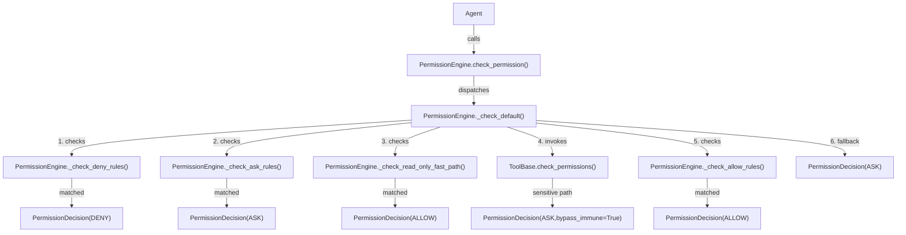

<!-- source: DeepWiki mcp.deepwiki.com · repo modelscope/agentscope · page 2.6 Permission System · fetched 2026-10-27 -->

# Permission System

<details>
<summary>Relevant source files</summary>

The following files were used as context for generating this wiki page:

- [src/agentscope/app/_router/_schema/_workspace.py](src/agentscope/app/_router/_schema/_workspace.py)
- [src/agentscope/app/_service/_download_token.py](src/agentscope/app/_service/_download_token.py)
- [src/agentscope/permission/_decision.py](src/agentscope/permission/_decision.py)
- [src/agentscope/permission/_engine.py](src/agentscope/permission/_engine.py)
- [src/agentscope/permission/_types.py](src/agentscope/permission/_types.py)
- [src/agentscope/tool/_builtin/_backend.py](src/agentscope/tool/_builtin/_backend.py)
- [src/agentscope/tool/_builtin/_bash.py](src/agentscope/tool/_builtin/_bash.py)
- [src/agentscope/tool/_builtin/_bash_parser.py](src/agentscope/tool/_builtin/_bash_parser.py)
- [tests/backend_local_test.py](tests/backend_local_test.py)
- [tests/builtin_bash_test.py](tests/builtin_bash_test.py)
- [tests/permission_bash_parser_test.py](tests/permission_bash_parser_test.py)
- [tests/permission_mode_test.py](tests/permission_mode_test.py)
- [tests/service_chat_middleware_factory_test.py](tests/service_chat_middleware_factory_test.py)
- [tests/service_workspace_files_test.py](tests/service_workspace_files_test.py)

</details>


## Purpose and Scope

The Permission System in AgentScope 2.0 provides a granular, rule-based security and policy enforcement layer for tool execution. It mediates between agent-generated tool calls and their execution environments, ensuring safety and compliance when agents interact with sensitive capabilities such as filesystem modifications or shell execution [src/agentscope/permission/_types.py:3-13]().

**Key capabilities:**
- **Dynamic Policy Enforcement**: Evaluates permissions at runtime based on tool names and specific tool arguments (e.g., file paths, command substrings) via `PermissionEngine.check_permission()` [src/agentscope/permission/_engine.py:17-31]().
- **Safety Guardrails**: Built-in protection against dangerous operations (e.g., destructive shell commands, editing sensitive files like `.bashrc`, command-injection patterns) that remain active even in relaxed modes via `bypass_immune` flags [src/agentscope/permission/_decision.py:33-68]().
- **Human-in-the-Loop**: Support for `ASK` behaviors that interrupt the agent execution loop to request explicit user confirmation [src/agentscope/permission/_types.py:88-102]().
- **Operational Modes**: Configurable execution strategies (`PermissionMode`) ranging from strict `DEFAULT` to `BYPASS` and `EXPLORE` (read-only) [src/agentscope/permission/_types.py:18-86]().

Sources: [src/agentscope/permission/_types.py:3-102](), [src/agentscope/permission/_engine.py:17-31](), [src/agentscope/permission/_decision.py:10-68]()

---

## Core Components and Data Structures

The permission architecture centers around several core classes responsible for holding rules, contexts, decisions, and evaluation logic.

### Permission Entities

| Class / Enum | Role | Key Attributes / Methods |
| :--- | :--- | :--- |
| `PermissionRule` | Defines a specific permission rule matching pattern and behavior. | `tool_name`, `rule_content`, `behavior`, `source` [src/agentscope/permission/_engine.py:49-62]() |
| `PermissionContext` | Holds the active runtime configuration and rule sets for a session. | `mode`, `allow_rules`, `deny_rules`, `ask_rules`, `working_directories` [src/agentscope/permission/_engine.py:33-47]() |
| `PermissionDecision` | Represents the outcome of an evaluation. | `behavior` (ALLOW/DENY/ASK), `message`, `suggested_rules`, `bypass_immune` [src/agentscope/permission/_decision.py:10-68]() |
| `PermissionEngine` | Orchestrates policy evaluation and rule matching. | `check_permission()`, `add_rule()`, `_check_default()` [src/agentscope/permission/_engine.py:17-115]() |

### Permission Modes (`PermissionMode`)

The engine behavior is governed by five concrete modes defined in `PermissionMode` [src/agentscope/permission/_types.py:18-86]():

1.  **`DEFAULT`**: Strict operational mode. Every operation requires an explicit `ALLOW` rule or successful tool safety check, unless it matches a read-only fast path [src/agentscope/permission/_types.py:27-35]().
2.  **`ACCEPT_EDITS`**: Development mode. Automatically allows file writes/reads and directory operations when target paths resolve inside authorized working directories [src/agentscope/permission/_types.py:37-42]().
3.  **`EXPLORE`**: Read-only mode. Allows tools marked as read-only (such as `Read`, `Grep`, `Glob`) and read-only bash commands, but blocks any modification [src/agentscope/permission/_types.py:44-50]().
4.  **`BYPASS`**: Sandbox mode. Bypasses standard confirmation rules and safety checks unless explicit user-configured `DENY` or `ASK` rules exist [src/agentscope/permission/_types.py:52-59]().
5.  **`DONT_ASK`**: Unattended mode. Converts all `ASK` decisions (including safety ASKs) into `DENY` for headless background execution [src/agentscope/permission/_types.py:61-63]().

Sources: [src/agentscope/permission/_types.py:18-86](), [src/agentscope/permission/_engine.py:104-115](), [src/agentscope/tool/_builtin/_bash.py:25-136]()

---

## Evaluation Engine and Priority Architecture

The `PermissionEngine` coordinates permission checks by dispatching requests to mode-specific internal handlers (e.g., `_check_default()`, `_check_accept_edits()`) [src/agentscope/permission/_engine.py:104-115](). 

### Title: Permission Evaluation Code Entity Flow

Sources: [src/agentscope/permission/_engine.py:77-176](), [src/agentscope/permission/_decision.py:10-68]()

### Rule Priority Sequence
When evaluating permissions under standard modes (like `DEFAULT`), execution proceeds through a strict priority order [src/agentscope/permission/_engine.py:117-176]():
1.  **`DENY` Rules**: Highest priority. If a matching deny rule exists, execution is immediately blocked [src/agentscope/permission/_engine.py:150-155]().
2.  **`ASK` Rules**: Prompts the user for confirmation and attaches suggested rules [src/agentscope/permission/_engine.py:157-166]().
3.  **Read-only Fast Path**: Automatically allows known read-only tools and commands [src/agentscope/permission/_engine.py:168-173]().
4.  **`tool.check_permissions`**: Tool-specific safety logic. If it returns a **bypass-immune** `ASK` (e.g., accessing sensitive paths like `/etc/passwd` or `.bashrc`), it cannot be overridden by allow rules [src/agentscope/permission/_engine.py:117-176]().
5.  **`ALLOW` Rules**: Grants permission if no higher-priority rule or safety guardrail blocks it [src/agentscope/permission/_engine.py:77-115]().
6.  **Default Fallback**: Resolves to `ASK` in `DEFAULT` mode or `DENY` in `DONT_ASK` mode [src/agentscope/permission/_types.py:18-86]().

Sources: [src/agentscope/permission/_engine.py:117-176](), [tests/permission_engine_test.py:30-130]()

---

## Bash Command Parsing and Read-Only Analysis

The `Bash` tool and permission engine leverage `BashCommandParser` for precise syntax analysis of shell commands using `tree-sitter-bash` [src/agentscope/tool/_builtin/_bash_parser.py:144-150]().

### Title: Bash Command Parsing Entity Flow

```mermaid
graph LR
    BashTool["Bash.check_permissions()"] -->|passes command| BashCommandParser["BashCommandParser.is_read_only_command()"]
    
    BashCommandParser -->|parses AST| TreeSitter["Parser(Language(tsbash.language()))"]
    TreeSitter -->|splits compound| SplitCmd["BashCommandParser.split_compound_command()"]
    
    SplitCmd -->|evaluates subcommands| SingleCheck["BashCommandParser._is_single_command_read_only()"]
    SingleCheck -->|checks| ReadOnlySet["READ_ONLY_COMMANDS / SAFE_COMMANDS"]
    
    ReadOnlySet -->|valid| ReturnTrue["Returns True (Read-Only)"]
    ReadOnlySet -->|mutating/unknown| ReturnFalse["Returns False (Requires Permission)"]
```

Sources: [src/agentscope/tool/_builtin/_bash.py:25-136](), [src/agentscope/tool/_builtin/_bash_parser.py:144-198]()

- **Compound Command Splitting**: Expressions containing `&&`, `||`, `;`, or `|` are decomposed into individual subcommands via AST inspection, ensuring that *every* subcommand must be read-only for the entire compound command to qualify for the read-only fast path [src/agentscope/tool/_builtin/_bash_parser.py:151-194]().
- **Prefix Matching**: `match_rule()` supports prefix and wildcard pattern matching (e.g., `git:*`) against the shell command [src/agentscope/tool/_builtin/_bash.py:25-136]().
- **Safe Environment Variables**: The parser identifies and ignores safe environment variable assignments (e.g., `NODE_ENV=prod`) when extracting command prefixes, preventing them from interfering with rule matching [src/agentscope/tool/_builtin/_bash_parser.py:38-63]().
- **Dangerous Node Types**: The parser can identify dangerous node types in the AST, such as command substitutions or process substitutions, which are used to detect potentially malicious commands [src/agentscope/tool/_builtin/_bash_parser.py:21-21]().

Sources: [src/agentscope/tool/_builtin/_bash.py:25-136](), [src/agentscope/tool/_builtin/_bash_parser.py:21-154](), [src/agentscope/tool/_builtin/_bash_parser.py:38-63](), [tests/permission_bash_parser_test.py:53-79]()

---

## Tool-Specific Permission Integration

Builtin tools override `check_permissions()`, `match_rule()`, and related hooks to implement custom security policies [src/agentscope/tool/_builtin/_bash.py:25-136]().

- **Dangerous Path Checking**: File tools (`Write`, `Edit`, `Read`) validate paths against sensitive files and directories to trigger bypass-immune `ASK` decisions [src/agentscope/tool/_builtin/_bash.py:10-12]().
- **Working Directory Integration**: In `ACCEPT_EDITS` mode, file and filesystem operations auto-allow operations if the target path resides within authorized working directories [src/agentscope/permission/_types.py:37-42]().
- **Write Tool Pre-read Requirement**: The `Write` tool enforces that an existing file must have been read by the agent in the current conversation before it can be overwritten, preventing accidental data loss [tests/builtin_bash_test.py:1-190]().

Sources: [src/agentscope/tool/_builtin/_bash.py:25-136](), [src/agentscope/permission/_types.py:37-42](), [tests/builtin_bash_test.py:1-190]()

---

## Usage Example

Configuring a `PermissionEngine` instance with custom rules and executing checks:

```python
from agentscope.permission import (
    PermissionEngine, 
    PermissionContext, 
    PermissionRule, 
    PermissionMode, 
    PermissionBehavior
)
from agentscope.tool import Bash

# 1. Setup Context with an ALLOW rule for git commands
context = PermissionContext(
    mode=PermissionMode.DEFAULT,
)
engine = PermissionEngine(context)
engine.add_rule(PermissionRule(
    tool_name="Bash",
    rule_content="git:*",
    behavior=PermissionBehavior.ALLOW,
    source="user"
))

# 2. Check permission for an allowed command
decision = await engine.check_permission(Bash(), {"command": "git status"})

# 3. Check permission for an unhandled command (returns ASK)
decision = await engine.check_permission(Bash(), {"command": "rm -rf tmp/"})
```

Sources: [src/agentscope/permission/_engine.py:33-75](), [tests/permission_engine_test.py:1-100]()

---

