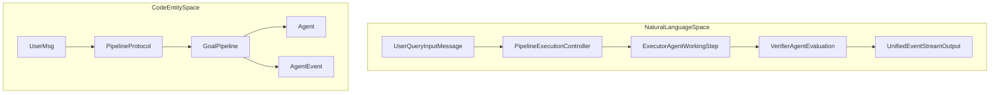
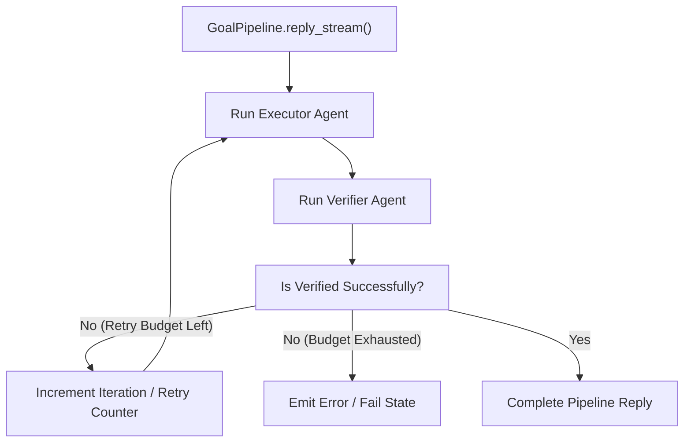
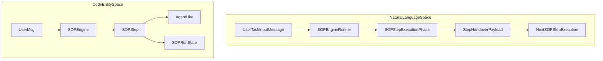

<!-- source: DeepWiki mcp.deepwiki.com · repo modelscope/agentscope · page 2.7 Pipelines, SOP Engine, and A2A Agents · fetched 2026-10-27 -->

# Pipelines, SOP Engine, and A2A Agents

Relevant source files

The following files were used as context for generating this wiki page:

- [examples/a2a/README.md](examples/a2a/README.md)
- [examples/a2a/client.py](examples/a2a/client.py)
- [examples/a2a/server.py](examples/a2a/server.py)
- [examples/pipeline/goal/README.md](examples/pipeline/goal/README.md)
- [examples/pipeline/goal/goal_pipeline.py](examples/pipeline/goal/goal_pipeline.py)
- [src/agentscope/agent/__init__.py](src/agentscope/agent/__init__.py)
- [src/agentscope/agent/_a2a_agent.py](src/agentscope/agent/_a2a_agent.py)
- [src/agentscope/middleware/_longterm_memory/_agentic_memory/_middleware.py](src/agentscope/middleware/_longterm_memory/_agentic_memory/_middleware.py)
- [src/agentscope/pipeline/__init__.py](src/agentscope/pipeline/__init__.py)
- [src/agentscope/pipeline/_base.py](src/agentscope/pipeline/_base.py)
- [src/agentscope/pipeline/_goal_pipeline.py](src/agentscope/pipeline/_goal_pipeline.py)
- [src/agentscope/pipeline/_team_pipeline.py](src/agentscope/pipeline/_team_pipeline.py)
- [src/agentscope/sop/__init__.py](src/agentscope/sop/__init__.py)
- [src/agentscope/sop/_engine.py](src/agentscope/sop/_engine.py)
- [src/agentscope/sop/_schema.py](src/agentscope/sop/_schema.py)
- [src/agentscope/sop/_state.py](src/agentscope/sop/_state.py)
- [src/agentscope/state/__init__.py](src/agentscope/state/__init__.py)
- [src/agentscope/state/_a2a_state.py](src/agentscope/state/_a2a_state.py)
- [src/agentscope/tui/_messages.py](src/agentscope/tui/_messages.py)
- [tests/a2a_agent_e2e_test.py](tests/a2a_agent_e2e_test.py)
- [tests/a2a_agent_test.py](tests/a2a_agent_test.py)
- [tests/middleware_filesystem_memory_test.py](tests/middleware_filesystem_memory_test.py)
- [tests/pipeline_goal_test.py](tests/pipeline_goal_test.py)
- [tests/pipeline_team_cleanup_test.py](tests/pipeline_team_cleanup_test.py)
- [tests/pipeline_team_test.py](tests/pipeline_team_test.py)
- [tests/sop_engine_test.py](tests/sop_engine_test.py)

This page documents AgentScope's fixed-logic workflow and inter-operability layers: the pipeline abstractions (`PipelineProtocol`), `GoalPipeline` (executor/verifier loop), `TeamPipeline` (leader-worker multi-agent delegation), the SOP subsystem (`SOP`/`SOPStep` definitions, `SOPEngine`, `SOPRunState`/`SOPPhase`), and `A2AAgent`/`A2AAgentState` for Agent-to-Agent protocol interop.

---

## 1. Pipeline Abstraction and Protocol

AgentScope pipelines provide deterministic, multi-level orchestration around agents. To ensure seamless substitutability, pipeline implementations conform to `PipelineProtocol`, mirroring the core interface of the standalone `Agent` class (`reply_stream()`, `reply()`, and `observe()`).

`PipelineProtocol` defines the structural contract that allows any composite multi-agent workflow to be plugged directly into consoles, routers, and higher-level execution loops without changing client code.

### Natural Language to Code Entity Space: Pipeline Orchestration

*Figure 1: Natural Language to Code Entity Space mapping for Pipeline orchestration.*

Sources: `[src/agentscope/pipeline/_base.py:1-32]()`, `[src/agentscope/pipeline/_goal_pipeline.py:1-60]()`

---

## 2. GoalPipeline and Verification Loops

`GoalPipeline` implements an iterative executor-verifier pattern. It drives an execution agent toward a target goal while routing outputs through a verification agent, managing retries, iteration limits, and human-in-the-loop (HITL) pause states safely `[src/agentscope/pipeline/_goal_pipeline.py:55-90]()`.

### Executor-Verifier Architecture
The pipeline coordinates two primary actors:
1. **Executor**: Generates content, calls tools, or solves sub-tasks.
2. **Verifier**: Evaluates the executor's output against the defined goal, returning structured reports.

The internal loop relies on two private schema classes defined alongside the pipeline:
- `_ExecutionReport`: Captures output artifacts, tool states, and status flags from the executor step `[src/agentscope/pipeline/_goal_pipeline.py:22-31]()`.
- `_VerificationResult`: Holds evaluation outcomes, error descriptions, and pass/fail boolean flags returned by the verifier `[src/agentscope/pipeline/_goal_pipeline.py:34-52]()`.

### Iteration Control and HITL Safety
`GoalPipeline` accepts configuration parameters `max_iters` and `max_retries` to prevent infinite loops during stubborn reasoning paths `[src/agentscope/pipeline/_goal_pipeline.py:59-90]()`. Iteration tracking is state-aware and HITL-safe: if an execution or verification step pauses for user confirmation (`RequireUserConfirmEvent`), the iteration count suspends correctly across resumed turns, preventing premature timeout errors `[src/agentscope/pipeline/_goal_pipeline.py:93-170]()`.

### GoalPipeline Execution Loop

*Figure 2: GoalPipeline execution-verification iteration control loop.*

Sources: `[src/agentscope/pipeline/_goal_pipeline.py:22-189]()`

---

## 3. TeamPipeline and Multi-Agent Delegation

`TeamPipeline` implements a leader-worker delegation model where a leader agent assigns tasks to specialized team members via dynamic tool calls `[src/agentscope/pipeline/_team_pipeline.py:110-128]()`.

### Team Structure (`TeamMember`, `_TeamAssign`)
- `TeamMember`: Associates an underlying `Agent` with a descriptive string defining its specialty and when it should be invoked `[src/agentscope/pipeline/_team_pipeline.py:37-49]()`.
- `_TeamAssign`: An internal external tool exposed to the leader. Its input schema dynamically enumerates the registered team members and expects a `member` name and a `prompt` string `[src/agentscope/pipeline/_team_pipeline.py:51-100]()`.

### Execution and Concurrency Model
When the leader invokes `TeamAssign`, the pipeline executes the target member agent in its own isolated context. The member's intermediate steps remain hidden from the leader; only its final reply is returned as the tool result. Members assigned within the same round execute concurrently, except that multiple assignments targeting the same member run sequentially in call order `[src/agentscope/pipeline/_team_pipeline.py:110-186]()`.

Sources: `[src/agentscope/pipeline/_team_pipeline.py:37-186]()`

---

## 4. SOP Subsystem and SOPEngine

The Standard Operating Procedure (SOP) subsystem provides a deterministic mechanism to execute a fixed sequence of milestones or steps (`SOPStep`), where each step enforces defined objectives, execution rules, and verification loops `[src/agentscope/sop/_schema.py:1-204]()`, `[src/agentscope/sop/_engine.py:24-30]()`.

### SOP Definitions (`SOP`, `SOPStep`, `SOPStepBase`)
- `SOP`: Holds a sequence of `SOPStep` instances, a name, and a description `[src/agentscope/sop/_schema.py:1-25]()`.
- `SOPStepBase` / `SOPStep`: Defines a milestone with a `subject`, `description`, and `max_attempts`. In standard `SOPStep`, an executor agent performs the work and an optional verifier agent evaluates the outcome against structured criteria `[src/agentscope/sop/_schema.py:65-204]()`.

### Execution Engine (`SOPEngine`)
`SOPEngine` walks through the steps sequentially. It manages run states (`SOPRunState`), transitions phases (`SOPPhase`), handles handovers between adjacent steps via handover blocks (`_handover`), and preserves progress across interruptions or HITL events `[src/agentscope/sop/_engine.py:24-174]()`.

### Natural Language to Code Entity Space: SOP Subsystem

*Figure 3: Natural Language to Code Entity Space mapping for SOP execution subsystem.*

Sources: `[src/agentscope/sop/_schema.py:1-204]()`, `[src/agentscope/sop/_engine.py:24-174]()`

---

## 5. Agent-to-Agent (A2A) Protocol Interop

`A2AAgent` and `A2AAgentState` provide a stateful client-side adapter implementing the A2A 1.0 specification. This enables local AgentScope applications to interact seamlessly with remote A2A-compliant agent servers `[src/agentscope/agent/_a2a_agent.py:189-207]()`, `[src/agentscope/state/_a2a_state.py:1-23]()`.

### `A2AAgent` and Content Stream Mapping
`A2AAgent` intentionally avoids inheriting from the base `Agent` class. While a local `Agent` manages its own model, toolkit, workspace, and prompt loop, `A2AAgent` delegates reasoning to a remote server. It tracks only conversation context (`context_id`) and task continuation markers (`task_id`) within `A2AAgentState` `[src/agentscope/agent/_a2a_agent.py:189-207]()`, `[src/agentscope/state/_a2a_state.py:1-23]()`.

As response chunks arrive from the remote A2A server, `A2AAgent` maps incoming parts to native AgentScope event streams via `_parts_to_events()`:
- Text parts stream into `TextBlockStartEvent`, `TextBlockDeltaEvent`, and `TextBlockEndEvent` (mapped to `TextBlock`) `[src/agentscope/agent/_a2a_agent.py:53-106]()`.
- Raw binary and URL parts map to `DataBlockStartEvent`, `DataBlockDeltaEvent`, and `DataBlockEndEvent` (mapped to `DataBlock`) `[src/agentscope/agent/_a2a_agent.py:108-149]()`.

### Natural Language to Code Entity Space: A2A Interop

```mermaid
graph TD
    subgraph "NaturalLanguageSpace"
        ClientInputQuery["ClientInputQuery"] --> A2AAgentClientAdapter["A2AAgentClientAdapter"]
        A2AAgentClientAdapter --> A2ATransport["A2ATransport"]
        A2ATransport --> RemoteAgentScopeExecutorServer["RemoteAgentScopeExecutorServer"]
        RemoteAgentScopeExecutorServer --> DashScopeChatModel["DashScopeChatModel"]
    end
    subgraph "CodeEntitySpace"
        UserMsg["UserMsg"] --> A2AAgent["A2AAgent"]
        A2AAgent --> SdkClient["Client"]
        SdkClient --> AgentScopeExecutor["AgentScopeExecutor"]
        AgentScopeExecutor --> Agent["Agent"]
    end
```

*Figure 4: Natural Language to Code Entity Space mapping for A2A remote interop.*

Sources: `[src/agentscope/agent/_a2a_agent.py:40-207]()`, `[src/agentscope/state/_a2a_state.py:1-23]()`

---

