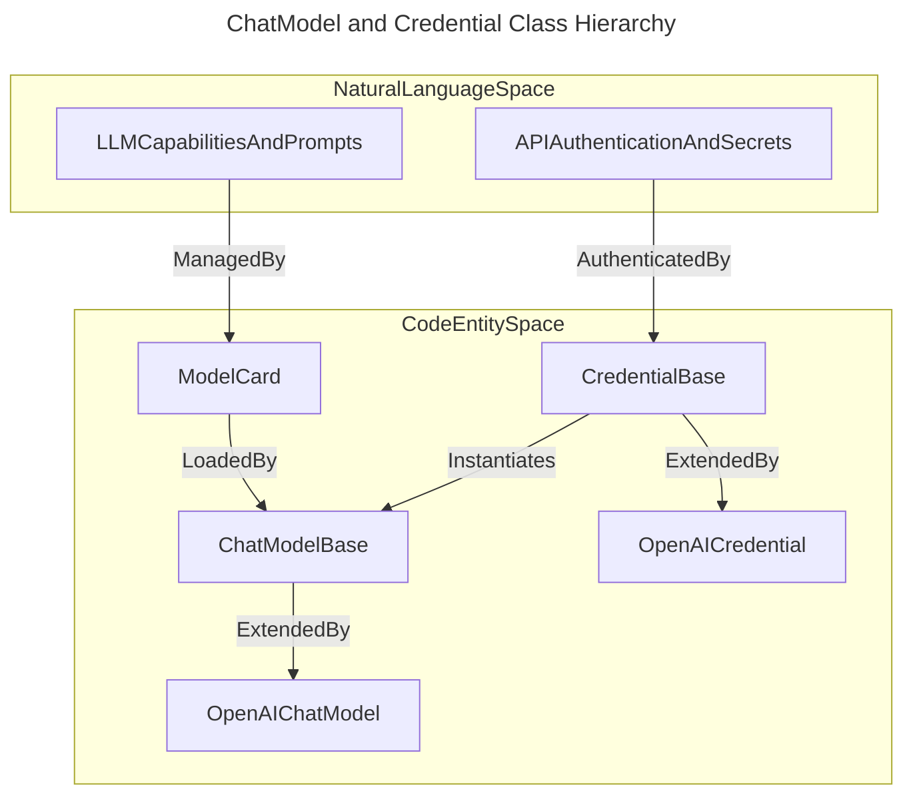
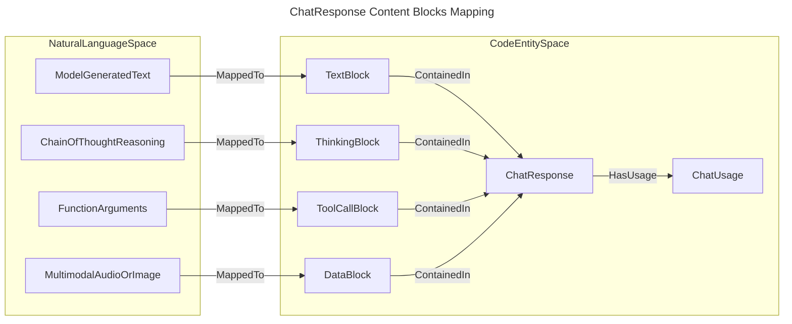
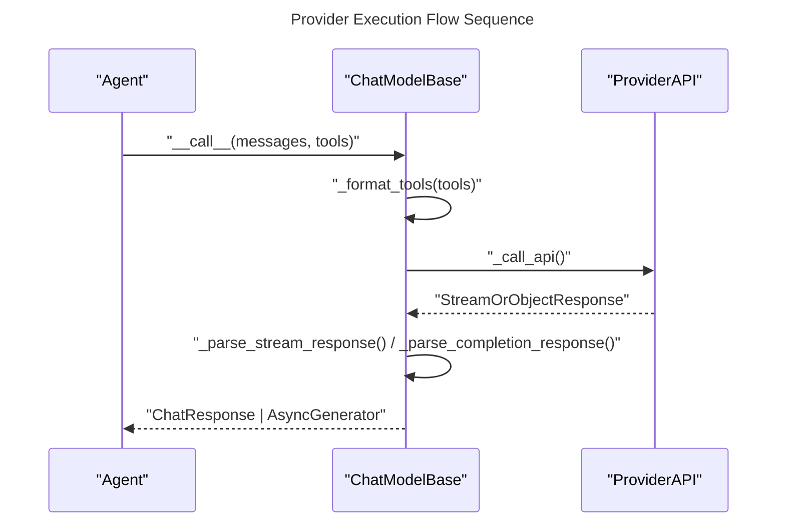

<!-- source: DeepWiki mcp.deepwiki.com · repo modelscope/agentscope · page 3.1 ChatModelBase and Provider Architecture · fetched 2026-10-27 -->

# ChatModelBase and Provider Architecture

Relevant source files

The following files were used as context for generating this wiki page:

- [src/agentscope/_utils/_audio.py](src/agentscope/_utils/_audio.py)
- [src/agentscope/asr/__init__.py](src/agentscope/asr/__init__.py)
- [src/agentscope/asr/_asr_base.py](src/agentscope/asr/_asr_base.py)
- [src/agentscope/asr/_asr_model_card.py](src/agentscope/asr/_asr_model_card.py)
- [src/agentscope/asr/_asr_response.py](src/agentscope/asr/_asr_response.py)
- [src/agentscope/asr/_openai/__init__.py](src/agentscope/asr/_openai/__init__.py)
- [src/agentscope/asr/_openai/_model.py](src/agentscope/asr/_openai/_model.py)
- [src/agentscope/asr/_openai/_models/gpt-4o-mini-transcribe.yaml](src/agentscope/asr/_openai/_models/gpt-4o-mini-transcribe.yaml)
- [src/agentscope/asr/_openai/_models/gpt-4o-transcribe.yaml](src/agentscope/asr/_openai/_models/gpt-4o-transcribe.yaml)
- [src/agentscope/credential/_base.py](src/agentscope/credential/_base.py)
- [src/agentscope/credential/_openai.py](src/agentscope/credential/_openai.py)
- [src/agentscope/model/_base.py](src/agentscope/model/_base.py)
- [src/agentscope/model/_model_card.py](src/agentscope/model/_model_card.py)
- [src/agentscope/model/_openai_chat/_model.py](src/agentscope/model/_openai_chat/_model.py)
- [src/agentscope/model/_openai_response/_models/gpt-4.1-mini.yaml](src/agentscope/model/_openai_response/_models/gpt-4.1-mini.yaml)
- [src/agentscope/model/_openai_response/_models/gpt-4.1-nano.yaml](src/agentscope/model/_openai_response/_models/gpt-4.1-nano.yaml)
- [src/agentscope/model/_openai_response/_models/gpt-4.1.yaml](src/agentscope/model/_openai_response/_models/gpt-4.1.yaml)
- [src/agentscope/model/_openai_response/_models/gpt-4o-mini.yaml](src/agentscope/model/_openai_response/_models/gpt-4o-mini.yaml)
- [src/agentscope/model/_openai_response/_models/gpt-4o.yaml](src/agentscope/model/_openai_response/_models/gpt-4o.yaml)
- [src/agentscope/model/_openai_response/_models/gpt-5.5.yaml](src/agentscope/model/_openai_response/_models/gpt-5.5.yaml)
- [src/agentscope/model/_openai_response/_models/gpt-5.6-luna.yaml](src/agentscope/model/_openai_response/_models/gpt-5.6-luna.yaml)
- [src/agentscope/model/_openai_response/_models/gpt-5.6-sol.yaml](src/agentscope/model/_openai_response/_models/gpt-5.6-sol.yaml)
- [src/agentscope/model/_openai_response/_models/gpt-5.6-terra.yaml](src/agentscope/model/_openai_response/_models/gpt-5.6-terra.yaml)
- [src/agentscope/model/_utils.py](src/agentscope/model/_utils.py)
- [tests/asr_openai_test.py](tests/asr_openai_test.py)
- [tests/model_base_test.py](tests/model_base_test.py)
- [tests/model_openai_chat_test.py](tests/model_openai_chat_test.py)

## Purpose and Scope

This page covers the foundational abstract classes and utilities that power LLM integration in AgentScope 2.0. Specifically, it details:
- The `ChatModelBase` abstract base class and its execution lifecycle [src/agentscope/model/_base.py:37-98]().
- The method pattern (`_call_api`, `_parse_stream_response`, `_parse_completion_response`, `_format_tools`).
- Standardized data containers (`ChatResponse`, `ChatUsage`, and accumulation utilities) [src/agentscope/model/_base.py:14-16](), [src/agentscope/model/_utils.py:199-204]().
- Authentication via `CredentialBase` [src/agentscope/credential/_base.py:18-30]() and concrete credentials like `OpenAICredential` [src/agentscope/credential/_openai.py:17-30]().
- The decentralized Model Card YAML configuration system and discovery mechanism [src/agentscope/model/_base.py:135-180]().

Sources: [src/agentscope/model/_base.py:37-98](), [src/agentscope/model/_base.py:135-180](), [src/agentscope/model/_utils.py:199-204](), [src/agentscope/credential/_base.py:18-30](), [src/agentscope/credential/_openai.py:17-30]()

## Overview

The model integration layer follows a decoupled architecture that separates model execution logic, network configuration, API authentication, and static metadata:

1. **`ChatModelBase`**: The abstract base class defining the core execution pattern (`__call__`, `_call_api`, `_call_api_with_structured_output`) [src/agentscope/model/_base.py:37-38]().
2. **`CredentialBase`**: The base class managing API keys, organization IDs, and provider base URLs [src/agentscope/credential/_base.py:18-30](), [src/agentscope/credential/_openai.py:17-30]().
3. **`ModelCard`**: A YAML-driven system for defining model capabilities, context window limits, and default parameters [src/agentscope/model/_base.py:135-180]().
4. **Provider Classes**: Concrete implementations (`OpenAIChatModel`, `DashScopeChatModel`) that bridge the framework to specific REST or SDK endpoints [src/agentscope/model/_openai_chat/_model.py:38-39]().

### Class Hierarchy and Space Bridge

Sources: [src/agentscope/model/_base.py:37-38](), [src/agentscope/model/_openai_chat/_model.py:38-39](), [src/agentscope/credential/_base.py:18-30](), [src/agentscope/credential/_openai.py:17-30](), [src/agentscope/model/_base.py:135-180]()

## ChatModelBase Interface and Execution Pattern

The `ChatModelBase` class defines the contract for all provider implementations. It manages retries, exception handling, and the high-level orchestration of API invocations [src/agentscope/model/_base.py:62-71](), [src/agentscope/model/_base.py:184-198]().

### Core Pattern: `__call__` and Subclass Hooks

The entry point for inference is the `__call__` method, which implements a standard retry loop based on `max_retries` and `retry_delay` [src/agentscope/model/_base.py:62-71](), [src/agentscope/model/_base.py:184-198](). It delegates the actual network request to the provider's implementation of `_call_api`.

Subclasses implement a consistent internal convention to decouple network I/O from payload transformation:
- `_format_tools(tools)`: Translates AgentScope's unified tool definitions into the provider's expected schema format.
- `_call_api(...)`: Executes the raw HTTP or SDK-based client request, returning either a complete response or an async generator of stream deltas [src/agentscope/model/_base.py:184-198]().
- `_parse_stream_response(...)`: Translates raw streaming chunks into AgentScope's standardized delta structures.
- `_parse_completion_response(...)`: Translates non-streaming completion payloads into `ChatResponse` objects.

If a call is cancelled (e.g., via `asyncio.CancelledError`), the base class intercepts it and returns a `ChatResponse` with `FinishedReason.INTERRUPTED` [tests/model_base_test.py:171-187](). For streaming calls, it uses a `_StreamAccumulator` to collect deltas into a final complete response [src/agentscope/model/_base.py:14-16](), [src/agentscope/model/_utils.py:199-204]().

| Method | Role | Return Type |
| :--- | :--- | :--- |
| `__call__` | Public entry point with retry logic [src/agentscope/model/_base.py:184-198]() | `ChatResponse \| AsyncGenerator` |
| `_call_api` | Abstract method for provider-specific API calls [src/agentscope/model/_base.py:184-198]() | `ChatResponse \| AsyncGenerator` |
| `_get_retryable_exceptions` | Declares provider-specific retryable error types [src/agentscope/model/_base.py:101-110]() | `tuple[Type[Exception], ...]` |
| `_get_disable_thinking_kwargs` | Returns provider kwargs to toggle off reasoning/thinking [src/agentscope/model/_base.py:111-120]() | `dict` |
| `list_models` | Discovers models from local YAML model cards [src/agentscope/model/_base.py:135-180]() | `list[ModelCard]` |

Sources: [src/agentscope/model/_base.py:62-198](), [tests/model_base_test.py:171-187]()

## Model Response, Usage, and Accumulation

All models return standardized objects to ensure interoperability across the framework.

### ChatResponse, ChatUsage, and Space Bridge
The `ChatResponse` contains a sequence of content blocks, representing the multimodal and agentic nature of modern LLMs [src/agentscope/model/_base.py:14-16]().

Sources: [src/agentscope/model/_base.py:14-16](), [src/agentscope/model/_utils.py:199-204]()

- **`ChatUsage`**: Tracks token counts and usage details [src/agentscope/model/_utils.py:9-9]().
- **`FinishedReason`**: Indicates if a response was successfully completed (`COMPLETED`), stopped by length, or interrupted (`INTERRUPTED`) [src/agentscope/model/_base.py:14-16]().

### Stream Accumulation
During streaming, AgentScope uses `_StreamAccumulator` to efficiently merge deltas. This avoids performance penalties for large payloads by keeping fragments in lists until the final `build()` call [src/agentscope/model/_utils.py:199-204]().

- **`_AccTextBlock`**: Accumulates text fragments [src/agentscope/model/_utils.py:22-41]().
- **`_AccThinkingBlock`**: Accumulates chain-of-thought fragments and preserves provider-specific metadata [src/agentscope/model/_utils.py:44-71]().
- **`_AccToolCallBlock`**: Accumulates JSON input fragments and captures the tool `name` from the opening delta [src/agentscope/model/_utils.py:74-100]().
- **`_AccDataBlock`**: Handles audio stream concatenation by decoding base64 deltas into raw bytes via `_AccBase64Source` before a final re-encoding and WAV header finalization [src/agentscope/model/_utils.py:103-138](), [src/agentscope/model/_utils.py:140-197]().

Sources: [src/agentscope/model/_base.py:14-16](), [src/agentscope/model/_utils.py:22-197](), [src/agentscope/model/_utils.py:199-204]()

## Credential Architecture

Credentials are decoupled from model logic, allowing for secure handling and easy rotation. Every `ChatModelBase` instance requires a `CredentialBase` object upon initialization [src/agentscope/model/_base.py:44-45]().

Concrete implementations like `OpenAICredential` manage specific `api_key` (`SecretStr`), organization strings, and custom base URLs required for provider-compatible gateways [src/agentscope/credential/_openai.py:17-30](). Base classes define abstract methods for retrieving model classes and listing available model cards per provider [src/agentscope/credential/_base.py:18-145]().

Sources: [src/agentscope/model/_base.py:44-45](), [src/agentscope/credential/_base.py:18-145](), [src/agentscope/credential/_openai.py:17-30]()

## Model Card YAML System and Discovery

AgentScope employs a decentralized configuration pattern where model definitions are stored as YAML files inside a provider-specific `_models/` directory adjacent to each concrete model implementation [src/agentscope/model/_base.py:135-155]().

The `ModelCard` class parses these YAML declarations and links them with the subclass's inner `Parameters` schema via `ModelCard.from_yaml()` [src/agentscope/model/_base.py:165-170](). The `ChatModelBase.list_models()` method scans this directory at runtime to dynamically surface available models, context lengths, and parameter defaults without hardcoding model catalogs into the core library [src/agentscope/model/_base.py:135-180]().

Sources: [src/agentscope/model/_base.py:135-180]()

## Provider Execution Flow

The typical lifecycle of a model request, from agent invocation to response parsing, is illustrated below:

Sources: [src/agentscope/model/_base.py:184-198]()

---

