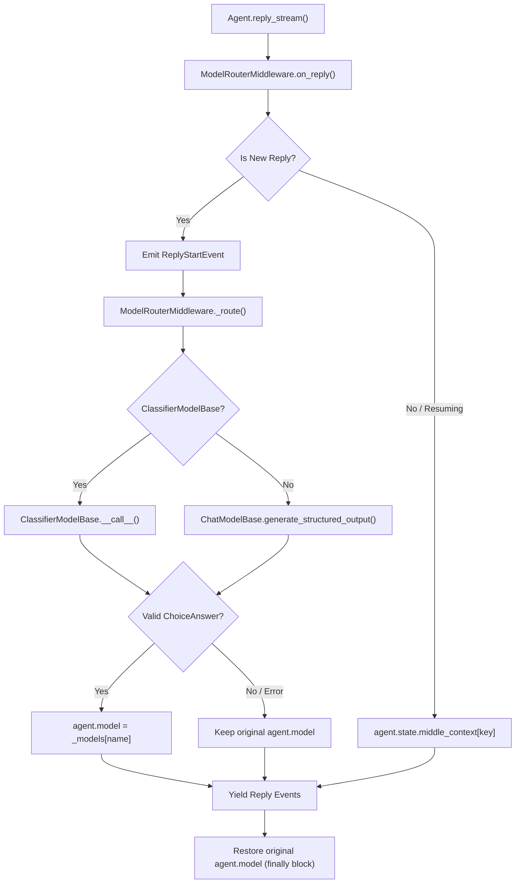
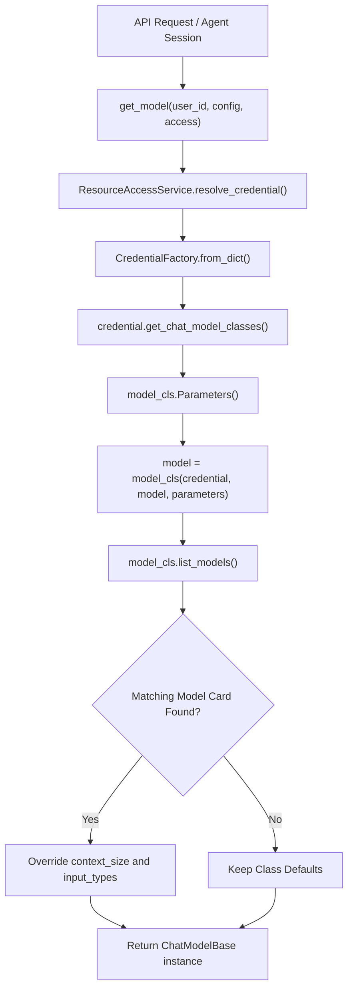

<!-- source: DeepWiki mcp.deepwiki.com · repo modelscope/agentscope · page 3.10 Model Routing · fetched 2026-10-27 -->

# Model Routing

Relevant source files

The following files were used as context for generating this wiki page:

- [examples/web_ui/frontend/src/components/popover/ModelParametersPopover.tsx](examples/web_ui/frontend/src/components/popover/ModelParametersPopover.tsx)
- [examples/web_ui/frontend/src/components/select/EmbeddingSelect.tsx](examples/web_ui/frontend/src/components/select/EmbeddingSelect.tsx)
- [examples/web_ui/frontend/src/components/select/LlmSelect.tsx](examples/web_ui/frontend/src/components/select/LlmSelect.tsx)
- [examples/web_ui/frontend/src/pages/channel/channel-form.tsx](examples/web_ui/frontend/src/pages/channel/channel-form.tsx)
- [examples/web_ui/frontend/src/pages/chat/ChatViewport.tsx](examples/web_ui/frontend/src/pages/chat/ChatViewport.tsx)
- [examples/web_ui/frontend/src/utils/common.ts](examples/web_ui/frontend/src/utils/common.ts)
- [src/agentscope/app/_router/_model.py](src/agentscope/app/_router/_model.py)
- [src/agentscope/app/_service/_model.py](src/agentscope/app/_service/_model.py)
- [src/agentscope/app/storage/_model/_session.py](src/agentscope/app/storage/_model/_session.py)
- [src/agentscope/classifier/__init__.py](src/agentscope/classifier/__init__.py)
- [src/agentscope/classifier/_openai/__init__.py](src/agentscope/classifier/_openai/__init__.py)
- [src/agentscope/classifier/_openai/_model.py](src/agentscope/classifier/_openai/_model.py)
- [src/agentscope/classifier/_response.py](src/agentscope/classifier/_response.py)
- [src/agentscope/middleware/_model_router.py](src/agentscope/middleware/_model_router.py)
- [tests/classifier_openai_test.py](tests/classifier_openai_test.py)
- [tests/classifier_test.py](tests/classifier_test.py)
- [tests/middleware_model_router_test.py](tests/middleware_model_router_test.py)
- [tests/service_model_test.py](tests/service_model_test.py)
- [tests/session_auto_naming_test.py](tests/session_auto_naming_test.py)

## Purpose and Scope

This page covers the model routing and resolution architecture in AgentScope 2.0. Specifically, it details `ModelRouterMiddleware` and `ChatModelCandidate` for dynamic per-request model selection via text classification or structured fallback generation [src/agentscope/middleware/_model_router.py:23-158](), as well as the application-layer model factory services (`get_model` and `get_realtime_model`) which construct and configure chat and realtime model instances from persistent user credentials and configuration records [src/agentscope/app/_service/_model.py:11-145]().

Sources: `src/agentscope/middleware/_model_router.py:23-158](), `src/agentscope/app/_service/_model.py:11-146`()

---

## Model Router Architecture and Candidates

The model routing subsystem allows an agent to dynamically switch its underlying chat model per request by analyzing the user's input text through a classifier model (`ClassifierModelBase`) or a structured-output chat model (`ChatModelBase`) [src/agentscope/middleware/_model_router.py:37-43]().

### `ChatModelCandidate`

`ChatModelCandidate` is a configuration dataclass that defines a named candidate model and the criteria for selecting it [src/agentscope/middleware/_model_router.py:23-36]().

*   `name` (`str`): The stable unique identifier returned by the classifier [src/agentscope/middleware/_model_router.py:27-28]().
*   `model` (`ChatModelBase`): The concrete chat model instance used when this candidate is selected [src/agentscope/middleware/_model_router.py:30-31]().
*   `description` (`str`): Natural language criteria text explaining when the candidate is appropriate [src/agentscope/middleware/_model_router.py:33-34]().

### `ModelRouterMiddleware`

`ModelRouterMiddleware` inherits from `MiddlewareBase` and intercepts the agent's `on_reply` hook [src/agentscope/middleware/_model_router.py:37-89](). During initialization, it verifies that candidate names are unique, compiles a `ChoiceQuestion` using the criteria descriptions, and prepares a JSON schema for structured fallback generation [src/agentscope/middleware/_model_router.py:45-82]().

Sources: `src/agentscope/middleware/_model_router.py:23-83](), `tests/middleware_model_router_test.py:26-28`()

---

## Routing Execution Flow and Fallbacks

When an agent processes a reply, `ModelRouterMiddleware.on_reply` executes a sequence of checks to determine whether to retain an existing routed model, classify a new input, or fall back to the agent's default model [src/agentscope/middleware/_model_router.py:84-111]().

### Diagram: Model Routing Execution Flow (Natural Language Space to Code Entity Space)

Sources: `src/agentscope/middleware/_model_router.py:84-150](), `tests/middleware_model_router_test.py:92-186`()

### Key Routing Methods

*   `on_reply`: Manages the request lifecycle by swapping `agent.model` to the selected candidate during event generation and restoring the original model in a `finally` block [src/agentscope/middleware/_model_router.py:84-110]().
*   `_route`: Evaluates the latest user text using either a dedicated `ClassifierModelBase` or fallback structured generation [src/agentscope/middleware/_model_router.py:112-150](). If classification fails or returns an unknown candidate name, a warning is logged via `logger.warning` and the agent's primary model is retained [src/agentscope/middleware/_model_router.py:135-147]().
*   `_latest_user_text`: Extracts the text content from the most recent message with role `"user"` in the input payload [src/agentscope/middleware/_model_router.py:151-158]().

Sources: `src/agentscope/middleware/_model_router.py:84-158`()

---

## App-Layer Model Service

At the application tier, chat and realtime models are dynamically constructed from persistent configurations and stored credentials via factory functions like `get_model` and `get_realtime_model` [src/agentscope/app/_service/_model.py:11-145]().

### Diagram: App-Layer Model Resolution (Natural Language Space to Code Entity Space)

Sources: `src/agentscope/app/_service/_model.py:11-90](), `tests/service_model_test.py:51-121`()

### Model Factory Mechanics

*   **Credential Resolution**: `ResourceAccessService.resolve_credential` resolves credential records for the requesting user (`user_id`), respecting multi-tenant sharing rules [src/agentscope/app/_service/_model.py:45-48]().
*   **Instantiation**: `CredentialFactory.from_dict` reconstructs the credential instance, which then provides the correct model class via `get_chat_model_class()` or `get_realtime_model_classes()` [src/agentscope/app/_service/_model.py:50-61](), [src/agentscope/app/_service/_model.py:117]().
*   **Model Card Overrides**: The factory inspects built-in model cards (`model_cls.list_models()`) to override the model's `context_size` and its formatter's `input_types` if a matching card is discovered [src/agentscope/app/_service/_model.py:77-87]().

Sources: `src/agentscope/app/_service/_model.py:11-146](), `tests/service_model_test.py:51-176`()

---

