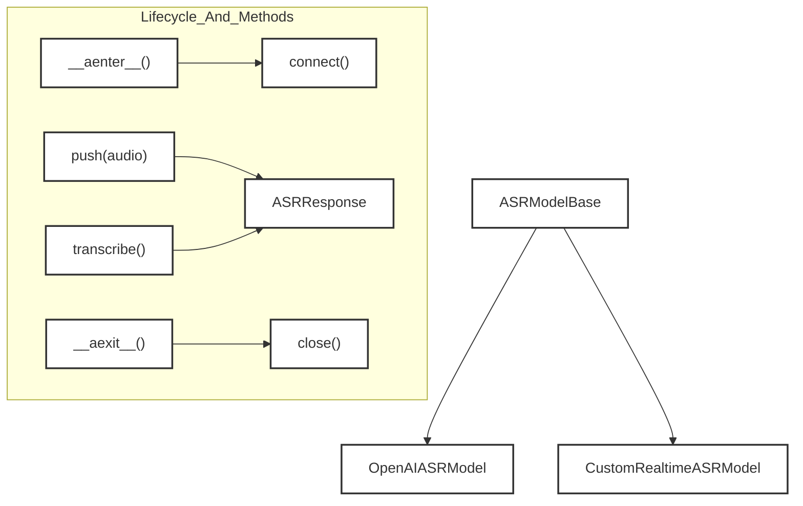
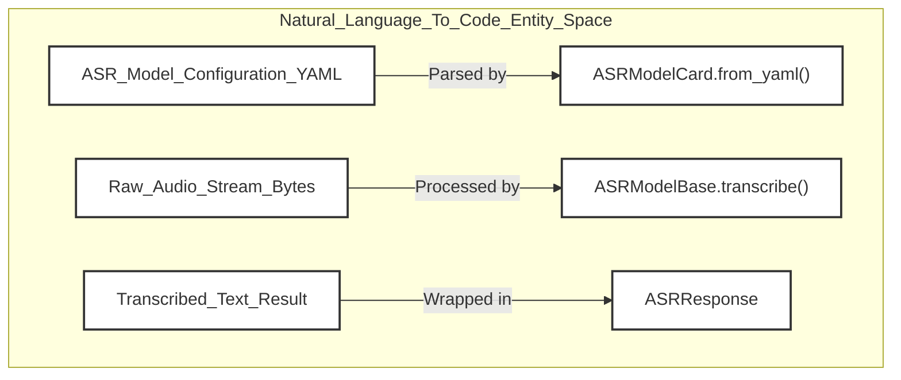
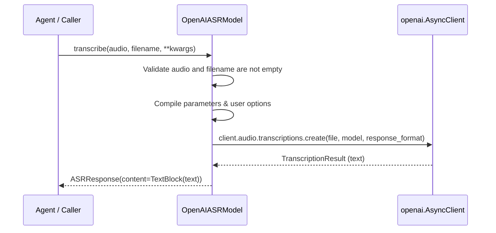

<!-- source: DeepWiki mcp.deepwiki.com · repo modelscope/agentscope · page 3.11 Speech Recognition (ASR) Models · fetched 2026-10-27 -->

# Speech Recognition (ASR) Models

<details>
<summary>Relevant source files</summary>

The following files were used as context for generating this wiki page:

- [src/agentscope/asr/__init__.py](src/agentscope/asr/__init__.py)
- [src/agentscope/asr/_asr_base.py](src/agentscope/asr/_asr_base.py)
- [src/agentscope/asr/_asr_model_card.py](src/agentscope/asr/_asr_model_card.py)
- [src/agentscope/asr/_asr_response.py](src/agentscope/asr/_asr_response.py)
- [src/agentscope/asr/_openai/__init__.py](src/agentscope/asr/_openai/__init__.py)
- [src/agentscope/asr/_openai/_model.py](src/agentscope/asr/_openai/_model.py)
- [src/agentscope/asr/_openai/_models/gpt-4o-mini-transcribe.yaml](src/agentscope/asr/_openai/_models/gpt-4o-mini-transcribe.yaml)
- [src/agentscope/asr/_openai/_models/gpt-4o-transcribe.yaml](src/agentscope/asr/_openai/_models/gpt-4o-transcribe.yaml)
- [src/agentscope/credential/_base.py](src/agentscope/credential/_base.py)
- [src/agentscope/credential/_openai.py](src/agentscope/credential/_openai.py)
- [tests/asr_openai_test.py](tests/asr_openai_test.py)

</details>


The purpose of this page is to document the `agentscope.asr` package, which provides a unified abstract framework for Automatic Speech Recognition (ASR) models within AgentScope. It covers batch transcription workflows, realtime streaming audio input capabilities, base interfaces, response containers, model card metadata loaders, and concrete integrations such as OpenAI's transcription models (`gpt-4o-transcribe` and `gpt-4o-mini-transcribe`).

---

## 1. Core Abstractions

The ASR subsystem centers around three core components: `ASRModelBase`, which defines the execution contract [src/agentscope/asr/_asr_base.py:19-30](); `ASRResponse`, which encapsulates transcription results [src/agentscope/asr/_asr_response.py:13-35](); and `ASRModelCard`, which handles metadata and capability parsing from YAML configuration files [src/agentscope/asr/_asr_model_card.py:10-63]().

### ASRModelBase Interface

`ASRModelBase` serves as the abstract base class for all speech recognition models [src/agentscope/asr/_asr_base.py:19-30](). It handles asynchronous context management and declares abstract hooks for concrete implementations.

*   **Initialization**: Configures the underlying model name, credential, and provider-specific parameters [src/agentscope/asr/_asr_base.py:51-71]().
*   **Asynchronous Context Manager**: The `__aenter__` and `__aexit__` methods manage connections for realtime models by automatically invoking `connect()` upon entry and `close()` upon exit (even during exceptions) [src/agentscope/asr/_asr_base.py:72-109](). Batch models bypass lifecycle hooks.
*   **Discovery**: `list_models()` scans implementation directories for `.yaml` files, instantiating `ASRModelCard` objects and filtering them by realtime capabilities [src/agentscope/asr/_asr_base.py:160-198]().


Sources: [src/agentscope/asr/_asr_base.py:19-198]()

### Response and Model Cards

*   `ASRResponse`: A data structure wrapping transcribed text blocks (`TextBlock`), unique identifiers, timestamps, response types (`asr`), metadata, and completion flags (`is_last`) [src/agentscope/asr/_asr_response.py:13-35]().
*   `ASRModelCard`: A Pydantic model that parses YAML files to expose metadata such as model names, labels, input media types (`input_types`), output types (`output_types`), realtime support flags, and provider-specific parameter schemas [src/agentscope/asr/_asr_model_card.py:10-63]().


Sources: [src/agentscope/asr/_asr_model_card.py:48-63](), [src/agentscope/asr/_asr_base.py:51-133](), [src/agentscope/asr/_asr_response.py:13-35]()

---

## 2. OpenAI ASR Implementation

The OpenAI integration is implemented via `OpenAIASRModel`, which bridges AgentScope's ASR interface to OpenAI's Audio Transcriptions API [src/agentscope/asr/_openai/_model.py:14-72]().

### OpenAIASRModel Architecture

*   **Parameters**: Defines configuration options via `OpenAIASRModel.Parameters`, accepting optional ISO-639-1 language codes and prompt guidance [src/agentscope/asr/_openai/_model.py:17-28]().
*   **Client Initialization**: Instantiates an `openai.AsyncClient` utilizing API keys, organization IDs, and custom base URLs derived from `OpenAICredential` [src/agentscope/asr/_openai/_model.py:35-50]().
*   **Transcription Workflow**: The `transcribe()` method validates input buffers and filenames, compiles provider options, and queries `client.audio.transcriptions.create()`, returning an `ASRResponse` containing a `TextBlock` [src/agentscope/asr/_openai/_model.py:51-72]().


Sources: [src/agentscope/asr/_openai/_model.py:51-72]()

### Model Card YAML Definitions

OpenAI transcription models are defined by configuration files stored under the provider's model registry directory:
*   `gpt-4o-transcribe.yaml`: Declares support for standard audio formats (`audio/flac`, `audio/mpeg`, `audio/mp4`, `audio/ogg`, `audio/wav`, `audio/webm`) [src/agentscope/asr/_openai/_models/gpt-4o-transcribe.yaml:1-9]().
*   `gpt-4o-mini-transcribe.yaml`: Lightweight counterpart with equivalent media type constraints [src/agentscope/asr/_openai/_models/gpt-4o-mini-transcribe.yaml:1-9]().

Sources: [src/agentscope/asr/_openai/_models/gpt-4o-transcribe.yaml:1-9](), [src/agentscope/asr/_openai/_models/gpt-4o-mini-transcribe.yaml:1-9]()

---

## 3. Credential Integration

Authentication and instantiation are tied into AgentScope's credential framework via `OpenAICredential` [src/agentscope/credential/_openai.py:17-90]() and its base class `CredentialBase` [src/agentscope/credential/_base.py:18-145]().

*   `OpenAICredential.get_asr_model_classes()` returns a list containing `OpenAIASRModel` [src/agentscope/credential/_openai.py:79-84]().
*   `CredentialBase.list_asr_models()` iterates over registered ASR classes and aggregates their respective `ASRModelCard` entries [src/agentscope/credential/_base.py:80-86]().

```mermaid
graph TD
    subgraph "Credential_To_ASR_Code_Mapping"
        Cred["OpenAICredential"] -->|get_asr_model_classes()| ModelClass["OpenAIASRModel"]
        ModelClass -->|list_models()| Card["ASRModelCard"]
        Card -->|from_yaml()| YAML["gpt-4o-transcribe.yaml"]
    end

    classDef default fill:#fff,stroke:#333,stroke-width:2px;
```
Sources: [src/agentscope/credential/_openai.py:79-84](), [src/agentscope/credential/_base.py:80-86](), [src/agentscope/asr/_asr_base.py:160-198]()

---

