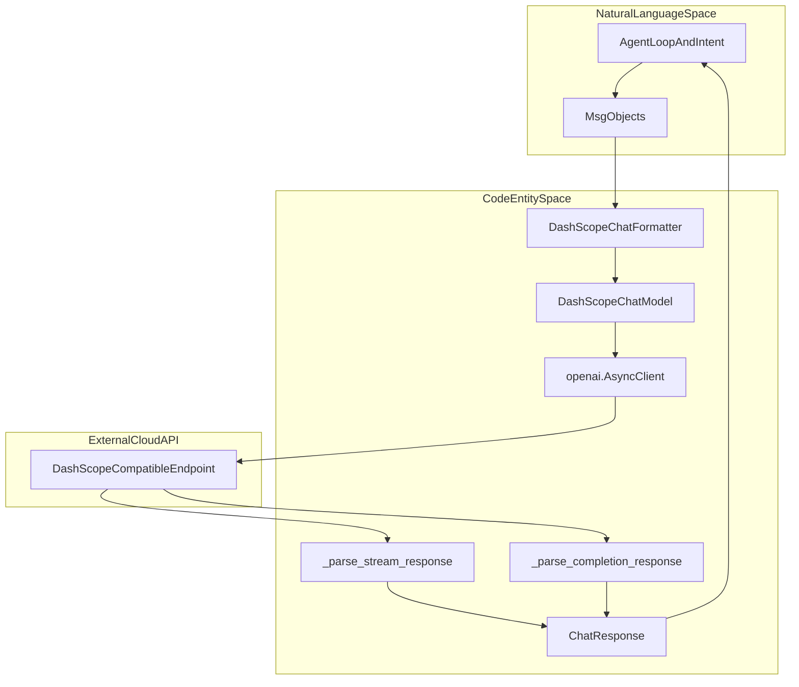
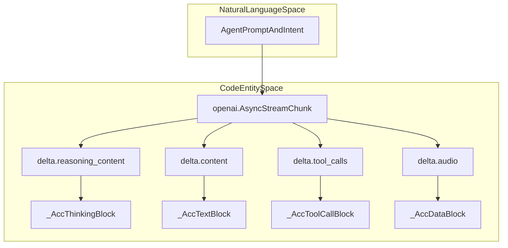

<!-- source: DeepWiki mcp.deepwiki.com · repo modelscope/agentscope · page 3.2 DashScope Integration · fetched 2026-10-27 -->

# DashScope Integration

Relevant source files

The following files were used as context for generating this wiki page:

- [src/agentscope/model/_anthropic/_model.py](src/agentscope/model/_anthropic/_model.py)
- [src/agentscope/model/_dashscope/_model.py](src/agentscope/model/_dashscope/_model.py)
- [src/agentscope/model/_dashscope/_models/deepseek-v4-pro.yaml](src/agentscope/model/_dashscope/_models/deepseek-v4-pro.yaml)
- [src/agentscope/model/_dashscope/_models/glm-5.2.yaml](src/agentscope/model/_dashscope/_models/glm-5.2.yaml)
- [src/agentscope/model/_dashscope/_models/qwen3.7-plus.yaml](src/agentscope/model/_dashscope/_models/qwen3.7-plus.yaml)
- [src/agentscope/model/_gemini/_model.py](src/agentscope/model/_gemini/_model.py)
- [src/agentscope/model/_ollama/_model.py](src/agentscope/model/_ollama/_model.py)
- [src/agentscope/model/_xai/_model.py](src/agentscope/model/_xai/_model.py)
- [tests/model_anthropic_test.py](tests/model_anthropic_test.py)
- [tests/model_dashscope_test.py](tests/model_dashscope_test.py)
- [tests/model_gemini_test.py](tests/model_gemini_test.py)
- [tests/model_ollama_test.py](tests/model_ollama_test.py)
- [tests/model_xai_test.py](tests/model_xai_test.py)

This page details the DashScope model adapter implementation (`DashScopeChatModel`) [src/agentscope/model/_dashscope/_model.py:34-41](), which provides integration with Alibaba Cloud's DashScope API. This integration relies on the OpenAI-compatible endpoint (`compatible-mode/v1`) while maintaining specialized support for DashScope-specific features such as deep thinking (`thinking_enable`/`thinking_budget`), multimodal inputs, audio streaming with dynamic WAV headers, and Text-to-Speech (TTS) services.

---

## 1. Overview and Architecture

The `DashScopeChatModel` class [src/agentscope/model/_dashscope/_model.py:34-41]() inherits from `ChatModelBase` [src/agentscope/model/_base.py:37-38]() and initializes an underlying `openai.AsyncClient` targeting DashScope's base URL [src/agentscope/model/_dashscope/_model.py:167-171](). Messages are formatted using `DashScopeChatFormatter` [src/agentscope/model/_dashscope/_model.py:162-162]() to match the expected API structure.

Title: "DashScope Integration Architecture Bridge"

Sources: [src/agentscope/model/_dashscope/_model.py:34-183]()

---

## 2. DashScopeCredential

Authentication and connection configurations for DashScope are encapsulated in `DashScopeCredential` [src/agentscope/credential/_dashscope.py:17-38](). It manages the API key and base URL parameters.

| Attribute | Default Value | Description |
|-----------|---------------|-------------|
| `api_key` | Required | DashScope API key wrapped as a `SecretStr` [src/agentscope/credential/_dashscope.py:27-30]() |
| `base_url` | `https://dashscope.aliyuncs.com/compatible-mode/v1` | OpenAI-compatible endpoint URL [src/agentscope/credential/_dashscope.py:32-38]() |

`DashScopeCredential` exposes factory methods to instantiate associated models, including `DashScopeChatModel` [src/agentscope/credential/_dashscope.py:41-46](), embedding models [src/agentscope/credential/_dashscope.py:63-67](), and TTS model variants [src/agentscope/credential/_dashscope.py:48-61]().

Sources: [src/agentscope/credential/_dashscope.py:1-67](), [src/agentscope/model/_dashscope/_model.py:16-16]()

---

## 3. Parameters and Thinking Mode

`DashScopeChatModel.Parameters` [src/agentscope/model/_dashscope/_model.py:43-110]() defines configurable parameters for generation requests, supporting extended reasoning and voice outputs.

### Parameters Summary
- `max_tokens`: Maximum output tokens limit [src/agentscope/model/_dashscope/_model.py:46-51]().
- `thinking_enable`: Boolean flag to enable reasoning outputs [src/agentscope/model/_dashscope/_model.py:53-57]().
- `thinking_budget`: Token budget allocated specifically to reasoning/thinking [src/agentscope/model/_dashscope/_model.py:59-64]().
- `temperature`, `top_p`, `top_k`: Standard sampling controls [src/agentscope/model/_dashscope/_model.py:66-88]().
- `parallel_tool_calls`: Enables parallel tool invocation [src/agentscope/model/_dashscope/_model.py:90-94]().
- `voice`: Configures voice output for omni-style models [src/agentscope/model/_dashscope/_model.py:96-109]().

### API Call Injection
During execution, `_call_api` inspects these parameters. If `thinking_enable` is active, it appends reasoning configurations to the request payload.

Sources: [src/agentscope/model/_dashscope/_model.py:43-264]()

---

## 4. Multimodality and Audio Support

`DashScopeChatModel` supports multimodal inputs (images, videos) via the OpenAI-compatible schema and handles audio streaming outputs.

### Audio Processing Data Flow
1. **Input**: A `Msg` object carries a `DataBlock` containing `Base64Source` or `URLSource`.
2. **Formatting**: `DashScopeChatFormatter` serializes these media contents into the API payload.
3. **Audio Streaming**: For omni models, audio binary chunks returned in `delta.audio` are processed and converted into `DataBlock` instances. Streaming WAV headers are generated dynamically using `_build_streaming_wav_header` [src/agentscope/_utils/_audio.py:47-74]() to ensure compliant audio playback streams.

Sources: [src/agentscope/model/_dashscope/_model.py:11-23](), [src/agentscope/_utils/_audio.py:47-74]()

---

## 5. Response Parsing and Streaming

`DashScopeChatModel` parses both non-streaming completions and asynchronous streaming responses into AgentScope `ChatResponse` objects, utilizing accumulator classes (`_AccTextBlock`, `_AccThinkingBlock`, `_AccToolCallBlock`, `_AccDataBlock`) defined in the internal model utilities [src/agentscope/model/_utils.py:22-202]().

### Non-Streaming Parsing
`_parse_completion_response` extracts reasoning content into `ThinkingBlock` and message text into `TextBlock`.

### Streaming Parsing
`_parse_stream_response` iterates over chunks from `openai.AsyncStream`, accumulating reasoning content, text content, tool calls, and audio streams.

Title: "DashScope Response and Stream Accumulation Bridge"

Sources: [src/agentscope/model/_dashscope/_model.py:266-412](), [src/agentscope/model/_utils.py:22-202]()

---

## 6. Usage Tracking

Token utilization is reported via `ChatUsage` and attached to the resulting `ChatResponse`. DashScope usage stats map prompt tokens, completion tokens, and reasoning tokens when returned by the API.

Sources: [src/agentscope/model/_dashscope/_model.py:317-333]()

---

## 7. Text-to-Speech (TTS) Subsystem

DashScope integration provides specialized text-to-speech classes supporting non-realtime and real-time WebSocket streaming:
1. `DashScopeTTSModel`: Standard non-realtime synthesis.
2. `DashScopeRealtimeTTSModel`: Low-latency WebSocket streaming synthesis.
3. `DashScopeCosyVoiceTTSModel`: CosyVoice family integration supporting advanced voice cloning and streaming output.

Sources: [src/agentscope/credential/_dashscope.py:48-61]()

---

