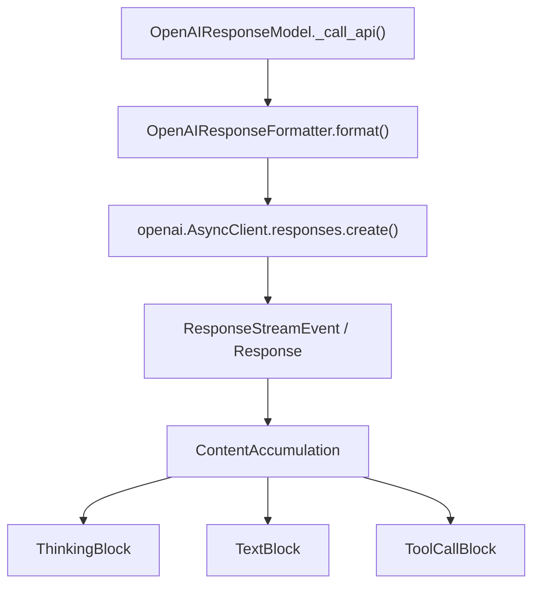
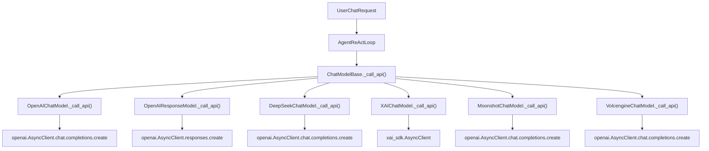
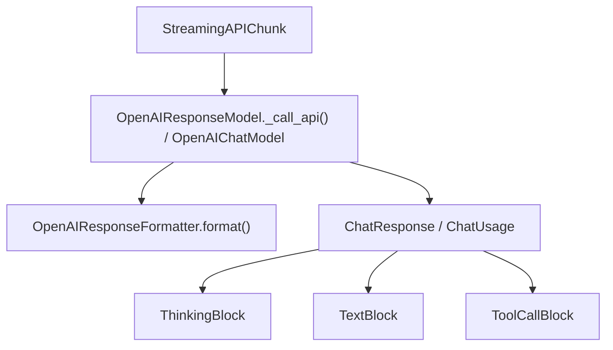
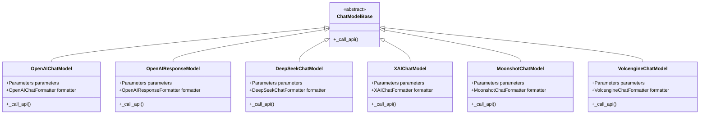

<!-- source: DeepWiki mcp.deepwiki.com · repo modelscope/agentscope · page 3.3 OpenAI and Compatible APIs · fetched 2026-10-27 -->

# OpenAI and Compatible APIs

Relevant source files

The following files were used as context for generating this wiki page:

- [src/agentscope/formatter/_openai_response_formatter.py](src/agentscope/formatter/_openai_response_formatter.py)
- [src/agentscope/model/_anthropic/_models/claude-opus-4-5.yaml](src/agentscope/model/_anthropic/_models/claude-opus-4-5.yaml)
- [src/agentscope/model/_anthropic/_models/claude-opus-4-6.yaml](src/agentscope/model/_anthropic/_models/claude-opus-4-6.yaml)
- [src/agentscope/model/_anthropic/_models/claude-opus-4-8.yaml](src/agentscope/model/_anthropic/_models/claude-opus-4-8.yaml)
- [src/agentscope/model/_anthropic/_models/claude-sonnet-4-5.yaml](src/agentscope/model/_anthropic/_models/claude-sonnet-4-5.yaml)
- [src/agentscope/model/_deepseek/_model.py](src/agentscope/model/_deepseek/_model.py)
- [src/agentscope/model/_moonshot/_model.py](src/agentscope/model/_moonshot/_model.py)
- [src/agentscope/model/_openai_chat/_models/gpt-4.1-mini.yaml](src/agentscope/model/_openai_chat/_models/gpt-4.1-mini.yaml)
- [src/agentscope/model/_openai_chat/_models/gpt-4.1-nano.yaml](src/agentscope/model/_openai_chat/_models/gpt-4.1-nano.yaml)
- [src/agentscope/model/_openai_chat/_models/gpt-4o-mini.yaml](src/agentscope/model/_openai_chat/_models/gpt-4o-mini.yaml)
- [src/agentscope/model/_openai_chat/_models/gpt-4o.yaml](src/agentscope/model/_openai_chat/_models/gpt-4o.yaml)
- [src/agentscope/model/_openai_chat/_models/gpt-5.5.yaml](src/agentscope/model/_openai_chat/_models/gpt-5.5.yaml)
- [src/agentscope/model/_openai_response/_model.py](src/agentscope/model/_openai_response/_model.py)
- [src/agentscope/model/_volcengine/_model.py](src/agentscope/model/_volcengine/_model.py)
- [tests/formatter_openai_response_test.py](tests/formatter_openai_response_test.py)
- [tests/formatter_openai_response_tool_result_test.py](tests/formatter_openai_response_tool_result_test.py)
- [tests/model_deepseek_test.py](tests/model_deepseek_test.py)
- [tests/model_moonshot_test.py](tests/model_moonshot_test.py)
- [tests/model_openai_response_test.py](tests/model_openai_response_test.py)
- [tests/model_volcengine_test.py](tests/model_volcengine_test.py)

This page documents the OpenAI model integration suite in AgentScope, covering the standard `OpenAIChatModel`, the specialized `OpenAIResponseModel` for the Responses API (including reasoning items and allowed tools), native gRPC integration for xAI via `XAIChatModel`, specialized parameters for DeepSeek and Moonshot, and OpenAI-compatible integration patterns for providers like Volcengine.

---

## Overview

The OpenAI integration layer provides unified chat model adapters built on top of `ChatModelBase`. AgentScope supports the **Responses API** via `OpenAIResponseModel` for models like `o3` and `o4-mini`, alongside native gRPC integration for xAI (`XAIChatModel`), specialized parameters for DeepSeek and Moonshot, and flexible compatibility options for providers such as Volcengine.

| Component | File Path | Purpose |
|-----------|-----------|---------|
| `OpenAIChatModel` | [src/agentscope/model/_openai_chat/_model.py:38-112]() | Standard Chat Completions API wrapper with audio/image support and OpenAI-compatible endpoints. |
| `OpenAIResponseModel` | [src/agentscope/model/_openai_response/_model.py:53-104]() | Responses API wrapper with native thinking support and `reasoning_item_id`. |
| `DeepSeekChatModel` | [src/agentscope/model/_deepseek/_model.py:26-76]() | DeepSeek integration with thinking mode (`reasoning_content`) and structured output fallbacks. |
| `XAIChatModel` | [src/agentscope/model/_xai/_model.py:30-91]() | xAI integration using the official gRPC client (`xai_sdk`). |
| `MoonshotChatModel` | [src/agentscope/model/_moonshot/_model.py:26-76]() | Moonshot (Kimi K2/K3) integration with reasoning effort and Kimi-specific parameters. |
| `VolcengineChatModel` | [src/agentscope/model/_volcengine/_model.py:27-78]() | Volcengine Ark integration supporting Ark-specific reasoning effort and thinking parameters. |

Sources: [src/agentscope/model/_openai_chat/_model.py:38-112](), [src/agentscope/model/_openai_response/_model.py:53-104](), [src/agentscope/model/_deepseek/_model.py:26-76](), [src/agentscope/model/_xai/_model.py:30-91](), [src/agentscope/model/_moonshot/_model.py:26-76](), [src/agentscope/model/_volcengine/_model.py:27-78]()

---

## Model Implementations

### OpenAIChatModel (Chat Completions)

`OpenAIChatModel` implements the standard OpenAI Chat Completions API via `openai.AsyncClient` [src/agentscope/model/_openai_chat/_model.py:170-177](). It supports multimodal inputs (images and audio) and parallel tool calling.

**Key Parameters:**
- `thinking_enable`: Whether to enable reasoning for reasoning models (e.g., `o3`, `o4-mini`) [src/agentscope/model/_openai_chat/_model.py:51-60]().
- `reasoning_effort`: Controls the depth of reasoning (`none`, `minimal`, `low`, `medium`, `high`, `xhigh`) [src/agentscope/model/_openai_chat/_model.py:61-72]().
- `parallel_tool_calls`: Whether to enable parallel tool calls [src/agentscope/model/_openai_chat/_model.py:90-94]().
- `voice`: Specifies the voice for audio output on omni-style models, implicitly configuring `modalities` [src/agentscope/model/_openai_chat/_model.py:96-109]().

Sources: [src/agentscope/model/_openai_chat/_model.py:38-177]()

### OpenAIResponseModel (Responses API)

`OpenAIResponseModel` utilizes OpenAI's newer Responses API (`client.responses.create`). This API provides first-class streaming events for reasoning, text output, and function-call arguments, making it ideal for reasoning models like `o3` and `o4-mini`.
The `OpenAIResponseModel.Parameters` class defines specific parameters for this model, including `max_tokens`, `thinking_enable`, and `reasoning_effort` [src/agentscope/model/_openai_response/_model.py:62-101](). The `_dump_reasoning_item` function serializes reasoning items for history replay, excluding `null` values to prevent API rejection [src/agentscope/model/_openai_response/_model.py:32-50](). The model uses `OpenAICredential` for authentication and `OpenAIResponseFormatter` for message formatting [src/agentscope/model/_openai_response/_model.py:106-163]().

Title: "OpenAI Responses API Execution Flow"

Sources: [src/agentscope/model/_openai_response/_model.py:32-163](), [tests/model_openai_response_test.py:177-193]()

### DeepSeekChatModel

`DeepSeekChatModel` integrates DeepSeek models using an OpenAI-compatible client [src/agentscope/model/_deepseek/_model.py:130-136](). It natively supports a thinking mode where chain-of-thought reasoning is returned before the final answer via the `reasoning_content` field.

**Key Parameters:**
- `thinking_enable`: Enables the reasoning chain output [src/agentscope/model/_deepseek/_model.py:39-47]().
- `reasoning_effort`: Controls reasoning depth (`high`, `max`), with compatibility mappings for standard effort levels [src/agentscope/model/_deepseek/_model.py:49-58]().

Sources: [src/agentscope/model/_deepseek/_model.py:26-136]()

### XAIChatModel (gRPC xai_sdk)

`XAIChatModel` connects to xAI models using the official gRPC `xai_sdk` client rather than the REST endpoint [src/agentscope/model/_xai/_model.py:30-37](). This provides native access to server-side agentic tools (such as web search and code execution) and advanced reasoning controls.

**Implementation Details:**
- Uses `xai_sdk.AsyncClient` for gRPC transport [src/agentscope/model/_xai/_model.py:160-168]().
- Uses `XAIChatFormatter` to map `Msg` objects to `xai_sdk` proto messages [src/agentscope/model/_xai/_model.py:144-145]().
- Supports `reasoning_effort` for models like `grok-3-mini` (`low`, `medium`, `high`) [src/agentscope/model/_xai/_model.py:60-70]().

Sources: [src/agentscope/model/_xai/_model.py:30-91](), [src/agentscope/model/_xai/_model.py:160-185]()

### MoonshotChatModel (Kimi K2/K3)

`MoonshotChatModel` provides integration with Moonshot AI models (including Kimi K2 and K3 series) via an OpenAI-compatible interface [src/agentscope/model/_moonshot/_model.py:130-135]().

**Key Features:**
- `thinking_enable`: Toggles thinking mode (always enabled for `kimi-k2-thinking`) [src/agentscope/model/_moonshot/_model.py:39-47]().
- `reasoning_effort`: Supports `low`, `high`, and `max` reasoning effort levels specifically for `kimi-k3` [src/agentscope/model/_moonshot/_model.py:49-57]().

Sources: [src/agentscope/model/_moonshot/_model.py:26-135]()

### VolcengineChatModel (Ark Engine)

`VolcengineChatModel` connects to Volcengine Ark models via an OpenAI-compatible interface [src/agentscope/model/_volcengine/_model.py:132-138]().

**Key Parameters:**
- `thinking_enable`: Enables or disables thinking mode; when unset, Ark uses its default auto mode [src/agentscope/model/_volcengine/_model.py:40-47]().
- `reasoning_effort`: Controls reasoning depth (`minimal`, `low`, `medium`, `high`), where `minimal` disables reasoning [src/agentscope/model/_volcengine/_model.py:49-59]().

Sources: [src/agentscope/model/_volcengine/_model.py:27-138]()

---

## Request Routing and Code Architecture

This section bridges natural language concepts (such as user chat requests and streaming responses) directly to their implementation entities in code.

Title: "NLP Request Dispatching to Model Implementations"

Sources: [src/agentscope/model/_openai_chat/_model.py:38](), [src/agentscope/model/_openai_response/_model.py:53](), [src/agentscope/model/_deepseek/_model.py:26](), [src/agentscope/model/_moonshot/_model.py:26](), [src/agentscope/model/_volcengine/_model.py:27](), [src/agentscope/model/_xai/_model.py:30]()

Title: "Streaming Response Parsing and Block Accumulation"

Sources: [src/agentscope/model/_openai_chat/_model.py:38](), [src/agentscope/model/_openai_response/_model.py:53](), [src/agentscope/formatter/_openai_response_formatter.py:162]()

---

## Technical Architecture

Title: "OpenAI and Compatible Provider Class Hierarchy"

Sources: [src/agentscope/model/_openai_chat/_model.py:38](), [src/agentscope/model/_openai_response/_model.py:53](), [src/agentscope/model/_deepseek/_model.py:26](), [src/agentscope/model/_xai/_model.py:30](), [src/agentscope/model/_moonshot/_model.py:26](), [src/agentscope/model/_volcengine/_model.py:27]()

---

