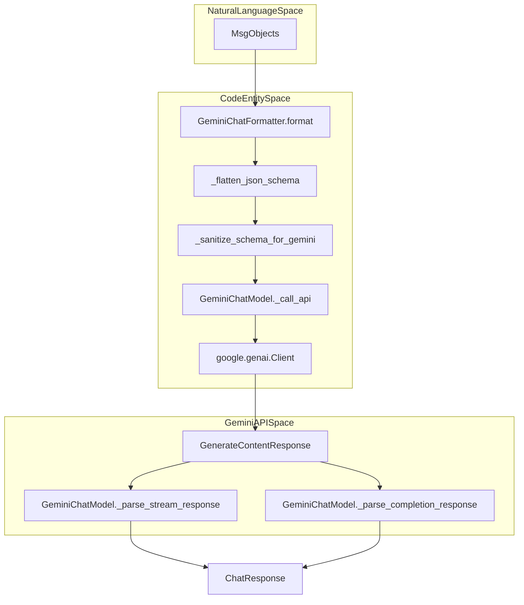
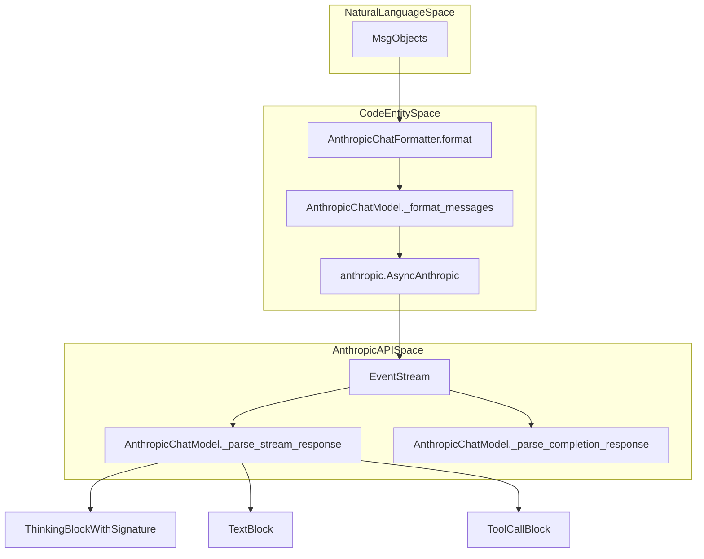

<!-- source: DeepWiki mcp.deepwiki.com · repo modelscope/agentscope · page 3.4 Gemini and Anthropic Integrations · fetched 2026-10-27 -->

# Gemini and Anthropic Integrations

Relevant source files

The following files were used as context for generating this wiki page:

- [src/agentscope/model/_anthropic/_model.py](src/agentscope/model/_anthropic/_model.py)
- [src/agentscope/model/_dashscope/_model.py](src/agentscope/model/_dashscope/_model.py)
- [src/agentscope/model/_gemini/_model.py](src/agentscope/model/_gemini/_model.py)
- [src/agentscope/model/_ollama/_model.py](src/agentscope/model/_ollama/_model.py)
- [src/agentscope/model/_ollama/_models/llama3.2-3b.yaml](src/agentscope/model/_ollama/_models/llama3.2-3b.yaml)
- [src/agentscope/model/_ollama/_models/phi4-mini.yaml](src/agentscope/model/_ollama/_models/phi4-mini.yaml)
- [src/agentscope/model/_ollama/_models/qwen3-8b.yaml](src/agentscope/model/_ollama/_models/qwen3-8b.yaml)
- [src/agentscope/model/_xai/_model.py](src/agentscope/model/_xai/_model.py)
- [tests/model_anthropic_test.py](tests/model_anthropic_test.py)
- [tests/model_dashscope_test.py](tests/model_dashscope_test.py)
- [tests/model_gemini_test.py](tests/model_gemini_test.py)
- [tests/model_ollama_test.py](tests/model_ollama_test.py)
- [tests/model_xai_test.py](tests/model_xai_test.py)

This page details the technical implementation and architecture of Google Gemini, Anthropic Claude, and Ollama chat models in AgentScope 2.0. It covers provider-specific mechanisms including Gemini's JSON schema sanitization and thinking parts translation, Anthropic's event-based streaming and thinking signatures, and Ollama's local async client execution.

---

## 1. Gemini Integration (`GeminiChatModel`)

The Gemini integration relies on the `google-genai` SDK via `GeminiChatModel` [src/agentscope/model/_gemini/_model.py:143](), translating between AgentScope's block-based message format and Gemini's part-based content structures.

### Architecture and Data Flow

Title: "Gemini Message and Schema Processing"

Sources: [src/agentscope/model/_gemini/_model.py:143-284](), [src/agentscope/_utils/_common.py:11]()

### Key Implementation Details

- **JSON Schema Flattening**: Gemini tool declarations do not support `$defs` or `$ref` schemas. The `_flatten_json_schema` utility [src/agentscope/_utils/_common.py:11]() inline-resolves these definitions.
- **Schema Sanitization**: The `_sanitize_schema_for_gemini` function [src/agentscope/model/_gemini/_model.py:33-140]() sanitizes schemas by removing `$schema` and `additionalProperties` [src/agentscope/model/_gemini/_model.py:97](), converting `const` keywords into single-value `enum` arrays [src/agentscope/model/_gemini/_model.py:101-103](), and simplifying nullable type arrays or `anyOf` unions [src/agentscope/model/_gemini/_model.py:106-123]().
- **Thinking Mode**: Configured via `thinking_enable` and `thinking_budget` inside `GeminiChatModel.Parameters` [src/agentscope/model/_gemini/_model.py:156-167](). Reasoning segments returned by the API map directly to `ThinkingBlock` instances [src/agentscope/message:16]() [tests/model_gemini_test.py:41-59]().
- **Tool Calling**: Tool definitions are formatted through `_format_tools` [src/agentscope/model/_gemini/_model.py:284](), and incoming function calls are parsed into `ToolCallBlock` objects [tests/model_gemini_test.py:154-187]().

Sources: [src/agentscope/model/_gemini/_model.py:33-284](), [src/agentscope/_utils/_common.py:11](), [tests/model_gemini_test.py:41-187]()

---

## 2. Anthropic Integration (`AnthropicChatModel`)

The Anthropic integration connects to the Claude model series through `AnthropicChatModel` [src/agentscope/model/_anthropic/_model.py:27](), implementing extended thinking, event-driven streaming, and prompt caching tracking.

### Architecture and Data Flow

Title: "Anthropic Message Processing Flow"

Sources: [src/agentscope/model/_anthropic/_model.py:27-230]()

### Key Implementation Details

- **System Prompt Separation**: Anthropic expects system instructions as a separate top-level parameter rather than an interleaved message role. `AnthropicChatModel` isolates system messages during formatting [src/agentscope/model/_anthropic/_model.py:230]().
- **Extended Thinking Controls**: Supports `thinking_mode` (`adaptive`, `enabled`, `disabled`), `thinking_display`, and `reasoning_effort` [src/agentscope/model/_anthropic/_model.py:59-96](). Validation logic ensures `max_tokens` accommodates the configured thinking budget [src/agentscope/model/_anthropic/_model.py:215-224]().
- **Thinking Signatures**: Retains cryptographic `signature` properties on `ThinkingBlock` elements to preserve multi-turn reasoning continuity [tests/model_anthropic_test.py:51]() [tests/model_anthropic_test.py:198]().
- **Cache Tracking**: Captures prompt caching metrics (`cache_read_input_tokens` and `cache_creation_input_tokens`) via `ChatUsage` [src/agentscope/model/_model_usage.py:20-21]() [tests/model_anthropic_test.py:73-74]().
- **Event-Driven Streaming**: Parses streaming deltas across events like `message_start`, `content_block_start`, `content_block_delta`, and `message_delta` [tests/model_anthropic_test.py:6-7]().

Sources: [src/agentscope/model/_anthropic/_model.py:27-230](), [tests/model_anthropic_test.py:6-198]()

---

## 3. Ollama Integration (`OllamaChatModel`)

The `OllamaChatModel` [src/agentscope/model/_ollama/_model.py:25]() interfaces with locally hosted open-weights models via the `ollama` Python package.

### Implementation and Features

- **Parameter Mapping**: Translates standard configuration fields such as `max_tokens` into Ollama's `num_predict` option, along with `temperature` and `thinking_enable` [src/agentscope/model/_ollama/_model.py:31-43]().
- **Thinking and Reasoning**: Configures reasoning flags (`think`) for reasoning-capable models like DeepSeek-R1 during `client.chat` execution [src/agentscope/model/_ollama/_model.py:176]().
- **Tool Execution**: Parses model tool invocations into `ToolCallBlock` instances, accepting arguments natively as dictionaries [src/agentscope/message:15]() [tests/model_ollama_test.py:51-52]().
- **Async Streaming**: Leverages `ollama.AsyncClient` iterators to progressively stream and aggregate responses [src/agentscope/model/_ollama/_model.py:114]() [src/agentscope/model/_ollama/_model.py:189]().

Sources: [src/agentscope/model/_ollama/_model.py:25-191](), [tests/model_ollama_test.py:51-52]()

---

## 4. Provider Feature Matrix

| Feature | Gemini (`GeminiChatModel`) | Anthropic (`AnthropicChatModel`) | Ollama (`OllamaChatModel`) |
| :--- | :--- | :--- | :--- |
| **Thinking Block** | `thought: true` part [tests/model_gemini_test.py:50]() | `thinking` block + `signature` [tests/model_anthropic_test.py:50-51]() | `think: true` flag [src/agentscope/model/_ollama/_model.py:176]() |
| **Streaming Mechanism** | Async Iterator [tests/model_gemini_test.py:111]() | Event-based [tests/model_anthropic_test.py:6]() | Async Iterator [tests/model_ollama_test.py:101]() |
| **System Prompt Handling** | Content part / Configuration | Top-level parameter [src/agentscope/model/_anthropic/_model.py:230]() | System role message |
| **Tool Choice Mode** | `tool_config` [src/agentscope/model/_gemini/_model.py:284]() | `tool_choice` parameter [src/agentscope/model/_anthropic/_model.py:228]() | `tools` list argument [src/agentscope/model/_ollama/_model.py:183]() |

Sources: [src/agentscope/model/_gemini/_model.py:143-284](), [src/agentscope/model/_anthropic/_model.py:27-230](), [src/agentscope/model/_ollama/_model.py:25-191](), [tests/model_gemini_test.py:50-111](), [tests/model_anthropic_test.py:6-51]()

---

