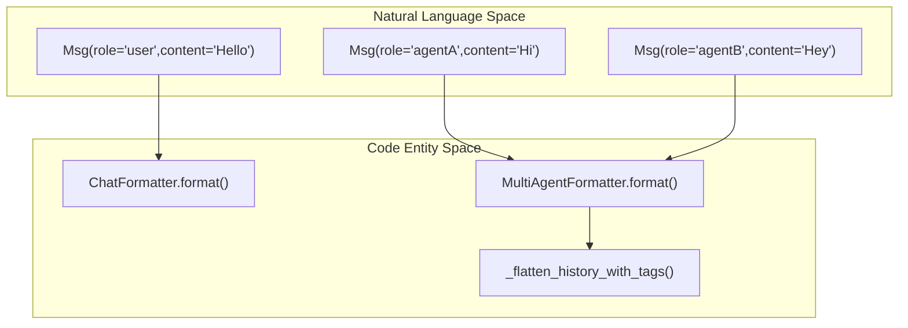
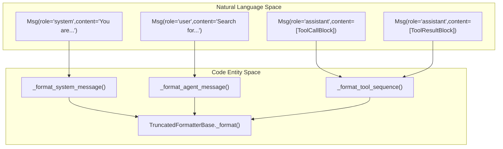
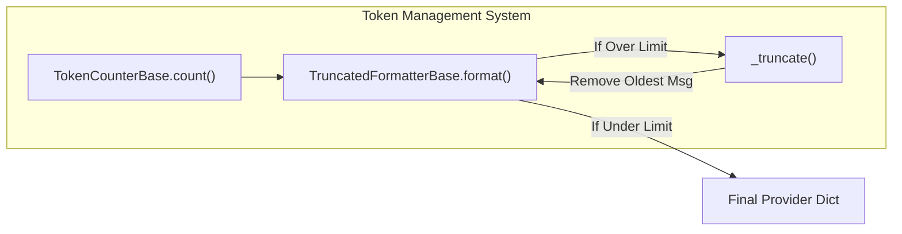

<!-- source: DeepWiki mcp.deepwiki.com · repo modelscope/agentscope · page 3.5 Message Formatters · fetched 2026-10-27 -->

# Message Formatters

Relevant source files

The following files were used as context for generating this wiki page:

- [src/agentscope/formatter/_anthropic_formatter.py](src/agentscope/formatter/_anthropic_formatter.py)
- [src/agentscope/formatter/_dashscope_formatter.py](src/agentscope/formatter/_dashscope_formatter.py)
- [src/agentscope/formatter/_deepseek_formatter.py](src/agentscope/formatter/_deepseek_formatter.py)
- [src/agentscope/formatter/_formatter_base.py](src/agentscope/formatter/_formatter_base.py)
- [src/agentscope/formatter/_gemini_formatter.py](src/agentscope/formatter/_gemini_formatter.py)
- [src/agentscope/formatter/_moonshot_formatter.py](src/agentscope/formatter/_moonshot_formatter.py)
- [src/agentscope/formatter/_ollama_formatter.py](src/agentscope/formatter/_ollama_formatter.py)
- [src/agentscope/formatter/_openai_formatter.py](src/agentscope/formatter/_openai_formatter.py)
- [src/agentscope/formatter/_xai_formatter.py](src/agentscope/formatter/_xai_formatter.py)
- [tests/formatter_anthropic_test.py](tests/formatter_anthropic_test.py)
- [tests/formatter_dashscope_test.py](tests/formatter_dashscope_test.py)
- [tests/formatter_deepseek_test.py](tests/formatter_deepseek_test.py)
- [tests/formatter_gemini_test.py](tests/formatter_gemini_test.py)
- [tests/formatter_moonshot_test.py](tests/formatter_moonshot_test.py)
- [tests/formatter_ollama_test.py](tests/formatter_ollama_test.py)
- [tests/formatter_openai_chat_test.py](tests/formatter_openai_chat_test.py)
- [tests/formatter_xai_test.py](tests/formatter_xai_test.py)

## Purpose and Scope

Message Formatters convert AgentScope's internal `Msg` objects into provider-specific API formats. They bridge AgentScope's multimodal message protocol (`Msg`, `DataBlock`, `TextBlock`, `ThinkingBlock`, `ToolCallBlock`, `ToolResultBlock`) and the JSON payload conventions of external LLM services.

Key responsibilities include:
- **Format Conversion**: Transforming message blocks into API-specific schemas (e.g., OpenAI content parts, Gemini `parts`, Anthropic `content` blocks) `[src/agentscope/formatter/_openai_formatter.py:30-78]`, `[src/agentscope/formatter/_gemini_formatter.py:32-62]`, `[src/agentscope/formatter/_anthropic_formatter.py:33-124]`.
- **Context Truncation**: Managing context window limits using token counting and FIFO truncation strategies `[src/agentscope/formatter/_truncated_formatter_base.py:18-82]`.
- **Multi-Agent History Flattening**: Consolidating multi-agent conversation histories into standard user-assistant chat APIs via `<history>` tags and prompt prefixes `[src/agentscope/formatter/_formatter_base.py:20-46]`.
- **Multimodal Handling**: Processing `DataBlock` sources (URLs, base64 strings, local `file://` URIs) into inline data URIs or multipart payloads `[src/agentscope/formatter/_openai_formatter.py:80-121]`, `[src/agentscope/formatter/_gemini_formatter.py:64-110]`.

Sources: `[src/agentscope/formatter/_formatter_base.py:20-46]`, `[src/agentscope/formatter/_truncated_formatter_base.py:18-51]`

---

## Formatter Architecture

AgentScope implements a class hierarchy rooted at `FormatterBase` and extended by `TruncatedFormatterBase`.

### Formatter Hierarchy

Title: "MessageFormatterClassHierarchy"

```mermaid
graph TB
    subgraph BaseAbstractions["Base Abstractions"]
    FormatterBase["FormatterBase"]
    TruncatedFormatterBase["TruncatedFormatterBase"]
    end
    
    subgraph ChatFormatterImplementations["Chat Formatter Implementations"]
    OpenAIChatFormatter["OpenAIChatFormatter"]
    OpenAIResponseFormatter["OpenAIResponseFormatter"]
    DashScopeChatFormatter["DashScopeChatFormatter"]
    AnthropicChatFormatter["AnthropicChatFormatter"]
    GeminiChatFormatter["GeminiChatFormatter"]
    OllamaChatFormatter["OllamaChatFormatter"]
    MoonshotChatFormatter["MoonshotChatFormatter"]
    DeepSeekChatFormatter["DeepSeekChatFormatter"]
    VolcengineChatFormatter["VolcengineChatFormatter"]
    XAIChatFormatter["XAIChatFormatter"]
    end
    
    subgraph MultiAgentFormatterImplementations["Multi-Agent Formatter Implementations"]
    OpenAIMultiAgentFormatter["OpenAIMultiAgentFormatter"]
    DashScopeMultiAgentFormatter["DashScopeMultiAgentFormatter"]
    AnthropicMultiAgentFormatter["AnthropicMultiAgentFormatter"]
    GeminiMultiAgentFormatter["GeminiMultiAgentFormatter"]
    OllamaMultiAgentFormatter["OllamaMultiAgentFormatter"]
    MoonshotMultiAgentFormatter["MoonshotMultiAgentFormatter"]
    DeepSeekMultiAgentFormatter["DeepSeekMultiAgentFormatter"]
    VolcengineMultiAgentFormatter["VolcengineMultiAgentFormatter"]
    XAIMultiAgentFormatter["XAIMultiAgentFormatter"]
    end
    
    FormatterBase --> TruncatedFormatterBase
    TruncatedFormatterBase --> OpenAIChatFormatter
    TruncatedFormatterBase --> OpenAIResponseFormatter
    TruncatedFormatterBase --> DashScopeChatFormatter
    TruncatedFormatterBase --> AnthropicChatFormatter
    TruncatedFormatterBase --> GeminiChatFormatter
    TruncatedFormatterBase --> OllamaChatFormatter
    TruncatedFormatterBase --> MoonshotChatFormatter
    TruncatedFormatterBase --> DeepSeekChatFormatter
    TruncatedFormatterBase --> VolcengineChatFormatter
    TruncatedFormatterBase --> XAIChatFormatter
    
    TruncatedFormatterBase --> OpenAIMultiAgentFormatter
    TruncatedFormatterBase --> DashScopeMultiAgentFormatter
    TruncatedFormatterBase --> AnthropicMultiAgentFormatter
    TruncatedFormatterBase --> GeminiMultiAgentFormatter
    TruncatedFormatterBase --> OllamaMultiAgentFormatter
    TruncatedFormatterBase --> MoonshotMultiAgentFormatter
    TruncatedFormatterBase --> DeepSeekMultiAgentFormatter
    TruncatedFormatterBase --> VolcengineMultiAgentFormatter
    TruncatedFormatterBase --> XAIMultiAgentFormatter
```

Sources: `src/agentscope/formatter/_formatter_base.py`, `src/agentscope/formatter/_truncated_formatter_base.py`, `src/agentscope/formatter/_openai_formatter.py`, `src/agentscope/formatter/_dashscope_formatter.py`, `src/agentscope/formatter/_anthropic_formatter.py`, `src/agentscope/formatter/_gemini_formatter.py`, `src/agentscope/formatter/_ollama_formatter.py`, `src/agentscope/formatter/_moonshot_formatter.py`, `src/agentscope/formatter/_deepseek_formatter.py`, `src/agentscope/formatter/_volcengine_formatter.py`, `src/agentscope/formatter/_xai_formatter.py`

### Base Class Responsibilities

| Class | Location | Key Functionality |
|-------|----------|-------------------|
| `FormatterBase` | `src/agentscope/formatter/_formatter_base.py` | Defines the abstract `format(msgs)` interface, input validation via `assert_list_of_msgs()`, and `convert_tool_result_to_string()` for text-only tool fallbacks `[src/agentscope/formatter/_formatter_base.py:20-173]`. |
| `TruncatedFormatterBase` | `src/agentscope/formatter/_truncated_formatter_base.py` | Integrates token limit enforcement and FIFO message dropping prior to provider-specific serialization `[src/agentscope/formatter/_truncated_formatter_base.py:18-112]`. |

Sources: `[src/agentscope/formatter/_formatter_base.py:20-173]`, `[src/agentscope/formatter/_truncated_formatter_base.py:18-112]`

---

## Formatter Patterns: Chat vs. Multi-Agent

Formatters handle conversation structure differently depending on whether they operate in a single-agent chat setting or a multi-agent team environment.

### ChatFormatter Pattern
Designed for single-agent chat scenarios where participants are strictly a user and an assistant `[src/agentscope/formatter/_openai_formatter.py:189-193]`.
- **Role Mapping**: Maps `Msg.role` directly to API roles (`user`, `assistant`, `system`) `[src/agentscope/formatter/_openai_formatter.py:189-217]`.
- **Block Iteration**: Processes content blocks (`TextBlock`, `DataBlock`, `ThinkingBlock`, `ToolCallBlock`, `ToolResultBlock`) sequentially `[src/agentscope/formatter/_anthropic_formatter.py:33-172]`.

### MultiAgentFormatter Pattern
Designed for multi-agent settings where messages originate from various named agents.
- **History Consolidation**: Flattens peer messages into a unified `user` role payload encapsulated within XML `<history>` tags `[tests/formatter_ollama_test.py:127-162]`.
- **Prompt Prefixing**: Injects `conversation_history_prompt` to provide role and identity context to the LLM `[tests/formatter_ollama_test.py:31-35]`.

Title: "ChatVsMultiAgentBridgeSpace"

Sources: `[src/agentscope/formatter/_formatter_base.py:20-46]`, `[tests/formatter_ollama_test.py:31-162]`

---

## ReAct-Oriented Formatting Logic

Formatters serialize interleaved reasoning, tool invocation, and execution outputs during ReAct agent executions.

### Message Sequence Processing

`TruncatedFormatterBase` segments conversation histories into:
1. **System Prompt**: Initialization directives `[src/agentscope/formatter/_truncated_formatter_base.py:84-88]`.
2. **Conversation Turns**: User requests and agent responses `[src/agentscope/formatter/_truncated_formatter_base.py:90-94]`.
3. **Tool Sequences**: `ToolCallBlock` objects paired with corresponding `ToolResultBlock` entries `[src/agentscope/formatter/_truncated_formatter_base.py:96-103]`.

Title: "ReActMessageMappingToCodeEntities"

Sources: `[src/agentscope/formatter/_truncated_formatter_base.py:84-112]`, `[src/agentscope/formatter/_openai_formatter.py:203-217]`

---

## Provider-Specific Implementations

### OpenAI & OpenAIResponse Formatters
- **OpenAIChatFormatter**: Formats multimodal content using `image_url` and `input_audio` types. Local `file://` URLs are loaded and base64-encoded; remote URLs pass through unaltered `[src/agentscope/formatter/_openai_formatter.py:80-121]`. Audio inputs support `wav` and `mp3` formats `[src/agentscope/formatter/_openai_formatter.py:139-150]`.
- **OpenAIResponseFormatter**: Targets OpenAI's Responses API (`o3`, `o4-mini`), mapping `TextBlock` to `input_text`/`output_text` and preserving `ThinkingBlock` metadata via `reasoning_item_id` `[src/agentscope/formatter/_openai_response_formatter.py:169-174]`.

Sources: `[src/agentscope/formatter/_openai_formatter.py:27-184]`, `src/agentscope/formatter/_openai_response_formatter.py`

### DashScope Formatter
Extends OpenAI-compatible specifications with `video_url` support and `application/x-thinking` reasoning content integration `[src/agentscope/formatter/_dashscope_formatter.py:27-62]`, `[src/agentscope/formatter/_dashscope_formatter.py:144-170]`.

Sources: `[src/agentscope/formatter/_dashscope_formatter.py:27-176]`

### Gemini Formatter
Utilizes a `parts` list structure per message dictionary `[src/agentscope/formatter/_gemini_formatter.py:150-155]`.
- **Thinking**: Marks reasoning content with `{"thought": True, "text": ...}` while filtering out empty reasoning parts `[src/agentscope/formatter/_gemini_formatter.py:199-203]`.
- **Tool Results**: Serializes tool output into `function_response` parts under `role="user"` messages `[tests/formatter_gemini_test.py:111-167]`.

Sources: `[src/agentscope/formatter/_gemini_formatter.py:28-203]`, `[tests/formatter_gemini_test.py:111-167]`

### Anthropic Formatter
Strictly requires cryptographic signatures on `thinking` blocks; unsigned thinking blocks from non-Anthropic providers are dropped to prevent API validation errors `[src/agentscope/formatter/_anthropic_formatter.py:85-124]`.
- **Tool Use**: Serializes `ToolCallBlock` into `tool_use` elements with dictionary inputs repaired via `_json_loads_with_repair` `[src/agentscope/formatter/_anthropic_formatter.py:164-172]`.
- **Role Enforcement**: Forces `role="user"` when handling `ToolResultBlock` sequences `[src/agentscope/formatter/_anthropic_formatter.py:60-73]`.

Sources: `[src/agentscope/formatter/_anthropic_formatter.py:28-172]`, `[tests/formatter_anthropic_test.py:150-174]`

### Ollama Formatter
- **Images**: Restricts binary data blocks to base64-encoded images `[src/agentscope/formatter/_ollama_formatter.py:61-100]`.
- **Tool Calls**: Formats tool call arguments as dictionaries rather than JSON strings `[tests/formatter_ollama_test.py:105-112]`.

Sources: `[src/agentscope/formatter/_ollama_formatter.py:28-100]`, `[tests/formatter_ollama_test.py:88-168]`

### Moonshot Formatter
- **OpenAI-Compatible**: Inherits from `_OpenAIFormatterBase` `[src/agentscope/formatter/_moonshot_formatter.py:63]`.
- **Preserved Thinking**: Specifically handles `ThinkingBlock` content by placing it into the `reasoning_content` field of assistant messages, which is crucial for Moonshot's "Preserved Thinking" feature in models like `kimi-k2.6` `[src/agentscope/formatter/_moonshot_formatter.py:141-143]`.
- **Media Handling**: Converts all media (images, videos) to base64 data URIs, downloading remote URLs if necessary, as Moonshot's vision API does not accept raw remote URLs `[src/agentscope/formatter/_moonshot_formatter.py:27-60]`.

Sources: `[src/agentscope/formatter/_moonshot_formatter.py:27-185]`, `[tests/formatter_moonshot_test.py:106-111]`

### DeepSeek Formatter
- **OpenAI-Compatible**: Inherits from `_OpenAIFormatterBase` `src/agentscope/formatter/_deepseek_formatter.py`.
- **Tool Calls**: Formats tool call arguments as dictionaries rather than JSON strings `src/agentscope/formatter/_deepseek_formatter.py`.

Sources: `src/agentscope/formatter/_deepseek_formatter.py`, `tests/formatter_deepseek_test.py`

### Volcengine Formatter
- **OpenAI-Compatible**: Inherits from `_OpenAIFormatterBase` `src/agentscope/formatter/_volcengine_formatter.py`.
- **Tool Calls**: Formats tool call arguments as dictionaries rather than JSON strings `src/agentscope/formatter/_volcengine_formatter.py`.

Sources: `src/agentscope/formatter/_volcengine_formatter.py`, `tests/formatter_volcengine_test.py`

### xAI Formatter
- **Protobuf Output**: Uniquely returns a list of `xai_sdk` protobuf `Message` objects instead of plain dictionaries, directly compatible with the `xai_sdk` gRPC client `[src/agentscope/formatter/_xai_formatter.py:121-146]`.
- **Image Handling**: Converts `DataBlock` images to `xai_sdk.chat.image` objects, handling both base64 and URL sources `[src/agentscope/formatter/_xai_formatter.py:70-98]`.
- **Thinking/Hint Blocks**: Silently skips `ThinkingBlock` and processes `HintBlock` by appending its content as user messages `[src/agentscope/formatter/_xai_formatter.py:165-179]`.

Sources: `[src/agentscope/formatter/_xai_formatter.py:10-190]`, `[tests/formatter_xai_test.py:35-108]`

---

## Token Truncation and FIFO Strategy

To prevent context window overflow, `TruncatedFormatterBase` applies a FIFO truncation workflow.

### Truncation Flow

Title: "ContextTruncationWorkflow"

Sources: `[src/agentscope/formatter/_truncated_formatter_base.py:47-82]`, `[src/agentscope/formatter/_truncated_formatter_base.py:150-177]`

---

