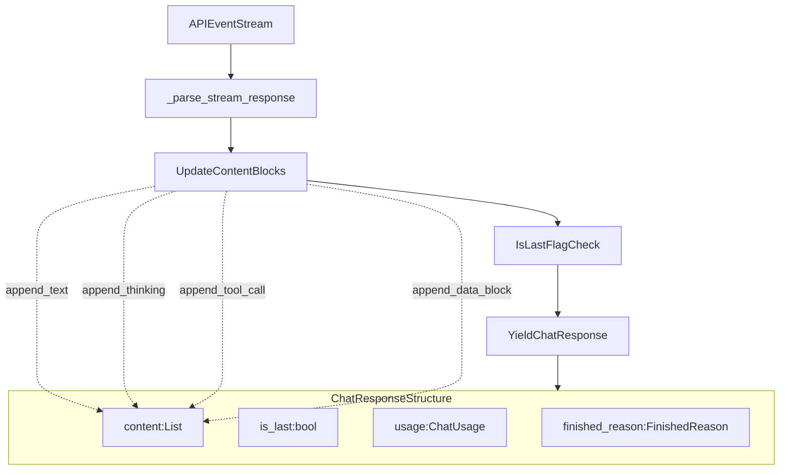
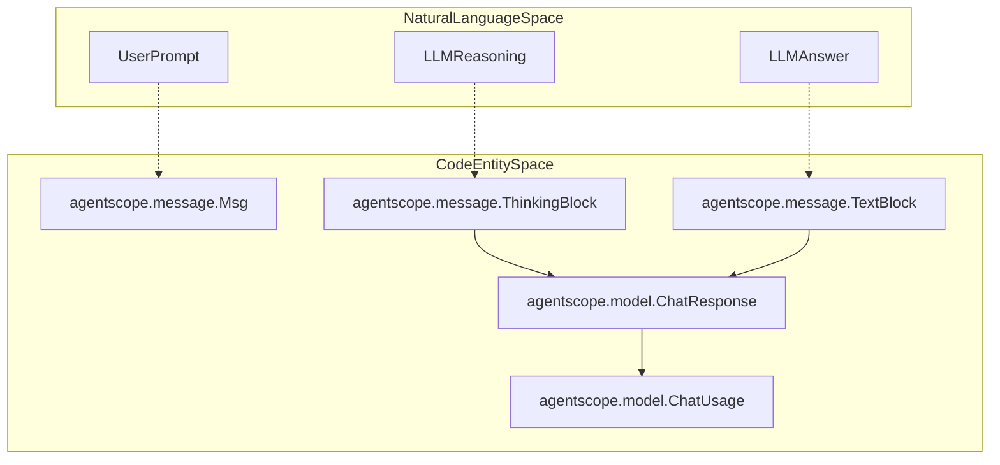
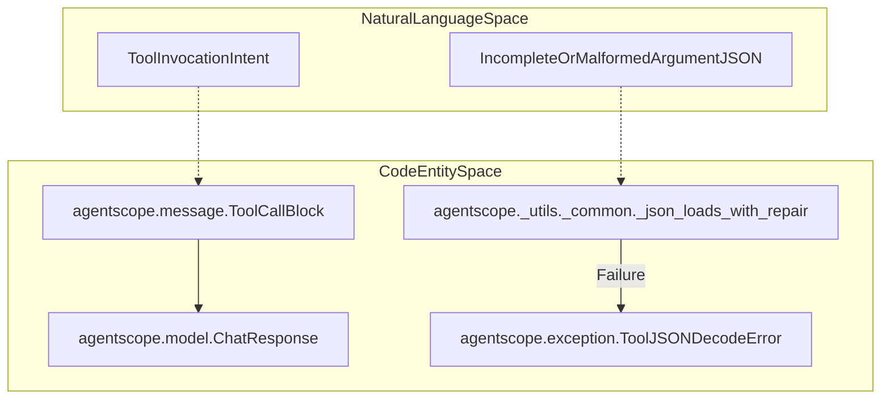

<!-- source: DeepWiki mcp.deepwiki.com · repo modelscope/agentscope · page 3.6 Streaming, Structured Output, and Tool Calling · fetched 2026-10-27 -->

# Streaming, Structured Output, and Tool Calling

Relevant source files

The following files were used as context for generating this wiki page:

- [examples/web_ui/frontend/src/components/dialog/MCPConfigForm.tsx](examples/web_ui/frontend/src/components/dialog/MCPConfigForm.tsx)
- [src/agentscope/_utils/_common.py](src/agentscope/_utils/_common.py)
- [src/agentscope/model/_model_response.py](src/agentscope/model/_model_response.py)
- [src/agentscope/state/_state.py](src/agentscope/state/_state.py)
- [src/agentscope/tool/_response.py](src/agentscope/tool/_response.py)
- [tests/agent_structured_output_test.py](tests/agent_structured_output_test.py)
- [tests/builtin_file_cache_test.py](tests/builtin_file_cache_test.py)
- [tests/model_response_test.py](tests/model_response_test.py)
- [tests/service_agent_interrupt_test.py](tests/service_agent_interrupt_test.py)
- [tests/tool_argument_repair_test.py](tests/tool_argument_repair_test.py)

This page details how AgentScope handles LLM responses across streaming and non-streaming execution modes. It covers the `ChatResponse` and `ChatUsage` data structures, structured output generation via Pydantic models, tool selection modes (`tool_choice`), JSON schema flattening, and schema-guided JSON argument repair.

---

## Streaming Execution and Response Structures

AgentScope implements a unified streaming architecture built around the accumulator pattern within `ChatModelBase`. Provider implementations parse incremental API stream chunks and update a cumulative `ChatResponse` object.

### The Accumulator Pattern and `ChatResponse`
During streaming execution, incoming chunks are accumulated into a single `ChatResponse` instance using specialized mutation methods:
- `append_text`: Accumulates text deltas into a `TextBlock` [src/agentscope/model/_model_response.py:68-83]().
- `append_thinking`: Accumulates reasoning deltas and extra provider-specific attributes (e.g. Anthropic signatures) into a `ThinkingBlock` [src/agentscope/model/_model_response.py:84-121]().
- `append_tool_call`: Accumulates incremental JSON argument strings into a `ToolCallBlock` [src/agentscope/model/_model_response.py:123-164]().
- `append_data_block`: Accumulates raw media bytes into a base64-encoded `DataBlock` [src/agentscope/model/_model_response.py:166-190]().

Title: "Streaming Accumulator Flow"

Sources: [src/agentscope/model/_base.py:182-198](), [src/agentscope/model/_model_response.py:32-190]()

### Response and Usage Classes
- **`ChatResponse`**: A dataclass inheriting from `DictMixin` that encapsulates response content blocks, the `is_last` flag, execution usage, and `FinishedReason` [src/agentscope/model/_model_response.py:32-67]().
- **`FinishedReason`**: An enumeration defining completion states (`COMPLETED` and `INTERRUPTED`) [src/agentscope/model/_model_response.py:21-29]().
- **`ChatUsage`**: Tracks consumption metrics including input tokens, output tokens, execution time, and cache statistics [src/agentscope/model/_model_usage.py:19-30]().

Sources: [src/agentscope/model/_model_response.py:32-67](), [src/agentscope/model/_model_usage.py:19-30](), [src/agentscope/model/_model_response.py:21-29]()

---

## Structured Output with Pydantic Models

AgentScope supports structured output by accepting Pydantic `BaseModel` classes at the agent call site.

### Schema Registration and State
The structured generation requirement is tracked within `ReplyContext`, which stores the target Pydantic model or raw JSON schema dictionary [src/agentscope/state/_state.py:182-196](). When a Pydantic class is supplied, `_serialize_structured_schema` serializes it via `.model_json_schema()` [src/agentscope/state/_state.py:197-203]().

To ensure compatibility across LLM providers, schemas undergo sanitization:
- Top-level and nested `title` attributes are stripped to prevent model confusion.
- Stringized type annotations are dynamically resolved using `typing.get_type_hints` under PEP 563.
- Provider-specific normalizations (such as Gemini's sanitization of `$schema`, `additionalProperties`, and `const` conversions) are applied [src/agentscope/model/_gemini/_model.py:33-140]().

Sources: [src/agentscope/state/_state.py:182-203](), [src/agentscope/model/_base.py:37-71](), [src/agentscope/model/_gemini/_model.py:33-140]()

---

## Tool Calling, ToolChoice Modes, and Schema Flattening

### ToolChoice Modes
The `tool_choice` configuration parameter controls how models select tools (`auto`, `none`, `required`, or explicit named tool enforcement) through validated literal modes defined in provider base modules [src/agentscope/model/_base.py:37-71]().

### Schema Flattening
Complex nested Pydantic structures used in tool argument definitions are flattened via `_flatten_json_schema()` to accommodate LLM APIs that do not support arbitrary nesting levels [src/agentscope/_utils/_common.py:400-435]().

Sources: [src/agentscope/model/_base.py:37-71](), [src/agentscope/_utils/_common.py:400-435]()

---

## JSON Argument Repair (`_json_loads_with_repair`)

Streaming tool calls frequently emit incomplete JSON payloads or argument types that violate the input schema (e.g. passing `"42"` where an integer is expected). AgentScope resolves this via `_json_loads_with_repair()` [src/agentscope/_utils/_common.py:95-123]().

### Repair Workflow
1. **Direct Parsing**: Attempts standard `json.loads()`. If a schema is present, type coercion is validated [src/agentscope/_utils/_common.py:130-141]().
2. **Schema-Guided Repair**: Utilizes `json_repair.repair_json()` with `stream_stable=True` and the provided `schema` to correct structural syntax and mismatched types [src/agentscope/_utils/_common.py:149-160]().
3. **Error Handling**: If repair fails or produces invalid JSON numbers (`NaN`, `Infinity`), a `ToolJSONDecodeError` exception containing diagnostic hints is raised, prompting the agent to self-correct in subsequent iterations [src/agentscope/_utils/_common.py:172-202]().

Sources: [src/agentscope/_utils/_common.py:95-202](), [tests/tool_argument_repair_test.py:61-143]()

---

## Code Entity Mappings

Title: "Natural Language to Code Entity Space - Response Blocks"

Sources: [src/agentscope/model/_model_response.py:32-67](), [src/agentscope/model/_model_usage.py:19-30]()

Title: "Natural Language to Code Entity Space - Tool Execution and Repair"

Sources: [src/agentscope/_utils/_common.py:95-202](), [tests/tool_argument_repair_test.py:123-142]()

---

