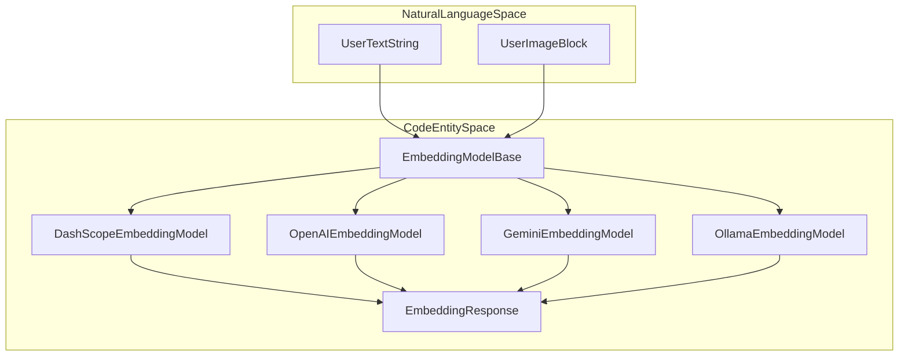
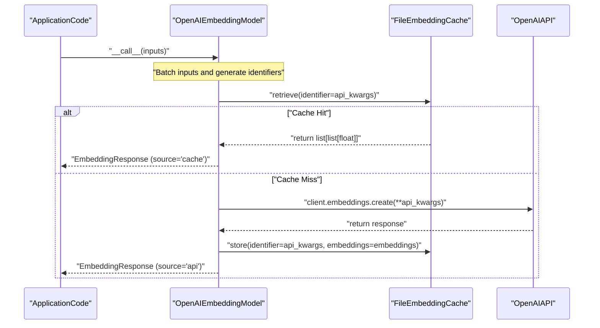
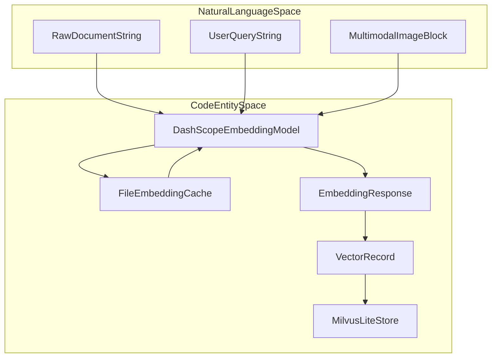

<!-- source: DeepWiki mcp.deepwiki.com · repo modelscope/agentscope · page 3.7 Embedding Models · fetched 2026-10-27 -->

# Embedding Models

Relevant source files

The following files were used as context for generating this wiki page:

- [src/agentscope/embedding/__init__.py](src/agentscope/embedding/__init__.py)
- [src/agentscope/embedding/_dashscope/_model.py](src/agentscope/embedding/_dashscope/_model.py)
- [src/agentscope/embedding/_embedding_base.py](src/agentscope/embedding/_embedding_base.py)
- [src/agentscope/embedding/_file_cache.py](src/agentscope/embedding/_file_cache.py)
- [src/agentscope/embedding/_gemini/_model.py](src/agentscope/embedding/_gemini/_model.py)
- [src/agentscope/embedding/_ollama/_model.py](src/agentscope/embedding/_ollama/_model.py)
- [src/agentscope/embedding/_openai/_model.py](src/agentscope/embedding/_openai/_model.py)
- [src/agentscope/tts/_openai/_model.py](src/agentscope/tts/_openai/_model.py)
- [tests/embedding_base_test.py](tests/embedding_base_test.py)
- [tests/embedding_dashscope_test.py](tests/embedding_dashscope_test.py)
- [tests/embedding_file_cache_test.py](tests/embedding_file_cache_test.py)
- [tests/embedding_gemini_test.py](tests/embedding_gemini_test.py)
- [tests/embedding_ollama_test.py](tests/embedding_ollama_test.py)
- [tests/embedding_openai_test.py](tests/embedding_openai_test.py)
- [tests/tts_openai_test.py](tests/tts_openai_test.py)

The embedding module in AgentScope provides a unified, production-ready interface for generating vector representations of text and multimodal data. It abstracts diverse model providers, handles automatic batching and retries, supports multimodal inputs (`str`, `DataBlock`, `TextBlock`), and implements a local caching layer to optimize performance and minimize API execution costs [src/agentscope/embedding/_embedding_base.py:20-31](). These models serve as the foundational vector transformation layer for Retrieval-Augmented Generation (RAG) and long-term memory subsystems.

Sources: [src/agentscope/embedding/_embedding_base.py:20-31]()

---

## 1. Architecture and Base Abstractions

All embedding implementations in AgentScope derive from a common base class, guaranteeing a uniform developer experience and consistent error handling across providers.

### EmbeddingModelBase
`EmbeddingModelBase` defines the core contract for all embedding models [src/agentscope/embedding/_embedding_base.py:34-52](). It uses generic input typing via `InputT` to handle both text (`str`, `TextBlock`) and multimodal (`DataBlock`) content [src/agentscope/embedding/_embedding_base.py:20-31]().
- **Automatic Batching**: The `__call__` method splits incoming payloads into chunks based on `batch_size`, dispatches them concurrently via `asyncio.gather`, and merges the resulting vectors [src/agentscope/embedding/_embedding_base.py:34-52]().
- **Retry Logic**: It wraps batch API calls with a retry mechanism [src/agentscope/embedding/_embedding_base.py:34-52](). Subclasses specify provider-specific transient errors by overriding `_get_retryable_exceptions` [src/agentscope/embedding/_embedding_base.py:50-52]().
- **Parameters and Dimensions**: `dimensions` is treated as a first-class required attribute on the instance rather than a tunable parameter [src/agentscope/embedding/_embedding_base.py:54-84](). Subclasses extend the nested `Parameters` class for non-dimensional settings (e.g., Gemini's `task_type`) [src/agentscope/embedding/_embedding_base.py:54-68]().

Sources: [src/agentscope/embedding/_embedding_base.py:20-164]()

### EmbeddingResponse and Usage
The output of an embedding operation is wrapped in an `EmbeddingResponse` instance [src/agentscope/embedding/_embedding_response.py:7-14]():
- `embeddings`: A list of float vectors [src/agentscope/embedding/_embedding_response.py:7-14]().
- `usage`: An `EmbeddingUsage` object recording token counts and elapsed execution time [src/agentscope/embedding/_embedding_usage.py:11]().
- `source`: Indicates whether the response originated from the `"api"` or the `"cache"` [src/agentscope/embedding/_embedding_response.py:7-14]().

Sources: [src/agentscope/embedding/_embedding_response.py:7-14](), [src/agentscope/embedding/_embedding_usage.py:11]()

### Embedding Input Processing Flow
The following diagram illustrates how inputs from the Natural Language Space flow through the framework into concrete embedding model implementations in the Code Entity Space.

**Embedding Input Processing Flow**

Sources: [src/agentscope/embedding/_embedding_base.py:20-89](), [src/agentscope/embedding/_dashscope/_model.py:91-103](), [src/agentscope/embedding/_openai/_model.py:16-43](), [src/agentscope/embedding/_gemini/_model.py:67-87](), [src/agentscope/embedding/_ollama/_model.py:15-24]()

---

## 2. Provider Implementations

AgentScope supports multiple model providers, each configured to handle specific API constraints, input payloads, and limits.

| Provider | Class | Input Type | Features |
| :--- | :--- | :--- | :--- |
| **DashScope** | `DashScopeEmbeddingModel` | `str \| DataBlock \| TextBlock` | Unified text and multimodal processing with content-aware batching [src/agentscope/embedding/_dashscope/_model.py:91-103](). |
| **OpenAI** | `OpenAIEmbeddingModel` | `str \| TextBlock` | Supports `text-embedding-3-small/large` and compatible endpoints with `pass_dimensions` control [src/agentscope/embedding/_openai/_model.py:16-43](). |
| **Gemini** | `GeminiEmbeddingModel` | `str \| TextBlock \| DataBlock` | Uses Google's `genai` SDK; supports multimodal inputs on `gemini-embedding-2` [src/agentscope/embedding/_gemini/_model.py:67-87](). |
| **Ollama** | `OllamaEmbeddingModel` | `str \| TextBlock` | Local model support via Ollama with host-aware caching identifiers [src/agentscope/embedding/_ollama/_model.py:15-88](). |

Sources: [src/agentscope/embedding/_dashscope/_model.py:91-103](), [src/agentscope/embedding/_openai/_model.py:16-43](), [src/agentscope/embedding/_gemini/_model.py:67-87](), [src/agentscope/embedding/_ollama/_model.py:15-88]()

### DashScope and Gemini Multimodal Embeddings
- **DashScopeEmbeddingModel**: Routes requests based on model name prefixes (e.g., `qwen*-vl-embedding`, `multimodal-embedding-*`) [src/agentscope/embedding/_dashscope/_model.py:31-103](). It overrides `__call__` to enforce per-model request limits on images and videos via `_MultimodalLimits` [src/agentscope/embedding/_dashscope/_model.py:40-81](), executing SDK calls on worker threads to keep the event loop unblocked [tests/embedding_dashscope_test.py:163-182]().
- **GeminiEmbeddingModel**: Routes multimodal requests for models like `gemini-embedding-2` [src/agentscope/embedding/_gemini/_model.py:31-87](). It applies content-aware batching constrained by `_MultimodalLimits` for elements, images, videos, audios, and PDFs [src/agentscope/embedding/_gemini/_model.py:35-87]().

Sources: [src/agentscope/embedding/_dashscope/_model.py:31-103](), [tests/embedding_dashscope_test.py:163-182](), [src/agentscope/embedding/_gemini/_model.py:31-87]()

### OpenAI and Ollama Text Embeddings
- **OpenAIEmbeddingModel**: Implements retryable error handling for rate limits, timeouts, and connection errors [src/agentscope/embedding/_openai/_model.py:104-113](), mapping API items back to input indexes [src/agentscope/embedding/_openai/_model.py:155-168]().
- **OllamaEmbeddingModel**: Integrates local Ollama models via `ollama.AsyncClient` [src/agentscope/embedding/_ollama/_model.py:15-88](). It includes the resolved client base URL in cache identifiers to prevent cross-host cache pollution [src/agentscope/embedding/_ollama/_model.py:84-129]().

Sources: [src/agentscope/embedding/_openai/_model.py:104-168](), [src/agentscope/embedding/_ollama/_model.py:15-129]()

---

## 3. Embedding Caching

To eliminate redundant computation, AgentScope provides an embedding cache architecture integrated directly into model execution pipelines.

- **EmbeddingCacheBase**: Abstract base class defining `retrieve`, `store`, `remove`, and `clear` interfaces [src/agentscope/embedding/_file_cache.py:11-134]().
- **FileEmbeddingCache**: A filesystem backend that serializes identifiers to SHA-256 `.npy` binary files [src/agentscope/embedding/_file_cache.py:19-48](). It maintains strict directory bounds via `_maintain_cache_dir`, enforcing file count and size limits while gracefully bypassing oversized entries [src/agentscope/embedding/_file_cache.py:151-171]().

Sources: [src/agentscope/embedding/_file_cache.py:11-171]()

**Embedding Execution Flow with Cache**

Sources: [src/agentscope/embedding/_openai/_model.py:140-179](), [src/agentscope/embedding/_dashscope/_model.py:204-245](), [src/agentscope/embedding/_file_cache.py:16-55]()

---

## 4. Usage in RAG Pipelines

Embedding models serve as the bridge between human-readable language and vector indexing layers within AgentScope's Retrieval-Augmented Generation (RAG) system [src/agentscope/embedding/_embedding_base.py:20-31](). Knowledge base modules leverage these models during two distinct phases:
1. **Indexing**: Transforming raw document chunks and multimodal data blocks into dense vector records before saving them to vector stores [src/agentscope/embedding/_embedding_base.py:20-31]().
2. **Retrieval**: Converting user queries into vector representations to execute approximate nearest-neighbor similarity searches [src/agentscope/embedding/_embedding_base.py:20-31]().

Sources: [src/agentscope/embedding/_embedding_base.py:20-31]()

**RAG Data Flow: Text to Vector Space**

Sources: [src/agentscope/embedding/_embedding_base.py:146-200](), [src/agentscope/embedding/_dashscope/_model.py:91-103](), [src/agentscope/embedding/_openai/_model.py:16-168]()

---

