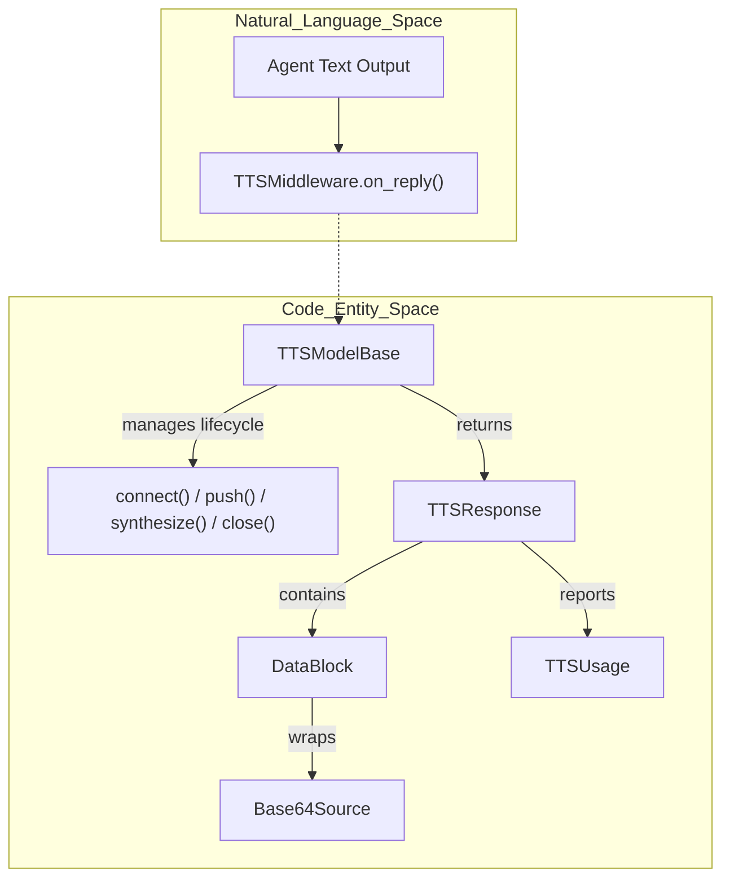
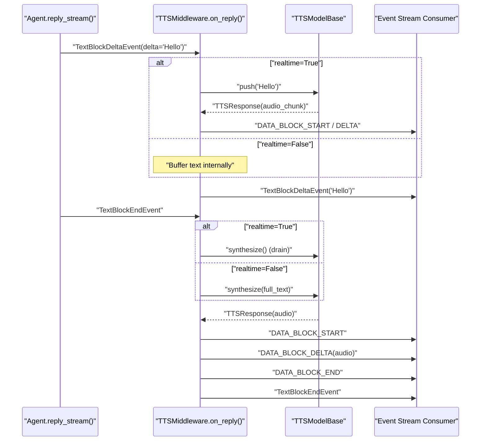
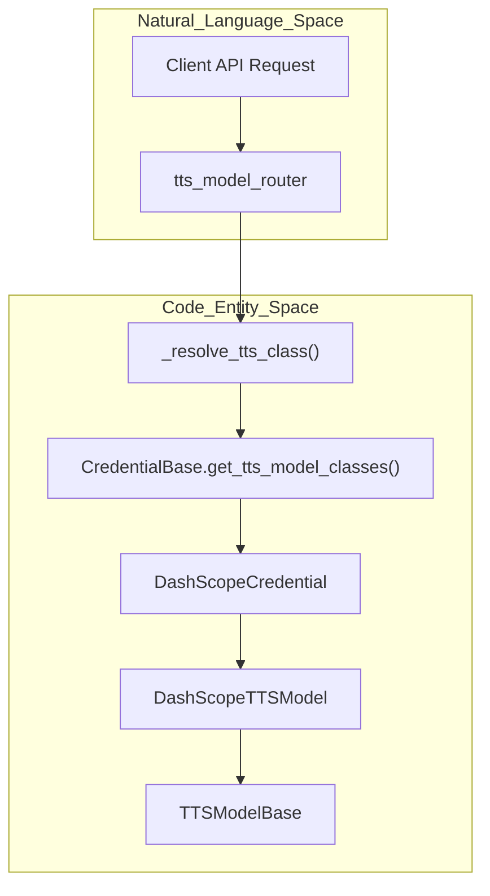

<!-- source: DeepWiki mcp.deepwiki.com · repo modelscope/agentscope · page 3.8 Text-to-Speech (TTS) Models · fetched 2026-10-27 -->

# Text-to-Speech (TTS) Models

Relevant source files

The following files were used as context for generating this wiki page:

- [src/agentscope/credential/_dashscope.py](src/agentscope/credential/_dashscope.py)
- [src/agentscope/embedding/_embedding_response.py](src/agentscope/embedding/_embedding_response.py)
- [src/agentscope/middleware/_tts_middleware.py](src/agentscope/middleware/_tts_middleware.py)
- [src/agentscope/state/_task.py](src/agentscope/state/_task.py)
- [src/agentscope/tts/__init__.py](src/agentscope/tts/__init__.py)
- [src/agentscope/tts/_dashscope/__init__.py](src/agentscope/tts/_dashscope/__init__.py)
- [src/agentscope/tts/_dashscope/_cosyvoice_model.py](src/agentscope/tts/_dashscope/_cosyvoice_model.py)
- [src/agentscope/tts/_dashscope/_cosyvoice_models/cosyvoice-v3-flash.yaml](src/agentscope/tts/_dashscope/_cosyvoice_models/cosyvoice-v3-flash.yaml)
- [src/agentscope/tts/_dashscope/_cosyvoice_models/cosyvoice-v3-plus.yaml](src/agentscope/tts/_dashscope/_cosyvoice_models/cosyvoice-v3-plus.yaml)
- [src/agentscope/tts/_dashscope/_cosyvoice_utils.py](src/agentscope/tts/_dashscope/_cosyvoice_utils.py)
- [src/agentscope/tts/_dashscope/_model.py](src/agentscope/tts/_dashscope/_model.py)
- [src/agentscope/tts/_dashscope/_realtime_model.py](src/agentscope/tts/_dashscope/_realtime_model.py)
- [src/agentscope/tts/_tts_base.py](src/agentscope/tts/_tts_base.py)
- [src/agentscope/tts/_tts_response.py](src/agentscope/tts/_tts_response.py)
- [tests/id_factory_test.py](tests/id_factory_test.py)
- [tests/tts_dashscope_test.py](tests/tts_dashscope_test.py)
- [tests/tts_middleware_test.py](tests/tts_middleware_test.py)

The Text-to-Speech (TTS) module in AgentScope provides a unified, production-ready abstraction for converting text generated by agents into audio output [src/agentscope/tts/__init__.py:1-25](). It supports traditional non-realtime (batch and streaming-output) synthesis as well as low-latency realtime streaming-input synthesis via WebSockets [src/agentscope/middleware/_tts_middleware.py:21-39](). The system integrates directly into the agent reasoning loop through `TTSMiddleware`, translating assistant text blocks into streaming audio data blocks (`DataBlock`) [src/agentscope/middleware/_tts_middleware.py:21-118]().

---

## 1. TTS Model Architecture & Base Classes (`TTSModelBase`)

The abstract base class `TTSModelBase` establishes the standard interface, configuration, and lifecycle management for all TTS providers in AgentScope [src/agentscope/tts/_tts_base.py:18-31]().

### Core Lifecycle Methods and Modes
- **Non-RealTime Mode (`realtime = False`)**: Subclasses implement `synthesize(text, **kwargs)` which accepts a text string and returns either a single `TTSResponse` or an `AsyncGenerator[TTSResponse, None]` [src/agentscope/tts/_tts_base.py:187-191](). Default no-op implementations are provided for `connect()`, `close()`, and `push()` so non-realtime models degrade gracefully if hooks are invoked [tests/tts_dashscope_test.py:6-7](), [tests/tts_dashscope_test.py:172-184]().
- **Realtime Mode (`realtime = True`)**: Subclasses manage a persistent bidirectional session (such as a WebSocket connection). Lifecycle operations are governed by an async context manager (`__aenter__` and `__aexit__`) [src/agentscope/tts/_tts_base.py:76-92]():
  - `connect()`: Establishes the underlying connection to the provider service [src/agentscope/tts/_tts_base.py:93-101]().
  - `push(text)`: Pushes incremental text chunks into the active synthesis queue asynchronously without blocking [src/agentscope/tts/_tts_base.py:112-138]().
  - `synthesize()`: Acts as a drain operation in realtime mode, blocking until all pushed tokens have been processed and the final audio stream is completed [src/agentscope/tts/_tts_base.py:187-198]().
  - `close()`: Cleans up resources and tears down network connections [src/agentscope/tts/_tts_base.py:103-110]().

`TTSResponse` wraps the resulting `DataBlock` (which contains a `Base64Source` with media types such as `audio/wav`), optional token/character usage statistics (`TTSUsage`), and an `is_last` boolean flag [src/agentscope/tts/__init__.py:4-6](), [src/agentscope/tts/_dashscope/_realtime_model.py]().

### Diagram: TTS Core Entities and Data Flow

Title: "TTS Core Entity Architecture"

Sources: [src/agentscope/tts/__init__.py:4-6](), [src/agentscope/middleware/_tts_middleware.py:51-118](), [src/agentscope/tts/_tts_base.py:18-138](), [tests/tts_dashscope_test.py:6-7](), [tests/tts_dashscope_test.py:172-184]()

---

## 2. Provider Implementations

AgentScope ships with built-in integrations for DashScope, Google Gemini, and OpenAI [src/agentscope/tts/__init__.py:7-13]().

### DashScope Implementations
- **`DashScopeTTSModel`**: Standard non-realtime and output-streaming TTS model using DashScope services [src/agentscope/tts/__init__.py:9](). It aggregates API chunks into a complete WAV container when `stream=False` [src/agentscope/tts/_dashscope/_model.py:146-180]().
- **`DashScopeRealtimeTTSModel`**: Implements realtime streaming-input synthesis via WebSocket using underlying real-time endpoints [src/agentscope/tts/__init__.py:10](). It utilizes internal callback mechanisms to handle asynchronous audio deltas and thread synchronization events [src/agentscope/tts/_dashscope/_realtime_model.py]().
- **`DashScopeCosyVoiceTTSModel`**: Provides access to advanced models like CosyVoice (`cosyvoice-v3-plus`, `cosyvoice-v3-flash`), supporting prosody controls, voice presets, and callback-based audio accumulation via `_make_cosyvoice_callback_class()` [src/agentscope/tts/__init__.py:8](), [src/agentscope/tts/_dashscope/_cosyvoice_utils.py:41-45](), [src/agentscope/tts/_dashscope/_cosyvoice_models/cosyvoice-v3-flash.yaml:1-23]().

### Gemini Implementation
- **`GeminiTTSModel`**: Utilizes the Google GenAI `generateContent` API with audio response modalities [src/agentscope/tts/__init__.py:12](), [src/agentscope/tts/_gemini/_model.py]().
- **PCM Wrapping**: Because Gemini returns raw 24kHz mono 16-bit PCM bytes, the model wraps them in a self-contained WAV header using streaming WAV header utilities so frontend clients can play the resulting audio directly [src/agentscope/tts/_gemini/_model.py]().
- **Streaming Output**: Supports generator-based response structures to yield incremental `TTSResponse` chunks [src/agentscope/tts/__init__.py:12]().

### OpenAI Implementation
- **`OpenAITTSModel`**: Implements text-to-speech using the OpenAI Audio Speech endpoint [src/agentscope/tts/__init__.py:13](), [src/agentscope/tts/_openai/_model.py:46-50]().
- **Formats & Streaming**: Supports multiple output formats mapped to appropriate MIME media types via `_media_types`, with built-in support for both single aggregation (`_aggregate`) and incremental streaming (`_stream`) [src/agentscope/tts/_openai/_model.py:24-31](), [src/agentscope/tts/_openai/_model.py:177-205]().

Sources: [src/agentscope/tts/__init__.py:7-13](), [src/agentscope/tts/_dashscope/_realtime_model.py](), [src/agentscope/tts/_dashscope/_cosyvoice_utils.py:41-45](), [src/agentscope/tts/_dashscope/_cosyvoice_models/cosyvoice-v3-flash.yaml:1-23](), [src/agentscope/tts/_openai/_model.py:24-50](), [src/agentscope/tts/_openai/_model.py:177-205](), [src/agentscope/tts/_gemini/_model.py](), [src/agentscope/tts/_dashscope/_model.py:146-180]()

---

## 3. Configuration and Discovery (`TTSModelCard` & Credentials)

### Model Cards and YAML Discovery
- **`TTSModelCard`**: Encapsulates metadata for TTS models, including model names, labels, supported input types, output types, and available voice lists [src/agentscope/tts/__init__.py:5]().
- **YAML Discovery**: Concrete TTS model subclasses implement discovery by scanning YAML configuration files located within provider-specific `_models` directories (e.g., `cosyvoice-v3-flash.yaml`) [src/agentscope/tts/_dashscope/_cosyvoice_models/cosyvoice-v3-flash.yaml:1-23](), [src/agentscope/tts/_tts_base.py:140-184]().

### Credential Mapping
Credentials inherit from `CredentialBase` and declare support for TTS via `get_tts_model_classes()` [src/agentscope/credential/_dashscope.py:48-61](). For example, `DashScopeCredential` maps to `DashScopeTTSModel`, `DashScopeRealtimeTTSModel`, and `DashScopeCosyVoiceTTSModel` [src/agentscope/credential/_dashscope.py:48-61]().

Sources: [src/agentscope/tts/__init__.py:5](), [src/agentscope/tts/_tts_base.py:140-184](), [src/agentscope/credential/_dashscope.py:48-61](), [src/agentscope/tts/_dashscope/_cosyvoice_models/cosyvoice-v3-flash.yaml:1-23]()

---

## 4. `TTSMiddleware` and Event Flow

The `TTSMiddleware` intercepts the agent's `on_reply` event stream to transform text generation into speech events [src/agentscope/middleware/_tts_middleware.py:21-58]().

### Operation Modes
1. **Non-RealTime Path (`realtime = False`)**:
   - Accumulates text from incoming `TextBlockDeltaEvent` objects [src/agentscope/middleware/_tts_middleware.py:67-68]().
   - Upon receiving a `TextBlockEndEvent`, invokes `tts.synthesize(full_text)` and emits `DATA_BLOCK_START`, `DATA_BLOCK_DELTA`, and `DATA_BLOCK_END` events [src/agentscope/middleware/_tts_middleware.py:82-117]().
2. **Realtime Path (`realtime = True`)**:
   - Immediately invokes `tts.push(delta)` for every `TextBlockDeltaEvent` [src/agentscope/middleware/_tts_middleware.py:69-70]().
   - Upon `TextBlockEndEvent`, calls `tts.synthesize()` to flush remaining audio buffers and emits corresponding audio block events [src/agentscope/middleware/_tts_middleware.py:86-97]().

### Diagram: Middleware Interception and Event Flow

Title: "TTSMiddleware Event Interception Flow"

Sources: [src/agentscope/middleware/_tts_middleware.py:21-174](), [tests/tts_middleware_test.py:49-124]()

---

## 5. Service Layer and `tts_model_router`

In the service application layer, TTS models are dynamically resolved and exposed via FastAPI routers.

### Service Integration
- **Model Resolution**: Helper functions such as `_resolve_tts_class` inspect credential types and model names to instantiate the correct `TTSModelBase` subclass [tests/tts_dashscope_test.py:27-35]().
- **`tts_model_router`**: Exposes endpoints for listing supported TTS models, querying voice catalogs under configured credentials, and performing audio synthesis validation in multi-tenant application deployments.

### Diagram: Service Routing and Resolution

Title: "TTS Service Routing and Resolution"

Sources: [tests/tts_dashscope_test.py:27-35](), [src/agentscope/credential/_dashscope.py:48-61]()

---

