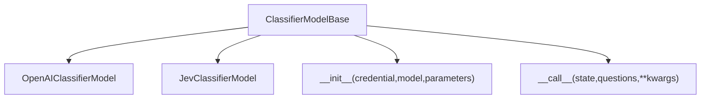
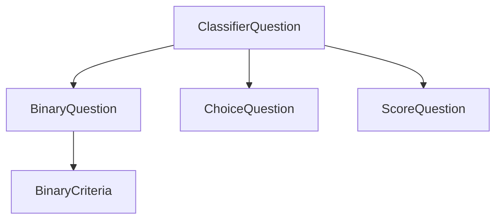
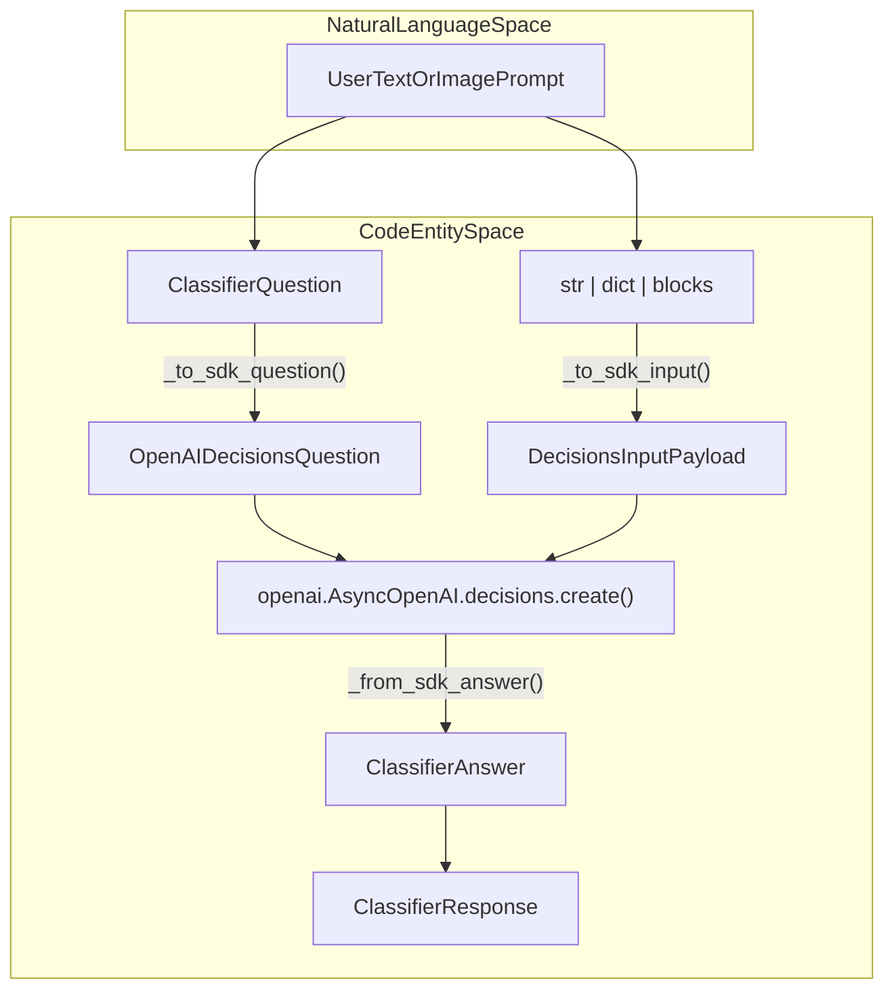
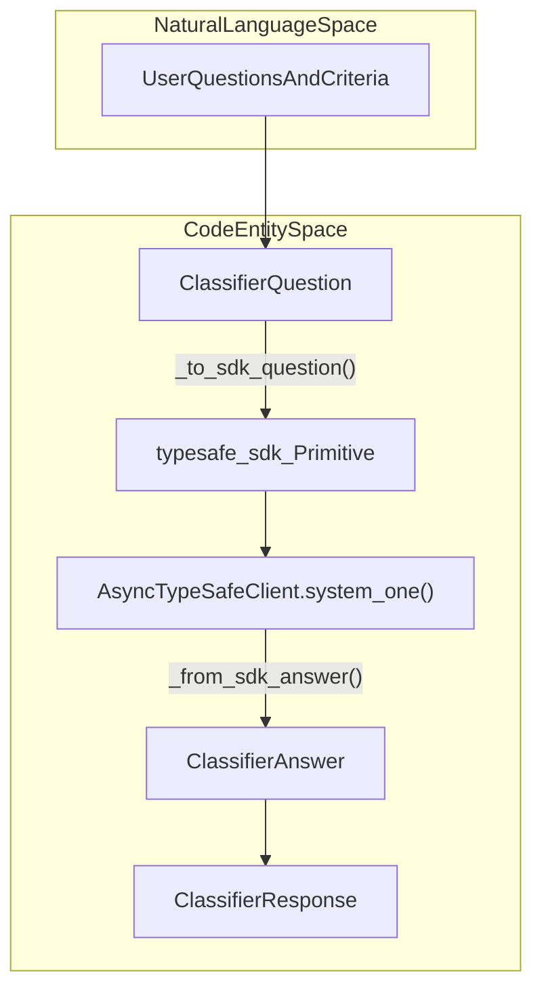
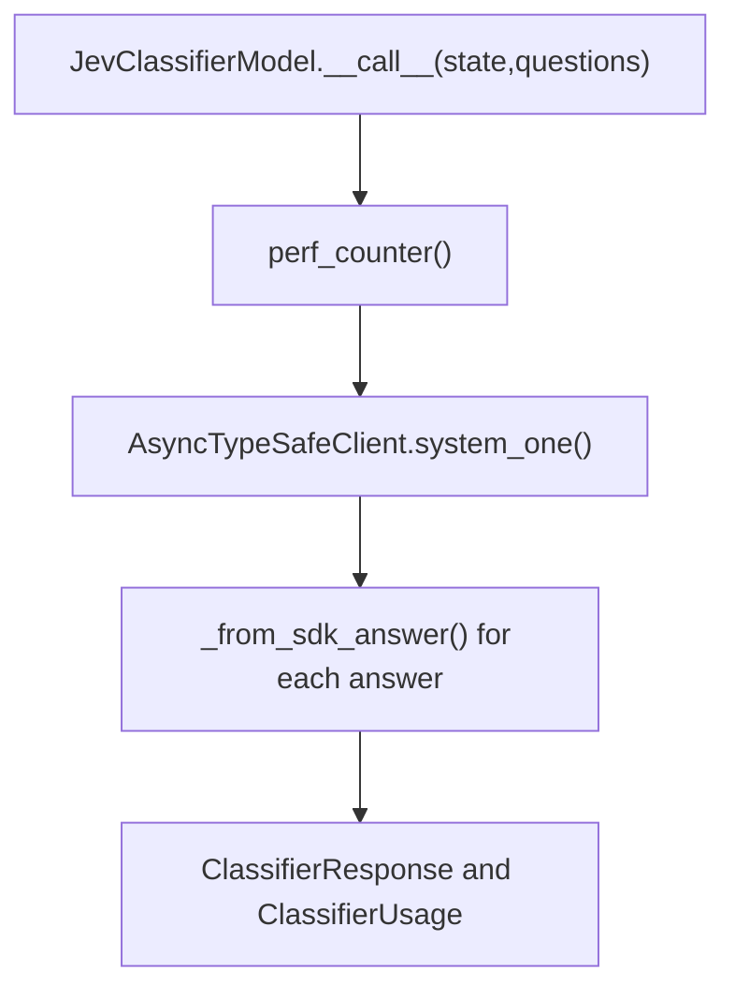

<!-- source: DeepWiki mcp.deepwiki.com · repo modelscope/agentscope · page 3.9 Classifier Models · fetched 2026-10-27 -->

# Classifier Models

Relevant source files

The following files were used as context for generating this wiki page:

- [src/agentscope/classifier/__init__.py](src/agentscope/classifier/__init__.py)
- [src/agentscope/classifier/_base.py](src/agentscope/classifier/_base.py)
- [src/agentscope/classifier/_jev/__init__.py](src/agentscope/classifier/_jev/__init__.py)
- [src/agentscope/classifier/_jev/_model.py](src/agentscope/classifier/_jev/_model.py)
- [src/agentscope/classifier/_openai/__init__.py](src/agentscope/classifier/_openai/__init__.py)
- [src/agentscope/classifier/_openai/_model.py](src/agentscope/classifier/_openai/_model.py)
- [src/agentscope/classifier/_question.py](src/agentscope/classifier/_question.py)
- [src/agentscope/classifier/_response.py](src/agentscope/classifier/_response.py)
- [src/agentscope/middleware/_model_router.py](src/agentscope/middleware/_model_router.py)
- [tests/classifier_jev_test.py](tests/classifier_jev_test.py)
- [tests/classifier_openai_test.py](tests/classifier_openai_test.py)
- [tests/classifier_test.py](tests/classifier_test.py)
- [tests/middleware_model_router_test.py](tests/middleware_model_router_test.py)

## Purpose and Scope
The `agentscope.classifier` package provides a typed, probabilistic classification interface for AgentScope 2.0. Rather than returning free-form text like standard chat models, classifier models evaluate structured inputs (text, JSON state, or multimodal image blocks) against collections of named typed questions, returning probability distributions, confidence scores, expected values, and explicit refusals. This page details the core abstractions (`ClassifierModelBase`), provider-independent question and response types, usage tracking, and the concrete `OpenAIClassifierModel` and `JevClassifierModel` implementations.

Sources: `src/agentscope/classifier/__init__.py:1-41`()

---

## Base Classifier Architecture
All classifier models inherit from `ClassifierModelBase`, an abstract base class. It defines a common initialization routine and an abstract `__call__` method for model execution.

*   `ClassifierModelBase`: The abstract base class taking a `CredentialBase` instance, a model name string, and optional provider-specific parameters `[src/agentscope/classifier/_base.py:13-38]()`.
*   `ClassifierModelBase.Parameters`: An inner container for provider-specific configuration options `[src/agentscope/classifier/_base.py:16-17]()`.
*   `__call__`: The asynchronous abstract method accepting an input state (`str | dict`), a mapping of named `ClassifierQuestion` objects, and arbitrary keyword arguments, returning a normalized `ClassifierResponse` `[src/agentscope/classifier/_base.py:39-59]().

### Classifier Model Inheritance and Core Interface

Sources: `src/agentscope/classifier/_base.py:13-60`(), `src/agentscope/classifier/_openai/_model.py:125-171`(), `src/agentscope/classifier/_jev/_model.py:70-123`()

---

## Question Types and Criteria
The package defines provider-independent question schemas using Pydantic. Every question type is validated with `model_config = ConfigDict(extra="forbid")`.

*   `BinaryCriteria`: Optional descriptions for positive (`true`) and negative (`false`) outcomes of a binary question `[src/agentscope/classifier/_question.py:8-18]()`.
*   `BinaryQuestion`: A question evaluating to a probability between zero and one. Contains optional `instructions` and `criteria` `[src/agentscope/classifier/_question.py:20-33]()`.
*   `ChoiceQuestion`: A question selecting one named alternative from a set of criteria (`dict[str, str | None]`) with mandatory minimum length of 1 `[src/agentscope/classifier/_question.py:35-48]()`.
*   `ScoreQuestion`: A question assigning an expected score using an ordered rubric list (`list[str]`) starting at score zero `[src/agentscope/classifier/_question.py:50-63]()`.
*   `ClassifierQuestion`: A discriminated `TypeAlias` union of `BinaryQuestion`, `ChoiceQuestion`, and `ScoreQuestion` `[src/agentscope/classifier/_question.py:65-69]()`.

### Question Schema Hierarchy

Sources: `src/agentscope/classifier/_question.py:8-69`(), `tests/classifier_test.py:44-90`()

---

## Answer, Response, and Usage Types
Classifier outputs are normalized into provider-independent response and answer data structures.

*   `BinaryAnswer`: Contains a `probability` float between 0 and 1, and a `type` discriminator set to `"binary_answer"` `[src/agentscope/classifier/_response.py:13-22]()`.
*   `ChoiceAnswer`: Contains the selected alternative (`choice`), provider-reported `confidence`, and a dictionary of `probabilities` `[src/agentscope/classifier/_response.py:26-41]()`.
*   `ScoreAnswer`: Contains the probability-weighted expected `score`, `confidence`, an integer-keyed rubric `legend`, and `probabilities` across score levels `[src/agentscope/classifier/_response.py:45-70]()`.
*   `RefusalAnswer`: Represents a refusal to answer a specific question, independent of other answers, with `type` set to `"refusal_answer"` `[src/agentscope/classifier/_response.py:73-80]()`.
*   `ClassifierAnswer`: A `TypeAlias` union of `BinaryAnswer | ChoiceAnswer | ScoreAnswer | RefusalAnswer` `[src/agentscope/classifier/_response.py:82-85]()`.
*   `ClassifierResponse`: A top-level container holding the `model` identifier, a dictionary of `content` mapping question names to `ClassifierAnswer` instances, optional `ClassifierUsage`, a generated `id`, `created_at` timestamp, and `metadata` `[src/agentscope/classifier/_response.py:88-115]()`.
*   `ClassifierUsage`: Tracks wall-clock execution `time`, optional `input_tokens`, and optional `output_tokens` `[src/agentscope/classifier/_usage.py:1-25]()`.

Sources: `src/agentscope/classifier/_response.py:1-116`()

---

## OpenAI Classifier Implementation
The `OpenAIClassifierModel` integrates OpenAI's Decisions API into AgentScope. It requires `openai>=3.26.0` `[src/agentscope/classifier/_openai/_model.py:125-135]()`.

### SDK Translation and Input Conversion
*   `_to_sdk_question(name: str, question: ClassifierQuestion)`: Translates binary questions to predicates, choice questions to choice options, and score questions to scored levels `[src/agentscope/classifier/_openai/_model.py:30-62]()`.
*   `_from_sdk_answer(answer: Any)`: Translates SDK predicate, choice, score, and refusal responses into AgentScope `BinaryAnswer`, `ChoiceAnswer`, `ScoreAnswer`, and `RefusalAnswer` instances `[src/agentscope/classifier/_openai/_model.py:65-90]()`.
*   `_to_sdk_input(state: str | dict | list[TextBlock | DataBlock])`: Converts text strings, JSON dictionaries, or ordered text and base64 image data blocks into input payloads accepted by the Decisions endpoint `[src/agentscope/classifier/_openai/_model.py:92-123]()`.

### OpenAI Decision Flow (Natural Language to Code Entity Space)

Sources: `src/agentscope/classifier/_openai/_model.py:30-123`(), `tests/classifier_openai_test.py:38-174`()

---

## Jev Classifier Implementation
The `JevClassifierModel` integrates TypeSafe's Jev System One API into AgentScope. It requires the optional `typesafe-sdk` dependency `[src/agentscope/classifier/_jev/_model.py:70-111]()`.

### SDK Translation Layer
AgentScope question and answer objects are translated to and from the TypeSafe SDK models:

*   `_to_sdk_question(question: ClassifierQuestion)`: Converts `BinaryQuestion` to TypeSafe's `Noul` primitive, `ChoiceQuestion` to `Choice`, and `ScoreQuestion` to `Score` `[src/agentscope/classifier/_jev/_model.py:26-47]()`.
*   `_from_sdk_answer(answer: Any)`: Converts SDK answer types into AgentScope's `BinaryAnswer`, `ChoiceAnswer`, and `ScoreAnswer` `[src/agentscope/classifier/_jev/_model.py:49-68]()`.

### Jev Question Translation Flow (Natural Language to Code Entity Space)

Sources: `src/agentscope/classifier/_jev/_model.py:26-68`(), `tests/classifier_jev_test.py:30-170`()

### Invocation and Execution Flow
When `JevClassifierModel.__call__` is invoked:
1. It records the start wall-clock time using `perf_counter()` `[src/agentscope/classifier/_jev/_model.py:146]`.
2. It delegates execution to `self.client.system_one(...)`, passing the state and mapped questions `[src/agentscope/classifier/_jev/_model.py:148-158]()`.
3. It wraps the raw SDK response inside a normalized `ClassifierResponse` populated with usage statistics and latency metrics `[src/agentscope/classifier/_jev/_model.py:159-170]()`.

### Jev Classifier Execution Flow

Sources: `src/agentscope/classifier/_jev/_model.py:124-171`(), `tests/classifier_jev_test.py:30-170`()

---

