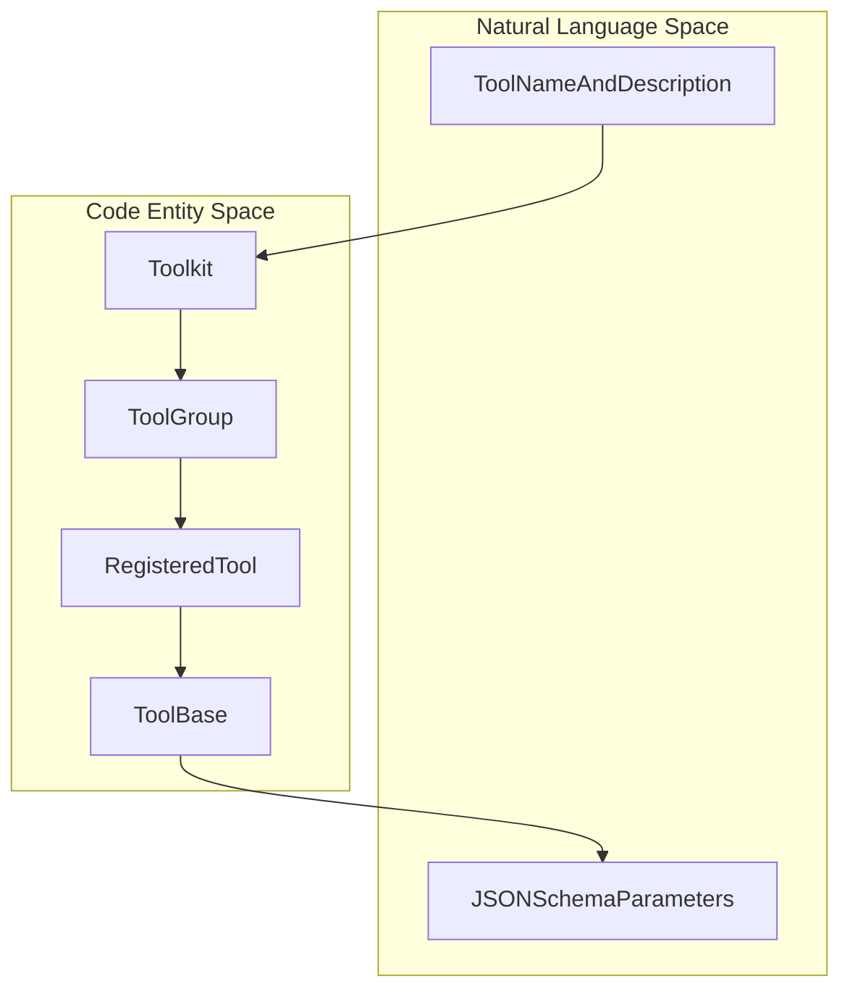
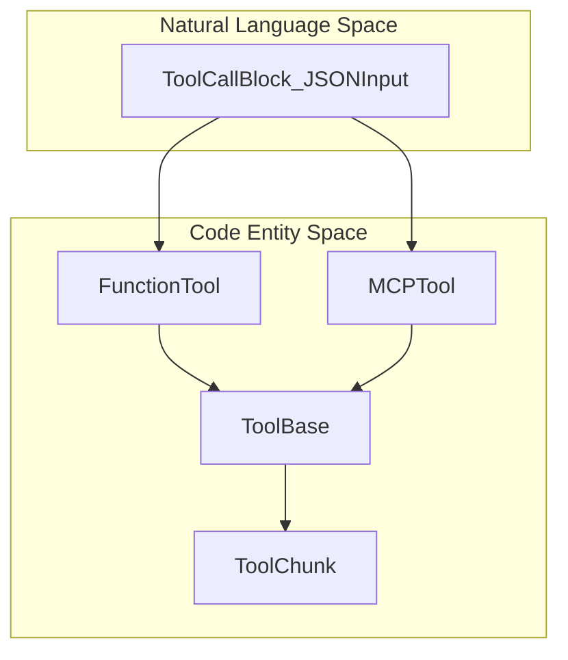

<!-- source: DeepWiki mcp.deepwiki.com · repo modelscope/agentscope · page 4 Tool System · fetched 2026-10-27 -->

# Tool System

Relevant source files

The following files were used as context for generating this wiki page:

- [src/agentscope/skill/_local_loader.py](src/agentscope/skill/_local_loader.py)
- [src/agentscope/tool/__init__.py](src/agentscope/tool/__init__.py)
- [src/agentscope/tool/_base.py](src/agentscope/tool/_base.py)
- [src/agentscope/tool/_builtin/__init__.py](src/agentscope/tool/_builtin/__init__.py)
- [src/agentscope/tool/_builtin/_ask_user.py](src/agentscope/tool/_builtin/_ask_user.py)
- [src/agentscope/tool/_builtin/_meta.py](src/agentscope/tool/_builtin/_meta.py)
- [src/agentscope/tool/_builtin/_skill.py](src/agentscope/tool/_builtin/_skill.py)
- [src/agentscope/tool/_toolkit.py](src/agentscope/tool/_toolkit.py)
- [src/agentscope/tool/_types.py](src/agentscope/tool/_types.py)
- [tests/ask_user_tool_test.py](tests/ask_user_tool_test.py)
- [tests/permission_engine_test.py](tests/permission_engine_test.py)
- [tests/skill_loader_test.py](tests/skill_loader_test.py)
- [tests/toolkit_skill_test.py](tests/toolkit_skill_test.py)

The Tool System provides the infrastructure for registering, managing, and executing tool functions in AgentScope. It enables agents to extend their capabilities through Python functions, Model Context Protocol (MCP) servers, and agent skills. The system supports dynamic tool activation via groups, schema extraction from docstrings, and a unified execution pipeline for both sync and async tools [src/agentscope/tool/_toolkit.py:66-86]().

**Key Capabilities:**
- **Multi-source registration**: Support for Python functions, MCP clients, and Skill directories [src/agentscope/tool/_toolkit.py:88-115]().
- **Hierarchical organization**: Tool groups with runtime activation/deactivation control via `ToolGroup` [src/agentscope/tool/_toolkit.py:127-142]().
- **Unified execution**: A common interface for sync/async functions and generators using `Toolkit.call_tool()`.
- **Schema management**: Automatic JSON schema generation from docstrings and Pydantic models, including `$defs` preservation for nested structures [src/agentscope/tool/_base.py:29-40]().
- **Meta-tools**: Built-in tools for agents to manage their own toolset, such as `ResetTools` [src/agentscope/tool/_builtin/_meta.py:21-47]() and `SkillViewer` [src/agentscope/tool/_builtin/_skill.py]().
- **MCP Integration**: Native support for connecting to MCP servers via `MCPClient` with support for Stdio, SSE, and streamable-HTTP transports [src/agentscope/tool/_toolkit.py:144-151]().

This page provides an architectural overview. For detailed information, see the child pages:
- **[Toolkit Core Architecture](#4.1)**: The `Toolkit` class, `RegisteredTool` data structures, schema repair via `_json_loads_with_repair`, and group management.
- **[Tool Registration and Adapters](#4.2)**: `FunctionTool` and `MCPTool` adapters, schema extraction, state injection, and the `ToolBase` abstraction [src/agentscope/tool/_base.py:100-120]().
- **[Built-in Tools and Skills](#4.3)**: Standard tools (`Bash`, `Read`, `Write`, etc.) and the `SKILL.md` skill system [src/agentscope/tool/_builtin/__init__.py:4-20]().
- **[MCP Integration](#4.4)**: Patterns for connecting to Model Context Protocol servers using `MCPClient`.

Sources: [src/agentscope/tool/_toolkit.py:66-170](), [src/agentscope/tool/_base.py:29-120](), [src/agentscope/tool/_builtin/__init__.py:4-20](), [src/agentscope/tool/_builtin/_meta.py:21-47]()

## Toolkit Core Architecture

The tool system is centered around the `Toolkit` class, which manages registration, storage, schema generation, and execution [src/agentscope/tool/_toolkit.py:66-86](). It bridges the "Natural Language Space" (where LLMs select tools by name and description) to the "Code Entity Space" (where Python callables and MCP endpoints reside).

Title: "Toolkit Registration bridging Natural Language Space and Code Entity Space"

For details on the `Toolkit` class, `RegisteredTool`, group activation, JSON argument repair, and streaming execution pipeline, see [Toolkit Core Architecture](#4.1).

Sources: [src/agentscope/tool/_toolkit.py:66-170]()

## Tool Registration and Adapters

Tools in AgentScope are abstracted via the `ToolBase` base class [src/agentscope/tool/_base.py:100-101]() and adapted from multiple sources through `FunctionTool` and `MCPTool`. These adapters handle docstring parsing, Pydantic schema extraction, and state injection (`is_state_injected`) [src/agentscope/tool/_base.py:117-120](). Middlewares implement the onion wrapping pattern via `ToolMiddlewareBase` [src/agentscope/tool/_base.py:42-50]().

Title: "Tool Execution bridging Natural Language Space and Code Entity Space"

For details on schema extraction, preset arguments, state injection, and `ToolResponse`/`ToolChunk` streaming, see [Tool Registration and Adapters](#4.2).

Sources: [src/agentscope/tool/_base.py:42-120]()

## Built-in Tools and Skills

AgentScope provides a comprehensive suite of built-in tools for system and file operations, such as `Bash`, `Read`, `Write`, `Edit`, `Grep`, `Glob`, `PowerShell`, and `AskUser` [src/agentscope/tool/_builtin/__init__.py:4-20](). The `AskUser` tool is an external tool, meaning its execution is handled by an external entity (e.g., a UI) rather than directly by the agent [src/agentscope/tool/_builtin/_ask_user.py:166-173](). Meta-tools like `ResetTools` [src/agentscope/tool/_builtin/_meta.py:21-47]() and `SkillViewer` allow agents to self-manage tool groups and inspect loaded markdown skills.

For details on built-in tools, backends (`LocalBackend`), and the skill loader architecture, see [Built-in Tools and Skills](#4.3).

Sources: [src/agentscope/tool/_builtin/__init__.py:4-39](), [src/agentscope/tool/_builtin/_meta.py:21-47](), [src/agentscope/tool/_builtin/_ask_user.py:166-173]()

## MCP Integration

The `Toolkit` supports the Model Context Protocol (MCP) to connect to external tool servers [src/agentscope/tool/_toolkit.py:67-86](). It manages stateful and stateless connections using `MCPClient` [src/agentscope/tool/_toolkit.py:144-151]() alongside transport configurations.

For details on MCP clients, connection scopes, transports, and tool name prefixing, see [MCP Integration](#4.4).

Sources: [src/agentscope/tool/_toolkit.py:67-151]()

---

