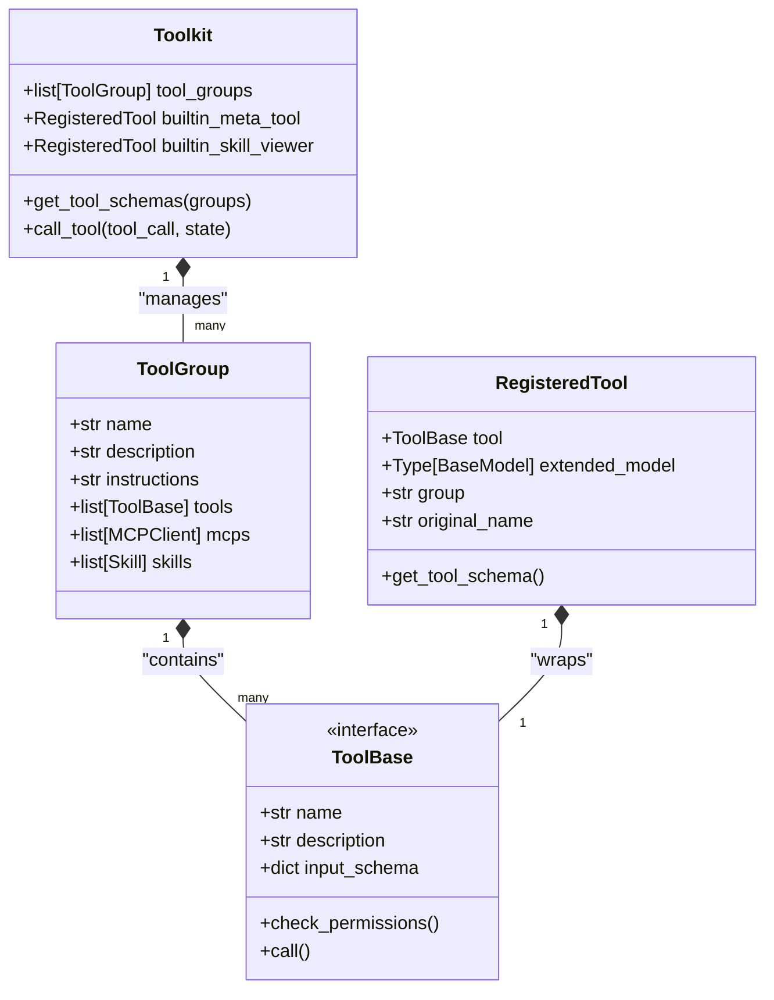
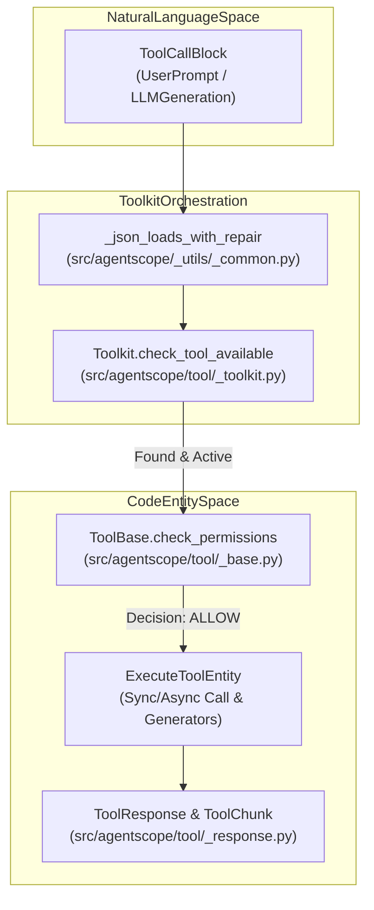
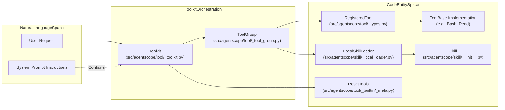

<!-- source: DeepWiki mcp.deepwiki.com · repo modelscope/agentscope · page 4.1 Toolkit Core Architecture · fetched 2026-10-27 -->

# Toolkit Core Architecture

Relevant source files

The following files were used as context for generating this wiki page:

- [src/agentscope/skill/_local_loader.py](src/agentscope/skill/_local_loader.py)
- [src/agentscope/tool/_tool_group.py](src/agentscope/tool/_tool_group.py)
- [src/agentscope/tool/_toolkit.py](src/agentscope/tool/_toolkit.py)
- [src/agentscope/tool/_types.py](src/agentscope/tool/_types.py)
- [tests/skill_loader_test.py](tests/skill_loader_test.py)
- [tests/tool_group_ownership_test.py](tests/tool_group_ownership_test.py)
- [tests/toolkit_skill_test.py](tests/toolkit_skill_test.py)

Purpose: Toolkit class, RegisteredTool, get_tool_schemas(), call_tool(), ToolGroup activation, JSON repair, and streaming execution pipeline.

This page documents the architecture of the `Toolkit` class in AgentScope, which serves as the central registry and execution engine for tool functions, MCP clients, and agent skills. The Toolkit manages tool registration, JSON schema generation, execution with unified streaming, schema-guided JSON argument repair, and dynamic tool group activation.

For information about registering and executing specific tools, see [4.2 Tool Registration and Adapters](). For MCP client integration, see [4.4 MCP Integration]().

---

## Overview

The `Toolkit` class [src/agentscope/tool/_toolkit.py:66-86]() is the core module for managing tool functions, MCP clients, and Agent skills. It provides a unified interface for:

- **Unified Registry**: Manages `ToolBase` objects, `MCPClient` instances, and `Skill` objects organized into groups [src/agentscope/tool/_toolkit.py:127-134]().
- **JSON Schema Generation**: Automatically parses schemas from docstrings and merges dynamic Pydantic model extensions [src/agentscope/tool/_types.py:56-153]().
- **Dynamic Group Management**: Supports activating/deactivating tool groups at runtime, allowing agents to manage their own tool context space via meta-tools like `ResetTools` [src/agentscope/tool/_toolkit.py:156-163]().
- **Unified Execution Pipeline**: Executes tools through a unified async/sync pipeline that supports streaming `ToolChunk` objects and final `ToolResponse` assembly [src/agentscope/tool/_toolkit.py:1-695]() (see also [src/agentscope/tool/_response.py:28-170]()).
- **Schema-Guided JSON Argument Repair**: Robustly parses and repairs malformed or type-mismatched tool arguments using `_json_loads_with_repair` [src/agentscope/tool/_toolkit.py:26-26]().

Sources: [src/agentscope/tool/_toolkit.py:66-163](), [src/agentscope/tool/_types.py:56-153]()

---

## Core Class Structure

### Toolkit, ToolGroup, and RegisteredTool

The `Toolkit` maintains a list of `ToolGroup` objects [src/agentscope/tool/_toolkit.py:127-134](). Each group contains tools that are wrapped into `RegisteredTool` dataclasses for schema management and execution [src/agentscope/tool/_types.py:25-42]().

Title: "Toolkit Architecture Diagram"

**Key Entities:**

| Entity | Role | Reference |
|-----------|------|---------|
| `Toolkit` | Central orchestrator for tool discovery and execution. | [src/agentscope/tool/_toolkit.py:66-86]() |
| `ToolGroup` | A logical container for tools, skills, and MCP clients. | [src/agentscope/tool/_toolkit.py:38-38](), [src/agentscope/tool/_tool_group.py:10-17]() |
| `RegisteredTool` | Metadata wrapper for execution and schema extension. | [src/agentscope/tool/_types.py:25-42]() |
| `ToolBase` | Abstract base class for all tool implementations. | [src/agentscope/tool/_base.py:1-50]() |

Sources: [src/agentscope/tool/_toolkit.py:66-170](), [src/agentscope/tool/_types.py:25-42](), [src/agentscope/tool/_tool_group.py:10-40]()

---

## Tool Registration and Schema Generation

### JSON Schema Extraction

The `Toolkit` relies on `ToolBase.input_schema`, which is generated by adapters like `FunctionTool` or `MCPTool`. For standard Python functions, the schema is derived from type hints and docstrings.

- **Title Removal**: The `_remove_title_field` function recursively strips `title` fields from the generated schema to reduce token noise for LLMs [src/agentscope/tool/_utils.py:123-156]().

### Schema Extension via RegisteredTool

The `RegisteredTool.get_tool_schema()` method allows for dynamic modification of the tool's interface [src/agentscope/tool/_types.py:56-153]():
- **Merging**: Combines the original function schema with an `extended_model` (Pydantic `BaseModel`).
- **Conflict Resolution**: Validates that extended fields do not collide with existing function parameters [src/agentscope/tool/_types.py:98-104]().
- **$defs Support**: Merges nested model definitions from `$defs` to support complex object inputs, preserving structure during the merge while checking for definition conflicts [src/agentscope/tool/_types.py:118-151]().

Sources: [src/agentscope/tool/_types.py:56-153](), [src/agentscope/tool/_toolkit.py:171-182]()

---

## Tool Execution Pipeline & Argument Repair

### JSON Argument Repair (`_json_loads_with_repair`)

When an LLM generates streaming or complete tool arguments (e.g. within a `ToolCallBlock`), the payload may be incomplete or contain type mismatches. The `_json_loads_with_repair` function handles this robustly [src/agentscope/_utils/_common.py:1-50]():
- **Standard Parsing**: Attempts direct JSON decoding with fallback repair strategies.
- **Repair Utility**: Leverages schema guidance to correct types and syntax best-effort.
- **Error Handling**: If unrecoverable, raises parsing exceptions with detailed error information to guide the agent in self-correction.

### Unified Async/Sync Streaming Execution

The `Toolkit.call_tool` method provides a unified entry point for executing any tool, verifying availability and processing streams via `ToolChunk` and `ToolResponse` [src/agentscope/tool/_response.py:28-170]().

Title: "Unified Tool Execution Data Flow"

**Execution Steps:**
1. **Availability Check**: Verifies the tool exists and its group is currently activated in `AgentState.tool_context.activated_groups` via internal checks [src/agentscope/tool/_toolkit.py:66-182]().
2. **Argument Repair**: Parses and repairs tool arguments using `_json_loads_with_repair()` against the tool's input schema [src/agentscope/tool/_toolkit.py:26-26]().
3. **Permission Evaluation**: Calls `check_permissions` before execution [src/agentscope/tool/_base.py:1-50]().
4. **Streaming**: Results are yielded as `ToolChunk` objects and aggregated into `ToolResponse` [src/agentscope/tool/_response.py:28-170]().

Sources: [src/agentscope/tool/_toolkit.py:66-182](), [src/agentscope/tool/_response.py:28-170]()

---

## Tool Group Activation and Skills

AgentScope supports dynamic tool management where an agent can enable or disable sets of tools to manage context window efficiency.

### ToolGroup Activation Logic
- **The "basic" Group**: Always active and included in schema generation by default [src/agentscope/tool/_toolkit.py:127-134]().
- **Activation State**: Checked against `AgentState.tool_context.activated_groups` during tool calls and schema queries [src/agentscope/tool/_toolkit.py:171-182]().
- **Meta-Tool (`ResetTools`)**: A built-in meta-tool [src/agentscope/tool/_toolkit.py:156-163]() that allows agents to modify their own `activated_groups` list.

### Skill Integration
Skills are treated as specialized resources. While skills are not directly callable as tools, the `SkillViewer` tool [src/agentscope/tool/_toolkit.py:165-169]() allows agents to read full skill instructions. 

The `Toolkit` manages skills through `SkillLoaderBase` implementations, such as `LocalSkillLoader` [src/agentscope/tool/_toolkit.py:24-24](), which scans directories for skill definition files [src/agentscope/tool/_toolkit.py:82-86](). The `Toolkit` generates combined skill instruction prompts using built-in templates [src/agentscope/tool/_toolkit.py:51-63]().

Title: "Skill and Group Mapping"

Sources: [src/agentscope/tool/_toolkit.py:51-169](), [src/agentscope/tool/_toolkit.py:257-308](), [src/agentscope/tool/_tool_group.py:10-108]()

---

