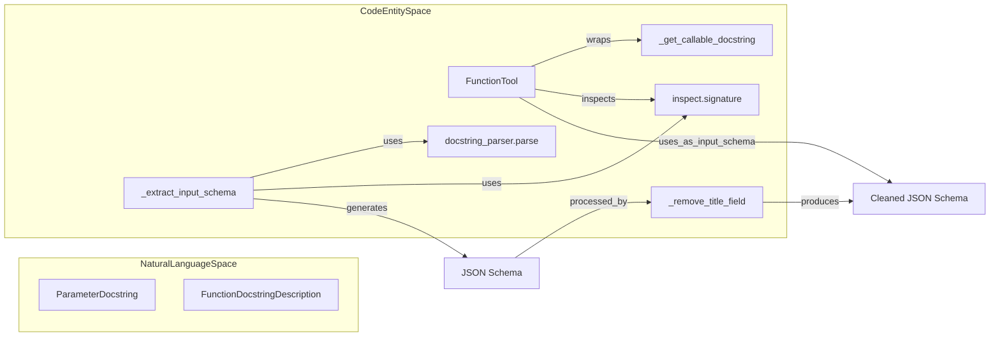
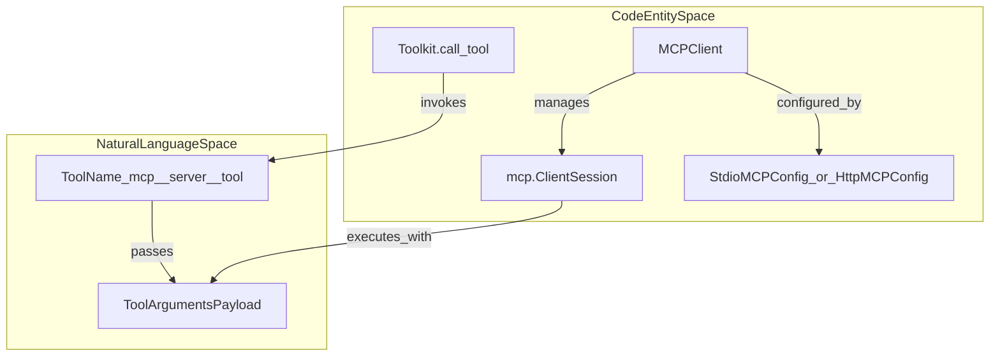
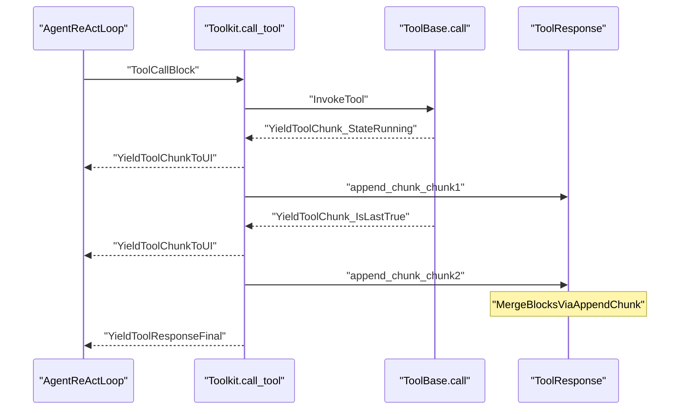

<!-- source: DeepWiki mcp.deepwiki.com · repo modelscope/agentscope · page 4.2 Tool Registration and Adapters · fetched 2026-10-27 -->

# Tool Registration and Adapters

Relevant source files

The following files were used as context for generating this wiki page:

- [examples/web_ui/frontend/src/components/dialog/MCPConfigForm.tsx](examples/web_ui/frontend/src/components/dialog/MCPConfigForm.tsx)
- [src/agentscope/_utils/_common.py](src/agentscope/_utils/_common.py)
- [src/agentscope/mcp/_mcp_client.py](src/agentscope/mcp/_mcp_client.py)
- [src/agentscope/state/_state.py](src/agentscope/state/_state.py)
- [src/agentscope/tool/_adapters.py](src/agentscope/tool/_adapters.py)
- [src/agentscope/tool/_response.py](src/agentscope/tool/_response.py)
- [src/agentscope/tool/_utils.py](src/agentscope/tool/_utils.py)
- [src/agentscope/workspace/_gateway_client.py](src/agentscope/workspace/_gateway_client.py)
- [src/agentscope/workspace/_mcp_gateway/_mcp_gateway_app.py](src/agentscope/workspace/_mcp_gateway/_mcp_gateway_app.py)
- [tests/agent_structured_output_test.py](tests/agent_structured_output_test.py)
- [tests/builtin_file_cache_test.py](tests/builtin_file_cache_test.py)
- [tests/mcp_client_reconnect_test.py](tests/mcp_client_reconnect_test.py)
- [tests/mcp_runtime_headers_test.py](tests/mcp_runtime_headers_test.py)
- [tests/mcp_sse_client_test.py](tests/mcp_sse_client_test.py)
- [tests/mcp_streamable_http_client_test.py](tests/mcp_streamable_http_client_test.py)
- [tests/mcp_tool_result_test.py](tests/mcp_tool_result_test.py)
- [tests/tool_argument_repair_test.py](tests/tool_argument_repair_test.py)
- [tests/tool_lazy_annotations_test.py](tests/tool_lazy_annotations_test.py)
- [tests/toolkit_test.py](tests/toolkit_test.py)

## Purpose and Scope
This page documents the tool registration and adapter mechanisms in AgentScope 2.0. It details the `ToolBase` abstract base class [src/agentscope/tool/_adapters.py:16](), how standard Python functions and Model Context Protocol (MCP) tools are adapted into the unified tool interface via `FunctionTool` [src/agentscope/tool/_adapters.py:39-116]() and MCP integration [src/agentscope/mcp/_mcp_client.py:32](), state injection (`is_state_injected`) [src/agentscope/tool/_adapters.py:65](), preset arguments, runtime headers in `MCPClient` [src/agentscope/mcp/_mcp_client.py:141](), and the streaming `ToolChunk` and `ToolResponse` execution model [src/agentscope/tool/_adapters.py:21]().

Sources: [src/agentscope/tool/_adapters.py:16](), [src/agentscope/tool/_adapters.py:39-116](), [src/agentscope/mcp/_mcp_client.py:32](), [src/agentscope/mcp/_mcp_client.py:141](), [src/agentscope/tool/_adapters.py:21]()

---

## ToolBase Abstract Class

The `ToolBase` class defines the foundational protocol and metadata attributes required for an agent to inspect, authorize, and invoke a tool. Concrete tool wrappers inherit from `ToolBase` to expose uniform metadata and execution contracts [src/agentscope/tool/_adapters.py:39]().

| Attribute / Method | Type | Description |
| :--- | :--- | :--- |
| `name` | `str` | The identifier presented to the LLM [src/agentscope/tool/_adapters.py:99](). |
| `description` | `str` | Agent-oriented instructions on when and how to use the tool [src/agentscope/tool/_adapters.py:100](). |
| `input_schema` | `dict` | JSON schema (OpenAPI compatible) defining tool parameters [src/agentscope/tool/_adapters.py:110](). |
| `is_concurrency_safe` | `bool` | Indicates whether the tool can be executed concurrently [src/agentscope/tool/_adapters.py:111](). |
| `is_read_only` | `bool` | Indicates whether the tool only reads data without side effects [src/agentscope/tool/_adapters.py:112](). |
| `is_external_tool` | `bool` | If `True`, the tool's `call` method is not invoked directly; instead, an external tool call event is yielded [src/agentscope/tool/_adapters.py:48-50](). |
| `is_state_injected` | `bool` | If `True`, injects the `AgentState` object as `_agent_state` [src/agentscope/tool/_adapters.py:65](). |
| `is_mcp` | `bool` | If `True`, indicates this is an MCP tool [src/agentscope/tool/_adapters.py:51-52](). |
| `mcp_name` | `str | None` | The name of the MCP server this tool belongs to, if `is_mcp` is `True` [src/agentscope/tool/_adapters.py:53-55](). |
| `call()` | `Callable` | Async execution override point returning a `ToolChunk` or async generator [src/agentscope/tool/_adapters.py:140-176](). |
| `check_permissions()` | `Callable` | Asynchronous method to determine if the tool call is allowed [src/agentscope/tool/_adapters.py:119-138](). |

Sources: [src/agentscope/tool/_adapters.py:39-138](), [src/agentscope/tool/_adapters.py:140-176]()

---

## FunctionTool Adapter

The `FunctionTool` class wraps standard Python functions, automatically extracting metadata from type annotations and docstrings [src/agentscope/tool/_adapters.py:39-46]().

### Schema Extraction and Normalization
`FunctionTool` utilizes `_extract_input_schema` to generate JSON schemas from function signatures (`inspect`) and docstrings (`docstring_parser`) [src/agentscope/tool/_utils.py:190-217](). The `_remove_title_field` helper recursively strips redundant `"title"` keys from properties, `$defs`, and nested structures to reduce token consumption for the LLM [src/agentscope/tool/_utils.py:123-156]().

Diagram: Mapping Function Metadata to LLM Schema via FunctionTool

Sources: [src/agentscope/tool/_adapters.py:39-116](), [src/agentscope/tool/_utils.py:123-217]()

### Execution and Async Generator Normalization
When invoked, `FunctionTool` inspects whether the underlying callable returns an awaitable or a generator, executing and normalizing standard return values, generators, and async generators into `ToolChunk` streams [src/agentscope/tool/_adapters.py:140-176]().

Sources: [src/agentscope/tool/_adapters.py:140-176]()

---

## MCPTool Adapter and MCPClient

The `MCPTool` adapter integrates tools exposed by Model Context Protocol (MCP) servers, preserving complex JSON schemas including `$defs` sub-schemas [tests/mcp_sse_client_test.py:45-67]().

### Connection Modes, Name Prefixing, and Runtime Headers
`MCPClient` manages underlying transport sessions in two modes:
1. **Stateful**: Maintains a persistent connection via explicit `connect()` and `close()` calls [src/agentscope/mcp/_mcp_client.py:38-39]().
2. **Stateless**: Instantiates ephemeral connections per request [src/agentscope/mcp/_mcp_client.py:39-40]().

Tool names from MCP servers are prefixed to avoid collisions (e.g., `mcp__{name}__{tool}`) [tests/mcp_sse_client_test.py:93](). Additionally, `MCPClient` supports live runtime header updates via `set_runtime_headers()`, allowing authentication contexts or routing headers to be modified without re-instantiating the client configuration [src/agentscope/mcp/_mcp_client.py:141](), [tests/mcp_runtime_headers_test.py:76-86]().

Diagram: MCP Protocol Integration and Execution Flow

Sources: [src/agentscope/mcp/_mcp_client.py:32-142](), [tests/mcp_sse_client_test.py:85-110](), [tests/mcp_runtime_headers_test.py:76-86]()

---

## State Injection and Preset Arguments

Tools can be configured with preset keyword arguments during registration, which are injected automatically into every call without exposing them in the LLM's tool schema.

When `is_state_injected=True`, the agent's runtime `AgentState` (including tool context and activated groups) is automatically passed to tool methods via the `_agent_state` parameter [src/agentscope/state/_state.py:32-45](), [src/agentscope/tool/_adapters.py:65](). For example, file-system tools like `Read`, `Write`, and `Edit` utilize `AgentState.tool_context` to manage file caches with LRU eviction and modification time checks [src/agentscope/state/_state.py:32-154]().

Sources: [src/agentscope/tool/_adapters.py:39-116](), [src/agentscope/state/_state.py:32-154]()

---

## ToolResponse and ToolChunk Streaming Model

AgentScope uses a chunk-based streaming model for tool execution, allowing real-time progress reporting and incremental output delivery [src/agentscope/tool/_response.py:28-70]().

1. **`ToolChunk`**: Represents an incremental piece of execution output containing partial `TextBlock` or `DataBlock` items, an execution state (defaulting to `RUNNING`), and an `is_last` boolean flag [src/agentscope/tool/_response.py:28-48]().
2. **`ToolResponse`**: Represents the final aggregated result collected from all chunks [src/agentscope/tool/_response.py:51-73]().

The `ToolResponse.append_chunk()` method merges incoming chunks, accumulating text blocks and merging base64-encoded binary chunks safely via `_merge_base64_chunks` without corrupting padding [src/agentscope/tool/_response.py:13-26](), [src/agentscope/tool/_response.py:74-134]().

Diagram: Streaming Tool Execution and Chunk Aggregation

Sources: [src/agentscope/tool/_response.py:13-170](), [tests/toolkit_test.py:193-247]()

---

