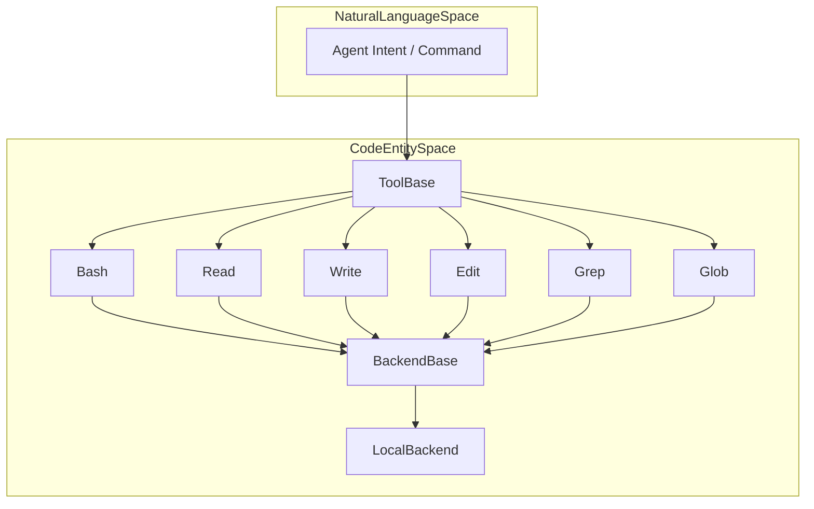
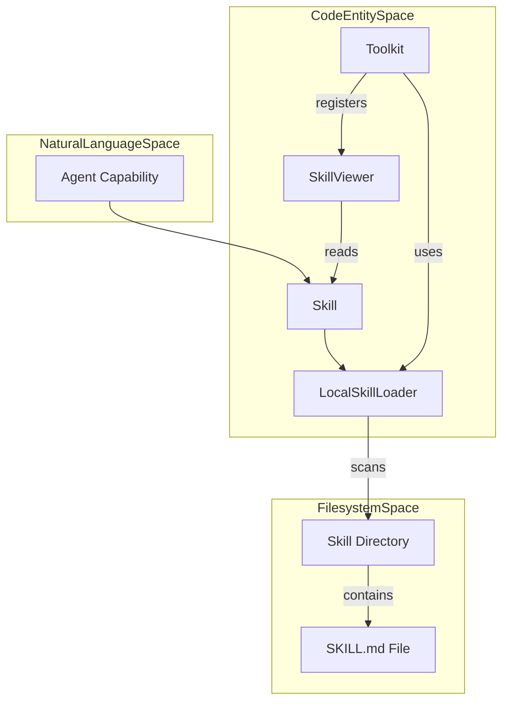
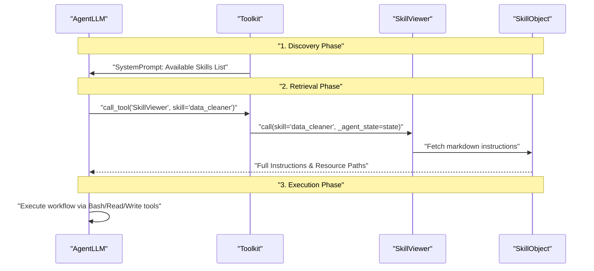

<!-- source: DeepWiki mcp.deepwiki.com · repo modelscope/agentscope · page 4.3 Built-in Tools and Skills · fetched 2026-10-27 -->

# Built-in Tools and Skills

<details>
<summary>Relevant source files</summary>

The following files were used as context for generating this wiki page:

- [src/agentscope/app/_router/_schema/_workspace.py](src/agentscope/app/_router/_schema/_workspace.py)
- [src/agentscope/app/_service/_download_token.py](src/agentscope/app/_service/_download_token.py)
- [src/agentscope/middleware/_budget.py](src/agentscope/middleware/_budget.py)
- [src/agentscope/tool/_builtin/_backend.py](src/agentscope/tool/_builtin/_backend.py)
- [src/agentscope/tool/_builtin/_bash.py](src/agentscope/tool/_builtin/_bash.py)
- [src/agentscope/tool/_builtin/_bash_parser.py](src/agentscope/tool/_builtin/_bash_parser.py)
- [src/agentscope/tool/_builtin/_edit.py](src/agentscope/tool/_builtin/_edit.py)
- [src/agentscope/tool/_builtin/_glob.py](src/agentscope/tool/_builtin/_glob.py)
- [src/agentscope/tool/_builtin/_grep.py](src/agentscope/tool/_builtin/_grep.py)
- [src/agentscope/tool/_builtin/_read.py](src/agentscope/tool/_builtin/_read.py)
- [src/agentscope/tool/_builtin/_scripts/_glob_helper.py](src/agentscope/tool/_builtin/_scripts/_glob_helper.py)
- [src/agentscope/tool/_builtin/_write.py](src/agentscope/tool/_builtin/_write.py)
- [src/agentscope/tool/_constants.py](src/agentscope/tool/_constants.py)
- [src/agentscope/tool/_task/_update_task.py](src/agentscope/tool/_task/_update_task.py)
- [tests/backend_local_test.py](tests/backend_local_test.py)
- [tests/builtin_bash_test.py](tests/builtin_bash_test.py)
- [tests/builtin_edit_test.py](tests/builtin_edit_test.py)
- [tests/builtin_glob_test.py](tests/builtin_glob_test.py)
- [tests/builtin_grep_test.py](tests/builtin_grep_test.py)
- [tests/builtin_read_test.py](tests/builtin_read_test.py)
- [tests/builtin_write_test.py](tests/builtin_write_test.py)
- [tests/middleware_budget_test.py](tests/middleware_budget_test.py)
- [tests/permission_bash_parser_test.py](tests/permission_bash_parser_test.py)
- [tests/service_chat_middleware_factory_test.py](tests/service_chat_middleware_factory_test.py)
- [tests/service_workspace_files_test.py](tests/service_workspace_files_test.py)
- [tests/task_tool_test.py](tests/task_tool_test.py)

</details>


## Purpose and Scope

This page documents the built-in tools, meta-tools, task management utilities, and the skill system provided by AgentScope. Built-in tools are atomic functions designed for filesystem operations, shell execution, user interaction, and task handling, backed by the `BackendBase` abstraction `[src/agentscope/tool/_builtin/_backend.py:138-147]()` to support local execution, Docker containers, and E2B sandboxes. The skill system enables agents to dynamically discover and learn complex procedures from structured documentation and resource directories, bridging atomic tool capabilities with higher-level execution strategies.

Sources: `[src/agentscope/tool/_toolkit.py:1-270]`, `[src/agentscope/tool/_builtin/_backend.py:138-147]()`

---

## 1. Built-in Filesystem and Shell Tools

AgentScope provides a robust suite of built-in tools implemented as subclasses of `ToolBase` and orchestrated via the `Toolkit` `[src/agentscope/tool/_toolkit.py:66-86]()`. These tools interact with operating environments exclusively through the `BackendBase` abstraction `[src/agentscope/tool/_builtin/_backend.py:138-147]()`, ensuring identical code paths for local execution (`LocalBackend`), Docker (`DockerBackend`), and remote sandboxes (`E2BBackend`) `[src/agentscope/tool/_builtin/_backend.py:22-32]()`.

| Tool Class | Purpose | Key Code References |
| :--- | :--- | :--- |
| `Bash` | Execute shell commands | `[src/agentscope/tool/_builtin/_bash.py:25-144]()` |
| `PowerShell` | Execute PowerShell commands | `[src/agentscope/tool/__init__.py:12-12]()` |
| `Read` | Read file content, images, and PDFs | `[src/agentscope/tool/_builtin/_read.py:82-172]()` |
| `Write` | Create or overwrite files | `[src/agentscope/tool/_builtin/_write.py:26-101]()` |
| `Edit` | Targeted string replacement | `[src/agentscope/tool/_builtin/_edit.py:25-122]()` |
| `Grep` | Search file contents (`ripgrep`) | `[src/agentscope/tool/_builtin/_grep.py:39-179]()` |
| `Glob` | File discovery via pattern matching | `[src/agentscope/tool/_builtin/_glob.py:45-124]()` |
| `AskUser` | Prompt user for input / clarification | `[src/agentscope/tool/__init__.py:1-50]()` |

### Natural Language to Code Entity Mapping: Tool Architecture

The following diagram illustrates how natural language agent intents map onto concrete code entities within the tool and backend execution subsystem.

Title: "Tool Execution Architecture"

Sources: `[src/agentscope/tool/_builtin/_bash.py:25-144]()`, `[src/agentscope/tool/_builtin/_read.py:82-172]()`, `[src/agentscope/tool/_builtin/_backend.py:138-176]()`

### Shell Execution and Safety (`Bash` and `PowerShell`)
The `Bash` tool executes shell commands with configurable timeouts and working directories (`cwd`) `[src/agentscope/tool/_builtin/_bash.py:101-144]`, `[tests/builtin_bash_test.py:48-77]()`. It relies on a `BashCommandParser` `[src/agentscope/tool/_builtin/_bash_parser.py:7-7]()` to analyze shell commands statically using `tree-sitter-bash` `[src/agentscope/tool/_builtin/_bash_parser.py:18-19]()`. It detects dangerous node types and matches command prefixes against `PermissionRule` definitions `[src/agentscope/tool/_builtin/_bash_parser.py:14-30]`, raising `PermissionBehavior.ASK` decisions when sensitive patterns are encountered `[src/agentscope/tool/_builtin/_bash.py:13-19]`, `[tests/builtin_bash_test.py:143-151]()`. The `BashCommandParser`'s `extract_command_prefixes` method `[tests/permission_bash_parser_test.py:34-35]()` is crucial for permission evaluation, identifying base commands and arguments across compound expressions (`&&`, `||`, `;`, `|`) `[tests/permission_bash_parser_test.py:82-150]()`.

Sources: `[src/agentscope/tool/_builtin/_bash.py:25-144]()`, `[tests/builtin_bash_test.py:48-151]()`, `[src/agentscope/tool/_builtin/_backend.py:138-176]()`, `[src/agentscope/tool/_builtin/_bash_parser.py:7-30]()`, `[tests/permission_bash_parser_test.py:34-150]()`

### File Access, Caching, and State Injection
Tools like `Read`, `Write`, and `Edit` set `is_state_injected: bool = True` `[src/agentscope/tool/_builtin/_read.py:129-129]`, `[src/agentscope/tool/_builtin/_edit.py:85-85]`, `[src/agentscope/tool/_builtin/_write.py:63-63]`, granting them direct access to `AgentState` and its `ToolContext` `[src/agentscope/state/_state.py:32-40]()`.

- **Read File Cache**: The `Read` tool caches file contents in `ToolContext.read_file_cache` `[src/agentscope/state/_state.py:39-40]()` with LRU eviction governed by `max_cache_files` and `max_cache_bytes` `[src/agentscope/state/_state.py:35-38]()`. Cache validity is verified against file modification times (`mtime`) `[src/agentscope/state/_state.py:56-83]()`. The `Read` tool also supports reading specific line offsets and limits for text files `[src/agentscope/tool/_builtin/_read.py:60-72]()`, and page ranges for PDF files `[src/agentscope/tool/_builtin/_read.py:73-79]()`. It can return image files as `DataBlock` objects if the model supports the media type `[src/agentscope/tool/_builtin/_read.py:103-109]`, `[src/agentscope/tool/_builtin/_read.py:147-158]()`.
- **Overwrite and Edit Guardrails**: The `Write` and `Edit` tools enforce that an existing file must be read into the cache prior to modification `[src/agentscope/tool/_builtin/_edit.py:34-36]`, `[src/agentscope/tool/_builtin/_write.py:37-37]()`. The `Edit` tool performs exact string replacements, with an option for `replace_all` `[src/agentscope/tool/_builtin/_edit.py:69-77]()`. Both `Write` and `Edit` include checks for "dangerous files" and "dangerous directories" `[src/agentscope/tool/_builtin/_write.py:66-68]`, `[src/agentscope/tool/_builtin/_edit.py:89-91]()`, which require explicit user confirmation `[src/agentscope/tool/_builtin/_write.py:133-140]`, `[src/agentscope/tool/_builtin/_edit.py:155-162]()`.
- **Glob and Grep**: `Glob` supports pagination via `head_limit` and `offset` `[src/agentscope/tool/_builtin/_glob.py:63-91]`, `[tests/builtin_glob_test.py:158-190]()`, while `Grep` invokes `ripgrep` via `exec_shell` across backends with support for regular expressions, context lines (`-A`, `-B`, `-C`), and output modes `[src/agentscope/tool/_builtin/_grep.py:39-179]()`. `Grep` also handles dash-prefixed paths correctly to avoid misinterpreting them as `ripgrep` options `[tests/builtin_grep_test.py:99-157]()`.

Sources: `[src/agentscope/tool/_toolkit.py:66-86]()`, `[src/agentscope/tool/_builtin/_backend.py:138-176]()`, `[src/agentscope/tool/_builtin/_read.py:82-172]()`, `[src/agentscope/tool/_builtin/_write.py:26-101]()`, `[src/agentscope/tool/_builtin/_edit.py:25-122]()`, `[src/agentscope/tool/_builtin/_grep.py:39-179]()`, `[src/agentscope/tool/_builtin/_glob.py:45-124]()`, `[tests/builtin_glob_test.py:158-190]()`, `[tests/builtin_grep_test.py:99-157]()`

---

## 2. Meta-Tools (`ResetTools` and `SkillViewer`)

Meta-tools allow agents to dynamically manage their own execution environment, equipped tools, and skills without exiting the ReAct loop.

- **`ResetTools`**: Allows an agent to self-manage equipped tool groups `[src/agentscope/tool/_builtin/_meta.py:21-23]()`. It dynamically constructs its input schema based on available tool groups `[src/agentscope/tool/_builtin/_meta.py:60-77]()` and updates `AgentState.tool_context.activated_groups` upon execution `[src/agentscope/tool/_builtin/_meta.py:142-143]()`.
- **`SkillViewer`**: A meta-tool registered by the `Toolkit` `[src/agentscope/tool/_toolkit.py:165-169]()` that retrieves and renders the full instructions and resource paths of a specific skill `[src/agentscope/tool/_builtin/_skill.py:12-12]()`.

Sources: `[src/agentscope/tool/_toolkit.py:165-169]()`, `[src/agentscope/tool/_builtin/_skill.py:12-12]()`

---

## 3. Task Management and Schedule Tools

AgentScope exposes task and schedule management tools to handle asynchronous operations and background execution across agent teams and multi-turn workflows.

- **Task Tools (`TaskCreate`, `TaskList`, `TaskUpdate`, `TaskGet`)**: Provide programmatic interfaces for creating, querying, and updating asynchronous background tasks and offloaded workloads `[src/agentscope/tool/__init__.py:27-32]()`. `TaskUpdate` `[src/agentscope/tool/_task/_update_task.py:54-133]()` enforces status state transitions (`pending` $\to$ `in_progress` $\to$ `completed` or `deleted`) and task dependency mapping against `AgentState.tasks_context` `[src/agentscope/tool/_task/_update_task.py:135-171]()`.
- **Schedule Tools**: Allow agents to establish and manage scheduled or cron-based agent triggers backed by the service layer's scheduling infrastructure.

Sources: `[src/agentscope/tool/__init__.py:27-32]()`, `[src/agentscope/tool/_task/_update_task.py:54-171]()`

---

## 4. Agent Skills System

The skill system bridges atomic tool execution and higher-level workflows. A `Skill` encapsulates metadata (`name`, `description`) and markdown instructions, typically loaded from directories containing a `SKILL.md` file `[src/agentscope/tool/_toolkit.py:24-24]`, `[tests/toolkit_skill_test.py:48-58]()`.

### Natural Language to Code Entity Mapping: Skill Subsystem

The following diagram maps natural language capabilities to concrete code entities and filesystem artifacts within the skill subsystem.

Title: "Skill Subsystem Code Mapping"

Sources: `[src/agentscope/tool/_toolkit.py:88-170]`, `[src/agentscope/tool/_toolkit.py:165-170]`, `[src/agentscope/skill/_local_loader.py:1-20]()`

### Skill Definition (`SKILL.md`)
Skills are authored using Markdown files featuring YAML frontmatter for metadata configuration:

```markdown
---
name: data_cleaner
description: Cleans CSV files using pandas scripts in this directory.
---
# Data Cleaner Instructions
1. Use `Read` to check the CSV header.
2. Run `python clean.py` located in this skill directory.
```

The `LocalSkillLoader` parses the YAML frontmatter to extract metadata while preserving the markdown body for retrieval via `SkillViewer` `[src/agentscope/skill/_local_loader.py:1-20]`, `[tests/skill_loader_test.py:24-36]()`. It handles UTF-8 BOM encoding safely to prevent frontmatter parsing errors on Windows platforms `[tests/skill_loader_test.py:92-130]()`.

Sources: `[src/agentscope/skill/_local_loader.py:1-20]()`, `[tests/skill_loader_test.py:24-130]()`

### Skill Discovery and Execution Flow

The `Toolkit` aggregates loaded skills and injects a summary into the agent's system prompt using `get_skill_instructions()` `[src/agentscope/tool/_toolkit.py:51-63]`, `[src/agentscope/tool/_toolkit.py:236-258]()`.

Title: "Skill Discovery and Execution Sequence"

Sources: `[src/agentscope/tool/_toolkit.py:51-63]`, `[src/agentscope/tool/_toolkit.py:165-170]`, `[src/agentscope/tool/_builtin/_skill.py:12-12]()`

### Skill Loading and Management
- **Initialization**: The `Toolkit` accepts `skills_or_loaders`, which can be path strings (automatically wrapped by `LocalSkillLoader`), `Skill` instances, or custom loaders `[src/agentscope/tool/_toolkit.py:90-97]()`.
- **Filtering**: Skills are filtered against `activated_groups`, ensuring only skills tied to active tool groups are exposed to the agent `[src/agentscope/tool/_toolkit.py:246-251]`, `[src/agentscope/tool/_tool_group.py:29-29]()`.
- **Prompt Rendering**: A Jinja2 template (`skill_instruction_template`) formats available skills into the system prompt, instructing the model to inspect detailed procedures via `SkillViewer` rather than treating skills as direct executable tools `[src/agentscope/tool/_toolkit.py:51-63]()`.

Sources: `[src/agentscope/tool/_toolkit.py:51-170]`, `[src/agentscope/tool/_toolkit.py:236-258]`, `[src/agentscope/skill/_local_loader.py:1-20]()`

---

