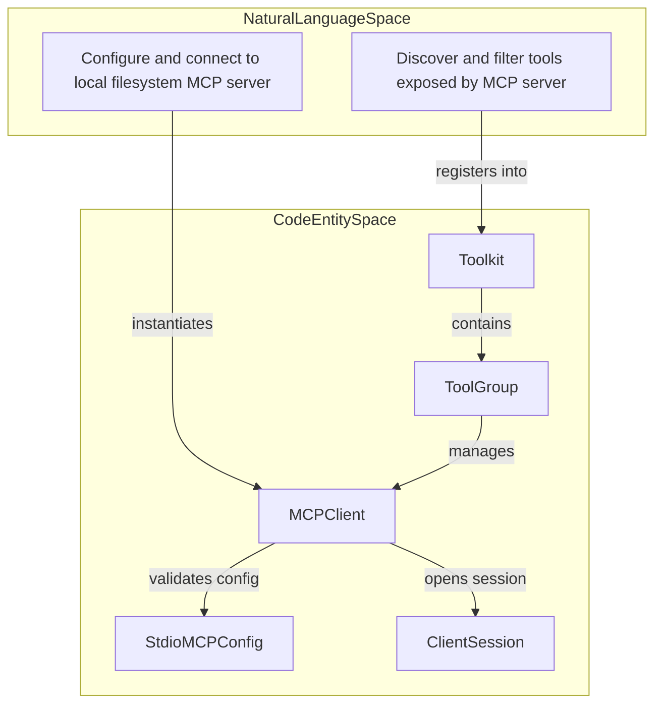
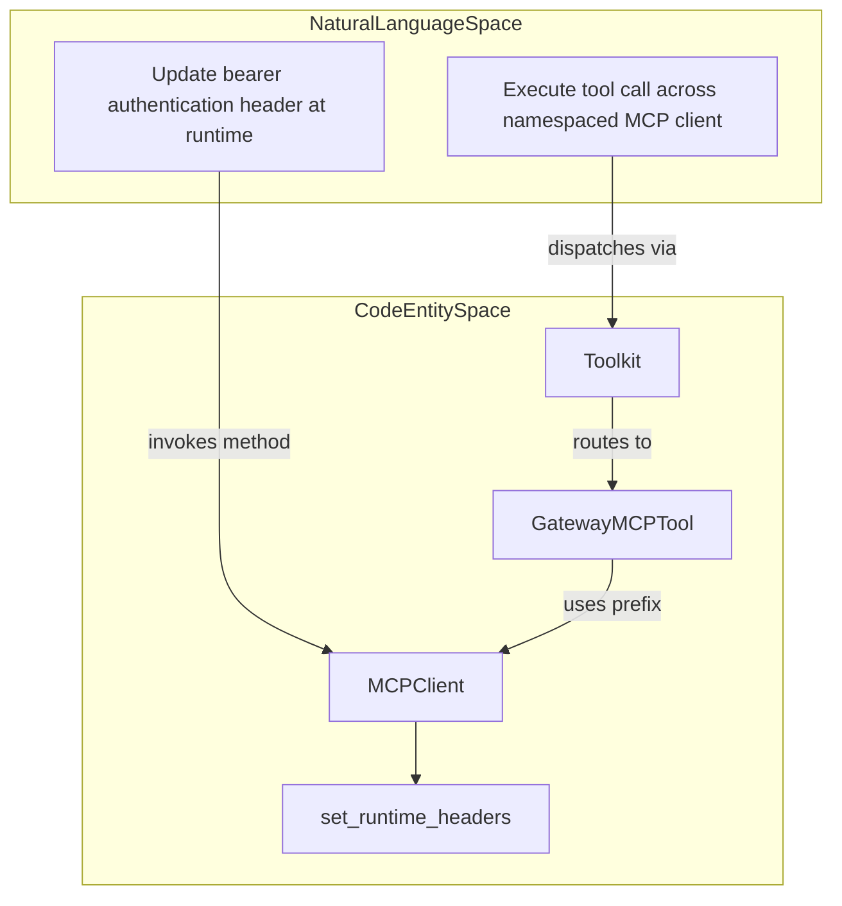

<!-- source: DeepWiki mcp.deepwiki.com · repo modelscope/agentscope · page 4.4 MCP Integration · fetched 2026-10-27 -->

# MCP Integration

Relevant source files

The following files were used as context for generating this wiki page:

- [src/agentscope/app/_router/_mcp.py](src/agentscope/app/_router/_mcp.py)
- [src/agentscope/mcp/_mcp_client.py](src/agentscope/mcp/_mcp_client.py)
- [src/agentscope/tool/_adapters.py](src/agentscope/tool/_adapters.py)
- [src/agentscope/tool/_utils.py](src/agentscope/tool/_utils.py)
- [src/agentscope/workspace/_gateway_client.py](src/agentscope/workspace/_gateway_client.py)
- [src/agentscope/workspace/_mcp_gateway/_mcp_gateway_app.py](src/agentscope/workspace/_mcp_gateway/_mcp_gateway_app.py)
- [tests/mcp_client_reconnect_test.py](tests/mcp_client_reconnect_test.py)
- [tests/mcp_rename_test.py](tests/mcp_rename_test.py)
- [tests/mcp_runtime_headers_test.py](tests/mcp_runtime_headers_test.py)
- [tests/mcp_sse_client_test.py](tests/mcp_sse_client_test.py)
- [tests/mcp_streamable_http_client_test.py](tests/mcp_streamable_http_client_test.py)
- [tests/mcp_tool_result_test.py](tests/mcp_tool_result_test.py)
- [tests/tool_lazy_annotations_test.py](tests/tool_lazy_annotations_test.py)
- [tests/toolkit_test.py](tests/toolkit_test.py)

This page details AgentScope's native integration with the Model Context Protocol (MCP), enabling agents to access external tools and data sources hosted on MCP-compliant servers via standard `stdio` and HTTP/SSE transports.

---

## 1. Overview and Architecture

MCP decouples LLM agent frameworks from concrete tool implementations. AgentScope integrates MCP through the `MCPClient` abstraction, which coordinates transport connection lifecycles, configuration validation, tool discovery, runtime headers, and strict name prefixing [src/agentscope/mcp/_mcp_client.py:32-79]().

### Natural Language to Code Entity Mapping: Initialization and Discovery

The following diagram maps high-level user intents for MCP client setup and tool discovery to their corresponding classes and methods in the codebase.

**Diagram: MCP Client Initialization and Tool Discovery Flow**

Sources: [src/agentscope/mcp/_mcp_client.py:32-111](), [src/agentscope/tool/_toolkit.py:66-135]()

---

## 2. Configuration Classes and Validation

`MCPClient` accepts two concrete configuration schemas through a Pydantic discriminator field (`mcp_config`) [src/agentscope/mcp/_mcp_client.py:106-111]():

- **`StdioMCPConfig`**: Configures local subprocess communication, requiring an executable `command` and arguments [src/agentscope/mcp/_config.py]().
- **`HttpMCPConfig`**: Configures HTTP-based Server-Sent Events (SSE) or Streamable-HTTP endpoints via a target `url` and optional headers/timeouts [src/agentscope/mcp/_config.py]().

During Pydantic model post-initialization (`model_post_init`), `MCPClient` enforces strict validation checks [src/agentscope/mcp/_mcp_client.py:152-187]():
1. **Name Format Constraint**: The client `name` must match `^[a-zA-Z0-9_-]+$` to ensure compliance with LLM tool-calling provider requirements [src/agentscope/mcp/_mcp_client.py:155-161]().
2. **Transport Rule**: Stdio-based MCP clients must be stateful (`is_stateful=True`), raising a `ValueError` otherwise [src/agentscope/mcp/_mcp_client.py:163-167]().
3. **Tool Filtering**: Validates `enable_tools` and `disable_tools` list integrity [src/agentscope/mcp/_mcp_client.py:169-186]().

Sources: [src/agentscope/mcp/_mcp_client.py:32-187]()

---

## 3. Stateful vs. Stateless Connections and Reconnection

`MCPClient` operates in two distinct connection modes governed by the `is_stateful` property [src/agentscope/mcp/_mcp_client.py:97-105]():

- **Stateful Connections**: Require explicit `connect()` and `close()` lifecycle calls. They maintain a persistent `ClientSession` backed by an `AsyncExitStack` and active transport stream [src/agentscope/mcp/_mcp_client.py:38-44]().
- **Stateless Connections**: Bypass explicit `connect()` calls, spinning up ephemeral transport sessions dynamically on every individual tool execution or tool listing request [src/agentscope/mcp/_mcp_client.py:39-41]().

### Reconnection and Transport Lifecycles

Stateful MCP transports are one-shot resources and cannot be re-entered after closing or encountering exceptions [tests/mcp_client_reconnect_test.py:14-35](). When `connect()` is invoked after `close()`, `MCPClient` discards the exhausted transport and initializes a fresh underlying instance [tests/mcp_client_reconnect_test.py:121-151](). Failed or cancelled connection attempts invoke cleanup handlers via `AsyncExitStack` to ensure complete resource reclamation [tests/mcp_client_reconnect_test.py:52-74]().

Sources: [src/agentscope/mcp/_mcp_client.py:32-44](), [tests/mcp_client_reconnect_test.py:14-194]()

---

## 4. Runtime Headers and Tool Name Prefixing

### Runtime Headers

In multi-tenant or rotating-credential environments, authentication headers (such as OAuth or bearer tokens) must be updatable without tearing down client instances. `MCPClient` provides `set_runtime_headers()` to dynamically override or clear headers on active HTTP clients [src/agentscope/mcp/_mcp_client.py:48-50](), [tests/mcp_runtime_headers_test.py:60-88](). These runtime headers respect reserved HTTP headers (`connection`, `content-length`, `host`, `transfer-encoding`) and allow per-request transport headers to take precedence [src/agentscope/mcp/_mcp_client.py:83-91](), [tests/mcp_runtime_headers_test.py:139-155]().

### Tool Name Prefixing

To eliminate naming collisions when multiple MCP servers or local tools are aggregated into a single `Toolkit`, `MCPClient` formats exposed tool names with strict namespacing: `mcp__{mcp_name}__{tool_name}` [src/agentscope/tool/_adapters.py:51-55](), [tests/mcp_sse_client_test.py:89-93]().

### Natural Language to Code Entity Mapping: Runtime Headers & Namespacing

**Diagram: Runtime Header Update and Namespaced Tool Execution Flow**

Sources: [src/agentscope/mcp/_mcp_client.py:32-51](), [src/agentscope/tool/_adapters.py:51-55](), [src/agentscope/workspace/_gateway_client.py:57-118](), [tests/mcp_runtime_headers_test.py:60-88]()

---

## 5. Toolkit Integration and Gateway Proxies

When MCP clients are registered into a `Toolkit` (either directly or via `ToolGroup`), the toolkit verifies that any stateful MCP client is connected prior to tool schema extraction or execution [src/agentscope/tool/_toolkit.py:93-152]().

Furthermore, in sandboxed environments, MCP connections are proxied through container gateway modules (`GatewayClient`, `GatewayMCPClient`, and `GatewayMCPTool`) to execute requests securely via loopback shell communication (`exec_shell`) without exposing host networks to untrusted subprocesses [src/agentscope/workspace/_gateway_client.py:5-22]().

Sources: [src/agentscope/tool/_toolkit.py:93-152](), [src/agentscope/workspace/_gateway_client.py:5-189]()

---

