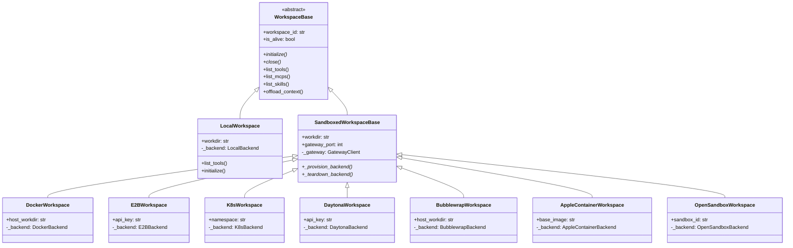
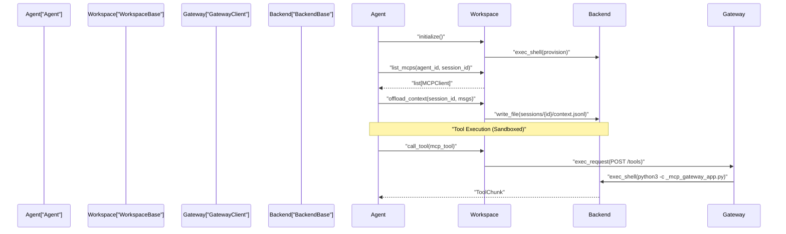

<!-- source: DeepWiki mcp.deepwiki.com · repo modelscope/agentscope · page 5 Workspace System · fetched 2026-10-27 -->

# Workspace System

Relevant source files

The following files were used as context for generating this wiki page:

- [src/agentscope/app/workspace_manager/__init__.py](src/agentscope/app/workspace_manager/__init__.py)
- [src/agentscope/workspace/__init__.py](src/agentscope/workspace/__init__.py)
- [src/agentscope/workspace/_base.py](src/agentscope/workspace/_base.py)
- [src/agentscope/workspace/_gateway_shim.py](src/agentscope/workspace/_gateway_shim.py)
- [src/agentscope/workspace/_local_workspace.py](src/agentscope/workspace/_local_workspace.py)
- [src/agentscope/workspace/_sandboxed_base.py](src/agentscope/workspace/_sandboxed_base.py)
- [tests/workspace_local_test.py](tests/workspace_local_test.py)
- [tests/workspace_manager_applecontainer_test.py](tests/workspace_manager_applecontainer_test.py)

The **Workspace System** provides agents with isolated, persistent, and manageable execution environments [src/agentscope/workspace/_base.py:5-10](). It abstracts underlying storage and compute backends—whether local filesystems, Docker containers, or cloud sandboxes—into a unified interface [src/agentscope/workspace/_base.py:12-20](). This system ensures that agents maintain a consistent execution context for their data, skills, and tools, while offering mechanisms to offload large context blocks and reduce LLM token overhead [src/agentscope/workspace/_base.py:5-10]().

### System Architecture

The workspace system architecture rests on three primary pillars:
1. **Discovery**: Providing agents with access to tools, Model Context Protocol (MCP) servers, and reusable skills [src/agentscope/workspace/_base.py:7-10]().
2. **Sandboxed Execution**: Executing code and file operations within isolated boundaries via a `BackendBase` implementation [src/agentscope/tool/_builtin/_backend.py:8-20](), [src/agentscope/workspace/_base.py:32-35]().
3. **Persistence and Offloading**: Managing session state, skill partitions, and offloaded multimodal payloads in a standardized filesystem layout [src/agentscope/workspace/_base.py:33-43]().

Sources: [src/agentscope/workspace/_base.py:5-43](), [src/agentscope/tool/_builtin/_backend.py:8-20]()

#### Workspace Class Hierarchy

The following diagram bridges natural language architectural concepts to concrete code entities, mapping abstract workspace definitions to their implementation files and classes.

**Workspace Backend Class Mapping**

Sources: [src/agentscope/workspace/_base.py:12-26](), [src/agentscope/workspace/_local_workspace.py:65-75](), [src/agentscope/workspace/_sandboxed_base.py:38-50]()

---

### Core Components

#### 5.1 WorkspaceBase and LocalWorkspace
The `WorkspaceBase` class establishes the foundational lifecycle contract (`initialize`, `close`, `reset`) and resource discovery APIs [src/agentscope/workspace/_base.py:21-26](). `LocalWorkspace` serves as the default implementation managing a structured host directory [src/agentscope/workspace/_local_workspace.py:65-75](). It organizes content into `data/` for multimodal assets, `skills/` for agent-editable skill partitions, and `sessions/` for compressed context logs [src/agentscope/workspace/_local_workspace.py:67-74](). File operations are executed directly through a bound `LocalBackend` [src/agentscope/workspace/_local_workspace.py:127](). The `LocalWorkspace` also handles the dynamic switching between `Bash` and `PowerShell` for shell tools based on the operating system [src/agentscope/workspace/_local_workspace.py:141-154](). Skill management includes migrating old skill layouts to a seed template and equipping agent partitions from this template [src/agentscope/workspace/_local_workspace.py:184-193](), [src/agentscope/workspace/_base.py:117-159]().

For details, see [WorkspaceBase and LocalWorkspace](#5.1).

Sources: [src/agentscope/workspace/_base.py:21-26](), [src/agentscope/workspace/_local_workspace.py:65-127](), [src/agentscope/workspace/_local_workspace.py:141-154](), [src/agentscope/workspace/_local_workspace.py:184-193](), [src/agentscope/workspace/_base.py:117-159]()

#### 5.2 Docker, E2B, K8s, Daytona, OpenSandbox, Bubblewrap, and AppleContainer Workspaces
To achieve stricter isolation, containerized and cloud-sandboxed backends inherit from `SandboxedWorkspaceBase` [src/agentscope/workspace/_sandboxed_base.py:38-50](). These backends operate an in-sandbox MCP gateway orchestrated via `GatewayClient` for secure tool routing and MCP execution [src/agentscope/workspace/_sandboxed_base.py:15-17](). Supported sandboxed implementations include `DockerWorkspace`, `E2BWorkspace`, `K8sWorkspace`, `DaytonaWorkspace`, `OpenSandboxWorkspace`, `BubblewrapWorkspace`, and `AppleContainerWorkspace` [src/agentscope/workspace/__init__.py:8-14](). The `SandboxedWorkspaceBase` defines properties for gateway paths like `_gateway_venv`, `_gateway_python`, `_gateway_script`, `_gateway_log`, and `_glob_helper_path` [src/agentscope/workspace/_sandboxed_base.py:74-112](). Subclasses must implement `_provision_backend`, `_teardown_backend`, and optionally `_bootstrap_commands` [src/agentscope/workspace/_sandboxed_base.py:146-170]().

For details, see [Docker, E2B, K8s, Daytona, OpenSandbox, Bubblewrap, and AppleContainer Workspaces](#5.2).

Sources: [src/agentscope/workspace/_sandboxed_base.py:38-50](), [src/agentscope/workspace/__init__.py:8-14](), [src/agentscope/workspace/_sandboxed_base.py:74-112](), [src/agentscope/workspace/_sandboxed_base.py:146-170]()

#### 5.3 Workspace Manager
Workspace Managers oversee the provisioning, lifecycle management, and resource clean-up of workspace instances across multi-tenant applications. They enforce isolation strategies via `IsolationPolicy` (such as `PER_AGENT` or `PER_SESSION`) to guarantee correct session reattachment [src/agentscope/app/workspace_manager/_base.py:5-15](). Concrete managers like `LocalWorkspaceManager` and `DockerWorkspaceManager` provide application-layer hooks for TTL and idle sweeping [src/agentscope/app/workspace_manager/__init__.py:5-17](). The session services interact with the `WorkspaceManagerBase` to manage and drop deleted session workspace states [src/agentscope/app/workspace_manager/_base.py:5-22]().

For details, see [Workspace Manager](#5.3).

Sources: [src/agentscope/app/workspace_manager/_base.py:5-22](), [src/agentscope/app/workspace_manager/__init__.py:5-17]()

---

### Integration Flow

The following sequence diagram associates runtime operations with specific methods and modules in the codebase, bridging the conceptual execution flow to concrete code symbols.

**Agent-Workspace Interaction Sequence**

Sources: [src/agentscope/workspace/_base.py:21-26](), [src/agentscope/workspace/_sandboxed_base.py:174-208](), [src/agentscope/workspace/_local_workspace.py:141-162](), [src/agentscope/workspace/_base.py:450-452]()

### Summary Table of Backends

| Feature | `LocalWorkspace` | `DockerWorkspace` | `E2BWorkspace` | `K8sWorkspace` | `DaytonaWorkspace` | `OpenSandboxWorkspace` | `BubblewrapWorkspace` | `AppleContainerWorkspace` |
| :--- | :--- | :--- | :--- | :--- | :--- | :--- | :--- | :--- |
| **Isolation** | Process-level (Low) | Container-level (High) | Cloud Sandbox (Highest) | Cluster-level (High) | Cloud Sandbox (High) | Cloud Sandbox (High) | Namespace-level (Medium) | macOS VM-level (High) |
| **Backend** | `LocalBackend` | `DockerBackend` | `E2BBackend` | `K8sBackend` | `DaytonaBackend` | `OpenSandboxBackend` | `BubblewrapBackend` | `AppleContainerBackend` |
| **Persistence** | Local Directory | Bind-mounted Volume | Pause/Resume Session | PVC | Pause/Resume Session | Pause/Resume Session | Host Directory | TTL-based Cache |
| **Gateway** | N/A (Direct) | `GatewayClient` | `GatewayClient` | `GatewayClient` | `GatewayClient` | `GatewayClient` | `GatewayClient` | `GatewayClient` |

Sources: [src/agentscope/workspace/_base.py:12-19](), [src/agentscope/workspace/_local_workspace.py:67-74](), [src/agentscope/workspace/__init__.py:18-35]()

---

