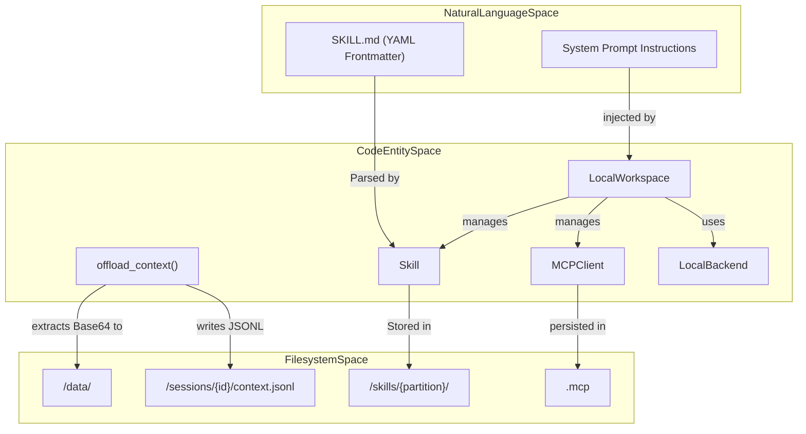
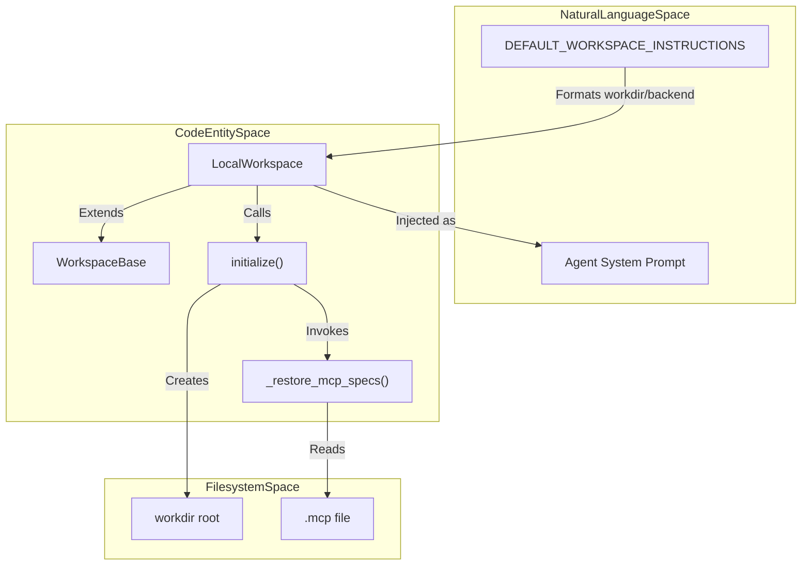
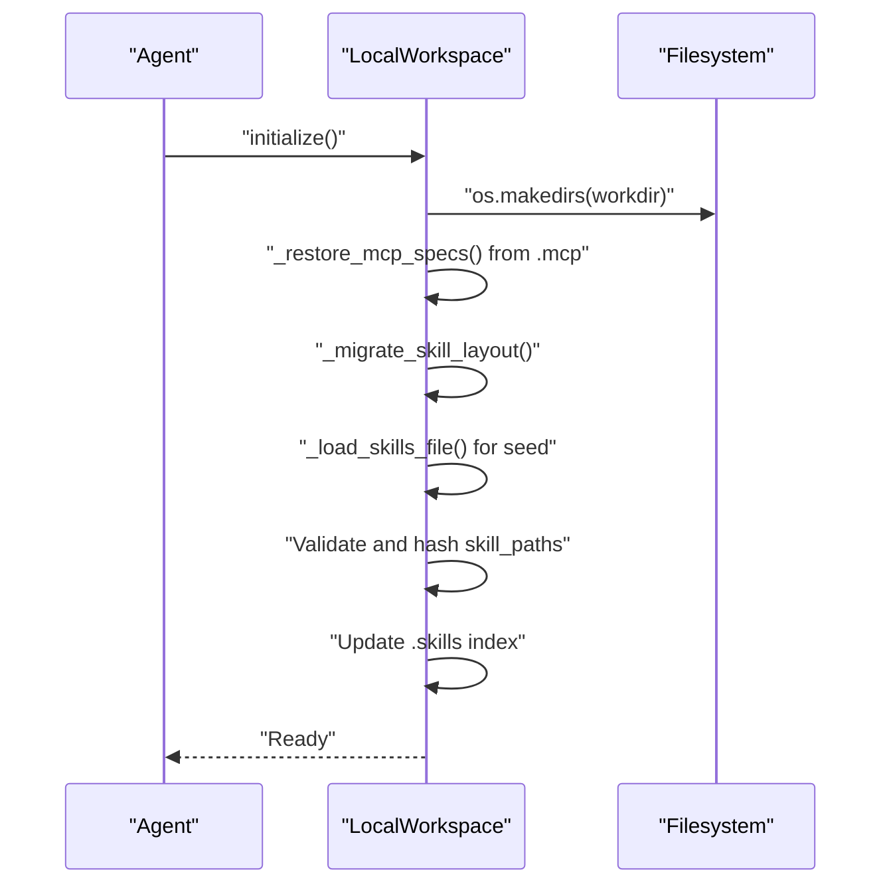

<!-- source: DeepWiki mcp.deepwiki.com · repo modelscope/agentscope · page 5.1 WorkspaceBase and LocalWorkspace · fetched 2026-10-27 -->

# WorkspaceBase and LocalWorkspace

<details>
<summary>Relevant source files</summary>

The following files were used as context for generating this wiki page:

- [src/agentscope/workspace/_base.py](src/agentscope/workspace/_base.py)
- [src/agentscope/workspace/_local_workspace.py](src/agentscope/workspace/_local_workspace.py)
- [src/agentscope/workspace/_sandboxed_base.py](src/agentscope/workspace/_sandboxed_base.py)
- [tests/workspace_local_test.py](tests/workspace_local_test.py)

</details>


A workspace provides a sandboxed execution environment for agents, managing resources such as tools, skills, and persistent storage for offloaded context and tool results [src/agentscope/workspace/_base.py:5-10](). The `WorkspaceBase` abstract base class defines a unified lifecycle and discovery interface [src/agentscope/workspace/_base.py:14-26](), while `LocalWorkspace` implements this contract on the host's local filesystem [src/agentscope/workspace/_local_workspace.py:65-74]().

Sources: [src/agentscope/workspace/_base.py:5-26](), [src/agentscope/workspace/_local_workspace.py:65-74]()

## WorkspaceBase Interface

`WorkspaceBase` is the abstract base class defining the contract for all workspace backends, including local and sandboxed environments [src/agentscope/workspace/_base.py:14-26](). It manages properties such as `workspace_id` and the `is_alive` lifecycle flag.

### Lifecycle Management
Workspaces follow a strict lifecycle to ensure resources (such as MCP connections or containerized environments) are properly provisioned and released.

| Method | Description |
| :--- | :--- |
| `initialize()` | Provisions resources, restores MCP declarations, and seeds initial skills [src/agentscope/workspace/_base.py:177-190](). |
| `close()` | Releases all resources and active connections [src/agentscope/workspace/_sandboxed_base.py:159-164](). |
| `reset()` | Wipes per-session state and returns the workspace to an empty state. |
| `__aenter__` / `__aexit__` | Provides asynchronous context manager support, automatically invoking `initialize` and `close`. |

### Discovery and Offloading
The `Agent` class and app layer consume the workspace via several key discovery and persistence methods:
*   **Discovery**: `list_tools()`, `list_mcps()`, and `list_skills()` allow the agent to inspect its capabilities within the sandbox [src/agentscope/workspace/_base.py:22-28]().
*   **Persistence**: `offload_context()` and `offload_tool_result()` move large or multimodal data out of primary conversation history into workspace storage [src/agentscope/workspace/_base.py:9-10]().

Sources: [src/agentscope/workspace/_base.py:5-28](), [src/agentscope/workspace/_sandboxed_base.py:159-164]()

## LocalWorkspace Implementation and Filesystem Layout

`LocalWorkspace` implements the workspace interface using the local filesystem, organizing files into a structured directory layout and managing persistent state for MCP clients and skills [src/agentscope/workspace/_local_workspace.py:65-74]().

### Filesystem Layout
When initialized, `LocalWorkspace` creates and manages the following directory structure within its `workdir` [src/agentscope/workspace/_local_workspace.py:67-74]():

```text
{workdir}/
├── .mcp          # JSON array of persisted MCPClient configurations
├── data/         # Offloaded multimodal files (images, audio, etc.)
├── skills/       # .seed template, plus one partition per agent
│   ├── .seed     # Template directory for equipping new partitions
│   └── {agent}/  # Partitioned skill storage per agent
└── sessions/     # Per-session context.jsonl and tool-result files
```

### Tool Listing
`LocalWorkspace.list_tools()` provides core filesystem and shell tools. It dynamically selects the shell based on the operating system: `PowerShell` for Windows (`nt`) and `Bash` for POSIX systems [src/agentscope/workspace/_local_workspace.py:150-153](). The standard toolset includes `Edit`, `Glob`, `Grep`, `Read`, and `Write`, all bound to a `LocalBackend` [src/agentscope/workspace/_local_workspace.py:155-162]().

### Workspace Entity Mapping

The following diagram bridges the Natural Language Space (such as skill markdown frontmatter and prompt text) to Code Entity Space and Filesystem Space.

**Workspace Entity Mapping**


Sources: [src/agentscope/workspace/_local_workspace.py:65-162](), [src/agentscope/workspace/_base.py:50-60]()

## Skill Indexing and Management

`LocalWorkspace` tracks installed skill states using a `.skills` index file modeled by `_SkillsFile` [src/agentscope/workspace/_local_workspace.py:38-45](). It records the SHA-256 hash of each skill's `SKILL.md` content [src/agentscope/workspace/_local_workspace.py:29-36]() and the modification time (`mtime`) of the directory [src/agentscope/workspace/_local_workspace.py:40-42]() to support fast change detection during initialization. Skills are partitioned per agent under `skills/` to prevent editing interference between agents [src/agentscope/workspace/_base.py:50-55]().

The `_sanitize_dir_name` function [src/agentscope/workspace/_local_workspace.py:47-62]() ensures that skill names from `SKILL.md` frontmatter are converted into safe directory names, allowing ASCII letters, digits, CJK unified ideographs, hyphens, and underscores, replacing other characters with `_`. This prevents issues with invalid characters in filesystem paths [src/agentscope/workspace/_local_workspace.py:47-62]().

Sources: [src/agentscope/workspace/_local_workspace.py:29-62](), [src/agentscope/workspace/_base.py:50-55]()

## System Prompt Instructions and Initialization

Workspaces inject instructions into the agent's system prompt via `self.instructions`, which formats the configured `workdir` and backend type [src/agentscope/workspace/_local_workspace.py:121-125](). These instructions provide agents with guidelines on filesystem usage, project organization, and tool invocation. The default instructions are defined by `DEFAULT_WORKSPACE_INSTRUCTIONS` [src/agentscope/workspace/_local_workspace.py:15]().

### Natural Language to Code Entity Bridge: Instructions and Initialization

The second architecture bridge illustrates how natural language system instructions map to internal initialization flows across code entities.

**Instruction and Initialization Flow**


**LocalWorkspace Initialization Sequence**


Sources: [src/agentscope/workspace/_local_workspace.py:15-15](), [src/agentscope/workspace/_local_workspace.py:121-125](), [src/agentscope/workspace/_local_workspace.py:164-190](), [src/agentscope/workspace/_base.py:14-26]()

## Context Offloading

`WorkspaceBase` and `LocalWorkspace` handle the persistence of message histories, offloading large objects and multimodal payloads [src/agentscope/workspace/_base.py:5-10]().

### Offload Process
1.  **Session Partitioning**: Data is stored under `sessions/{session_id}/` [tests/workspace_local_test.py:198-201]().
2.  **Multimodal Extraction**: If a message contains a `DataBlock` with `Base64Source`, the workspace generates a unique filename using a hash, saves binary data to the `data/` directory, and converts the source into a `URLSource` pointing to the file.
3.  **JSONL Persistence**: Modified messages are appended to `context.jsonl` within the session directory.

Sources: [src/agentscope/workspace/_base.py:5-10](), [tests/workspace_local_test.py:198-201]()

---

