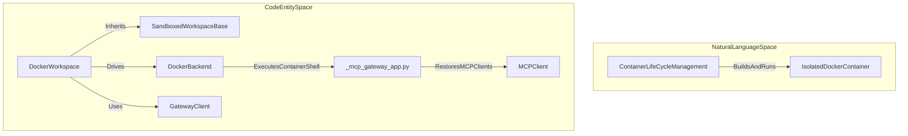
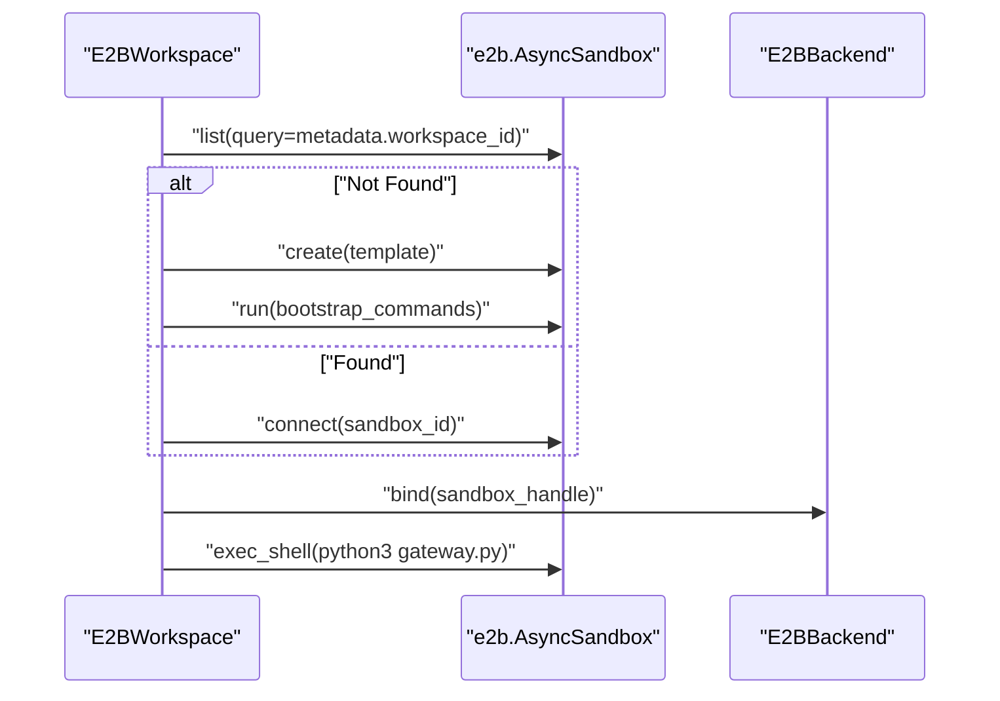

<!-- source: DeepWiki mcp.deepwiki.com · repo modelscope/agentscope · page 5.2 Docker, E2B, K8s, Daytona, OpenSandbox, Bubblewrap, and AppleContainer Workspaces · fetched 2026-10-27 -->

# Docker, E2B, K8s, Daytona, OpenSandbox, Bubblewrap, and AppleContainer Workspaces

Relevant source files

The following files were used as context for generating this wiki page:

- [examples/workspace/apple-container-workspace.md](examples/workspace/apple-container-workspace.md)
- [src/agentscope/workspace/_applecontainer/__init__.py](src/agentscope/workspace/_applecontainer/__init__.py)
- [src/agentscope/workspace/_applecontainer/_applecontainer_backend.py](src/agentscope/workspace/_applecontainer/_applecontainer_backend.py)
- [src/agentscope/workspace/_applecontainer/_applecontainer_workspace.py](src/agentscope/workspace/_applecontainer/_applecontainer_workspace.py)
- [src/agentscope/workspace/_applecontainer/_constants.py](src/agentscope/workspace/_applecontainer/_constants.py)
- [src/agentscope/workspace/_daytona/_daytona_workspace.py](src/agentscope/workspace/_daytona/_daytona_workspace.py)
- [src/agentscope/workspace/_docker/_docker_workspace.py](src/agentscope/workspace/_docker/_docker_workspace.py)
- [src/agentscope/workspace/_e2b/_e2b_workspace.py](src/agentscope/workspace/_e2b/_e2b_workspace.py)
- [src/agentscope/workspace/_k8s/_k8s_workspace.py](src/agentscope/workspace/_k8s/_k8s_workspace.py)
- [src/agentscope/workspace/_opensandbox/_constants.py](src/agentscope/workspace/_opensandbox/_constants.py)
- [src/agentscope/workspace/_opensandbox/_opensandbox_backend.py](src/agentscope/workspace/_opensandbox/_opensandbox_backend.py)
- [src/agentscope/workspace/_opensandbox/_opensandbox_workspace.py](src/agentscope/workspace/_opensandbox/_opensandbox_workspace.py)
- [src/agentscope/workspace/_utils.py](src/agentscope/workspace/_utils.py)
- [tests/backend_applecontainer_test.py](tests/backend_applecontainer_test.py)
- [tests/backend_daytona_test.py](tests/backend_daytona_test.py)
- [tests/backend_docker_test.py](tests/backend_docker_test.py)
- [tests/backend_e2b_test.py](tests/backend_e2b_test.py)
- [tests/backend_opensandbox_test.py](tests/backend_opensandbox_test.py)
- [tests/docker/k8s_workspace_test.Dockerfile](tests/docker/k8s_workspace_test.Dockerfile)
- [tests/sandbox_checkout_wheel_test.py](tests/sandbox_checkout_wheel_test.py)
- [tests/sandbox_test_support/__init__.py](tests/sandbox_test_support/__init__.py)
- [tests/sandbox_test_support/_verify_wheel.py](tests/sandbox_test_support/_verify_wheel.py)
- [tests/test_e2e_docker_mcp.py](tests/test_e2e_docker_mcp.py)
- [tests/test_e2e_e2b_mcp.py](tests/test_e2e_e2b_mcp.py)
- [tests/workspace_applecontainer_test.py](tests/workspace_applecontainer_test.py)
- [tests/workspace_bubblewrap_test.py](tests/workspace_bubblewrap_test.py)
- [tests/workspace_daytona_test.py](tests/workspace_daytona_test.py)
- [tests/workspace_docker_test.py](tests/workspace_docker_test.py)
- [tests/workspace_e2b_test.py](tests/workspace_e2b_test.py)
- [tests/workspace_k8s_test.py](tests/workspace_k8s_test.py)
- [tests/workspace_opensandbox_test.py](tests/workspace_opensandbox_test.py)

AgentScope provides isolated and reproducible execution environments through sandboxed `Workspace` backends [src/agentscope/workspace/_sandboxed_base.py:15-17](). While local workspaces operate directly on the host filesystem, sandboxed backends manage isolated execution contexts via a unified gateway architecture [src/agentscope/workspace/_mcp_gateway/_mcp_gateway_app.py:2-30]().

Sources: [src/agentscope/workspace/_sandboxed_base.py:15-17](), [src/agentscope/workspace/_mcp_gateway/_mcp_gateway_app.py:2-30]()

---

## Sandboxed Workspace Architecture

All sandboxed workspace backends—including Docker, E2B, Kubernetes, Daytona, OpenSandbox, Bubblewrap, and AppleContainer—inherit from `SandboxedWorkspaceBase` [src/agentscope/workspace/_sandboxed_base.py:15-17](). This base class defines a template-method lifecycle for environments running an in-sandbox **MCP Gateway** process [src/agentscope/workspace/_mcp_gateway/_mcp_gateway_app.py:2-30]().

Sources: [src/agentscope/workspace/_sandboxed_base.py:15-17](), [src/agentscope/workspace/_mcp_gateway/_mcp_gateway_app.py:2-30]()

---

## The Gateway Shim and Transport

To prevent the need for complex host-to-sandbox network reachability or port forwarding, AgentScope uses a **Gateway Shim** mechanism [src/agentscope/workspace/_utils.py:124-137]():

1. **Request Execution**: The host-side `GatewayClient` triggers a request by spawning a lightweight Python script inside the sandbox using `backend.exec_shell` [src/agentscope/workspace/_e2b/_e2b_workspace.py:28-30]().
2. **Shim Operation**: The script executes local loopback HTTP calls against the gateway process running inside the sandbox [src/agentscope/workspace/_mcp_gateway/_mcp_gateway_app.py:2-30]().
3. **Data Relay**: Small responses are returned directly via `stdout`. Large payloads spill to temporary files to protect host memory [src/agentscope/workspace/_utils.py:124-137]().
4. **Security**: Communication is secured via bearer tokens generated during workspace initialization.

Title: Gateway Communication Flow and Code Entity Mapping

```mermaid
graph TD
    subgraph "NaturalLanguageSpace"
        HostProcess["HostProcessLayer"] -->|DispatchesCommand| SandboxEnv["SandboxExecutionEnvironment"]
    end

    subgraph "CodeEntitySpace"
        GatewayClient["GatewayClient"] -->|CallsExecShell| BackendBase["SandboxedWorkspaceBase"]
        BackendBase -->|ExecutesShimScript| SandboxTmpDir["SANDBOX_WORKDIR"]
        SandboxTmpDir -->|HTTPPostGet| FastAPIGateway["_mcp_gateway_app.py"]
        FastAPIGateway -->|RouteHandlers| RouteMcps["_add_mcp / _list_mcps"]
        RouteMcps -->|ManagesState| StateClass["_State"]
    end
```

Sources: [src/agentscope/workspace/_e2b/_e2b_workspace.py:28-30](), [src/agentscope/workspace/_utils.py:124-137](), [src/agentscope/workspace/_mcp_gateway/_mcp_gateway_app.py:2-30]()

---

## DockerWorkspace

`DockerWorkspace` implements a containerized execution environment using `aiodocker` [src/agentscope/workspace/_docker/_docker_workspace.py:43-148]().

* **Content-Hashed Builds**: Images are built via `prepare_build_context` [src/agentscope/workspace/_docker/_make_dockerfile.py:31-37](). A SHA-256 hash of the Dockerfile template and dependencies serves as the image tag; existing tags skip building.
* **Persistence**: When `host_workdir` is specified, it is bind-mounted to `/workspace` inside the container [src/agentscope/workspace/_docker/_docker_workspace.py:116-118](), ensuring `.mcp`, `skills/`, and `sessions/` survive container restarts.
* **GatewayClient**: Manages the in-container FastAPI process, reading `.mcp` configurations directly [src/agentscope/workspace/_docker/_docker_workspace.py:14-17]().

Title: Docker Workspace Entity Mapping

Sources: [src/agentscope/workspace/_docker/_docker_workspace.py:43-148](), [src/agentscope/workspace/_docker/_make_dockerfile.py:31-37](), [src/agentscope/workspace/_sandboxed_base.py:15-17]()

---

## E2BWorkspace

`E2BWorkspace` provides cloud-based sandboxes using the E2B SDK (`e2b.AsyncSandbox`) [src/agentscope/workspace/_e2b/_e2b_workspace.py:66-153]().

* **Reattachment**: `initialize()` searches for existing sandboxes via `METADATA_WORKSPACE_ID_KEY` in E2B metadata to resume them [src/agentscope/workspace/_e2b/_e2b_workspace.py:52-59]().
* **Bootstrap Sequence**: Installs `uv`, creates a gateway venv, installs `agentscope` with `--no-deps`, and uploads the gateway script if missing [src/agentscope/workspace/_e2b/_e2b_workspace.py:20-25]().
* **Persistence**: `close()` calls `sandbox.pause()`, preserving the entire cloud filesystem for subsequent sessions [src/agentscope/workspace/_e2b/_e2b_workspace.py:10-16]().

Title: E2B Sandbox Interaction Flow

Sources: [src/agentscope/workspace/_e2b/_e2b_workspace.py:10-59](), [src/agentscope/workspace/_e2b/_e2b_backend.py:1-50]()

---

## K8s and OpenSandbox Workspaces

### K8sWorkspace
Backs the workspace with a Kubernetes Pod using `kubernetes_asyncio`.
* **Persistence**: Utilizes a PersistentVolumeClaim (PVC) named `as-ws-{workspace_id}` mounted at `/workspace` to preserve state across Pod restarts.
* **Lifecycle**: `initialize()` reuses existing Pods by label or provisions new ones; `close()` deletes the Pod while retaining the PVC by default.

### OpenSandboxWorkspace
Integrates with the OpenSandbox remote sandbox service [tests/backend_opensandbox_test.py:42-65](). Uses `OpenSandboxBackend` to wrap remote execution and file APIs.
* **Metadata Reattachment**: Relies on `METADATA_WORKSPACE_ID_KEY` to discover and attach to existing remote sandboxes.
* **Bootstrap**: Supports streaming `apt-get` and `uv` setup into a slim base image during initial provisioning.

Sources: [tests/backend_opensandbox_test.py:42-65](), [src/agentscope/workspace/_opensandbox/_opensandbox_backend.py:2-47]()

---

## DaytonaWorkspace

`DaytonaWorkspace` leverages the Daytona SDK for remote workspace management [tests/workspace_daytona_test.py:59-65]().

* **Label-Based Reattachment**: Uses `METADATA_WORKSPACE_ID_KEY` to attach to existing Daytona workspaces via tags [tests/workspace_daytona_test.py:59-65]().
* **Workdir Detection**: Automatically discovers the project root directory within the Daytona environment before routing gateway operations [tests/workspace_daytona_test.py:142-156]().
* **Idle Management**: Compatible with Daytona's idle cleanup routines via graceful shutdown requests [tests/workspace_daytona_test.py:189-197]().

Sources: [tests/workspace_daytona_test.py:59-197]()

---

## BubblewrapWorkspace

`BubblewrapWorkspace` provides a local Linux sandbox using `bwrap` [tests/workspace_bubblewrap_test.py:99-123]().

* **Filesystem Isolation**: Mounts standard system directories as read-only while providing an ephemeral `tmpfs` layer for `/tmp` and `/run` [tests/workspace_bubblewrap_test.py:3-31]().
* **Persistence**: Supports `host_workdir` (bind-mounted to `/workspace`) and `host_cache_dir` for caching `uv` and `pip` packages [tests/workspace_bubblewrap_test.py:164-174]().
* **Network Sharing**: Requires `share_net=True` to allow TCP communication with the MCP gateway over loopback [tests/workspace_bubblewrap_test.py:137-141]().

Sources: [tests/workspace_bubblewrap_test.py:3-174](), [src/agentscope/workspace/_utils.py:18-79]()

---

## AppleContainerWorkspace

`AppleContainerWorkspace` provides sandboxed execution on macOS (v26+ Apple Silicon) using the `container` CLI [src/agentscope/workspace/_applecontainer/_applecontainer_workspace.py:75-102]().

* **AppleContainerBackend**: Drives the `container` CLI for container execution, copying, and process management [src/agentscope/workspace/_applecontainer/_applecontainer_workspace.py:152-166]().
* **OCI Image Support**: Pulls and caches OCI-compliant base images [src/agentscope/workspace/_applecontainer/_applecontainer_workspace.py:167-172]().
* **Lifecycle**: `initialize()` sets up the container, bootstraps the gateway environment via `uv`, and starts the MCP gateway [src/agentscope/workspace/_applecontainer/_applecontainer_workspace.py:157-166]().

Sources: [src/agentscope/workspace/_applecontainer/_applecontainer_workspace.py:75-166](), [tests/workspace_applecontainer_test.py:4-25]()

---

## Shared MCP Gateway Module

All sandboxed backends share the `_mcp_gateway` module for centralized tool execution [src/agentscope/workspace/_mcp_gateway/_mcp_gateway_app.py:2-30]().

* **GatewayClient**: Host-side facade that handles request authentication and command relay [src/agentscope/workspace/_gateway_client.py:2-8]().
* **GatewayMCPClient**: An `MCPClient` implementation where connection lifecycle methods are mapped to gateway HTTP calls [src/agentscope/workspace/_gateway_client.py:173-186]().
* **GatewayMCPTool**: A `ToolBase` implementation whose execution invokes remote tools via the gateway shim [src/agentscope/workspace/_gateway_client.py:57-155]().

Sources: [src/agentscope/workspace/_mcp_gateway/_mcp_gateway_app.py:2-30](), [src/agentscope/workspace/_gateway_client.py:2-189]()

---

## Backend Implementation Matrix

| Implementation | Primary Technology | Persistence Layer | OS Support |
| :--- | :--- | :--- | :--- |
| `LocalWorkspace` | `asyncio.subprocess` | Host Filesystem | Cross-platform |
| `DockerWorkspace` | `aiodocker` | Host Bind-mount | Cross-platform |
| `E2BWorkspace` | `e2b.AsyncSandbox` | Cloud Disk (Paused Sandbox) | Cloud |
| `K8sWorkspace` | `kubernetes_asyncio` | PersistentVolumeClaim (PVC) | K8s Cluster |
| `DaytonaWorkspace`| `daytona` SDK | Daytona Workspace Storage | Cloud/Self-hosted |
| `BubblewrapWorkspace`| `bwrap` CLI | Host Bind-mount | Linux Only |
| `AppleContainerWorkspace`| `container` CLI | Container Filesystem | macOS (Apple Silicon) |

Sources: [src/agentscope/workspace/_gateway_client.py:2-189](), [src/agentscope/workspace/_utils.py:18-79](), [src/agentscope/workspace/_e2b/_e2b_workspace.py:7-35](), [src/agentscope/workspace/_applecontainer/_applecontainer_workspace.py:1-37]()

---

