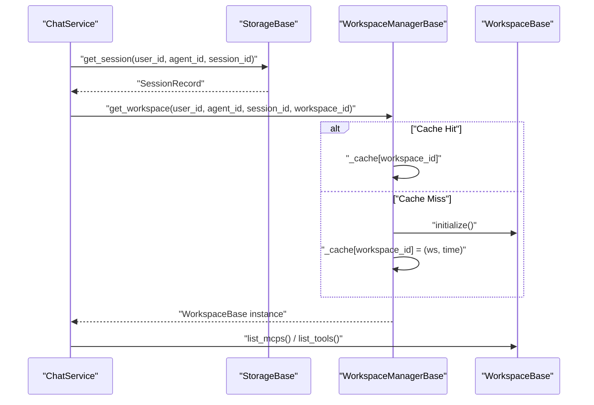
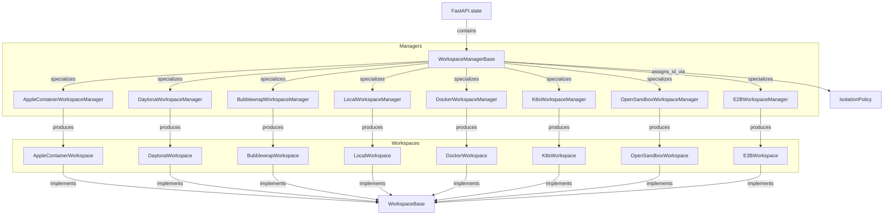

<!-- source: DeepWiki mcp.deepwiki.com · repo modelscope/agentscope · page 5.3 Workspace Manager · fetched 2026-10-27 -->

# Workspace Manager

Relevant source files

The following files were used as context for generating this wiki page:

- [.github/workflows/k8s-workspace.yml](.github/workflows/k8s-workspace.yml)
- [src/agentscope/app/workspace_manager/_applecontainer_workspace_manager.py](src/agentscope/app/workspace_manager/_applecontainer_workspace_manager.py)
- [src/agentscope/app/workspace_manager/_base.py](src/agentscope/app/workspace_manager/_base.py)
- [src/agentscope/app/workspace_manager/_bubblewrap_workspace_manager.py](src/agentscope/app/workspace_manager/_bubblewrap_workspace_manager.py)
- [src/agentscope/app/workspace_manager/_daytona_workspace_manager.py](src/agentscope/app/workspace_manager/_daytona_workspace_manager.py)
- [src/agentscope/app/workspace_manager/_docker_workspace_manager.py](src/agentscope/app/workspace_manager/_docker_workspace_manager.py)
- [src/agentscope/app/workspace_manager/_e2b_workspace_manager.py](src/agentscope/app/workspace_manager/_e2b_workspace_manager.py)
- [src/agentscope/app/workspace_manager/_k8s_workspace_manager.py](src/agentscope/app/workspace_manager/_k8s_workspace_manager.py)
- [src/agentscope/app/workspace_manager/_local_workspace_manager.py](src/agentscope/app/workspace_manager/_local_workspace_manager.py)
- [src/agentscope/app/workspace_manager/_opensandbox_workspace_manager.py](src/agentscope/app/workspace_manager/_opensandbox_workspace_manager.py)
- [src/agentscope/workspace/_docker/Dockerfile.template](src/agentscope/workspace/_docker/Dockerfile.template)
- [src/agentscope/workspace/_docker/_make_dockerfile.py](src/agentscope/workspace/_docker/_make_dockerfile.py)
- [tests/workspace_docker_build_test.py](tests/workspace_docker_build_test.py)
- [tests/workspace_manager_daytona_test.py](tests/workspace_manager_daytona_test.py)
- [tests/workspace_manager_docker_test.py](tests/workspace_manager_docker_test.py)

The Workspace Manager subsystem (located in `src/agentscope/app/workspace_manager/`) acts as the lifecycle orchestrator for sandboxed execution environments (`WorkspaceBase`) within the AgentScope 2.0 application layer. It provides a unified, backend-agnostic interface for the service layer to provision, cache, pre-warm, and clean up environments that host tools, skills, and Model Context Protocol (MCP) servers.

Sources: [src/agentscope/app/workspace_manager/__init__.py:1-30](), [src/agentscope/app/workspace_manager/_base.py:1-40]()

---

## WorkspaceManagerBase and IsolationPolicy

The architecture implements a manager-worker pattern where concrete subclasses of `WorkspaceManagerBase` manage collections of sandboxed workspaces [src/agentscope/app/workspace_manager/_base.py:28-40]().

The `IsolationPolicy` configuration enum determines how workspace identifiers are assigned when requests do not specify an explicit `workspace_id`:
* `PER_SESSION`: Isolates workspaces per chat session [src/agentscope/app/workspace_manager/_base.py:18-26]().
* `PER_AGENT`: Isolates workspaces per individual agent instance [src/agentscope/app/workspace_manager/_base.py:18-26]().
* `PER_USER`: Isolates workspaces per user identifier [src/agentscope/app/workspace_manager/_base.py:18-26]().

When `get_workspace()` is invoked without an explicit `workspace_id`, the manager assigns a stable identifier via `assign_workspace_id()` based on the active `IsolationPolicy` [src/agentscope/app/workspace_manager/_base.py:83-125]().

Sources: [src/agentscope/app/workspace_manager/_base.py:18-40](), [src/agentscope/app/workspace_manager/_base.py:83-125]()

---

## Concrete Workspace Managers

AgentScope provides multiple concrete managers tailored to different local and cloud-based execution backends. Each manager exposes a uniform public interface (`get_workspace()`, `close()`, `close_all()`) so that upper layers like `ChatService` do not need to branch on backend types [src/agentscope/app/workspace_manager/_docker_workspace_manager.py:4-7]().

### LocalWorkspaceManager
Manages `LocalWorkspace` instances mapping directly to host filesystem directories, using TTL-based lazy lifecycle management keyed by `workspace_id` [src/agentscope/app/workspace_manager/_local_workspace_manager.py:15-22]().

### DockerWorkspaceManager
Orchestrates `DockerWorkspace` instances inside dedicated Docker containers [src/agentscope/app/workspace_manager/_docker_workspace_manager.py:2-8](). It supports `PER_AGENT` or `PER_SESSION` isolation, bind-mounts workdirs to `/workspace`, and uses deterministic container naming (`as_ws_<workspace_id>`) to support reattachment across process restarts [src/agentscope/app/workspace_manager/_docker_workspace_manager.py:15-18](). It also supports pre-warming via `WorkspacePrewarmMixin` [src/agentscope/app/workspace_manager/_docker_workspace_manager.py:49-52]().

### E2BWorkspaceManager
Integrates with the E2B cloud sandbox platform using `AsyncSandbox` [src/agentscope/app/workspace_manager/_e2b_workspace_manager.py:2-21](). It uses sandbox metadata (`agentscope.workspace.id`) for reattachment and supports pre-warming buffers [src/agentscope/app/workspace_manager/_e2b_workspace_manager.py:16-21]().

### K8sWorkspaceManager
Orchestrates Kubernetes Pods and PersistentVolumeClaims (PVCs), ensuring data durability across Pod restarts by mounting provisioned volumes [src/agentscope/app/workspace_manager/_k8s_workspace_manager.py:2-16]().

### DaytonaWorkspaceManager
Manages development environments via Daytona [src/agentscope/app/workspace_manager/_daytona_workspace_manager.py:2-15](). It writes `workspace_id` to the sandbox label `agentscope.workspace.id` at creation time for reattachment and instantiates a dedicated provider client per workspace [src/agentscope/app/workspace_manager/_daytona_workspace_manager.py:10-18]().

### OpenSandboxWorkspaceManager
Orchestrates OpenSandbox environments, reattaching via sandbox metadata lookup (`agentscope.workspace.id`) and managing lifecycle transitions such as pause and resume [src/agentscope/app/workspace_manager/_opensandbox_workspace_manager.py:2-28]().

### BubblewrapWorkspaceManager
Manages Linux Bubblewrap-based sandboxes (`BubblewrapWorkspace`) [src/agentscope/app/workspace_manager/_bubblewrap_workspace_manager.py:2-38](). It resolves host workdirs using `basedir`, `user_id`, and `workspace_id` combined with `blake2b` hashing for filesystem isolation [src/agentscope/app/workspace_manager/_bubblewrap_workspace_manager.py:24-38]().

### AppleContainerWorkspaceManager
Lifecycle manager for `AppleContainerWorkspace` on macOS with Apple silicon [src/agentscope/app/workspace_manager/_applecontainer_workspace_manager.py:2-17](). It pulls OCI images directly, uses deterministic container names for reattachment, and executes parallel teardowns via `close_all()` [src/agentscope/app/workspace_manager/_applecontainer_workspace_manager.py:11-17]().

Sources: [src/agentscope/app/workspace_manager/__init__.py:1-30](), [src/agentscope/app/workspace_manager/_docker_workspace_manager.py:2-52](), [src/agentscope/app/workspace_manager/_daytona_workspace_manager.py:2-23](), [src/agentscope/app/workspace_manager/_applecontainer_workspace_manager.py:2-48]()

---

## TTL and Idle Sweeping

Workspace managers implement Time-To-Live (TTL) caching to optimize performance and prevent resource exhaustion.

*   **TTL Configuration**: Each manager accepts a `ttl` parameter (defaulting to `3600.0` seconds) and a `sweep_interval` [src/agentscope/app/workspace_manager/_applecontainer_workspace_manager.py:50-64]().
*   **Background Sweeper Task**: When entered via its asynchronous context manager (`__aenter__`), managers spawn a background `_sweep_task` [src/agentscope/app/workspace_manager/_applecontainer_workspace_manager.py:45-48]().
*   **Eviction Logic**: The sweeper periodically iterates over cached entries, evaluates `time.monotonic() - last_access > ttl`, and invokes workspace closure (`close()`) for expired instances [src/agentscope/app/workspace_manager/_daytona_workspace_manager.py:175-187]().

Sources: [src/agentscope/app/workspace_manager/_applecontainer_workspace_manager.py:50-114](), [src/agentscope/app/workspace_manager/_daytona_workspace_manager.py:175-187]()

---

## Application Layer Integration and Data Flow

The workspace manager is registered during application startup (in FastAPI lifespan handlers) and queried by chat services during agent execution.

### Workspace Resolution Sequence

**Workspace Resolution Sequence**

Sources: [src/agentscope/app/workspace_manager/_applecontainer_workspace_manager.py:149-185](), [src/agentscope/app/workspace_manager/_base.py:83-171]()

### System Component Association

**Workspace Management Entity Mapping**

Sources: [src/agentscope/app/workspace_manager/_base.py:28-40](), [src/agentscope/app/workspace_manager/_applecontainer_workspace_manager.py:37-48](), [src/agentscope/app/workspace_manager/__init__.py:1-30]()

---

