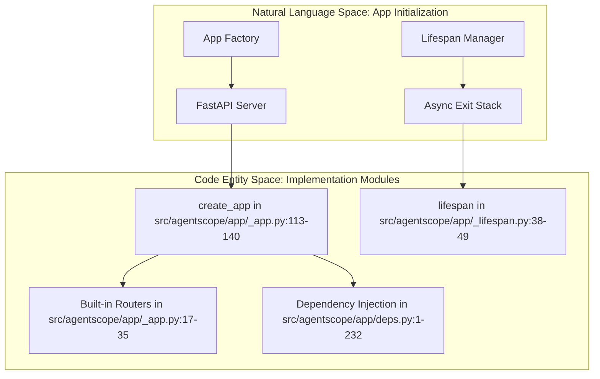
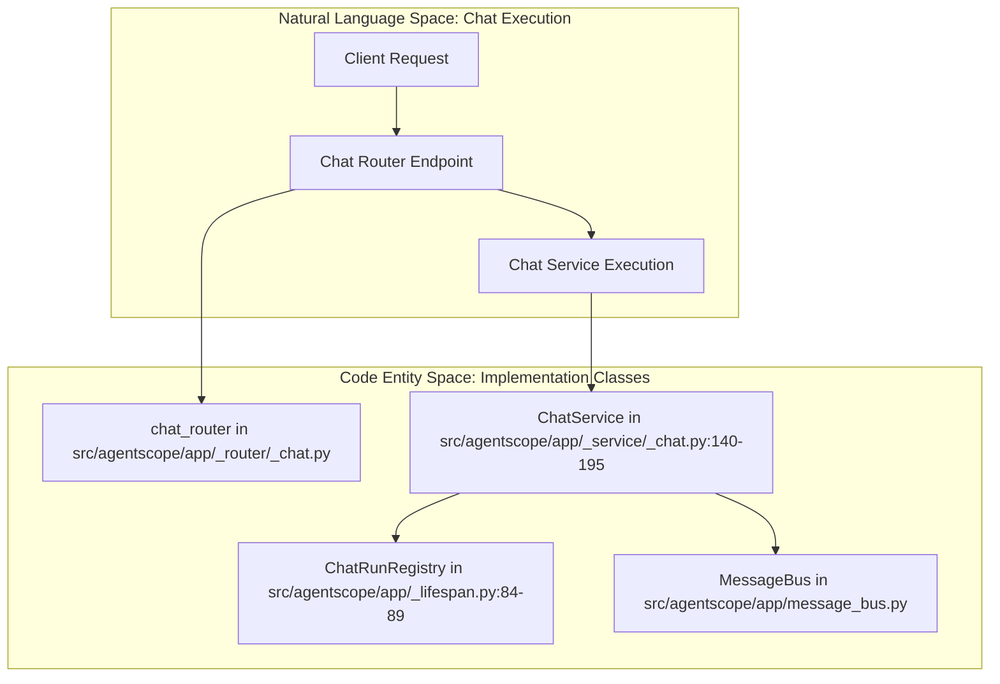

<!-- source: DeepWiki mcp.deepwiki.com · repo modelscope/agentscope · page 6 Agent Service (App Layer) · fetched 2026-10-27 -->

# Agent Service (App Layer)

Relevant source files

The following files were used as context for generating this wiki page:

- [examples/agent_service/main.py](examples/agent_service/main.py)
- [src/agentscope/app/_app.py](src/agentscope/app/_app.py)
- [src/agentscope/app/_lifespan.py](src/agentscope/app/_lifespan.py)
- [src/agentscope/app/_router/_chat.py](src/agentscope/app/_router/_chat.py)
- [src/agentscope/app/_service/_chat.py](src/agentscope/app/_service/_chat.py)
- [src/agentscope/app/_types.py](src/agentscope/app/_types.py)
- [src/agentscope/app/deps.py](src/agentscope/app/deps.py)
- [tests/service_team_failure_report_test.py](tests/service_team_failure_report_test.py)

The Agent Service layer provides a production-ready, FastAPI-based multi-tenant environment for deploying agents. It shifts the framework from a local script execution model to a service-oriented architecture, managing agent lifecycles, persistence, background execution, and channel integrations [src/agentscope/app/_app.py:113-140]().

The service is built around a "Service-Manager" pattern: **Routers** handle HTTP/SSE communication, **Services** encapsulate the business logic of agent assembly and execution (`ChatService` [src/agentscope/app/_service/_chat.py:140-195](), `SessionService`, `WorkspaceService`), and **Managers** handle stateful resources like sessions, workspaces, and background tasks (`ChatRunRegistry`, `WorkspaceManagerBase`, `SchedulerManager`) [src/agentscope/app/_lifespan.py:38-103]().

---

## App Factory and Routers

The application is initialized via the `create_app()` factory function [src/agentscope/app/_app.py:113-140](). This function configures a `FastAPI` instance with a comprehensive suite of built-in routers (`agent_router`, `chat_router`, `session_router`, `credential_router`, `model_router`, `tts_model_router`, `schedule_router`, `knowledge_base_router`, `skill_router`, `mcp_router`, `hub_router`, `channel_router`, and `workspace_router`) [src/agentscope/app/_app.py:17-35]() and manages the application lifecycle through a `lifespan` handler [src/agentscope/app/_lifespan.py:38-49](). Dependency injection is handled through modular helpers in `deps.py` [src/agentscope/app/deps.py:1-232]().

**Diagram: App Factory Initialization and Code Entities**

Sources: [src/agentscope/app/_app.py:17-140](), [src/agentscope/app/_lifespan.py:38-49](), [src/agentscope/app/deps.py:1-232]()

For details, see [App Factory and Routers](#6.1).

---

## Storage Layer and Message Bus

The storage layer provides the persistence backbone for the multi-tenant service, defining the `StorageBase` abstract interface for CRUD operations on agents, sessions, credentials, and schedules. Separately, the `MessageBus` acts as the live transport layer handling event fan-out, distributed session locking, and cross-process communication [src/agentscope/app/_service/_chat.py:140-195](). Implementations include `RedisStorage`, `AsyncSQLAlchemyStorage`, and `RedisMessageBus` / `InMemoryMessageBus` [src/agentscope/app/storage/__init__.py:86-140]().

Sources: [src/agentscope/app/_service/_chat.py:140-195](), [src/agentscope/app/storage/__init__.py:86-140]()

For details, see [Storage Layer and Message Bus](#6.2).

---

## Session Management and Chat Execution

Execution is coordinated by `ChatService` [src/agentscope/app/_service/_chat.py:140-195](). Unlike local execution, the service layer uses a fire-and-forget trigger, while events are streamed to clients via SSE connections. The system wires middlewares such as `InboxMiddleware`, `StateChangeMiddleware`, and `ToolOffloadMiddleware` during agent construction [src/agentscope/app/_service/_chat.py:45-51](), while `ChatRunRegistry` tracks active tasks per process [src/agentscope/app/_lifespan.py:84-89]().

**Diagram: Chat Execution and Session Management**

Sources: [src/agentscope/app/_service/_chat.py:45-195](), [src/agentscope/app/_lifespan.py:84-89]()

For details, see [Session Management and Chat Execution](#6.3).

---

## Scheduler and Scheduled Tasks

The `SchedulerManager` manages cron-based agent triggers using `APScheduler`, allowing agents to perform autonomous actions [src/agentscope/app/_lifespan.py:94-102](). When a schedule fires, it pushes a `HintBlock` to the target session's inbox and enqueues a wakeup via the `MessageBus`. Schedules are persisted as `ScheduleRecord` instances and exposed through schedule router endpoints [src/agentscope/app/_lifespan.py:94-102]().

Sources: [src/agentscope/app/_lifespan.py:94-102]()

For details, see [Scheduler and Scheduled Tasks](#6.4).

---

## Agent Teams

AgentScope supports a multi-agent team architecture where a Leader agent can spawn Worker agents using `SubAgentTemplate` blueprints [src/agentscope/app/_types.py:114-181](). Team management is driven by tools such as `TeamCreate`, `AgentCreate`, `AgentInvite`, `TeamSay`, and `TeamDelete`. Members communicate via `TeamSay`, routing messages through the `MessageBus` to target inboxes [src/agentscope/app/_service/_chat.py:140-195]().

Sources: [src/agentscope/app/_types.py:114-181](), [src/agentscope/app/_service/_chat.py:140-195]()

For details, see [Agent Teams](#6.5).

---

## Hub System

The Hub system allows users to browse and install resources like Skills and MCP servers from remote registries into their local workspaces. It defines abstract interfaces (`HubBase`, `MCPHubBase`, `SkillHubBase`) [src/agentscope/app/_app.py:13]() and concrete clients backed by `hub_router` endpoints and MCP render services [src/agentscope/app/_app.py:23]().

Sources: [src/agentscope/app/_app.py:13-23]()

For details, see [Hub System](#6.6).

---

## Channel System

The Channel system connects AgentScope agents to external instant messaging platforms such as Feishu, Discord, and DingTalk. The stateless `ChannelGateway` orchestrates events, `ChannelService` manages CRUD operations [src/agentscope/app/_lifespan.py:139-143](), and `ChannelLifecycleDispatcher` synchronizes live instances with storage [src/agentscope/app/_lifespan.py:153-163]().

Sources: [src/agentscope/app/_lifespan.py:139-163]()

For details, see [Channel System](#6.7).

---

## Resource Access Policy

The resource access subsystem governs multi-tenant sharing of credentials, agents, and knowledge bases [src/agentscope/app/_lifespan.py:108-112](). The `ResourceAccessService` combines owner-scoped storage reads with injected policies like `DenyAllResourceAccessPolicy` [src/agentscope/app/_app.py:12](), ensuring secure resolution across tenants during agent assembly.

Sources: [src/agentscope/app/_app.py:12](), [src/agentscope/app/_lifespan.py:108-112]()

For details, see [Resource Access Policy](#6.8).

---

