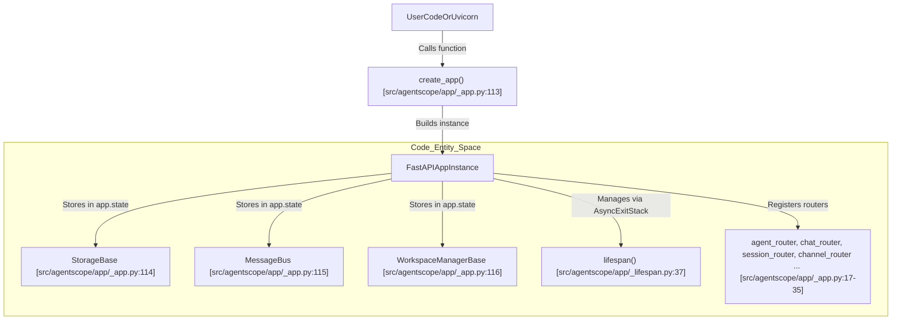
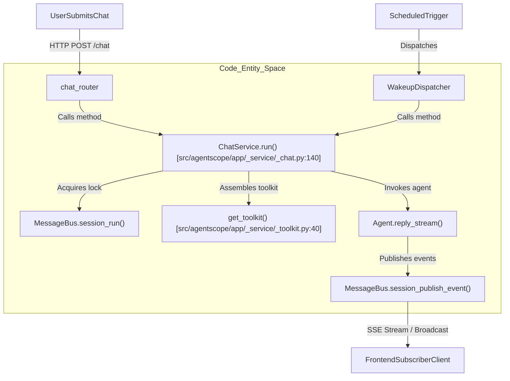

<!-- source: DeepWiki mcp.deepwiki.com · repo modelscope/agentscope · page 6.1 App Factory and Routers · fetched 2026-10-27 -->

# App Factory and Routers

Relevant source files

The following files were used as context for generating this wiki page:

- [examples/agent_service/main.py](examples/agent_service/main.py)
- [examples/web_ui/frontend/src/api/client.ts](examples/web_ui/frontend/src/api/client.ts)
- [examples/web_ui/frontend/src/api/health.ts](examples/web_ui/frontend/src/api/health.ts)
- [examples/web_ui/frontend/src/api/index.ts](examples/web_ui/frontend/src/api/index.ts)
- [examples/web_ui/frontend/src/pages/setup/index.tsx](examples/web_ui/frontend/src/pages/setup/index.tsx)
- [src/agentscope/app/_app.py](src/agentscope/app/_app.py)
- [src/agentscope/app/_lifespan.py](src/agentscope/app/_lifespan.py)
- [src/agentscope/app/_router/__init__.py](src/agentscope/app/_router/__init__.py)
- [src/agentscope/app/_router/_agent.py](src/agentscope/app/_router/_agent.py)
- [src/agentscope/app/_router/_chat.py](src/agentscope/app/_router/_chat.py)
- [src/agentscope/app/_router/_health.py](src/agentscope/app/_router/_health.py)
- [src/agentscope/app/_router/_schema/_agent.py](src/agentscope/app/_router/_schema/_agent.py)
- [src/agentscope/app/_router/_schema/_sop.py](src/agentscope/app/_router/_schema/_sop.py)
- [src/agentscope/app/_router/_sop.py](src/agentscope/app/_router/_sop.py)
- [src/agentscope/app/_router/_workspace.py](src/agentscope/app/_router/_workspace.py)
- [src/agentscope/app/_service/_chat.py](src/agentscope/app/_service/_chat.py)
- [src/agentscope/app/_service/_knowledge_base.py](src/agentscope/app/_service/_knowledge_base.py)
- [src/agentscope/app/_service/_sop.py](src/agentscope/app/_service/_sop.py)
- [src/agentscope/app/_types.py](src/agentscope/app/_types.py)
- [src/agentscope/app/deps.py](src/agentscope/app/deps.py)
- [tests/service_team_failure_report_test.py](tests/service_team_failure_report_test.py)
- [tests/workspace_skill_archive_test.py](tests/workspace_skill_archive_test.py)

This page documents the AgentScope 2.0 application layer, centered around the `create_app()` factory function [src/agentscope/app/_app.py:113-140](). It details the FastAPI-based multi-tenant agent service architecture, including all built-in routers, lifespan management via `AsyncExitStack` [src/agentscope/app/_lifespan.py:37-49](), dependency injection via `deps.py`, live transport via `MessageBus`, protocol middleware (`ag-ui`), and extension factories.

---

## Overview and System Architecture

AgentScope 2.0 provides a production-ready, multi-tenant agent service built on FastAPI. The architecture cleanly separates the HTTP routing layer from agent execution (`ChatService`) [src/agentscope/app/_service/_chat.py:140-153](), live transport (`MessageBus`), and persistence backends (`StorageBase`).

### Key Components

- **`create_app()`**: The central factory function for configuring and instantiating the FastAPI application, wiring global state into `app.state` [src/agentscope/app/_app.py:113-140]().
- **`lifespan`**: An asynchronous context manager utilizing `AsyncExitStack` to manage startup and shutdown ordering across storage, message bus, workspaces, hubs, workers, and schedulers [src/agentscope/app/_lifespan.py:37-103]().
- **`ChatService`**: The single source of truth for chat runs, encapsulating agent assembly, persistence, and middleware wiring [src/agentscope/app/_service/_chat.py:140-153]().
- **`deps.py`**: A comprehensive collection of FastAPI dependency injection functions (`get_storage`, `get_message_bus`, `get_chat_service`, etc.) [src/agentscope/app/deps.py:35-230]().

**Diagram: Natural Language to Code Entity Mapping: Application Bootstrap**

Sources: [src/agentscope/app/_app.py:113-140](), [src/agentscope/app/_lifespan.py:37-67]()

---

## App Factory: `create_app()` and Application State

The `create_app()` function instantiates a FastAPI application, registers all built-in routers, attaches ASGI middlewares, and configures `app.state` attributes required by routers and dependency injectors [src/agentscope/app/_app.py:113-140]().

### Configuration Parameters and Helpers

- **Core Storage and Bus**: `storage` (`StorageBase`), `message_bus` (`MessageBus`), and `workspace_manager` (`WorkspaceManagerBase`) [src/agentscope/app/_app.py:114-116]().
- **Knowledge Base Subsystem**: `knowledge_base_manager`, `knowledge_parsers`, `knowledge_chunkers`, and `blob_store` [src/agentscope/app/_app.py:117-120]().
- **Hub Registries**: `mcp_hubs` and `skill_hubs` indexed via `_index_hubs()` to guarantee unique `hub_id` values [src/agentscope/app/_app.py:61-87,122-123]().
- **Realtime ICE Servers**: Loaded and validated via `_load_realtime_ice_servers()` from explicit configuration or the `AGENTSCOPE_REALTIME_ICE_SERVERS` environment variable [src/agentscope/app/_app.py:90-110,136]().
- **Optional Services & Flags**: `enable_index_worker`, `enable_channel_worker`, `enable_scheduler`, `extra_credentials`, `extra_middlewares`, `extra_agent_middlewares`, `extra_agent_tools`, `custom_subagent_templates`, `custom_agent_cls`, `resource_access_policy`, `channels`, and `download_secret` [src/agentscope/app/_app.py:121-139]().

Sources: [src/agentscope/app/_app.py:61-140]()

---

## Lifespan Management and Resource Lifecycles

The `lifespan(app: FastAPI)` asynchronous context manager orchestrates initialization and teardown of application-wide resources using an `AsyncExitStack` [src/agentscope/app/_lifespan.py:37-49](). 

### Startup Sequence and Shutdown Ordering

1. **Storage & Transport**: Enters `storage` and `message_bus` async contexts [src/agentscope/app/_lifespan.py:61-62]().
2. **Workspaces & KBs**: Enters `workspace_manager`, `knowledge_base_manager`, and `blob_store` [src/agentscope/app/_lifespan.py:63-69]().
3. **Hubs**: Enters each MCP and skill hub in `app.state.mcp_hubs` and `app.state.skill_hubs` to maintain persistent registry connections [src/agentscope/app/_lifespan.py:73-77]().
4. **Managers & Dispatchers**: Initializes `BackgroundTaskManager`, `ChatRunRegistry`, `SchedulerManager`, `ResourceAccessService`, and channel services (`ChannelService`, `CredentialBindingService`, `ChannelLifecycleDispatcher`) [src/agentscope/app/_lifespan.py:79-165]().
5. **Chat Service**: Constructs `ChatService` with all bound managers and background services [src/agentscope/app/_lifespan.py:167-171]().

On shutdown, the `AsyncExitStack` unwinds all entered contexts in exact reverse order, preventing resource leaks even on partial startup failures [src/agentscope/app/_lifespan.py:40-45]().

Sources: [src/agentscope/app/_lifespan.py:37-171]()

---

## Dependency Injection (`deps.py`)

The `src/agentscope/app/deps.py` module exposes FastAPI dependency providers used across route handlers to extract request-scoped state and services [src/agentscope/app/deps.py:35-230]().

| Dependency Function | Return Type | Description |
| :--- | :--- | :--- |
| `get_current_user_id()` | `str` | Extracts authenticated user ID from `X-User-ID` header (401 if missing) [src/agentscope/app/deps.py:35-57]() |
| `get_storage()` | `StorageBase` | Retrieves storage backend from `request.app.state.storage` [src/agentscope/app/deps.py:60-70]() |
| `get_message_bus()` | `MessageBus` | Retrieves message bus from `request.app.state.message_bus` [src/agentscope/app/deps.py:72-82]() |
| `get_chat_service()` | `ChatService` | Retrieves chat service instance [src/agentscope/app/deps.py:84-94]() |
| `get_realtime_service()` | `RealtimeService` | Retrieves realtime agent assembly service [src/agentscope/app/deps.py:96-99]() |
| `get_resource_access_service()` | `ResourceAccessService` | Retrieves resource access authorization service [src/agentscope/app/deps.py:101-116]() |
| `get_session_service()` | `SessionService` | Retrieves session management service [src/agentscope/app/deps.py:118-129]() |
| `get_workspace_service()` | `WorkspaceService` | Retrieves workspace filesystem service [src/agentscope/app/deps.py:131-141]() |
| `get_chat_run_registry()` | `ChatRunRegistry` | Retrieves in-flight run tracking registry [src/agentscope/app/deps.py:143-153]() |
| `get_scheduler_manager()` | `SchedulerManager` | Retrieves APScheduler-backed scheduler manager [src/agentscope/app/deps.py:155-165]() |
| `get_background_task_manager()` | `BackgroundTaskManager` | Retrieves background task tracker [src/agentscope/app/deps.py:167-180]() |
| `get_sop_service()` | `SOPService` | Retrieves SOP service instance [src/agentscope/app/deps.py:182-192]() |
| `get_workspace_manager()` | `WorkspaceManagerBase` | Retrieves workspace manager backend [src/agentscope/app/deps.py:194-204]() |
| `get_download_secret()` | `str` | Retrieves file-download token signing secret [src/agentscope/app/deps.py:206-215]() |
| `get_extra_agent_middlewares()` | `AgentMiddlewareFactory \| None` | Retrieves extra agent middleware factory [src/agentscope/app/deps.py:217-230]() |

Sources: [src/agentscope/app/deps.py:35-230]()

---

## Built-in Routers Reference

AgentScope includes built-in `APIRouter` instances mounted by `create_app()` [src/agentscope/app/_app.py:17-35]().

| Router Object | Prefix | Module Source | Core Purpose & Operations |
| :--- | :--- | :--- | :--- |
| `agent_router` | `/agent` | `_agent.py` | Agent configuration CRUD (`AgentRecord`) [src/agentscope/app/_app.py:18]() |
| `chat_router` | `/chat` | `_chat.py` | Trigger chat executions (`ChatRequest`) [src/agentscope/app/_app.py:20]() |
| `session_router` | `/sessions` | `_session.py` | Session management, history, and SSE streaming [src/agentscope/app/_app.py:31]() |
| `credential_router` | `/credential` | `_credential.py` | API keys and credentials CRUD [src/agentscope/app/_app.py:21]() |
| `model_router` | `/model` | `_model.py` | LLM model discovery and parameter settings [src/agentscope/app/_app.py:27]() |
| `tts_model_router` | `/tts_model` | `_tts_model.py` | Text-to-Speech model configurations [src/agentscope/app/_app.py:29]() |
| `embedding_model_router` | `/embedding_model` | `_embedding_model.py` | Embedding model listings and dimensions [src/agentscope/app/_app.py:25]() |
| `schedule_router` | `/schedule` | `_schedule.py` | Cron-based scheduled task CRUD [src/agentscope/app/_app.py:30]() |
| `workspace_router` | `/workspace` | `_workspace.py` | Filesystem, tool, MCP, and skill inspection [src/agentscope/app/_app.py:34]() |
| `mcp_router` | `/mcp` | `_mcp.py` | Model Context Protocol client management [src/agentscope/app/_app.py:26]() |
| `skill_router` | `/skill` | `_skill.py` | Skill installation and management [src/agentscope/app/_app.py:32]() |
| `hub_router` | `/hub` | `_hub.py` | Browsing and installing from MCP/Skill hubs [src/agentscope/app/_app.py:23]() |
| `knowledge_base_router`| `/knowledge_base`| `_knowledge_base.py` | RAG knowledge bases and document parsing [src/agentscope/app/_app.py:24]() |
| `channel_router` | `/channel` | `_channel.py` | IM platform binding (DingTalk, Feishu, Discord) [src/agentscope/app/_app.py:19]() |
| `health_router` | `/health` | `_health.py` | Service liveness and readiness reporting [src/agentscope/app/_app.py:22]() |
| `realtime_router` | `/realtime` | `_realtime.py` | Realtime voice session configuration and ICE servers [src/agentscope/app/_app.py:28]() |
| `sop_router` | `/sop` | `_sop.py` | Standard Operating Procedure (SOP) state inspection [src/agentscope/app/_app.py:33]() |

Sources: [src/agentscope/app/_app.py:17-35]()

---

## Agent Assembly and `ChatService` Data Flow

`ChatService` serves as the single source of truth for executing an agent against a session [src/agentscope/app/_service/_chat.py:140-153](). Both HTTP chat triggers and background wakeup dispatchers invoke `ChatService.run()`, ensuring uniform persistence, middleware wiring, and locking semantics via `MessageBus.session_run()`. Toolkits are assembled dynamically per turn via `get_toolkit()` [src/agentscope/app/_service/_toolkit.py:40-135]().

**Diagram: Natural Language to Code Entity Mapping: Chat Execution Flow**

Sources: [src/agentscope/app/_service/_chat.py:140-153]()

---

## Protocol Middleware (`ag-ui`)

AgentScope includes specialized ASGI middleware (`AGUIProtocolMiddleware`) to bridge internal `AgentEvent` data streams with external UI requirements (such as the `ag-ui` protocol) [src/agentscope/app/middleware/_protocol/_agui.py:44-68]().

- **Stream Interception**: Wraps `text/event-stream` HTTP responses, intercepting raw JSON data frames and SSE data frames [tests/agui_protocol_test.py:73-152]().
- **Protocol Mapping**: Converts internal event types (`ReplyStartEvent`, `ReplyEndEvent`, `TextBlockDeltaEvent`, `ToolCallStartEvent`, etc.) into standardized protocol events (`RUN_STARTED`, `RUN_FINISHED`, `TEXT_DELTA`, `TOOL_CALL_START`) [src/agentscope/app/middleware/_protocol/_agui.py:71-190]().

Sources: [src/agentscope/app/middleware/_protocol/_agui.py:44-190](), [tests/agui_protocol_test.py:73-152]()

---

## Extension Factories

`create_app()` accepts several factory parameters to customize agent behavior dynamically during runtime assembly:

- **`AgentMiddlewareFactory`**: An async factory callable producing session- or user-specific middlewares [src/agentscope/app/_types.py:46-56](). The factory signature supports `(user_id, agent_id, session_id)` or optionally accepts `workspace` [src/agentscope/app/_types.py:46-56]().
- **`AgentToolFactory`**: An async factory callable producing dynamic tools to register into the agent's toolkit per session with signature `(user_id, agent_id, session_id)` returning an awaitable list of `ToolBase` instances [src/agentscope/app/_types.py:58-63]().
- **`SubAgentTemplate`**: Declarative blueprints for worker agents within multi-agent teams, specifying prompts, permission contexts, and role boundaries [src/agentscope/app/_types.py:114-181]().
- **`EventProjector`**: Strategy protocol defining `maybe_project()` to mirror events across sessions for specialized UI feeds such as HITL progress tracking [src/agentscope/app/_types.py:66-112]().

Sources: [src/agentscope/app/_types.py:46-181]()

---

