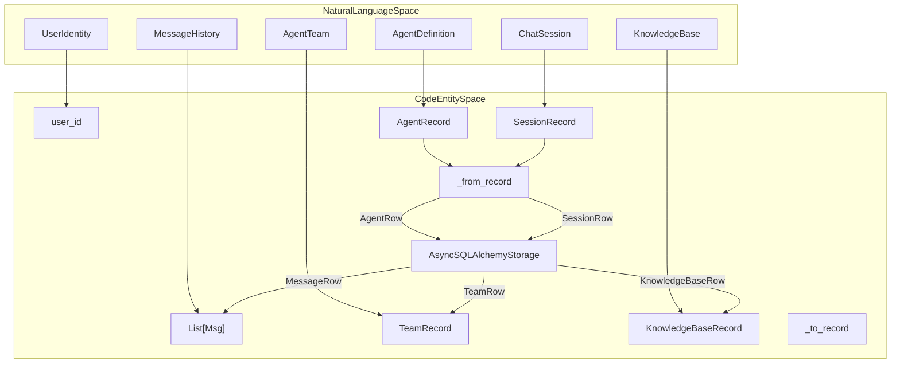
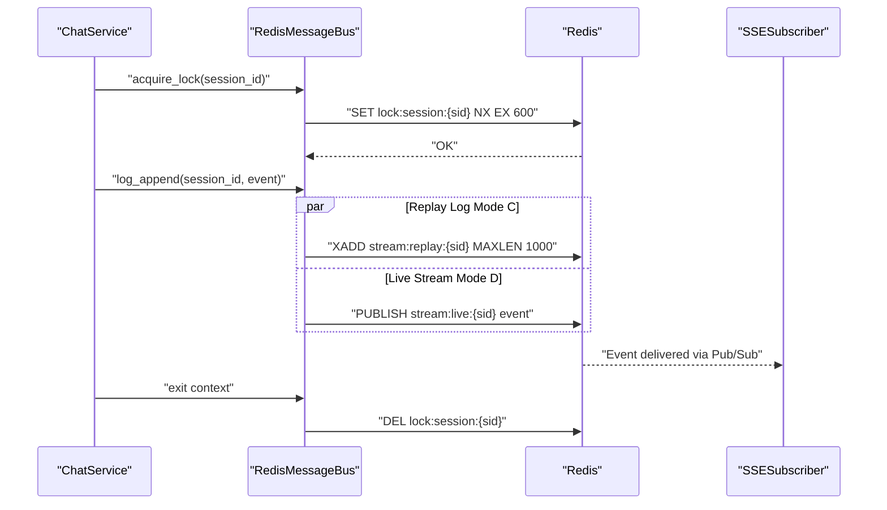
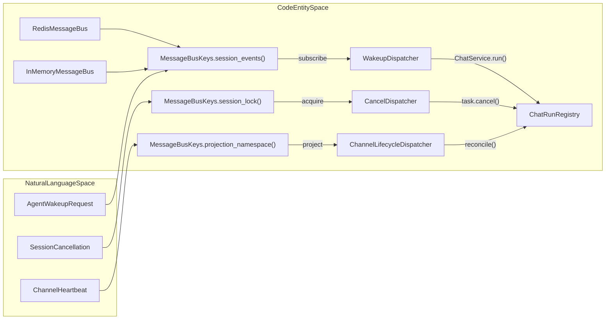

<!-- source: DeepWiki mcp.deepwiki.com · repo modelscope/agentscope · page 6.2 Storage Layer and Message Bus · fetched 2026-10-27 -->

# Storage Layer and Message Bus

Relevant source files

The following files were used as context for generating this wiki page:

- [src/agentscope/app/_bus_ops.py](src/agentscope/app/_bus_ops.py)
- [src/agentscope/app/_manager/_background_task_manager.py](src/agentscope/app/_manager/_background_task_manager.py)
- [src/agentscope/app/_manager/_cancel_dispatcher.py](src/agentscope/app/_manager/_cancel_dispatcher.py)
- [src/agentscope/app/_manager/_wakeup_dispatcher.py](src/agentscope/app/_manager/_wakeup_dispatcher.py)
- [src/agentscope/app/message_bus/__init__.py](src/agentscope/app/message_bus/__init__.py)
- [src/agentscope/app/message_bus/_base.py](src/agentscope/app/message_bus/_base.py)
- [src/agentscope/app/message_bus/_in_memory_message_bus.py](src/agentscope/app/message_bus/_in_memory_message_bus.py)
- [src/agentscope/app/message_bus/_keys.py](src/agentscope/app/message_bus/_keys.py)
- [src/agentscope/app/message_bus/_redis_message_bus.py](src/agentscope/app/message_bus/_redis_message_bus.py)
- [src/agentscope/app/middleware/_tool_offload_middleware.py](src/agentscope/app/middleware/_tool_offload_middleware.py)
- [src/agentscope/app/storage/_base.py](src/agentscope/app/storage/_base.py)
- [src/agentscope/app/storage/_redis_storage.py](src/agentscope/app/storage/_redis_storage.py)
- [src/agentscope/app/storage/_sql/_mappers.py](src/agentscope/app/storage/_sql/_mappers.py)
- [src/agentscope/app/storage/_sql/_storage.py](src/agentscope/app/storage/_sql/_storage.py)
- [tests/in_memory_message_bus_test.py](tests/in_memory_message_bus_test.py)
- [tests/service_cancel_dispatcher_test.py](tests/service_cancel_dispatcher_test.py)
- [tests/service_message_bus_test.py](tests/service_message_bus_test.py)
- [tests/service_wakeup_dispatcher_test.py](tests/service_wakeup_dispatcher_test.py)
- [tests/storage_redis_test.py](tests/storage_redis_test.py)
- [tests/storage_sql_test.py](tests/storage_sql_test.py)
- [tests/tool_offload_middleware_test.py](tests/tool_offload_middleware_test.py)

## Purpose and Scope

The Storage Layer and Message Bus provide the persistence and live transport infrastructure for the AgentScope 2.0 multi-tenant service architecture [src/agentscope/app/message_bus/_base.py:4-9](), [src/agentscope/app/storage/_base.py:29-30](). The **Storage Layer** manages long-term state persistence for agents, sessions, credentials, tools, and conversation history via `StorageBase` implementations (`RedisStorage` and `AsyncSQLAlchemyStorage`) [src/agentscope/app/storage/_base.py:29-30](), [src/agentscope/app/storage/_redis_storage.py:56-57](), [src/agentscope/app/storage/_sql/_storage.py:95-109](). The **Message Bus** (`MessageBus`, `RedisMessageBus`, `InMemoryMessageBus`) acts as a transactional, push-capable transport layer for real-time event streaming, queue-based agent inboxes, and distributed synchronization [src/agentscope/app/message_bus/_base.py:53-59](), [src/agentscope/app/message_bus/_redis_message_bus.py:48-71](), [src/agentscope/app/message_bus/_in_memory_message_bus.py:30-56]().

Sources: [src/agentscope/app/message_bus/_base.py:4-9](), [src/agentscope/app/storage/_base.py:29-30](), [src/agentscope/app/message_bus/_in_memory_message_bus.py:30-56]()

---

## Storage Layer Architecture

The storage subsystem abstracts persistence operations behind the `StorageBase` abstract base class [src/agentscope/app/storage/_base.py:32-33](). This interface defines uniform asynchronous contracts for managing user-scoped entities, configuration records, and relational hierarchies [src/agentscope/app/storage/_base.py:51-279]().

### StorageBase Interface
`StorageBase` defines lifecycle management methods across multiple resource domains:
- **Credentials**: `upsert_credential()`, `list_credentials()`, `get_credential()`, and `delete_credential()` [src/agentscope/app/storage/_base.py:51-116]().
- **MCP Clients**: `upsert_mcp()`, `list_mcps()`, `get_mcp()`, `get_mcp_by_name()`, and `delete_mcp()` [src/agentscope/app/storage/_base.py:119-204]().
- **Skills**: `upsert_skill()`, `list_skills()`, `get_skill()`, `get_skill_by_name()`, and `delete_skill()` [src/agentscope/app/storage/_base.py:207-279]().
- **Agents and Sessions**: `upsert_agent()`, `list_agents()`, `get_agent()`, `delete_agent()`, `upsert_session()`, `list_sessions()`, `get_session()`, and `delete_session()` [src/agentscope/app/storage/_base.py:51-279]().

Sources: [src/agentscope/app/storage/_base.py:32-279]()

---

### Concrete Backends

#### RedisStorage
`RedisStorage` implements `StorageBase` using `redis.asyncio`, utilizing structured key templates defined within `RedisStorage.KeyConfig` [src/agentscope/app/storage/_redis_storage.py:56-138]().
- **Sliding TTL**: Supports an optional `key_ttl` parameter which refreshes key expirations on every write operation [src/agentscope/app/storage/_redis_storage.py:152-176]().
- **Secret Sanitization**: Employs `_dump_with_secrets()` to ensure sensitive parameters are safely serialized [src/agentscope/app/storage/_redis_storage.py:30-32]().
- **Uniqueness Indexes**: Uses Redis Hashes (`mcp_name_index`, `skill_name_index`) to enforce per-user uniqueness constraints on tool and skill names [src/agentscope/app/storage/_redis_storage.py:82-86]().

#### AsyncSQLAlchemyStorage
`AsyncSQLAlchemyStorage` provides a relational backend utilizing SQLAlchemy 2.0 async engines (`AsyncEngine`, `AsyncSession`) [src/agentscope/app/storage/_sql/_storage.py:95-109]().
- **Naive UTC Timestamps**: Normalizes all datetimes using `_utcnow()` and `_to_naive_utc()`, ensuring cross-node comparability in distributed deployments [src/agentscope/app/storage/_sql/_storage.py:72-92]().
- **Dialect Portability**: Uses dialect-neutral constructs to support SQLite (`sqlite+aiosqlite`), PostgreSQL (`postgresql+asyncpg`), and MySQL [src/agentscope/app/storage/_sql/_storage.py:3-9]().
- **Schema Management**: Supports `create_tables` via `Base.metadata.create_all` and `auto_migrate` to execute Alembic upgrade scripts on startup [src/agentscope/app/storage/_sql/_storage.py:111-142]().

Sources: [src/agentscope/app/storage/_redis_storage.py:30-138](), [src/agentscope/app/storage/_sql/_storage.py:72-160]()

---

## Relational Schema, Alembic, and Record Models

The relational backend structured in `AsyncSQLAlchemyStorage` maps domain records to normalized SQL tables defined in `src/agentscope/app/storage/_sql/_tables.py`. Entities are wrapped in Pydantic record models before persistence, binding metadata (such as owner `user_id` and timestamps) to core domain data structures [tests/storage_redis_test.py:42-53]().

### Core Database Tables and Record Models
- `AgentRow` / `AgentRecord`: Stores agent definitions, system prompts, and configuration blobs (`AgentData`) [src/agentscope/app/storage/_sql/_tables.py:43-58](), [tests/storage_redis_test.py:51-62]().
- `SessionRow` / `SessionRecord`: Maintains session state, workspace bindings, `SessionOrigin` (`UserOrigin`, `ScheduleOrigin`, `ChannelOrigin`, `TeamOrigin`, `SOPOrigin`), and associated agent references [src/agentscope/app/storage/_sql/_tables.py:43-58](), [src/agentscope/app/storage/_model/_session.py:15-108]().
- `MessageRow`: Persists sequential message history linked to specific sessions [src/agentscope/app/storage/_sql/_tables.py:43-58]().
- `CredentialRow` / `CredentialRecord`: Stores provider authentication payloads per user [src/agentscope/app/storage/_sql/_tables.py:43-58](), [src/agentscope/app/storage/_model/__init__.py:12-12]().
- `ScheduleRow` & `TeamRow`: Manage recurring task definitions and multi-agent team rosters (`TeamData`) [src/agentscope/app/storage/_sql/_tables.py:43-58](), [src/agentscope/app/storage/_model/__init__.py:54-54]().

### Mappers and Serialization Contracts
Conversion between Pydantic record models and SQLAlchemy ORM rows is handled by `_from_record()` and `_to_record()` in `src/agentscope/app/storage/_sql/_mappers.py` [src/agentscope/app/storage/_sql/_mappers.py:54-137](). Envelope fields (`id`, `created_at`, `updated_at`) and indexed search properties are promoted to dedicated columns, while remaining properties are stored as JSON in the `payload` column.

Title: Storage Entity Mapping

Sources: [src/agentscope/app/storage/_sql/_tables.py:43-58](), [src/agentscope/app/storage/_sql/_mappers.py:54-137](), [tests/storage_redis_test.py:42-62]()

---

## Redis Key Configuration and Namespacing

`RedisStorage` structures multi-tenant keys through nested templates inside `RedisStorage.KeyConfig` [src/agentscope/app/storage/_redis_storage.py:59-151]().

| Entity | Key Template | Redis Data Structure |
|:---|:---|:---|
| **Agent** | `agentscope:user:{user_id}:agent:{agent_id}` | Hash [src/agentscope/app/storage/_redis_storage.py:71-71]() |
| **Session** | `agentscope:user:{user_id}:session:{session_id}` | Hash [src/agentscope/app/storage/_redis_storage.py:72-72]() |
| **Messages** | `agentscope:user:{user_id}:session:{session_id}:messages` | List [src/agentscope/app/storage/_redis_storage.py:97-99]() |
| **Credential** | `agentscope:user:{user_id}:credential:{credential_id}` | Hash [src/agentscope/app/storage/_redis_storage.py:68-70]() |
| **Team** | `agentscope:user:{user_id}:team:{team_id}` | Hash [src/agentscope/app/storage/_redis_storage.py:130-131]() |
| **Schedule** | `agentscope:user:{user_id}:schedule:{schedule_id}` | Hash [src/agentscope/app/storage/_redis_storage.py:104-104]() |
| **Knowledge Base** | `agentscope:user:{user_id}:knowledge_base:{knowledge_base_id}` | Hash [src/agentscope/app/storage/_redis_storage.py:133-136]() |

Sources: [src/agentscope/app/storage/_redis_storage.py:59-151]()

---

## Message Bus Abstraction and Consumption Modes

The `MessageBus` abstract base class provides the live messaging transport layer [src/agentscope/app/message_bus/_base.py:53-59](). It is decoupled from `StorageBase` to allow persistence on relational databases while leveraging high-throughput push brokers for real-time delivery [src/agentscope/app/message_bus/_base.py:4-9]().

The interface exposes orthogonal consumption modes managed through helper definitions in `MessageBusKeys` [src/agentscope/app/message_bus/_base.py:53-475](), [src/agentscope/app/message_bus/_keys.py:19-24]():
1. **Mode A (Drain Queue)** (`queue_push()`, `queue_drain()`, `queue_delete()`): Ack-on-read queues with sliding TTLs, used for agent inboxes [src/agentscope/app/message_bus/_base.py:96-169]().
2. **Mode C (Replay Log)** (`log_append()`, `log_read()`, `log_trim()`): Append-only logs with cursor-based reading, used for SSE event history [src/agentscope/app/message_bus/_base.py:176-240]().
3. **Mode D (Transient Broadcast)** (`publish()`, `subscribe()`): Fire-and-forget pub/sub channels for wake-up signals [src/agentscope/app/message_bus/_base.py:273-308]().
4. **Mode E (Distributed Lock)** (`acquire_lock()`, `is_locked()`, `try_lock()`, `unlock()`): Mutex primitives for session concurrency control [src/agentscope/app/message_bus/_base.py:358-401]().
5. **Mode F (Registry Map)** (`registry_set()`, `registry_set_if()`, `registry_pop()`): Hash mappings supporting compare-and-set semantics for tracking active tasks [src/agentscope/app/message_bus/_base.py:411-475]().

Sources: [src/agentscope/app/message_bus/_base.py:53-475](), [src/agentscope/app/message_bus/_keys.py:19-24]()

---

## Message Bus Concrete Backends and Lua Scripting

### RedisMessageBus
`RedisMessageBus` implements the `MessageBus` protocol over Redis primitives [src/agentscope/app/message_bus/_redis_message_bus.py:48-71]().
- **Queue and Log Operations**: Uses Redis Streams combined with atomic Lua scripts such as `_QUEUE_DRAIN_LUA` to guarantee single-consumer delivery [src/agentscope/app/message_bus/_redis_message_bus.py:21-27]().
- **Registry and Locking**: Utilizes Redis Hashes with custom Lua scripts (`_REGISTRY_SET_IF_LUA`, `_REGISTRY_POP_LUA`) for safe conditional updates and take-once semantics [src/agentscope/app/message_bus/_redis_message_bus.py:32-45]().

### InMemoryMessageBus
`InMemoryMessageBus` provides a pure-Python, `asyncio`-backed implementation of `MessageBus` designed for single-process development, testing, and fallback scenarios without external dependencies [src/agentscope/app/message_bus/_in_memory_message_bus.py:4-16](). It maps modes to internal lists, dicts, and `asyncio.Queue`/`asyncio.Lock` primitives [src/agentscope/app/message_bus/_in_memory_message_bus.py:30-56]().

Title: Message Bus Data Flow

Title: Coordination and Dispatch Architecture

Sources: [src/agentscope/app/message_bus/_redis_message_bus.py:21-71](), [src/agentscope/app/message_bus/_keys.py:67-149](), [src/agentscope/app/message_bus/_in_memory_message_bus.py:30-88]()

---

