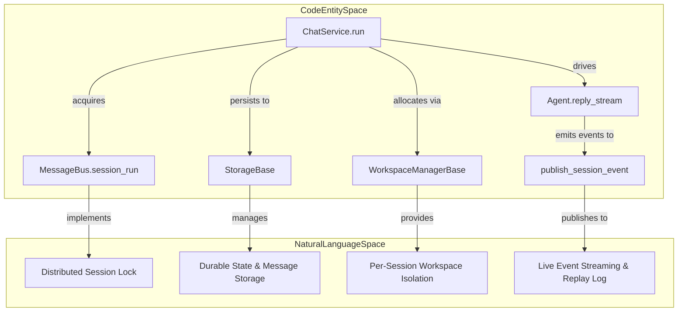
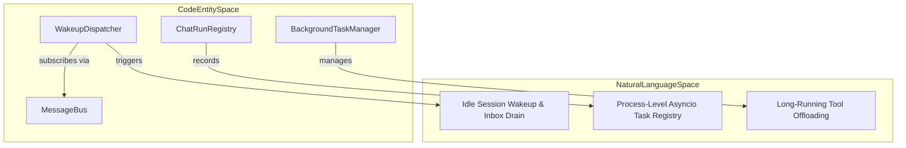
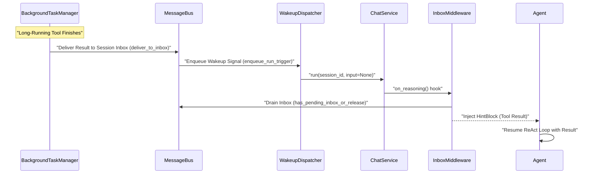

<!-- source: DeepWiki mcp.deepwiki.com · repo modelscope/agentscope · page 6.3 Session Management and Chat Execution · fetched 2026-10-27 -->

# Session Management and Chat Execution

Relevant source files

The following files were used as context for generating this wiki page:

- [examples/agent_service/main.py](examples/agent_service/main.py)
- [examples/web_ui/frontend/src/api/session.ts](examples/web_ui/frontend/src/api/session.ts)
- [src/agentscope/app/_app.py](src/agentscope/app/_app.py)
- [src/agentscope/app/_lifespan.py](src/agentscope/app/_lifespan.py)
- [src/agentscope/app/_router/_chat.py](src/agentscope/app/_router/_chat.py)
- [src/agentscope/app/_router/_schema/_session.py](src/agentscope/app/_router/_schema/_session.py)
- [src/agentscope/app/_router/_session.py](src/agentscope/app/_router/_session.py)
- [src/agentscope/app/_service/__init__.py](src/agentscope/app/_service/__init__.py)
- [src/agentscope/app/_service/_chat.py](src/agentscope/app/_service/_chat.py)
- [src/agentscope/app/_service/_session.py](src/agentscope/app/_service/_session.py)
- [src/agentscope/app/_service/_toolkit.py](src/agentscope/app/_service/_toolkit.py)
- [src/agentscope/app/_tool/__init__.py](src/agentscope/app/_tool/__init__.py)
- [src/agentscope/app/_tool/_agent_create.py](src/agentscope/app/_tool/_agent_create.py)
- [src/agentscope/app/_tool/_agent_invite.py](src/agentscope/app/_tool/_agent_invite.py)
- [src/agentscope/app/_tool/_team_say.py](src/agentscope/app/_tool/_team_say.py)
- [src/agentscope/app/_types.py](src/agentscope/app/_types.py)
- [src/agentscope/app/deps.py](src/agentscope/app/deps.py)
- [src/agentscope/app/middleware/__init__.py](src/agentscope/app/middleware/__init__.py)
- [src/agentscope/app/storage/_model/_team.py](src/agentscope/app/storage/_model/_team.py)
- [src/agentscope/app/storage/_utils.py](src/agentscope/app/storage/_utils.py)
- [tests/service_inbox_handoff_test.py](tests/service_inbox_handoff_test.py)
- [tests/service_inbox_middleware_test.py](tests/service_inbox_middleware_test.py)
- [tests/service_team_failure_report_test.py](tests/service_team_failure_report_test.py)
- [tests/service_team_tools_test.py](tests/service_team_tools_test.py)
- [tests/service_toolkit_test.py](tests/service_toolkit_test.py)

## Purpose and Scope

In AgentScope 2.0, Session Management and Chat Execution provide the robust backend infrastructure for multi-tenant, production-grade agent services [src/agentscope/app/_service/_chat.py:2-13](). This subsystem guarantees serialized agent execution per session via distributed locking [src/agentscope/app/_service/_chat.py:146-153](), reliable event broadcasting and durable replay logs [src/agentscope/app/_service/_chat.py:9-13](), and asynchronous recovery of idle sessions triggered by background completions, tool events, or scheduled triggers.

**Scope**: This page covers `ChatService` [src/agentscope/app/_service/_chat.py:140-153](), `ChatRunRegistry` [src/agentscope/app/_lifespan.py:84-89](), wakeup and cancel dispatchers, `BackgroundTaskManager` [src/agentscope/app/_lifespan.py:79-82](), the middleware stack (`InboxMiddleware`, `StateChangeMiddleware`, `ToolOffloadMiddleware`, `SOPStepSubmitMiddleware`, `TeamMemberLoopMiddleware`, `RAGMiddleware`, `TTSMiddleware`) [src/agentscope/app/_service/_chat.py:45-52](), inbox hand-off protocols [src/agentscope/app/_bus_ops.py:23-30](), RAG and TTS wiring, and the underlying session and workspace services [src/agentscope/app/_service/_session.py:98-140]().

Sources: [src/agentscope/app/_service/_chat.py:2-153](), [src/agentscope/app/_lifespan.py:79-89](), [src/agentscope/app/_service/_session.py:98-140]()

---

## Chat Execution Architecture (`ChatService`)

`ChatService` is the single source of truth for executing an agent against a specific session [src/agentscope/app/_service/_chat.py:2-7](). Both the HTTP REST chat endpoints and the asynchronous wakeup dispatcher route through `ChatService.run`, ensuring identical validation, middleware wiring, and state persistence [src/agentscope/app/_service/_chat.py:140-148]().

### The `ChatService.run` Workflow

1.  **Distributed Session Locking**: `ChatService` wraps execution in `MessageBus.session_run`, which acquires a distributed lock over the session key [src/agentscope/app/_service/_chat.py:146-153](). This guarantees at most one active execution per session across all cluster replicas.
2.  **Resource Resolution**: It resolves the agent record via `ResourceAccessService`, builds or mounts the session's isolated workspace using `WorkspaceManagerBase`, and initializes the model and toolkit configurations [src/agentscope/app/_service/_chat.py:155-195]().
3.  **Message Input Handling**: User inputs or continuation prompts are ingested and persisted via `StorageBase`. If running as a wakeup trigger with no fresh input, it consumes pending items from the session's message inbox using inbox hand-off mechanisms.
4.  **Agent Reply Stream**: It invokes `agent.reply_stream()` while fanning out every yielded `AgentEvent` through session event publishing primitives to both a live Pub/Sub channel and a durable replay log.
5.  **State Synchronization**: Upon completion, the updated `AgentState` and final messages are committed back to `StorageBase` [src/agentscope/app/_service/_chat.py:2-7]().

### Code-to-Concept Bridge: Chat Execution

*Figure: ChatService Code-to-Concept Mapping*

Sources: [src/agentscope/app/_service/_chat.py:2-195](), [src/agentscope/app/_bus_ops.py:23-30]()

---

## Lifecycle, Concurrency, and Dispatchers

AgentScope coordinates distributed background work across worker nodes using specialized registries and dispatchers integrated into the FastAPI application lifespan [src/agentscope/app/_lifespan.py:37-103]().

### Key Components

-   **`ChatRunRegistry`**: A process-local registry tracking all in-flight chat-run `asyncio.Task` instances [src/agentscope/app/_lifespan.py:84-89](). It allows graceful shutdown routines and cancel dispatchers to target active tasks precisely.
-   **Dispatchers (`WakeupDispatcher`, `CancelDispatcher`)**: Subscribes to wake-up and cancel signals over the `MessageBus` [src/agentscope/app/_lifespan.py:14-14](). When a background task completes or a scheduled task fires, the wakeup dispatcher triggers `ChatService.run` to process pending inbox items for idle or sleeping sessions. Run triggers are typed via `MessageBusKeys`.
-   **`BackgroundTaskManager`**: Manages long-running tool executions offloaded from the main agent loop [src/agentscope/app/_lifespan.py:79-82](). It registers running tasks with metadata (`session_id`, `agent_id`, `user_id`) so that tool cancellation or timeout monitoring can operate asynchronously.

### Code-to-Concept Bridge: Concurrency and Dispatchers

*Figure: Concurrency and Dispatchers Mapping*

Sources: [src/agentscope/app/_lifespan.py:14](), [src/agentscope/app/_lifespan.py:79-89]()

---

## Middleware Integration Pipeline

The `ChatService` assembles the agent with a comprehensive middleware stack that intercepts execution at critical lifecycle hooks [src/agentscope/app/_service/_chat.py:45-52]().

### Middleware Roles and Hooks

| Middleware | Target Hook | Description |
| :--- | :--- | :--- |
| `InboxMiddleware` | `on_reasoning` | Drains the session's `MessageBus` inbox queue and injects pending hints (such as tool completion results or team messages) as `HintBlock` instances into the agent context [src/agentscope/app/_service/_chat.py:46](). |
| `StateChangeMiddleware` | `on_reply`, `on_acting` | Monitors modifications to task lists, subagent structures, or permission contexts, emitting `CustomEvent` notifications for UI clients [src/agentscope/app/_service/_chat.py:48](). |
| `ToolOffloadMiddleware` | `on_acting` | Intercepts tool execution; if a tool exceeds time limits, it offloads the call to `BackgroundTaskManager`, yields a synthetic running response, and schedules an async wakeup upon completion [src/agentscope/app/_service/_chat.py:49](). |
| `SOPStepSubmitMiddleware` | `on_acting` | Handles SOP step submission states and triggers phase advances. |
| `TeamMemberLoopMiddleware` | `on_reasoning` | Coordinates team interaction loops for leader and worker agents [src/agentscope/app/_service/_chat.py:50](). |
| `RAGMiddleware` | `on_reasoning` | Injects knowledge base search results as static hints or provides dynamic retrieval tools to the agent toolkit [src/agentscope/app/_service/_chat.py:52](). |
| `TTSMiddleware` | `on_reply` | Integrates text-to-speech synthesis into the agent reply stream, attaching audio blocks to assistant messages [src/agentscope/app/_service/_chat.py:52](). |

### Inbox Hand-Off Protocol

Producers and running agent turns coordinate inbox items through helper functions in `_bus_ops.py`:
-   `deliver_to_inbox`: Pushes a payload to the per-session inbox queue and enqueues a wakeup signal if no worker is currently registered as consuming the session [src/agentscope/app/_bus_ops.py:23-30]().
-   `register_inbox_consumer` / `abandon_inbox_consumer` / `has_pending_inbox_or_release`: Ensures that a finishing run inspects the inbox one final time before releasing its consumer status, preventing race conditions where payloads arrive just as a run completes [src/agentscope/app/_bus_ops.py:23-30]().

### Data Flow: Background Tool Completion & Agent Wakeup

*Figure: Background Tool Completion and Agent Wakeup Sequence*

Sources: [src/agentscope/app/_service/_chat.py:45-52](), [src/agentscope/app/_bus_ops.py:23-30]()

---

## RAG and TTS Wiring

`ChatService` integrates retrieval-augmented generation and text-to-speech capabilities dynamically at runtime:
-   **RAG Wiring**: Instantiates `RAGMiddleware` utilizing `KnowledgeBaseManagerBase` and session-specific knowledge base configurations to inject relevant document chunks into the agent's context or provide search tools [src/agentscope/app/_service/_chat.py:32](), [src/agentscope/app/_service/_chat.py:52]().
-   **TTS Wiring**: Instantiates `TTSMiddleware` via `get_tts_model` to synthesize spoken audio from text responses generated during `agent.reply_stream()` [src/agentscope/app/_service/_chat.py:63](), [src/agentscope/app/_service/_chat.py:52]().

Sources: [src/agentscope/app/_service/_chat.py:32](), [src/agentscope/app/_service/_chat.py:52](), [src/agentscope/app/_service/_chat.py:63]()

---

## Session and Workspace Services

Supporting the chat execution pipeline are dedicated service classes that manage high-level persistence and sandbox provisioning [src/agentscope/app/_service/_session.py:98-140]().

-   **`SessionService`**: Manages session CRUD operations, session listing, history trimming, and cascading purges (deleting associated storage records, vector indexes, and message bus queues via `StorageBase`) [src/agentscope/app/_service/_session.py:98-140](). It computes unified `SessionStatus` indicators combining cluster liveness from the message bus with durable parking states [src/agentscope/app/_service/_session.py:61-96]():
    -   `RUNNING`: A worker in the cluster holds the session's run lease [src/agentscope/app/_service/_session.py:78-80]().
    -   `IDLE`: No worker is running the session, and the context is not parked [src/agentscope/app/_service/_session.py:81-83]().
    -   `AWAITING_PERMISSION`: Persisted context tail has a tool call waiting for human permission (HITL) [src/agentscope/app/_service/_session.py:83-85]().
    -   `AWAITING_EXTERNAL_RESULT`: Persisted context tail has a tool call dispatched to an external executor [src/agentscope/app/_service/_session.py:86-90]().
-   **`WorkspaceService`**: Interfaces directly with `WorkspaceManagerBase` to provision, reset, and inspect sandboxed environments associated with user sessions or agents. It handles file staging, MCP server binding, and skill index synchronization.

Sources: [src/agentscope/app/_service/_session.py:61-140]()

---

