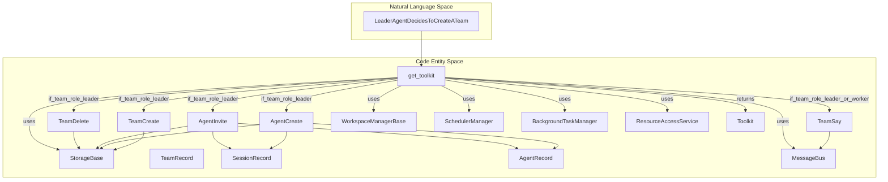
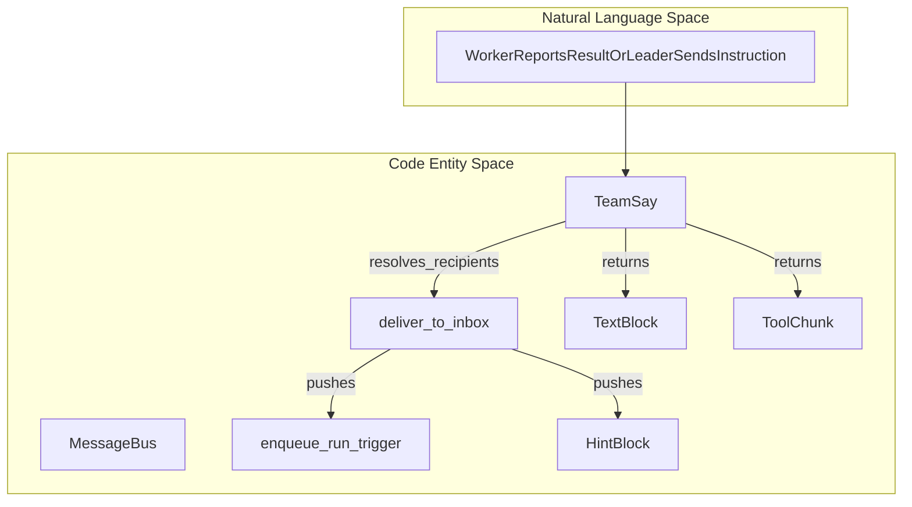

<!-- source: DeepWiki mcp.deepwiki.com · repo modelscope/agentscope · page 6.5 Agent Teams · fetched 2026-10-27 -->

# Agent Teams

Relevant source files

The following files were used as context for generating this wiki page:

- [examples/web_ui/frontend/src/api/session.ts](examples/web_ui/frontend/src/api/session.ts)
- [src/agentscope/app/_router/_schema/_session.py](src/agentscope/app/_router/_schema/_session.py)
- [src/agentscope/app/_router/_session.py](src/agentscope/app/_router/_session.py)
- [src/agentscope/app/_service/__init__.py](src/agentscope/app/_service/__init__.py)
- [src/agentscope/app/_service/_session.py](src/agentscope/app/_service/_session.py)
- [src/agentscope/app/_service/_toolkit.py](src/agentscope/app/_service/_toolkit.py)
- [src/agentscope/app/_tool/__init__.py](src/agentscope/app/_tool/__init__.py)
- [src/agentscope/app/_tool/_agent_create.py](src/agentscope/app/_tool/_agent_create.py)
- [src/agentscope/app/_tool/_agent_invite.py](src/agentscope/app/_tool/_agent_invite.py)
- [src/agentscope/app/_tool/_team_say.py](src/agentscope/app/_tool/_team_say.py)
- [src/agentscope/app/middleware/__init__.py](src/agentscope/app/middleware/__init__.py)
- [src/agentscope/app/storage/_model/_team.py](src/agentscope/app/storage/_model/_team.py)
- [src/agentscope/app/storage/_utils.py](src/agentscope/app/storage/_utils.py)
- [tests/service_inbox_handoff_test.py](tests/service_inbox_handoff_test.py)
- [tests/service_team_tools_test.py](tests/service_team_tools_test.py)
- [tests/service_toolkit_test.py](tests/service_toolkit_test.py)

The purpose and scope of this page is to document the multi-agent team system in AgentScope 2.0. This includes the hierarchical leader/worker session architecture, team tool implementations (`TeamCreate`, `AgentCreate`, `AgentInvite`, `TeamSay`, `TeamDelete`) [src/agentscope/app/_tool/__init__.py](), the `TeamRecord`, `TeamData`, and `TeamMember` storage models [src/agentscope/app/storage/_model/_team.py:10-124](), toolkit role-gating [src/agentscope/app/_service/_toolkit.py:40-135](), state changes and event notifications, inbox hand-off protocols [tests/service_inbox_handoff_test.py:31-176](), and cascade deletion via `SessionService` [src/agentscope/app/_service/_session.py:98-140]().

---

## Architectural Overview & Leader/Worker Sessions

The multi-agent team system extends the single-agent ReAct loop into a collaborative network where a **Leader Agent** can dynamically spawn, configure, and coordinate **Worker Agents**.

- **Leader-Worker Relationship**: A leader agent initiates a team and spawns workers using `AgentCreate` [src/agentscope/app/_tool/_agent_create.py:146-176]().
- **Agent Borrowing**: Leaders can "invite" existing user-owned agents into a team via `AgentInvite` [src/agentscope/app/_tool/_agent_invite.py:141-153](). This borrows a pre-existing agent by minting a fresh team-scoped `SessionRecord` on top of an existing `AgentRecord`.
- **Session Isolation**: Every worker agent operates within its own session, tracked via session services and backed by isolated storage.
- **Communication**: Coordination occurs via `TeamSay`, which utilizes the message bus to push messages and trigger runs [src/agentscope/app/_tool/_team_say.py:121-148]().
- **Toolkit Gating**: Toolkit assembly (`get_toolkit`) injects team tools depending on the caller's resolved `team_role` (`"leader"` or `"worker"`) [src/agentscope/app/_service/_toolkit.py:73-75]().

| Entity | Role | Source Attribute | Tool Set |
| :--- | :--- | :--- | :--- |
| **Leader** | Orchestrator | `user` | `TeamCreate`, `AgentCreate`, `AgentInvite`, `TeamSay`, `TeamDelete` |
| **Worker (Created)** | Specialist | `team` | `TeamSay` (Worker Role) |
| **Worker (Invited)** | Specialist | `user` | `TeamSay` (Worker Role) |

### Diagram: Team Creation & Toolkit Assembly

Sources: [src/agentscope/app/_service/_toolkit.py:40-135](), [src/agentscope/app/_tool/_agent_create.py:146-176](), [src/agentscope/app/_tool/_team_say.py:78-148](), [src/agentscope/app/storage/_model/_team.py:100-124]()

---

## Team Data Model and Storage

Teams are represented by `TeamRecord`, `TeamData`, and `TeamMember` models [src/agentscope/app/storage/_model/_team.py:10-124]().

### Team Member Schema
The `TeamMember` model maintains the explicit roster with roles [src/agentscope/app/storage/_model/_team.py:10-53]():
- **`role='created'`**: Spawned from a `SubAgentTemplate` via `AgentCreate`. Fully deleted when the team dissolves.
- **`role='invited'`**: Borrowed user-owned agent via `AgentInvite`. Only the team-scoped session is cleaned up; the underlying `AgentRecord` survives.

Storage utilities such as `_ensure_team_members` and `_resolve_team_leader` handle lazy migration of legacy `member_ids` and runtime leader resolution [src/agentscope/app/storage/_model/_team.py:74-122]().

Sources: [src/agentscope/app/storage/_model/_team.py:10-124]()

---

## Sub-Agent Templates and Permission Merging

`SubAgentTemplate` serves as a blueprint for worker agents spawned via `AgentCreate` [src/agentscope/app/_tool/_agent_create.py:45-65]().

### Configuration Inheritance
When an agent is created, `_merge_leader_permissions` combines the template's configuration with the leader's runtime `PermissionContext` [src/agentscope/app/_tool/_agent_create.py:67-112]():
- **`override_leader_mode`**: If `False`, the worker inherits the leader's `PermissionMode` [src/agentscope/app/_tool/_agent_create.py:94-95]().
- **`extend_leader_permission_rules`**: Appends leader permission rules after template rules [src/agentscope/app/_tool/_agent_create.py:104-110]().
- **`extend_leader_working_directories`**: Merges working directories from the leader's context [src/agentscope/app/_tool/_agent_create.py:97-102]().

Sources: [src/agentscope/app/_tool/_agent_create.py:45-112]()

---

## Core Team Tools and Base Class

All team tools inherit from `_TeamToolBase`, binding request-scoped identifiers (`user_id`, `session_id`, `agent_id`) and shared dependencies (`storage`, `message_bus`, `workspace_manager`).

- **`TeamCreate`**: Initializes a `TeamRecord` and stamps `team_id` onto the calling session [tests/service_team_tools_test.py:178-214]().
- **`AgentCreate`**: Spawns a new worker agent, creates a `SessionRecord`, and initializes its execution run [src/agentscope/app/_tool/_agent_create.py:146-176]().
- **`AgentInvite`**: Borrows an existing user-owned agent by minting a team-scoped session [src/agentscope/app/_tool/_agent_invite.py:141-153]().
- **`TeamDelete`**: Dissolves the team by delegating the cleanup cascade to `SessionService.delete_team` [src/agentscope/app/_service/_session.py:98-140]().
- **`TeamSay`**: Sends messages to a teammate or broadcasts to all teammates, adapting its description based on whether the caller is a `leader` or `worker` [src/agentscope/app/_tool/_team_say.py:78-120]().

Sources: [src/agentscope/app/_tool/_agent_create.py:146-176](), [src/agentscope/app/_tool/_agent_invite.py:141-153](), [src/agentscope/app/_tool/_team_say.py:78-120](), [src/agentscope/app/_service/_session.py:98-140](), [tests/service_team_tools_test.py:178-214]()

---

## Message Routing, Inbox Handoff, and Delivery

Inter-session messaging relies on the message bus and inbox injection patterns managed via `deliver_to_inbox` [src/agentscope/app/_bus_ops.py:23-30]() and coordinated via `register_inbox_consumer` and `has_pending_inbox_or_release` [tests/service_inbox_handoff_test.py:68-102](). When a worker turn finishes or fails, notifications and hints are delivered directly to the target inbox.

### Diagram: Message Routing & Delivery

Sources: [src/agentscope/app/_tool/_team_say.py:121-148](), [src/agentscope/app/_bus_ops.py:23-30]()

---

