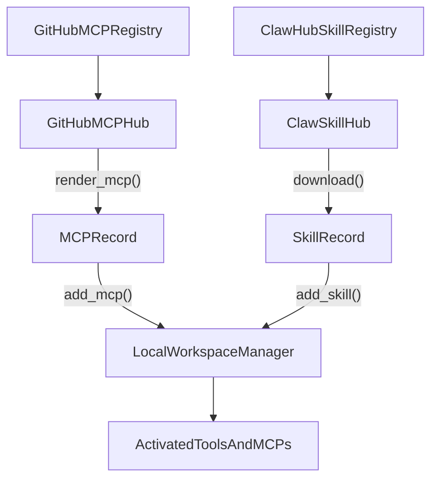
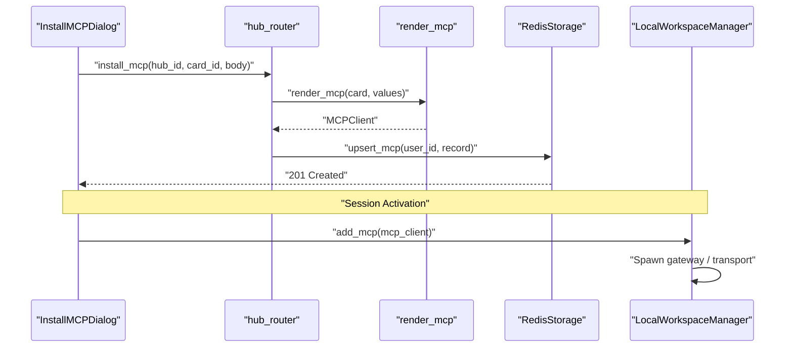

<!-- source: DeepWiki mcp.deepwiki.com · repo modelscope/agentscope · page 6.6 Hub System · fetched 2026-10-27 -->

# Hub System

Relevant source files

The following files were used as context for generating this wiki page:

- [examples/web_ui/frontend/src/components/dialog/InstallMCPDialog.tsx](examples/web_ui/frontend/src/components/dialog/InstallMCPDialog.tsx)
- [src/agentscope/app/_router/_hub.py](src/agentscope/app/_router/_hub.py)
- [src/agentscope/app/_service/_mcp_render.py](src/agentscope/app/_service/_mcp_render.py)
- [src/agentscope/app/hub/_mcp/_github_hub.py](src/agentscope/app/hub/_mcp/_github_hub.py)
- [src/agentscope/app/hub/_skill/_claw_hub.py](src/agentscope/app/hub/_skill/_claw_hub.py)
- [tests/hub_claw_test.py](tests/hub_claw_test.py)
- [tests/hub_github_test.py](tests/hub_github_test.py)
- [tests/hub_router_test.py](tests/hub_router_test.py)
- [tests/service_mcp_render_test.py](tests/service_mcp_render_test.py)

The Hub System in AgentScope 2.0 provides a standardized mechanism for browsing, searching, and installing external resources—specifically **Model Context Protocol (MCP)** servers and **Skills**—into a user's library and subsequently into agent workspaces. It abstracts various upstream registries (such as GitHub and ClawHub) into a unified interface for the Agent Service.

Sources: [src/agentscope/app/_router/_hub.py:2-10]()

## Core Architecture

The system is built on a hierarchy of abstract base classes that define how registries are queried and how resources are downloaded.

### Hub Base Interfaces
All hubs inherit from `HubBase`, which provides metadata for UI rendering.
*   **`HubBase`**: Defined in `src/agentscope/app/hub/_base.py`, it contains `hub_id`, `display_name`, `description`, and `icon_url` [src/agentscope/app/hub/_base.py:16-56]().
*   **`MCPHubBase`**: Defined in `src/agentscope/app/hub/_mcp/_base.py`, it extends `HubBase` with methods for listing MCP cards (`list_mcps`) and retrieving specific cards (`get_mcp`) [src/agentscope/app/hub/_mcp/_base.py:1-69]().
*   **`SkillHubBase`**: Defined in `src/agentscope/app/hub/_skill/_base.py`, it extends `HubBase` with methods for listing skill cards (`list_skills`), getting card details (`get_skill`), and downloading skill archives (`download`) [src/agentscope/app/hub/_skill/_base.py:1-125]().

Sources: [src/agentscope/app/hub/_base.py:16-56](), [src/agentscope/app/hub/_mcp/_base.py:1-69](), [src/agentscope/app/hub/_skill/_base.py:1-125]()

### Resource Flow Diagram
This diagram illustrates how a resource moves from a remote registry into an active AgentScope workspace, bridging natural language spaces to code entities.

Title: Registry to Workspace Data Flow
Sources: [src/agentscope/app/hub/_mcp/_github_hub.py:101-108](), [src/agentscope/app/hub/_skill/_claw_hub.py:75-84](), [src/agentscope/app/_router/_hub.py:134-203]()

## Hub Implementations

### GitHubMCPHub
The `GitHubMCPHub` (`src/agentscope/app/hub/_mcp/_github_hub.py`) acts as a client for the GitHub-hosted MCP registry (`api.mcp.github.com`). It handles the mapping of environment variable placeholders and runtime hints [src/agentscope/app/hub/_mcp/_github_hub.py:101-121]().
*   **Runtime Hints**: The registry uses `runtime_hint` fields. `GitHubMCPHub` maps these to local execution commands, such as `npx` (with `-y`), `uvx`, `uv` (with `tool run`), or `docker` (with `run -i --rm`) [src/agentscope/app/hub/_mcp/_github_hub.py:37-42]().
*   **Placeholder Substitution**: The registry writes secret placeholders as `{TOKEN}`. The hub rewrites these to `${TOKEN}` via `_substitute()` to be compatible with `string.Template` used by the service-layer renderer [src/agentscope/app/hub/_mcp/_github_hub.py:31-33](), [src/agentscope/app/hub/_mcp/_github_hub.py:45-62]().
*   **Input Schema Generation**: Registry variable definitions (secrets, choices, defaults) are converted into standard JSON Schema via `_inputs_schema()` for frontend form rendering [src/agentscope/app/hub/_mcp/_github_hub.py:82-98]().

Sources: [src/agentscope/app/hub/_mcp/_github_hub.py:31-121]()

### ClawSkillHub
`ClawSkillHub` (`src/agentscope/app/hub/_skill/_claw_hub.py`) is a client for `clawhub.ai`, providing access to a large repository of agent skills via a thin async client [src/agentscope/app/hub/_skill/_claw_hub.py:75-97]().
*   **Pagination**: Supports cursor-based pagination for browsing (`GET /api/v1/skills`) and single-page results for search queries (`GET /api/v1/search`) [src/agentscope/app/hub/_skill/_claw_hub.py:14-17]().
*   **Archive Download**: Uses `httpx` to stream-download skill archives with a default chunk size of 64 KiB (`DEFAULT_CHUNK_SIZE`) [src/agentscope/app/hub/_skill/_claw_hub.py:35-37](), [src/agentscope/app/hub/_skill/_claw_hub.py:192-207]().
*   **Version Humanization**: Automatically converts timestamp-based versions (e.g., `0.20260729.110214`) into readable date formats (`2026-07-29`) via `_humanize_version` [src/agentscope/app/hub/_skill/_claw_hub.py:46-72]().

Sources: [src/agentscope/app/hub/_skill/_claw_hub.py:14-97]()

## Service Layer and API

The Hub System is exposed via `hub_router` in `src/agentscope/app/_router/_hub.py`, providing endpoints for the Web UI to browse and install resources [src/agentscope/app/_router/_hub.py:34-34]().

### MCP Card Rendering and Installation
When a user installs an MCP card, the `render_mcp` utility (`src/agentscope/app/_service/_mcp_render.py`) transforms the `MCPCard` template and user-supplied values into a connectable `MCPClient` [src/agentscope/app/_service/_mcp_render.py:103-127]().
*   **`render_mcp(card, values, name)`**: Performs JSON Schema validation, fills placeholders, and handles optional environment variables [src/agentscope/app/_service/_mcp_render.py:103-127]().
*   **Placeholder Logic**: Uses `string.Template.safe_substitute`. If a declared placeholder is missing from the user's `values`, an `MCPRenderError` is raised [src/agentscope/app/_service/_mcp_render.py:12-18](), [src/agentscope/app/_service/_mcp_render.py:153-158]().
*   **Optional Env Omission**: If an optional environment variable placeholder is unfilled, that specific key is omitted from the `env` dict rather than failing the installation [src/agentscope/app/_service/_mcp_render.py:32-55]().

Sources: [src/agentscope/app/_service/_mcp_render.py:12-168]()

### API Endpoints
*   **`GET /hub/mcp` / `GET /hub/skill`**: Lists available hub providers registered in the system [src/agentscope/app/_router/_hub.py:92-97](), [src/agentscope/app/_router/_hub.py:211-216]().
*   **`GET /hub/mcp/{hub_id}/cards`**: Browses MCP resources within a specific hub with optional search query `q` and pagination `cursor` [src/agentscope/app/_router/_hub.py:100-112]().
*   **`POST /hub/mcp/{hub_id}/cards/{card_id}/install`**: Persists the MCP resource into the user's library as an `MCPRecord` [src/agentscope/app/_router/_hub.py:134-203]().
*   **`POST /hub/skill/{hub_id}/cards/{card_id}/install`**: Downloads and persists a skill into the user's library as a `SkillRecord` [src/agentscope/app/_router/_hub.py:252-303]().

Sources: [src/agentscope/app/_router/_hub.py:92-303]()

## Resource Installation Flow

The installation process bridges user-level Web UI interactions down to backend storage and workspace execution entities.

Title: Installation Sequence
Sources: [examples/web_ui/frontend/src/components/dialog/InstallMCPDialog.tsx:61-94](), [src/agentscope/app/_service/_mcp_render.py:103-127](), [src/agentscope/app/_router/_hub.py:134-203]()

## Implementation Details

### ClawHub Card Mapping
The `ClawSkillHub` performs extensive mapping to normalize upstream data into `SkillCard` objects:
*   **Author/Icon**: Extracted from the `owner` or `native.owner` fields [tests/hub_claw_test.py:79-98]().
*   **IDs**: Card IDs are owner-scoped (e.g., `runware/music`) to prevent collisions [tests/hub_claw_test.py:112-147]().

Sources: [tests/hub_claw_test.py:79-147]()

### Frontend Components
*   **`InstallMCPDialog`**: Collected answers from `SchemaForm`. For edits, it only sends filled fields to the server to avoid overwriting existing secrets with blanks [examples/web_ui/frontend/src/components/dialog/InstallMCPDialog.tsx:44-94]().
*   **`hub_router` Utility**: The internal `_pick_hub` function ensures requested hub IDs exist before attempting operations, raising `404 NOT FOUND` otherwise [src/agentscope/app/_router/_hub.py:39-62]().

Sources: [examples/web_ui/frontend/src/components/dialog/InstallMCPDialog.tsx:44-94](), [src/agentscope/app/_router/_hub.py:39-62]()

### Data Persistence
Installed resources flow into the user-level library managed by `StorageBase` implementations.
*   **`MCPRecord`**: Stores the rendered `MCPClient` configuration along with source identifiers to track origin and versions [src/agentscope/app/storage/_model.py:176-189]().
*   **`SkillRecord`**: Stores the skill name, description, and the local path to the downloaded archive in the user's storage area [src/agentscope/app/storage/_model.py:206-218]().

Sources: [src/agentscope/app/storage/_model.py:176-218]()

---

