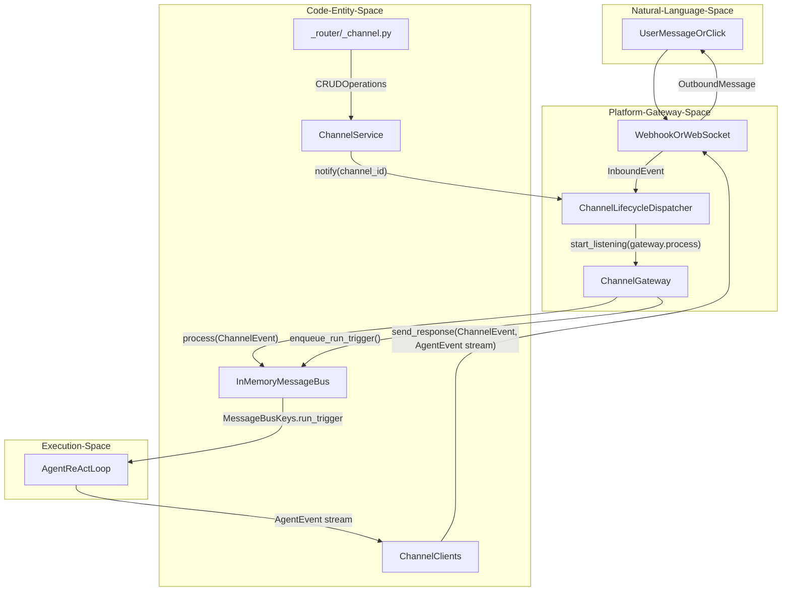
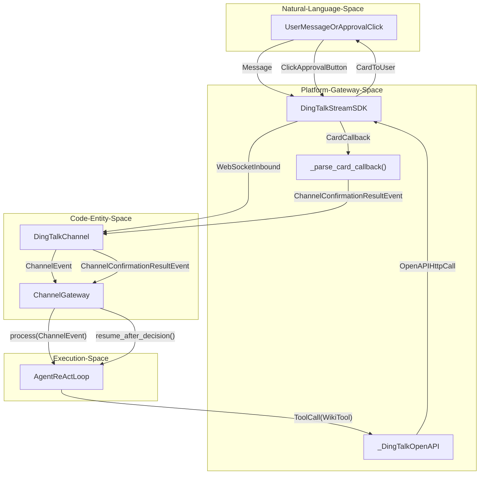

<!-- source: DeepWiki mcp.deepwiki.com · repo modelscope/agentscope · page 6.7 Channel System · fetched 2026-10-27 -->

# Channel System

Relevant source files

The following files were used as context for generating this wiki page:

- [assets/dingtalk/tool_approval_card.json](assets/dingtalk/tool_approval_card.json)
- [src/agentscope/app/_router/_channel.py](src/agentscope/app/_router/_channel.py)
- [src/agentscope/app/_router/_schema/_channel.py](src/agentscope/app/_router/_schema/_channel.py)
- [src/agentscope/app/_service/_channel.py](src/agentscope/app/_service/_channel.py)
- [src/agentscope/app/channel/__init__.py](src/agentscope/app/channel/__init__.py)
- [src/agentscope/app/channel/_base.py](src/agentscope/app/channel/_base.py)
- [src/agentscope/app/channel/_clients.py](src/agentscope/app/channel/_clients.py)
- [src/agentscope/app/channel/_dingtalk/_card.py](src/agentscope/app/channel/_dingtalk/_card.py)
- [src/agentscope/app/channel/_dingtalk/_channel.py](src/agentscope/app/channel/_dingtalk/_channel.py)
- [src/agentscope/app/channel/_dingtalk/_openapi.py](src/agentscope/app/channel/_dingtalk/_openapi.py)
- [src/agentscope/app/channel/_dingtalk/_tools/_list_conversations.py](src/agentscope/app/channel/_dingtalk/_tools/_list_conversations.py)
- [src/agentscope/app/channel/_dingtalk/_tools/_list_users.py](src/agentscope/app/channel/_dingtalk/_tools/_list_users.py)
- [src/agentscope/app/channel/_discord/_channel.py](src/agentscope/app/channel/_discord/_channel.py)
- [src/agentscope/app/channel/_dispatcher.py](src/agentscope/app/channel/_dispatcher.py)
- [src/agentscope/app/channel/_feishu/_channel.py](src/agentscope/app/channel/_feishu/_channel.py)
- [src/agentscope/app/channel/_gateway.py](src/agentscope/app/channel/_gateway.py)
- [src/agentscope/app/channel/_stream.py](src/agentscope/app/channel/_stream.py)
- [src/agentscope/app/storage/_model/_channel.py](src/agentscope/app/storage/_model/_channel.py)
- [src/agentscope/app/storage/_sql/_alembic/versions/0003_channels.py](src/agentscope/app/storage/_sql/_alembic/versions/0003_channels.py)
- [src/agentscope/app/storage/_sql/_tables.py](src/agentscope/app/storage/_sql/_tables.py)
- [tests/channel_clients_test.py](tests/channel_clients_test.py)
- [tests/channel_dingtalk_test.py](tests/channel_dingtalk_test.py)
- [tests/channel_gateway_test.py](tests/channel_gateway_test.py)
- [tests/channel_routing_test.py](tests/channel_routing_test.py)
- [tests/channel_stream_test.py](tests/channel_stream_test.py)
- [tests/service_chat_channel_delivery_test.py](tests/service_chat_channel_delivery_test.py)

The Channel System in AgentScope 2.0 provides a production-ready framework for bridging multi-agent applications with external instant messaging (IM) platforms such as Feishu/Lark, Discord, and DingTalk. It normalizes inbound messaging and interactive UI events into standard AgentScope data structures (`ChannelEvent`, `ChannelConfirmationResultEvent`), manages session mapping and routing bindings via `RoutingConfig` and `ChannelBinding`, and streams agent execution events back to platform clients using decoupled stream/client mechanisms.

Sources: [src/agentscope/app/channel/_base.py:1-14](), [src/agentscope/app/channel/_gateway.py:1-18]()

---

## Core Abstractions and Data Models

All channel integrations inherit from the `ChannelBase` abstract base class defined in `src/agentscope/app/channel/_base.py` [src/agentscope/app/channel/_base.py:17-200](). The architecture cleanly separates long-lived connection management from stateful agent execution, allowing platform integration code to run in isolated workers or scale across distributed cluster nodes.

*   **`ChannelBase`**: Abstract base class defining connection lifecycles (`start_listening`, `aclose`), configuration validation models (`Credentials` and `Config`), and response delivery hooks (`send_response`) [src/agentscope/app/channel/_base.py:17-200]().
*   **`ChannelEvent`**: Normalized inbound payload wrapping unified content blocks (`TextBlock`, `DataBlock`), user IDs (`channel_user_id`), chat IDs (`chat_id`), and platform metadata [src/agentscope/app/channel/_base.py:57-106]().
*   **`ChannelConfirmationResultEvent`**: Normalizes inbound Human-in-the-Loop (HITL) button clicks or approval decisions from message cards, routing approvals back to suspended agent runs [src/agentscope/app/channel/_base.py:107-143]().
*   **`ChannelStatus` & `ChannelHeartbeat`**: Track live connection health (`stopped`, `connecting`, `connected`, `retrying`, `failed`) and publish periodic liveness reports to the `MessageBus` with a defined time-to-live (`LIVENESS_TTL_SECS`) [src/agentscope/app/channel/_base.py:144-185]().
*   **`ChannelCapability`**: Declares platform rendering capabilities (text, markdown, image, file, interactive components, streaming) [src/agentscope/app/channel/_base.py:190-200]().

**Diagram: Inbound Processing and Lifecycle Architecture**

Sources: [src/agentscope/app/channel/_dispatcher.py:54-126](), [src/agentscope/app/channel/_gateway.py:15-30](), [src/agentscope/app/channel/_base.py:57-143](), [src/agentscope/app/_service/_channel.py:99]()

---

## Routing, Gateway, and Session Mapping

The `ChannelGateway` (`src/agentscope/app/channel/_gateway.py`) coordinates inbound processing, matching platform events to routing rules and deriving internal sessions [src/agentscope/app/channel/_gateway.py:46-181]().

*   **Routing and Binding**: Inbound events are matched against `RoutingConfig` and `ChannelBinding` rules using platform properties or wildcards (`*`) to resolve target agent IDs [tests/channel_gateway_test.py:29]().
*   **Session Derivation**: Maps platform chat identifiers (`chat_id`) to internal agent sessions, isolating conversations per chat or per chat-user [src/agentscope/app/channel/_gateway.py:46-180]().
*   **Card-Click Resumption**: When a `ChannelConfirmationResultEvent` arrives, the gateway matches the `tool_call_id` and resumes the waiting session via `resume_after_decision` [src/agentscope/app/channel/_gateway.py:88-181]().
*   **`ChannelOrigin`**: Sessions created via channels record their origin parameters (`ChannelOrigin`) to ensure replies can be correctly routed back even on background triggers or scheduled wakes [src/agentscope/app/storage/_model/_session.py:44-69]().

Sources: [src/agentscope/app/channel/_gateway.py:46-181](), [src/agentscope/app/channel/_base.py:107-143](), [src/agentscope/app/storage/_model/_session.py:44-69]()

---

## Channel Lifecycle, Services, and Client Factories

Management operations and connection lifecycles are divided between stateless CRUD services, node-level dispatchers, and connection-free client factories.

*   **`ChannelService`**: Stateless CRUD provider (`src/agentscope/app/_service/_channel.py`) handling database writes, bot ID uniqueness checks [src/agentscope/app/_service/_channel.py:69-81](), and broadcasting lifecycle notification events via `MessageBus` [src/agentscope/app/_service/_channel.py:99]().
*   **`ChannelLifecycleDispatcher`**: Reconciles local channel process instances against storage records per node (`src/agentscope/app/channel/_dispatcher.py`), spawning background tasks for `start_listening` and publishing heartbeat liveness statuses [src/agentscope/app/channel/_dispatcher.py:81-98]().
*   **`ChannelClients`**: Factory providing connection-free channel wrappers (`src/agentscope/app/channel/_clients.py`) for API replicas or workers needing to deliver outbound responses or run platform tools without holding a persistent WebSocket socket [tests/channel_clients_test.py:130-195]().
*   **Channel Stream**: Manages formatting and streaming rendering of agent event streams (`AgentEvent`) into platform-specific message blocks or chunks (`src/agentscope/app/channel/_stream.py`).

Sources: [src/agentscope/app/_service/_channel.py:24-191](), [src/agentscope/app/channel/_dispatcher.py:54-180](), [tests/channel_clients_test.py:130-195](), [src/agentscope/app/channel/_clients.py]()

---

## Platform Implementations

### DingTalk Channel Integration
The `DingTalkChannel` (`src/agentscope/app/channel/_dingtalk/_channel.py`) uses the official DingTalk Stream SDK for persistent WebSocket connectivity, combined with a lightweight `_DingTalkOpenAPI` client (`src/agentscope/app/channel/_dingtalk/_openapi.py`) for media downloads, uploads, and card rendering [src/agentscope/app/channel/_dingtalk/_channel.py:83-190]().

*   **Interactive Approval Cards**: Uses structured card layouts (`_card.py`) and tracking IDs to manage tool approval workflows [src/agentscope/app/channel/_dingtalk/_card.py]()
*   **Platform Tools**: Exposes OpenAPI-backed tools (such as wiki workspace/node listing and document reading) to let agents interact with DingTalk enterprise knowledge bases [src/agentscope/app/channel/_dingtalk/_openapi.py:31-82]().

**Diagram: DingTalk Tool and Card Execution Flow**

Sources: [src/agentscope/app/channel/_dingtalk/_channel.py:83-190](), [src/agentscope/app/channel/_dingtalk/_openapi.py:31-82](), [tests/channel_dingtalk_test.py:132-227](), [src/agentscope/app/channel/_dingtalk/_card.py]()

### Feishu and Discord Channels
*   **`FeishuChannel`**: Integrates with Feishu/Lark open platform Webhooks and Event Subscriptions via `lark_oapi`, translating interactive message cards for approval flows and handling multimodal image/file attachments [src/agentscope/app/channel/_feishu/_channel.py:91-175]().
*   **`DiscordChannel`**: Connects via the `discord.py` gateway client, mapping Discord message events and button interactions into unified `ChannelEvent` and `ChannelConfirmationResultEvent` streams [src/agentscope/app/channel/_discord/_channel.py]() [src/agentscope/app/channel/_base.py:57-143]().

Sources: [src/agentscope/app/channel/_feishu/_channel.py:91-175](), [src/agentscope/app/channel/_discord/_channel.py](), [src/agentscope/app/channel/_base.py:57-143]()

---

## Channel Router and Out-of-Process Worker

The channel system exposes administrative controls via `channel_router` and supports out-of-process execution.

*   **API Endpoints (`channel_router`)**: Provides CRUD endpoints (`POST /channels/`, `GET /channels/{id}`, `PATCH /channels/{id}`, `DELETE /channels/{id}`), liveness status checks, and channel type discovery [src/agentscope/app/_router/_channel.py]() [src/agentscope/app/channel/_errors.py]().
*   **Channel Worker Process (`run_channel_worker`)**: Production deployments can run channel adapters inside a dedicated worker process, separating long-lived WebSocket connections from stateless FastAPI application replicas [src/agentscope/app/channel/worker/__init__.py]() [src/agentscope/app/channel/_dispatcher.py:54-126]().

Sources: [src/agentscope/app/_router/_schema/_channel.py](), [src/agentscope/app/channel/worker/__init__.py](), [src/agentscope/app/_router/_channel.py](), [src/agentscope/app/channel/_dispatcher.py:54-126]()

---

