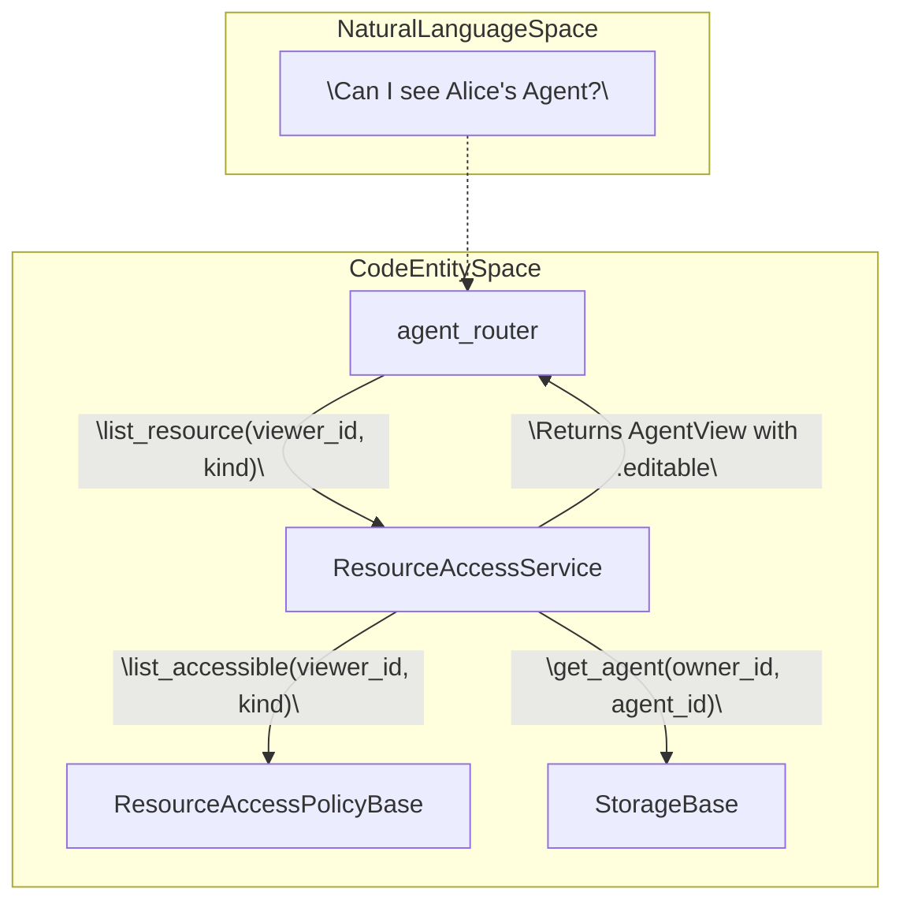
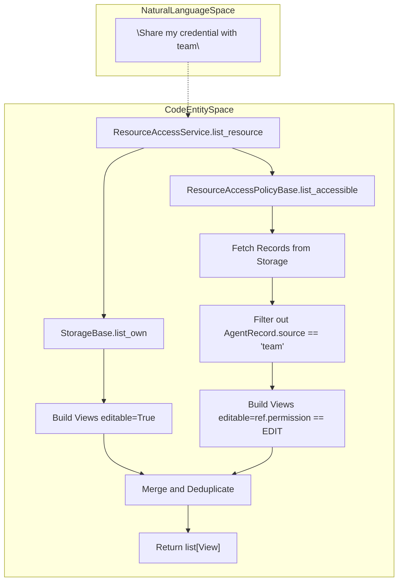

<!-- source: DeepWiki mcp.deepwiki.com · repo modelscope/agentscope · page 6.8 Resource Access Policy · fetched 2026-10-27 -->

# Resource Access Policy

Relevant source files

The following files were used as context for generating this wiki page:

- [examples/agent_service/main.py](examples/agent_service/main.py)
- [examples/web_ui/frontend/src/api/session.ts](examples/web_ui/frontend/src/api/session.ts)
- [src/agentscope/app/_app.py](src/agentscope/app/_app.py)
- [src/agentscope/app/_lifespan.py](src/agentscope/app/_lifespan.py)
- [src/agentscope/app/_router/_chat.py](src/agentscope/app/_router/_chat.py)
- [src/agentscope/app/_router/_schema/_session.py](src/agentscope/app/_router/_schema/_session.py)
- [src/agentscope/app/_router/_session.py](src/agentscope/app/_router/_session.py)
- [src/agentscope/app/_service/__init__.py](src/agentscope/app/_service/__init__.py)
- [src/agentscope/app/_service/_chat.py](src/agentscope/app/_service/_chat.py)
- [src/agentscope/app/_service/_session.py](src/agentscope/app/_service/_session.py)
- [src/agentscope/app/_service/_toolkit.py](src/agentscope/app/_service/_toolkit.py)
- [src/agentscope/app/_tool/__init__.py](src/agentscope/app/_tool/__init__.py)
- [src/agentscope/app/_tool/_agent_create.py](src/agentscope/app/_tool/_agent_create.py)
- [src/agentscope/app/_tool/_agent_invite.py](src/agentscope/app/_tool/_agent_invite.py)
- [src/agentscope/app/_tool/_team_say.py](src/agentscope/app/_tool/_team_say.py)
- [src/agentscope/app/_types.py](src/agentscope/app/_types.py)
- [src/agentscope/app/deps.py](src/agentscope/app/deps.py)
- [src/agentscope/app/middleware/__init__.py](src/agentscope/app/middleware/__init__.py)
- [src/agentscope/app/storage/_model/_team.py](src/agentscope/app/storage/_model/_team.py)
- [src/agentscope/app/storage/_utils.py](src/agentscope/app/storage/_utils.py)
- [tests/service_inbox_handoff_test.py](tests/service_inbox_handoff_test.py)
- [tests/service_team_failure_report_test.py](tests/service_team_failure_report_test.py)
- [tests/service_team_tools_test.py](tests/service_team_tools_test.py)
- [tests/service_toolkit_test.py](tests/service_toolkit_test.py)

The purpose of this section is to document the **Resource Access Policy** system in AgentScope 2.0, which provides a structured mechanism for cross-owner resource sharing in multi-tenant environments. While the underlying storage layer (e.g., `RedisStorage` [src/agentscope/app/storage/_redis_storage.py:53-55]() or `AsyncSQLAlchemyStorage` [src/agentscope/app/storage/_sql/_storage.py:90-91]()) is strictly owner-isolated by default, the access policy layer allows applications to grant `READ` or `EDIT` permissions to external users (viewers) for specific resources like credentials, agents, and knowledge bases.

Sources: [src/agentscope/app/storage/_redis_storage.py:53-55](), [src/agentscope/app/storage/_sql/_storage.py:90-91]()

---

## Core Abstractions

The system is built on a set of primitives that decouple identity management from resource storage within `ResourceAccessPolicyBase` and associated classes [src/agentscope/app/access/_policy.py:11-163]().

### Resource Primitives
- **`ResourceKind`**: An enumeration defining the types of sharable entities: `CREDENTIAL`, `AGENT`, and `KNOWLEDGE_BASE` [src/agentscope/app/access/_policy.py:11-30]().
- **`ResourcePermission`**: Defines the access level. `READ` allows viewing and runtime usage, while `EDIT` grants mutation rights (equivalent to co-ownership) [src/agentscope/app/access/_policy.py:32-50]().
- **`ResourceRef`**: A lightweight model that points to a specific resource using an `(owner_id, resource_id)` tuple, carrying a specific permission level [src/agentscope/app/access/_policy.py:51-77]().

### Policy Base Class
`ResourceAccessPolicyBase` is an abstract class that applications must implement to define sharing logic. It does not store sharing records itself but acts as an oracle that the service layer queries [src/agentscope/app/access/_policy.py:79-88]().

| Method | Description |
| :--- | :--- |
| `list_accessible` | Returns a list of `ResourceRef` objects for a given viewer and kind [src/agentscope/app/access/_policy.py:91-112](). |
| `can_edit` | Checks if a viewer has mutation rights. The default implementation checks if the viewer is the owner or has a `ResourceRef` with `EDIT` permission [src/agentscope/app/access/_policy.py:114-150](). |

Sources: [src/agentscope/app/access/_policy.py:11-150]()

---

## System Integration and Data Flow

`ResourceAccessService` acts as the orchestrator between the **Access Policy** and the **Storage Layer** (`StorageBase` [src/agentscope/app/storage/_base.py:29-30](), implemented by `RedisStorage` [src/agentscope/app/storage/_redis_storage.py:53-55]() and `AsyncSQLAlchemyStorage` [src/agentscope/app/storage/_sql/_storage.py:90-91]()). It provides views which are viewer-relative projections of storage records, including an `editable` flag [src/agentscope/app/_service/_access.py:32-44]().

### Natural Language to Code Entity Resolution Flow

Title: "Natural Language to Code Entity Resolution Flow"

Sources: [src/agentscope/app/_service/_access.py:193-210](), [tests/storage_redis_test.py:140-148]()

### Data Masking and Security
A critical security feature of `ResourceAccessService` is the handling of credentials. When a credential is shared with `READ` access:
1.  **API Views**: `CredentialView` masks the sensitive `data` field, leaving only metadata like `type` and `name` to prevent leakage to the frontend [src/agentscope/app/_service/_access.py:47-61]().
2.  **Runtime Resolution**: `resolve_credential` returns the full record, but it is intended for internal use when constructing models, not for exposure via REST endpoints [src/agentscope/app/_service/_access.py:325-340]().

Sources: [src/agentscope/app/_service/_access.py:47-61](), [src/agentscope/app/_service/_access.py:325-340]()

### Resource Resolution and Sharing Logic Flow

Title: "Resource Resolution and Sharing Logic Flow"

Sources: [src/agentscope/app/_service/_access.py:211-255](), [tests/storage_sql_test.py:214-220]()

---

## Default Behavior and Safety

AgentScope 2.0 defaults to a **Deny-All** posture to ensure backward compatibility and security.

- **`DenyAllResourceAccessPolicy`**: The default implementation of the policy. It returns an empty list for all `list_accessible` calls [src/agentscope/app/access/_policy.py:153-163](), which can also be verified in unit tests [tests/storage_redis_test.py:140-148](). This policy is used by default in `create_app` if no other policy is provided.
- **Isolation of Team Agents**: Agents created as part of a team (where `source == "team"`) are explicitly excluded from sharing results in `list_resource`. This ensures that internal worker agents do not leak into a user's primary agent list [src/agentscope/app/_service/_access.py:236-240]().
- **Knowledge Base Flattening**: `KnowledgeBaseView` uses a model validator called `_lift_data_payload` to flatten the nested `data` payload from `KnowledgeBaseRecord` into a top-level wire format for API consumers [src/agentscope/app/_service/_access.py:155-182](). This ensures `name`, `description`, and `embedding_model_config` are accessible at the root of the JSON response [src/agentscope/app/_service/_access.py:81-153]().

Sources: [src/agentscope/app/access/_policy.py:153-163](), [src/agentscope/app/_service/_access.py:155-182](), [src/agentscope/app/_service/_access.py:236-240](), [tests/storage_redis_test.py:140-148]()

---

## Multi-Tenant Sharing Integration

The resource access policy plays a crucial role in enabling multi-tenant sharing, particularly for team tools like `AgentInvite`.

### `AgentInvite` and Resource Access
`AgentInvite` allows a leader agent to borrow a pre-existing user-owned agent into its team [src/agentscope/app/_tool/_agent_invite.py:2-16](). This process relies on `ResourceAccessService` to determine which agents are invitable by the current user.

1.  **Invitable Pool**: When the `AgentInvite` tool is attached to a leader's toolkit (via `get_toolkit` [src/agentscope/app/_service/_toolkit.py:58-134]()), `ResourceAccessService.list_resource` is called to build a snapshot of invitable agents [src/agentscope/app/_service/_toolkit.py:250-254]().
2.  **Policy Enforcement**: `list_resource` queries the configured `ResourceAccessPolicyBase` (e.g., `_SharedAgentPolicy` in tests [tests/service_team_tools_test.py:114-136]()) to identify agents that the current user can access and invite.
3.  **Agent Record Survival**: Unlike agents created with `AgentCreate` (which are deleted with the team), an invited agent's underlying `AgentRecord` survives team dissolution, with only the borrowed session being cleaned up [src/agentscope/app/_tool/_agent_invite.py:12-16](), [src/agentscope/app/storage/_model/_team.py:45-54](). This is reflected in `TeamMember.role`, which can be `"created"` or `"invited"` [src/agentscope/app/storage/_model/_team.py:45-54]().

### `AgentCreate` and Permissions
`AgentCreate` spawns a new worker agent into the team [src/agentscope/app/_tool/_agent_create.py:2-3](). The permissions for this new agent are derived from a `SubAgentTemplate` [src/agentscope/app/_types.py:114-174]().

- **Permission Context Inheritance**: `_merge_leader_permissions` [src/agentscope/app/_tool/_agent_create.py:67-112]() merges the template's `PermissionContext` with the leader's runtime `PermissionContext`. This allows for flexible control over the worker's capabilities:
    - `override_leader_mode`: Determines if the template's permission mode overrides the leader's [src/agentscope/app/_tool/_agent_create.py:94-95]().
    - `extend_leader_permission_rules`: Appends the leader's permission rules to the template's rules [src/agentscope/app/_tool/_agent_create.py:104-110]().
    - `extend_leader_working_directories`: Merges the leader's working directories into the worker's context [src/agentscope/app/_tool/_agent_create.py:97-102]().

### Team Tool Permissions
All team tools (`TeamCreate`, `AgentCreate`, `AgentInvite`, `TeamSay`, `TeamDelete`) inherit from `_TeamToolBase` [src/agentscope/app/_tool/_team_tool_base.py:22-25](). These tools inherently allow themselves unconditionally within their `check_permissions` method [src/agentscope/app/_tool/_team_tool_base.py:134-155](). The actual gating of which team tools are available to an agent is handled at the toolkit assembly stage in `get_toolkit` based on the session's team role (leader vs. worker) [src/agentscope/app/_tool/__init__.py:13-32]().

Sources: [src/agentscope/app/_tool/_agent_invite.py:2-16](), [src/agentscope/app/_tool/_agent_create.py:2-3](), [src/agentscope/app/_tool/_agent_create.py:67-112](), [src/agentscope/app/_tool/__init__.py:13-32](), [src/agentscope/app/_tool/_team_tool_base.py:22-25](), [src/agentscope/app/_tool/_team_tool_base.py:134-155](), [src/agentscope/app/_service/_toolkit.py:58-134](), [src/agentscope/app/_service/_toolkit.py:250-254](), [src/agentscope/app/_types.py:114-174](), [src/agentscope/app/storage/_model/_team.py:45-54](), [tests/service_team_tools_test.py:114-136]()

---

## Validation Patterns

The system is validated using test suites that demonstrate common implementation patterns:

1.  **Sharing Policies**: Demonstrates granting `READ` access to specific hardcoded resource IDs for agents and credentials [tests/storage_redis_test.py:140-148]().
2.  **Edit Policies**: Demonstrates granting `EDIT` access, allowing a viewer to pass mutation checks for a specific agent.
3.  **Owner Check**: Validates that the base policy preserves owner-isolated behavior unless explicitly overridden [tests/storage_redis_test.py:140-148]().

### Integration with Storage Backends
The storage layer (`RedisStorage` [src/agentscope/app/storage/_redis_storage.py:53-55]() and `AsyncSQLAlchemyStorage` [src/agentscope/app/storage/_sql/_storage.py:90-91]()) enforces strict owner-scoping at the database query level (e.g. `list_credentials(user_id)` [src/agentscope/app/storage/_base.py:68-78](), `list_agents`, `list_knowledge_bases`). `ResourceAccessService` bridges multi-tenant sharing by orchestrating multi-owner fetching when `ResourceAccessPolicyBase` grants cross-owner references.

Sources: [tests/storage_redis_test.py:140-148](), [src/agentscope/app/access/_policy.py:79-112](), [src/agentscope/app/storage/_base.py:68-78]()

---

