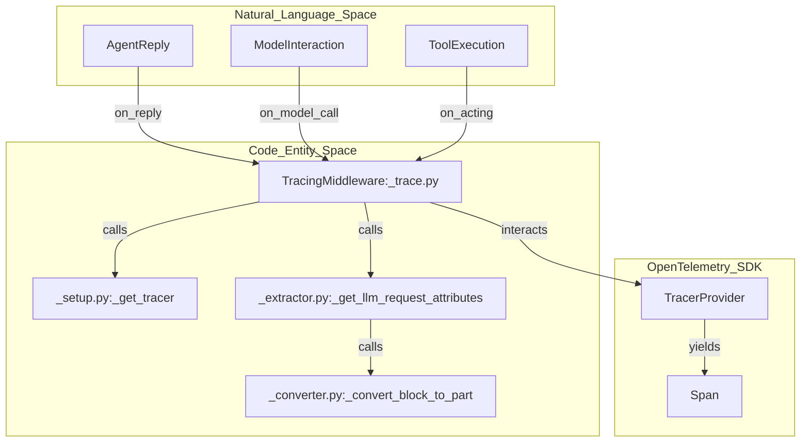
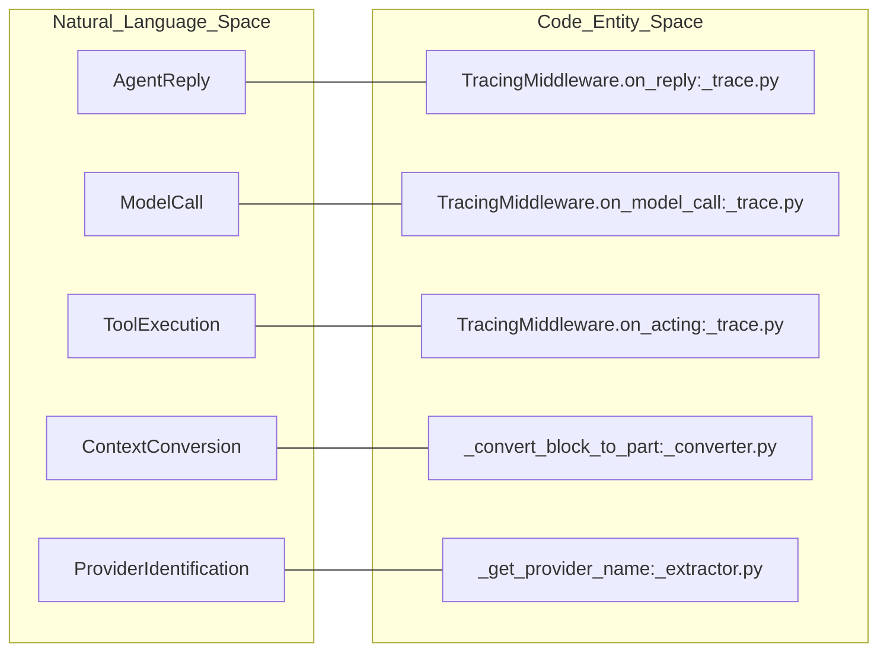

<!-- source: DeepWiki mcp.deepwiki.com · repo modelscope/agentscope · page 7 Observability · fetched 2026-10-27 -->

# Observability

Relevant source files

The following files were used as context for generating this wiki page:

- [src/agentscope/middleware/_tracing/__init__.py](src/agentscope/middleware/_tracing/__init__.py)
- [src/agentscope/middleware/_tracing/_attributes.py](src/agentscope/middleware/_tracing/_attributes.py)
- [src/agentscope/middleware/_tracing/_converter.py](src/agentscope/middleware/_tracing/_converter.py)
- [src/agentscope/middleware/_tracing/_extractor.py](src/agentscope/middleware/_tracing/_extractor.py)
- [src/agentscope/middleware/_tracing/_setup.py](src/agentscope/middleware/_tracing/_setup.py)
- [src/agentscope/middleware/_tracing/_trace.py](src/agentscope/middleware/_tracing/_trace.py)
- [src/agentscope/middleware/_tracing/_utils.py](src/agentscope/middleware/_tracing/_utils.py)
- [tests/tracing_test.py](tests/tracing_test.py)

This page provides a high-level overview of AgentScope's monitoring and tracing capabilities. AgentScope uses OpenTelemetry (OTel) to track agent execution flows, debug reasoning loops, and analyze model performance across distributed environments [src/agentscope/middleware/_tracing/_trace.py:117-132]().

For deep technical details, refer to the child pages:
- [OpenTelemetry Integration](#7.1) — Tracing setup, OTLP configuration, attribute mapping, and semantic conventions.
- [Tracing Middleware and Decorators](#7.2) — Middleware hook points, helper utilities, and custom component instrumentation.

Sources: `[src/agentscope/middleware/_tracing/_trace.py:117-132]`, `[src/agentscope/middleware/_tracing/_attributes.py:8-154]`

## Overview of Observability Subsystem

AgentScope's observability layer relies on a non-invasive middleware architecture that captures execution metrics without altering core agent logic. The subsystem is structured around standardized OpenTelemetry GenAI semantic conventions [src/agentscope/middleware/_tracing/_attributes.py:8-154]() and converts internal message structures into exportable telemetry spans via `TracingMiddleware` [src/agentscope/middleware/_tracing/_trace.py:117-132]().

Title: "Tracing Component Architecture"

Sources: `[src/agentscope/middleware/_tracing/_trace.py:117-132]`, `[src/agentscope/middleware/_tracing/_setup.py:11-19]`, `[src/agentscope/middleware/_tracing/_extractor.py:170-190]`, `[src/agentscope/middleware/_tracing/_converter.py:63-121]`

## OpenTelemetry Integration

The OpenTelemetry integration standardizes how agent runs, model calls, and tool executions are serialized into telemetry data. It maps internal configuration values and provider endpoints (such as DashScope, OpenAI, Anthropic, and Volcengine) to standard GenAI span attributes defined in `SpanAttributes` [src/agentscope/middleware/_tracing/_attributes.py:8-154](). The `_extractor.py` module contains logic to derive provider names from model instances, including special handling for OpenAI-compatible APIs based on their `base_url` [src/agentscope/middleware/_tracing/_extractor.py:70-105]().

For details on tracing setup (`_setup.py`), OTLP configuration, backend integration, span attribute mapping (`_converter.py`), semantic conventions (`_attributes.py`), and context propagation (`_extractor.py`), see [OpenTelemetry Integration](#7.1).

Sources: `[src/agentscope/middleware/_tracing/_setup.py:11-19]`, `[src/agentscope/middleware/_tracing/_extractor.py:69-105]`, `[src/agentscope/middleware/_tracing/_attributes.py:8-154]`

## Tracing Middleware and Decorators

Tracing is injected into the execution pipeline via `TracingMiddleware` [src/agentscope/middleware/_tracing/_trace.py:117-132](), which hooks into key lifecycle events such as `on_reply`, `on_model_call`, and `on_acting`. It handles asynchronous generator wrapping for streaming responses [src/agentscope/middleware/_tracing/_trace.py:86-110](), error recording, and status code propagation across async boundaries. The middleware also creates synthetic `execute_tool` spans for externally executed tools or tools requiring human-in-the-loop confirmation [src/agentscope/middleware/_tracing/_trace.py:173-198]().

For details on `_trace.py` middleware mechanics, helper utilities, and instrumenting custom components, see [Tracing Middleware and Decorators](#7.2).

Sources: `[src/agentscope/middleware/_tracing/_trace.py:117-132]`, `[src/agentscope/middleware/_tracing/_utils.py:60-79]`, `[src/agentscope/middleware/_tracing/_trace.py:86-110]`, `[src/agentscope/middleware/_tracing/_trace.py:173-198]`

## Code Entity Mapping

The mapping between high-level observability concepts and underlying codebase entities is summarized below.

Title: "Observability Mapping (NL Space to Code Space)"

Sources: `[src/agentscope/middleware/_tracing/_trace.py:137-142]`, `[src/agentscope/middleware/_tracing/_converter.py:63-121]`, `[src/agentscope/middleware/_tracing/_extractor.py:70-105]`

## Child Pages

*   **[OpenTelemetry Integration](#7.1)** — Document tracing setup (`_setup.py`), OTLP configuration, supported backends, `_converter.py` span attribute mapping, `_attributes.py` semantic conventions, and `_extractor.py` context propagation. For details, see [OpenTelemetry Integration](#7.1).
*   **[Tracing Middleware and Decorators](#7.2)** — Explain `_trace.py` middleware, helper utilities, how tracing hooks into middleware hook points, and how to instrument custom components. For details, see [Tracing Middleware and Decorators](#7.2).

Sources: `[src/agentscope/middleware/_tracing/_trace.py:117-132]`, `[src/agentscope/middleware/_tracing/_setup.py:11-19]`

---

