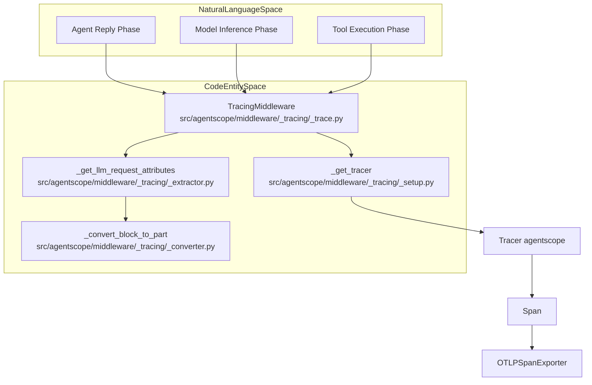
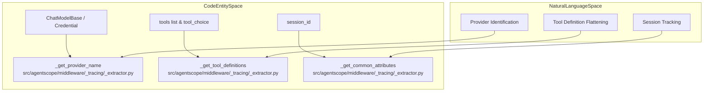

<!-- source: DeepWiki mcp.deepwiki.com · repo modelscope/agentscope · page 7.1 OpenTelemetry Integration · fetched 2026-10-27 -->

# OpenTelemetry Integration

Relevant source files

The following files were used as context for generating this wiki page:

- [src/agentscope/middleware/_tracing/__init__.py](src/agentscope/middleware/_tracing/__init__.py)
- [src/agentscope/middleware/_tracing/_attributes.py](src/agentscope/middleware/_tracing/_attributes.py)
- [src/agentscope/middleware/_tracing/_converter.py](src/agentscope/middleware/_tracing/_converter.py)
- [src/agentscope/middleware/_tracing/_extractor.py](src/agentscope/middleware/_tracing/_extractor.py)
- [src/agentscope/middleware/_tracing/_setup.py](src/agentscope/middleware/_tracing/_setup.py)
- [src/agentscope/middleware/_tracing/_trace.py](src/agentscope/middleware/_tracing/_trace.py)
- [src/agentscope/middleware/_tracing/_utils.py](src/agentscope/middleware/_tracing/_utils.py)
- [tests/tracing_test.py](tests/tracing_test.py)

## Purpose and Scope
This page documents the OpenTelemetry (OTel) integration in AgentScope 2.0, detailing tracing setup (`_setup.py`), OTLP configuration, supported backends, span attribute mapping via `_converter.py`, semantic conventions in `_attributes.py`, and context propagation through `_extractor.py` [src/agentscope/middleware/_tracing/_trace.py:116-131](). It provides a technical reference for capturing execution flows across agents, models, tools, and formatters.

Sources: [src/agentscope/middleware/_tracing/_trace.py:116-131]()

---

## Tracing Architecture & Setup (`_setup.py` & `_trace.py`)

AgentScope implements distributed tracing primarily via `TracingMiddleware`, which hooks into agent reply, model call, and tool execution lifecycles [src/agentscope/middleware/_tracing/_trace.py:117-132](). 

The initialization and tracer acquisition are managed by `_get_tracer()` in `_setup.py`, which retrieves an OTel tracer named `"agentscope"` using the framework version [src/agentscope/middleware/_tracing/_setup.py:11-19](). Before emitting spans, the middleware verifies whether a real SDK `TracerProvider` is active via `_check_tracing_enabled()`, ensuring zero overhead when tracing is unconfigured [src/agentscope/middleware/_tracing/_trace.py:59-71]().

### Tracing System Data Flow and Code Entities

Sources: [src/agentscope/middleware/_tracing/_setup.py:11-19](), [src/agentscope/middleware/_tracing/_trace.py:59-132](), [src/agentscope/middleware/_tracing/_extractor.py:1-191](), [src/agentscope/middleware/_tracing/_converter.py:1-121]()

### Key Implementation Mechanisms
- **Tracer Acquisition**: `_get_tracer()` instantiates or fetches the OTel tracer with the correct package version [src/agentscope/middleware/_tracing/_setup.py:11-19]().
- **Async Generator Wrapping**: Streaming LLM responses are intercepted by `_trace_async_generator_wrapper()`, which captures token usage and response attributes from the last yielded chunk before finalizing the span [src/agentscope/middleware/_tracing/_trace.py:86-111]().
- **External Execution Tracing**: Synthetic `execute_tool` spans are generated for externally executed tools (e.g., via `ExternalExecutionResultEvent`), marked with `AGENTSCOPE_IS_EXTERNAL_EXECUTION` [src/agentscope/middleware/_tracing/_trace.py:173-197]().

Sources: [src/agentscope/middleware/_tracing/_setup.py:11-19](), [src/agentscope/middleware/_tracing/_trace.py:59-111](), [src/agentscope/middleware/_tracing/_trace.py:173-197]()

---

## Semantic Conventions and Supported Backends (`_attributes.py`)

AgentScope adheres to OpenTelemetry GenAI semantic conventions, complemented by framework-specific attributes for Human-in-the-Loop (HITL) and caching metrics [src/agentscope/middleware/_tracing/_attributes.py:8-154]().

### Span Attributes Reference
The `SpanAttributes` class defines mapping keys for requests, responses, usage, and agent metadata [src/agentscope/middleware/_tracing/_attributes.py:8-154]().

| Attribute Category | Constant / Key | Description |
|--------------------|----------------|-------------|
| **Common** | `SpanAttributes.GEN_AI_CONVERSATION_ID` | Maps to AgentScope `session_id` [src/agentscope/middleware/_tracing/_attributes.py:12-13](). |
| **Request** | `SpanAttributes.GEN_AI_REQUEST_MODEL` | The model name used in the invocation [src/agentscope/middleware/_tracing/_attributes.py:22-23](). |
| **Usage** | `SpanAttributes.GEN_AI_USAGE_INPUT_TOKENS` | Token usage reporting for inputs [src/agentscope/middleware/_tracing/_attributes.py:65-66](). |
| **Cache Usage** | `SpanAttributes.AGENTSCOPE_CACHE_INPUT_TOKENS` | Tokens read from the prompt cache [src/agentscope/middleware/_tracing/_attributes.py:107-108](). |
| **AgentScope Specific** | `SpanAttributes.AGENTSCOPE_REPLY_ID` | Unique ID grouping multi-step HITL or external-execution chains [src/agentscope/middleware/_tracing/_attributes.py:115-121](). |
| **HITL/External** | `SpanAttributes.AGENTSCOPE_HITL_PENDING_TOOLS` | JSON list of tools awaiting human confirmation [src/agentscope/middleware/_tracing/_attributes.py:123-128](). |

### Supported Backends and Operation Names
Supported providers are enumerated via `ProviderNameValues`, including `DASHSCOPE`, `OLLAMA`, `DEEPSEEK`, `OPENAI`, `ANTHROPIC`, `GCP_GEMINI`, `MOONSHOT`, `MINIMAX`, `VOLCENGINE`, `AZURE_AI_OPENAI`, and `AWS_BEDROCK` [src/agentscope/middleware/_tracing/_attributes.py:168-202](). 

Spans are categorized into three core operation names (`OperationNameValues`):
- `chat`: LLM model interactions [src/agentscope/middleware/_tracing/_attributes.py:158-159]().
- `invoke_agent`: High-level agent `reply` execution [src/agentscope/middleware/_tracing/_attributes.py:161-162]().
- `execute_tool`: Tool/function execution [src/agentscope/middleware/_tracing/_attributes.py:164-165]().

Sources: [src/agentscope/middleware/_tracing/_attributes.py:8-202]()

---

## Attribute Mapping and Context Propagation (`_extractor.py`)

The `_extractor.py` module extracts metadata from agents, models, and tools, mapping them into OTel GenAI attributes [src/agentscope/middleware/_tracing/_extractor.py:1-191]().

### Key Extraction Functions
- **Provider Resolution**: `_get_provider_name()` determines the LLM provider from the `ChatModelBase` instance class name and inspects credential `base_url` fragments (e.g., `api.openai.com`, `dashscope`, `generativelanguage.googleapis.com`) to correctly attribute OpenAI-compatible APIs [src/agentscope/middleware/_tracing/_extractor.py:67-104]().
- **Tool Definition Serialization**: `_get_tool_definitions()` converts nested tool schemas into flat OTel GenAI-compliant tool definition strings [src/agentscope/middleware/_tracing/_extractor.py:106-166]().
- **Common Attributes**: `_get_common_attributes()` injects conversation identifiers (`session_id`) into span attributes [src/agentscope/middleware/_tracing/_extractor.py:49-64]().

### Attribute Extraction Data Flow and Code Mapping

Sources: [src/agentscope/middleware/_tracing/_extractor.py:49-166]()

---

## Span Attribute Mapping (`_converter.py`)

AgentScope uses a block-based message architecture. The `_converter.py` module maps internal `ContentBlock` subclasses into standardized OTel GenAI parts [src/agentscope/middleware/_tracing/_converter.py:1-121]().

### Content Block Conversions
- `TextBlock` → `{"type": "text", "content": block.text}` [src/agentscope/middleware/_tracing/_converter.py:85-89]().
- `ThinkingBlock` → `{"type": "reasoning", "content": block.thinking}` [src/agentscope/middleware/_tracing/_converter.py:90-94]().
- `ToolCallBlock` → `{"type": "tool_call", "id": block.id, "name": block.name, "arguments": arguments}` [src/agentscope/middleware/_tracing/_converter.py:95-105]().
- `ToolResultBlock` → `{"type": "tool_call_response", "id": block.id, "response": result}` [src/agentscope/middleware/_tracing/_converter.py:106-117]().
- `DataBlock` → Converted via `_convert_media_block()` to `uri` or `blob` parts with derived modalities (`image`, `audio`, `video`) [src/agentscope/middleware/_tracing/_converter.py:24-61]().

Sources: [src/agentscope/middleware/_tracing/_converter.py:24-121]()

---

