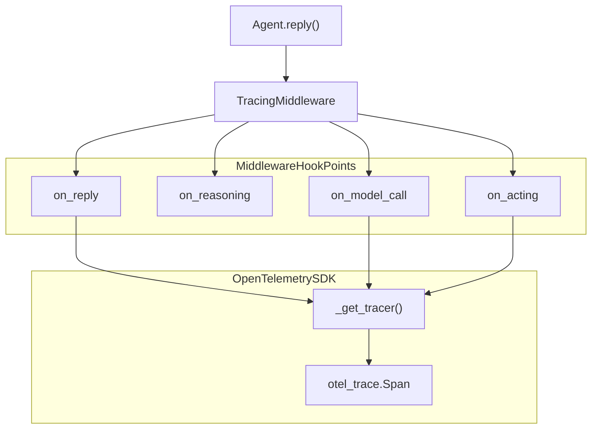
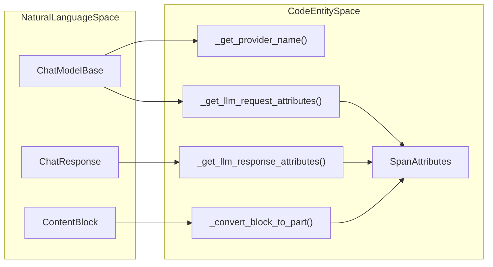
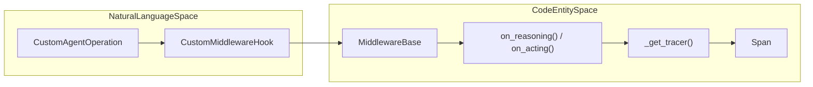

<!-- source: DeepWiki mcp.deepwiki.com · repo modelscope/agentscope · page 7.2 Tracing Middleware and Decorators · fetched 2026-10-27 -->

# Tracing Middleware and Decorators

Relevant source files

The following files were used as context for generating this wiki page:

- [src/agentscope/middleware/_tracing/__init__.py](src/agentscope/middleware/_tracing/__init__.py)
- [src/agentscope/middleware/_tracing/_attributes.py](src/agentscope/middleware/_tracing/_attributes.py)
- [src/agentscope/middleware/_tracing/_converter.py](src/agentscope/middleware/_tracing/_converter.py)
- [src/agentscope/middleware/_tracing/_extractor.py](src/agentscope/middleware/_tracing/_extractor.py)
- [src/agentscope/middleware/_tracing/_setup.py](src/agentscope/middleware/_tracing/_setup.py)
- [src/agentscope/middleware/_tracing/_trace.py](src/agentscope/middleware/_tracing/_trace.py)
- [src/agentscope/middleware/_tracing/_utils.py](src/agentscope/middleware/_tracing/_utils.py)
- [tests/tracing_test.py](tests/tracing_test.py)

This page covers the implementation details of OpenTelemetry (OTel) tracing in AgentScope 2.0. It details `TracingMiddleware` (`[src/agentscope/middleware/_tracing/_trace.py:117-132]()`), how it hooks into agent lifecycle methods (`MiddlewareBase` `[src/agentscope/middleware/_base.py:13-53]()`), helper utilities (`[src/agentscope/middleware/_tracing/_utils.py:15-87]()`), attribute extractors (`[src/agentscope/middleware/_tracing/_extractor.py:2-106]()`), and conventions (`[src/agentscope/middleware/_tracing/_attributes.py:8-154]()`).

Sources: `[src/agentscope/middleware/_tracing/_trace.py:117-132](), [src/agentscope/middleware/_base.py:13-53](), [src/agentscope/middleware/_tracing/_extractor.py:2-106](), [src/agentscope/middleware/_tracing/_attributes.py:8-154](), [src/agentscope/middleware/_tracing/_utils.py:15-87]()`

---

## 1. Tracing Architecture and Middleware Hook Points

`TracingMiddleware` intercepts execution across several hook points in the agent lifecycle defined in `MiddlewareBase`, specifically `on_reply` (`[src/agentscope/middleware/_tracing/_trace.py:137-142]()`). Before performing any tracing operations, it checks whether an OTel SDK `TracerProvider` has been initialized via `_check_tracing_enabled()` (`[src/agentscope/middleware/_tracing/_trace.py:59-70]()`). If disabled, it short-circuits to `next_handler` with minimal overhead (`[src/agentscope/middleware/_tracing/_trace.py:143-146]()`).

*Diagram 1: Tracing Middleware Hook Flow bridging agent calls to OpenTelemetry spans.*

Sources: `[src/agentscope/middleware/_tracing/_trace.py:59-146](), [src/agentscope/middleware/_base.py:13-53]()`

---

## 2. Attribute Extraction and Semantics

The attribute extraction subsystem (`[src/agentscope/middleware/_tracing/_extractor.py:2-635]()`) maps AgentScope data structures (such as `ChatModelBase`, `ChatResponse`, `Msg`, and `Toolkit`) to OpenTelemetry GenAI semantic conventions (`[src/agentscope/middleware/_tracing/_attributes.py:8-154]()`).
- `_get_provider_name()` determines the provider (e.g., `openai`, `dashscope`, `volcengine`) by checking class names and inspecting `base_url` patterns against `_BASE_URL_PROVIDER_MAP` (`[src/agentscope/middleware/_tracing/_extractor.py:38-105]()`).
- `_get_llm_request_attributes()` extracts parameters like temperature, top_p, max_tokens, and flattened tool definitions via `_get_tool_definitions()` (`[src/agentscope/middleware/_tracing/_extractor.py:108-164](), [src/agentscope/middleware/_tracing/_extractor.py:170-191]()`).
- `_convert_block_to_part()` transforms content blocks (`TextBlock`, `ThinkingBlock`, `ToolCallBlock`, `ToolResultBlock`, `DataBlock`) into standardized OTel GenAI part formats (`[src/agentscope/middleware/_tracing/_converter.py:63-121]()`).

*Diagram 2: Bridging domain model objects to OpenTelemetry attributes.*

Sources: `[src/agentscope/middleware/_tracing/_extractor.py:38-191](), [src/agentscope/middleware/_tracing/_converter.py:63-121](), [src/agentscope/middleware/_tracing/_attributes.py:8-154]()`

---

## 3. Handling External Execution and HITL

When agents pause for human-in-the-loop confirmation (`RequireUserConfirmEvent`) or external tool execution (`RequireExternalExecutionEvent`), `TracingMiddleware` captures pending tool lists as attributes (`AGENTSCOPE_HITL_PENDING_TOOLS`, `AGENTSCOPE_EXTERNAL_EXECUTION_PENDING_TOOLS`) (`[src/agentscope/middleware/_tracing/_attributes.py:123-137]()`). When resumption events such as `ExternalExecutionResultEvent` arrive, synthetic `execute_tool` spans are created to record external executions (`[src/agentscope/middleware/_tracing/_trace.py:173-197]()`). The `AGENTSCOPE_IS_EXTERNAL_EXECUTION` attribute (`[src/agentscope/middleware/_tracing/_attributes.py:147-152]()`) marks these spans.

Sources: `[src/agentscope/middleware/_tracing/_trace.py:173-197](), [src/agentscope/middleware/_tracing/_attributes.py:123-152]()`

---

## 4. Streaming and Async Generators

For streaming LLM calls and tool executions, `_trace_async_generator_wrapper()` intercepts the `AsyncGenerator` stream (`[src/agentscope/middleware/_tracing/_trace.py:86-111]()`). It iterates over chunks, preserves the last chunk for usage and finish reason extraction via `_get_llm_response_attributes()`, sets span status (`StatusCode.OK`), or records exceptions (`_set_span_error_status()`) if an error occurs (`[src/agentscope/middleware/_tracing/_trace.py:79-110]()`).

Sources: `[src/agentscope/middleware/_tracing/_trace.py:79-111]()`

---

## 5. Serialization Utilities

The `_utils.py` module supplies `_serialize_to_str()` and `_to_serializable()` to safely format complex python objects, Pydantic models, enums, and timestamps into JSON strings suitable for OpenTelemetry span attributes (`[src/agentscope/middleware/_tracing/_utils.py:15-87]()`).

Sources: `[src/agentscope/middleware/_tracing/_utils.py:15-87]()`

---

## 6. Instrumenting Custom Components and Middleware

To instrument custom agent components or write custom middlewares, inherit from `MiddlewareBase` (`[src/agentscope/middleware/_base.py:13-53]()`), implement the desired hook methods (e.g. `on_reasoning`, `on_acting`), and utilize `_get_tracer()` (`[src/agentscope/middleware/_tracing/_setup.py:11-19]()`) to start custom spans and set semantic attributes.

*Diagram 3: Bridging custom agent operations to OpenTelemetry instrumentation entities.*

Sources: `[src/agentscope/middleware/_base.py:13-53](), [src/agentscope/middleware/_tracing/_setup.py:11-19](), [src/agentscope/middleware/_tracing/_trace.py:117-132]()`

---

