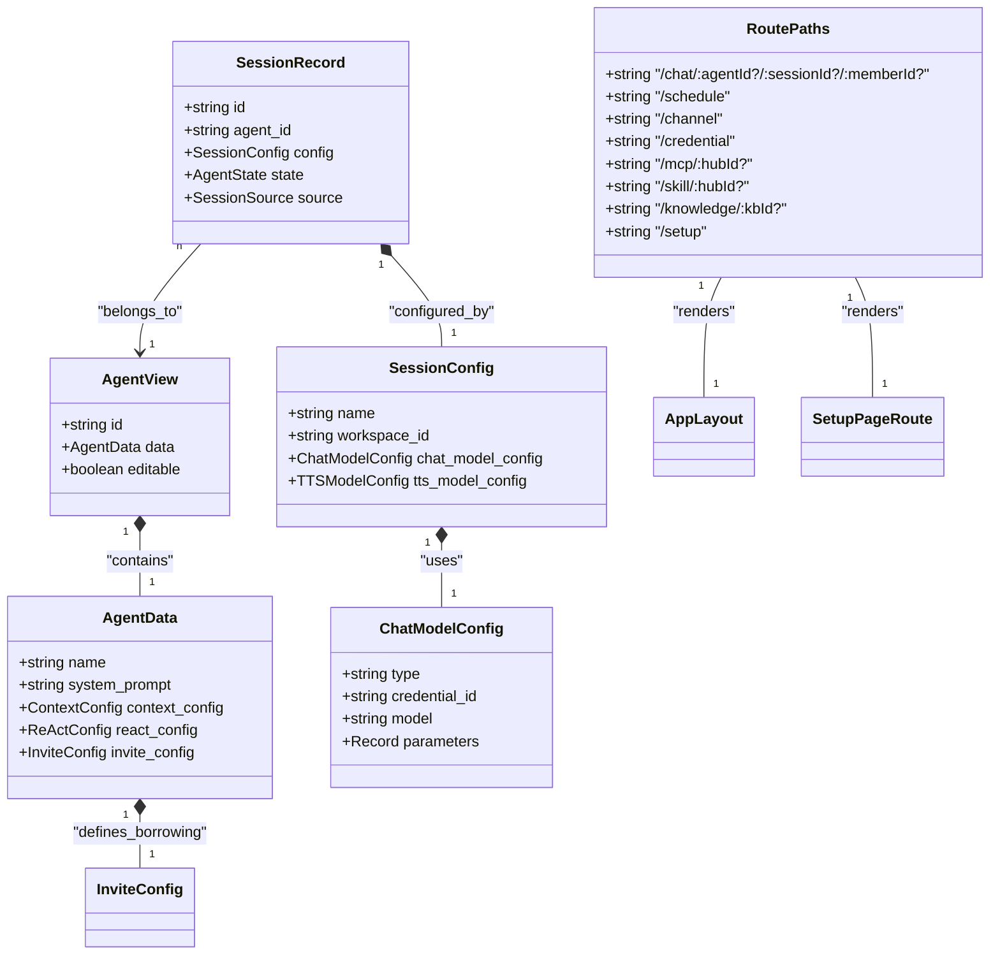
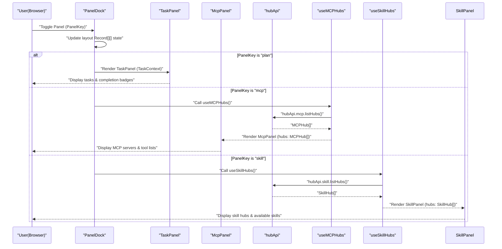

<!-- source: DeepWiki mcp.deepwiki.com · repo modelscope/agentscope · page 8 Web UI · fetched 2026-10-27 -->

# Web UI

Relevant source files

The following files were used as context for generating this wiki page:

- [examples/web_ui/frontend/src/App.tsx](examples/web_ui/frontend/src/App.tsx)
- [examples/web_ui/frontend/src/components/error/RouteError.tsx](examples/web_ui/frontend/src/components/error/RouteError.tsx)
- [examples/web_ui/frontend/src/hooks/useMCPHubs.ts](examples/web_ui/frontend/src/hooks/useMCPHubs.ts)
- [examples/web_ui/frontend/src/hooks/useSkillHubs.ts](examples/web_ui/frontend/src/hooks/useSkillHubs.ts)

The AgentScope Web UI is a production-grade React-based companion for the agent service. It provides a graphical interface for managing agents, configuring model credentials, and interacting with agent sessions through a rich chat interface. Built on **React 19** and **Vite**, it utilizes a modern stack including **Tailwind CSS**, **Shadcn UI**, and **Lucide** for iconography [examples/web_ui/frontend/package.json:13-43](), [examples/web_ui/frontend/package.json:63-64](), [examples/web_ui/frontend/package.json:68-69](), [examples/web_ui/frontend/src/App.tsx:1-96](). Routing is managed by `react-router-dom` with robust route-level error boundaries (`RouteError`) and multi-tenant setup flows [examples/web_ui/frontend/src/App.tsx:35-66](), [examples/web_ui/frontend/src/components/error/RouteError.tsx:28-58]().

The purpose of this page is to provide a high-level overview of the Web UI architecture, core functional areas, and how frontend components coordinate with backend agent services. For deep technical details, refer to the child pages linked below.

*   [Frontend Architecture and API Client](#8.1) — React/Vite structure, routing, API client modules (`examples/web_ui/frontend/src/api/types.ts`), and SSE event consumption.
*   [Chat Components and Tool Renderers](#8.2) — ChatViewport, ChatContent, ASMessageBubble, TextInput, and tool-renderer components.
*   [Agent and Credential Management UI](#8.3) — AgentDialog, SchemaForm (`examples/web_ui/frontend/src/components/form/SchemaForm.tsx`), and credential dialogs.
*   [Panel System and Workspace UI](#8.4) — PanelDock layout, TaskPanel, PermissionPanel, SkillPanel, and MCP Hub browsing.

Sources: [examples/web_ui/frontend/src/App.tsx:1-96](), [examples/web_ui/frontend/src/components/error/RouteError.tsx:28-58]()

### Core Functional Areas

*   **Chat Interface**: A multi-session chat surface supporting streaming text, "thinking" blocks, and specialized renderers for tool inputs and outputs. For details, see [Chat Components and Tool Renderers](#8.2).
*   **Agent & Team Management**: CRUD operations for agents and real-time visualization of agent teams, including worker-level session drilling [examples/web_ui/frontend/src/api/types.ts:43-50](), [examples/web_ui/frontend/src/api/types.ts:143-149]().
*   **Model & Credential Configuration**: Management of API keys and model parameters across different providers [examples/web_ui/frontend/src/api/types.ts:9-14]().
*   **Knowledge Base Management**: Interface for creating knowledge bases and configuring session-level RAG settings [examples/web_ui/frontend/src/api/types.ts:162-163]().
*   **Panel System**: A flexible, dockable layout (`PanelDock`) for monitoring tasks via `TaskPanel`, permissions via `PermissionPanel`, and workspace resources like MCP servers (`McpPanel`) and Skills (`SkillPanel`) [examples/web_ui/frontend/src/components/panel/PanelDock.tsx:143-189](), [examples/web_ui/frontend/src/components/panel/McpPanel.tsx:197-209](), [examples/web_ui/frontend/src/components/panel/SkillPanel.tsx:65-72](), [examples/web_ui/frontend/src/components/panel/PermissionPanel.tsx:154-156](), [examples/web_ui/frontend/src/components/panel/TaskPanel.tsx:86-88](). For details, see [Panel System and Workspace UI](#8.4).
*   **Hub Browsing**: The UI provides dedicated pages for browsing and managing MCP Hubs (`/mcp`) and Skill Hubs (`/skill`), which are registered on the server at deploy time [examples/web_ui/frontend/src/App.tsx:55-58](), [examples/web_ui/frontend/src/hooks/useMCPHubs.ts:14-19](), [examples/web_ui/frontend/src/hooks/useSkillHubs.ts:14-19]().
*   **Internationalization**: Full support for English and Chinese via `react-i18next` [examples/web_ui/frontend/package.json:29-43]().

Sources: [examples/web_ui/frontend/src/App.tsx:35-66](), [examples/web_ui/frontend/src/components/panel/PanelDock.tsx:143-189](), [examples/web_ui/frontend/src/components/panel/McpPanel.tsx:197-209](), [examples/web_ui/frontend/src/components/panel/SkillPanel.tsx:65-72](), [examples/web_ui/frontend/src/components/panel/PermissionPanel.tsx:154-156](), [examples/web_ui/frontend/src/components/panel/TaskPanel.tsx:86-88](), [examples/web_ui/frontend/src/hooks/useMCPHubs.ts:14-19](), [examples/web_ui/frontend/src/hooks/useSkillHubs.ts:14-19]()

### System Entity Mapping

The following diagram bridges natural language configuration concepts to their underlying TypeScript definitions in `types.ts` and React router structures (`App.tsx`).

**Entity Relationship Diagram**

Sources: [examples/web_ui/frontend/src/api/types.ts:9-14](), [examples/web_ui/frontend/src/api/types.ts:43-60](), [examples/web_ui/frontend/src/api/types.ts:116-152](), [examples/web_ui/frontend/src/App.tsx:35-66]()

---

### 8.1 Frontend Architecture and API Client

The frontend follows a modular architecture using `react-router-dom` for navigation, where the URL serves as the single source of truth for agent and session selection [examples/web_ui/frontend/src/App.tsx:35-66](). Communication with the backend is handled by typed API modules and contracts defined in `types.ts`. Event consumption is managed via SSE streams which process `AgentEvent` payloads to update the UI state in real-time.

For details, see [Frontend Architecture and API Client](#8.1).

Sources: [examples/web_ui/frontend/src/App.tsx:35-66](), [examples/web_ui/frontend/src/api/types.ts:1-226]()

---

### 8.2 Chat Components and Tool Renderers

The chat experience utilizes specialized rendering for different content blocks. `ASMessageBubble` handles agent and user messages, including thinking durations and audio playback. Tool renderers display tool-specific outputs, while confirmation cards and HITL widgets provide human-in-the-loop interaction workflows [examples/web_ui/frontend/src/components/chat/TextInput.tsx:51-100]().

For details, see [Chat Components and Tool Renderers](#8.2).

Sources: [examples/web_ui/frontend/src/components/chat/TextInput.tsx:51-100]()

---

### 8.3 Agent and Credential Management UI

Management of agents and credentials is implemented through dynamic dialogs and schema-driven forms (`SchemaForm`) which consume JSON Schema definitions to render structured inputs for model parameters and agent configurations.

For details, see [Agent and Credential Management UI](#8.3).

Sources: [examples/web_ui/frontend/src/App.tsx:35-66]()

---

### 8.4 Panel System and Workspace UI

The UI features a flexible dockable panel system (`PanelDock`) that arranges columns and panels dynamically based on `PanelKey` mappings [examples/web_ui/frontend/src/components/panel/PanelDock.tsx:16-63](), [examples/web_ui/frontend/src/components/panel/PanelDock.tsx:143-189](). Specialized panels include `McpPanel` for MCP clients [examples/web_ui/frontend/src/components/panel/McpPanel.tsx:197-209](), `SkillPanel` for equipped skills [examples/web_ui/frontend/src/components/panel/SkillPanel.tsx:65-72](), `PermissionPanel` for security context [examples/web_ui/frontend/src/components/panel/PermissionPanel.tsx:154-156](), and `TaskPanel` for tracking tasks and execution dependencies [examples/web_ui/frontend/src/components/panel/TaskPanel.tsx:86-88]().

For details, see [Panel System and Workspace UI](#8.4).

Sources: [examples/web_ui/frontend/src/components/panel/PanelDock.tsx:16-63](), [examples/web_ui/frontend/src/components/panel/PanelDock.tsx:143-189](), [examples/web_ui/frontend/src/components/panel/McpPanel.tsx:197-209](), [examples/web_ui/frontend/src/components/panel/SkillPanel.tsx:65-72](), [examples/web_ui/frontend/src/components/panel/PermissionPanel.tsx:154-156](), [examples/web_ui/frontend/src/components/panel/TaskPanel.tsx:86-88]()

### Component Communication Flow

This diagram maps user-facing panel actions and layout mutations to underlying React components like `PanelDock`, `McpPanel`, and `TaskPanel`.

**Dock Panel Layout and Interaction Flow**

Sources: [examples/web_ui/frontend/src/components/panel/PanelDock.tsx:143-189](), [examples/web_ui/frontend/src/components/panel/McpPanel.tsx:197-209](), [examples/web_ui/frontend/src/components/panel/TaskPanel.tsx:86-88](), [examples/web_ui/frontend/src/hooks/useMCPHubs.ts:14-19](), [examples/web_ui/frontend/src/hooks/useSkillHubs.ts:14-19]()

---

