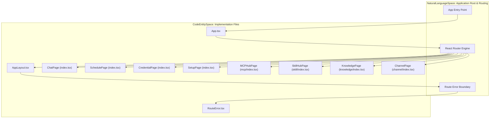

<!-- source: DeepWiki mcp.deepwiki.com · repo modelscope/agentscope · page 8.1 Frontend Architecture and API Client · fetched 2026-10-27 -->

# Frontend Architecture and API Client

Relevant source files

The following files were used as context for generating this wiki page:

- [examples/web_ui/frontend/src/App.tsx](examples/web_ui/frontend/src/App.tsx)
- [examples/web_ui/frontend/src/api/client.ts](examples/web_ui/frontend/src/api/client.ts)
- [examples/web_ui/frontend/src/api/health.ts](examples/web_ui/frontend/src/api/health.ts)
- [examples/web_ui/frontend/src/api/index.ts](examples/web_ui/frontend/src/api/index.ts)
- [examples/web_ui/frontend/src/api/types.ts](examples/web_ui/frontend/src/api/types.ts)
- [examples/web_ui/frontend/src/components/chat/ASMessageBubble.tsx](examples/web_ui/frontend/src/components/chat/ASMessageBubble.tsx)
- [examples/web_ui/frontend/src/components/chat/ChatContent.tsx](examples/web_ui/frontend/src/components/chat/ChatContent.tsx)
- [examples/web_ui/frontend/src/components/error/RouteError.tsx](examples/web_ui/frontend/src/components/error/RouteError.tsx)
- [examples/web_ui/frontend/src/hooks/useMCPHubs.ts](examples/web_ui/frontend/src/hooks/useMCPHubs.ts)
- [examples/web_ui/frontend/src/hooks/useMessages.ts](examples/web_ui/frontend/src/hooks/useMessages.ts)
- [examples/web_ui/frontend/src/hooks/useSessions.ts](examples/web_ui/frontend/src/hooks/useSessions.ts)
- [examples/web_ui/frontend/src/hooks/useSkillHubs.ts](examples/web_ui/frontend/src/hooks/useSkillHubs.ts)
- [examples/web_ui/frontend/src/i18n/locales/en.json](examples/web_ui/frontend/src/i18n/locales/en.json)
- [examples/web_ui/frontend/src/i18n/locales/zh.json](examples/web_ui/frontend/src/i18n/locales/zh.json)
- [examples/web_ui/frontend/src/pages/chat/index.tsx](examples/web_ui/frontend/src/pages/chat/index.tsx)
- [examples/web_ui/frontend/src/pages/credential/index.tsx](examples/web_ui/frontend/src/pages/credential/index.tsx)
- [examples/web_ui/frontend/src/pages/setup/index.tsx](examples/web_ui/frontend/src/pages/setup/index.tsx)
- [src/agentscope/app/_router/__init__.py](src/agentscope/app/_router/__init__.py)
- [src/agentscope/app/_router/_health.py](src/agentscope/app/_router/_health.py)
- [src/agentscope/app/_router/_schema/__init__.py](src/agentscope/app/_router/_schema/__init__.py)
- [src/agentscope/credential/_moonshot.py](src/agentscope/credential/_moonshot.py)

## Purpose and Scope
This page documents the architecture of the AgentScope Web UI, a single-page application built with **React**, **Vite**, and **TypeScript** (`[examples/web_ui/frontend/src/App.tsx:1-96]()`). It details the routing engine, API client modules, TypeScript contract types (`[examples/web_ui/frontend/src/api/types.ts:1-225]()`), Server-Sent Events (SSE) consumption in `useMessages` (`[examples/web_ui/frontend/src/hooks/useMessages.ts:110-140]()`), internationalization, and styling utilities.

---

## App Routing and Component Structure

The frontend application uses **React Router** via `createBrowserRouter` to drive application state from URL path segments, managing routes for chat sessions, schedules, channels, credentials, MCP hubs, skill hubs, and knowledge bases (`[examples/web_ui/frontend/src/App.tsx:35-66]()`).

Application setup and provider wrappers are configured in `App.tsx`, wrapping the router in `@tanstack/react-query`'s `QueryClientProvider`, Onborda tour providers, and an `UploadProvider` (`[examples/web_ui/frontend/src/App.tsx:78-93]()`). The `RouteError` component acts as a route-level error boundary capturing rendering faults inside the `Outlet` area without crashing the persistent navigation frame (`[examples/web_ui/frontend/src/components/error/RouteError.tsx]()`, `[examples/web_ui/frontend/src/App.tsx:35-46]()`). Furthermore, the chat page structure relies on an outer shell (`ChatPageInner`) in `[examples/web_ui/frontend/src/pages/chat/index.tsx]()` that coordinates URL-derived parameters (`agentId`, `sessionId`, `memberId`) and syncs session state across sidebar and viewport mounts (`[examples/web_ui/frontend/src/pages/chat/index.tsx:92-144]()`).

Title: Routing and Component Architecture

Sources: `[examples/web_ui/frontend/src/App.tsx:35-96]()`, `[examples/web_ui/frontend/src/pages/chat/index.tsx:92-144]`, `[examples/web_ui/frontend/src/pages/credential/index.tsx]()`

---

## API Client and Type System

Communication with the FastAPI backend is mediated through modular API service wrappers in `src/api/` backed by a unified fetch client (`client.ts`), paired with strict TypeScript interfaces in `types.ts` that mirror backend Pydantic models.

### Core Contracts (`types.ts`)
The `[examples/web_ui/frontend/src/api/types.ts]()` file defines the TypeScript interfaces that contractually bind the frontend to the backend API schemas.

-   **`RecordBase`**: Foundational interface for record-like entities providing `id`, `created_at`, and `updated_at` (`[examples/web_ui/frontend/src/api/types.ts:3-7]()`).
-   **`ChatModelConfig`**: Specifies chat model configuration (`type`, `credential_id`, `model`, `parameters`) (`[examples/web_ui/frontend/src/api/types.ts:9-15]()`).
-   **`TTSModelConfig`**: Text-to-Speech model configuration parameters (`[examples/web_ui/frontend/src/api/types.ts:17-22]()`).
-   **`RealtimeModelConfig`**: Realtime voice model configuration (`[examples/web_ui/frontend/src/api/types.ts:24-29]()`).
-   **`ContextConfig`**: Context management parameters such as `trigger_ratio`, `reserve_ratio`, `tool_result_limit`, `compression_prompt`, and `summary_template` (`[examples/web_ui/frontend/src/api/types.ts:31-37]()`).
-   **`ReActConfig`**: ReAct loop configuration (`max_iters`, `stop_on_reject`) (`[examples/web_ui/frontend/src/api/types.ts:39-42]()`).
-   **`InviteConfig`**: Agent invitation parameters (`invitable`, `invite_description`) (`[examples/web_ui/frontend/src/api/types.ts:44-47]()`).
-   **`AgentData`**: Encapsulates agent identity, `system_prompt`, and `chat_config` (`[examples/web_ui/frontend/src/api/types.ts:61-66]()`).
-   **`AgentView`**: Extends `RecordBase` with `AgentData`, `user_id`, and `editable` permissions flag (`[examples/web_ui/frontend/src/api/types.ts:68-76]()`).
-   **`SessionOrigin`**: Discriminated union describing session creation source (`'user'`, `'schedule'`, `'channel'`, `'team'`) (`[examples/web_ui/frontend/src/api/types.ts:138-147]()`).
-   **`SessionConfig`**: Configuration for a specific session including model configurations, workspace ID, and `cwd` (`[examples/web_ui/frontend/src/api/types.ts:152-172]()`).
-   **`SessionRecord`**: Persistent session record structure extending `RecordBase` with `user_id`, `agent_id`, `origin`, `team_id`, `config`, and `state` (`[examples/web_ui/frontend/src/api/types.ts:177-190]()`).

### API Client Modules
API modules in `src/api/` encapsulate HTTP operations corresponding to backend FastAPI routers (`[src/agentscope/app/_router/__init__.py:1-39]()`).

Title: API Client and Data Model Architecture

```mermaid
graph TD
    subgraph "NaturalLanguageSpace: Type Definitions & Services"
        ClientBase["HTTP Client Base"]
        AgentContracts["Agent & Session Models"]
        ApiModules["Domain API Wrappers"]
        BackendRouters["Backend FastAPI Routers"]
    end

    subgraph "CodeEntitySpace: Implementation Files"
        Client["client.ts"]
        Types["types.ts"]
        AgentApi["agent.ts"]
        SessionApi["session.ts"]
        CredentialApi["credential.ts"]
        ChatApi["chat.ts"]
        WorkspaceApi["workspace.ts"]
        HubApi["hub.ts"]
        McpApi["mcp.ts"]
        SkillApi["skill.ts"]
        ScheduleApi["schedule.ts"]
        ModelApi["model.ts"]
        EmbeddingModelApi["embeddingModel.ts"]
        TtsModelApi["ttsModel.ts"]
        KnowledgeBaseApi["knowledgeBase.ts"]
        ChannelApi["channel.ts"]
        HealthApi["health.ts"]
        IndexApi["index.ts"]
        BackendAgentRouter["_agent.py"]
        BackendChatRouter["_chat.py"]
        BackendCredentialRouter["_credential.py"]
        BackendSessionRouter["_session.py"]
        BackendRouterInit["_router/__init__.py"]
    end

    ClientBase --> Client
    AgentContracts --> Types
    ApiModules --> AgentApi
    ApiModules --> SessionApi
    ApiModules --> CredentialApi
    ApiModules --> ChatApi
    ApiModules --> WorkspaceApi
    ApiModules --> HubApi
    ApiModules --> McpApi
    ApiModules --> SkillApi
    ApiModules --> ScheduleApi
    ApiModules --> ModelApi
    ApiModules --> EmbeddingModelApi
    ApiModules --> TtsModelApi
    ApiModules --> KnowledgeBaseApi
    ApiModules --> ChannelApi
    ApiModules --> HealthApi

    IndexApi --> AgentApi
    IndexApi --> SessionApi
    IndexApi --> CredentialApi
    IndexApi --> ChatApi

    AgentApi --> Client
    SessionApi --> Client
    CredentialApi --> Client
    ChatApi --> Client

    AgentApi --> Types
    SessionApi --> Types
    CredentialApi --> Types
    ChatApi --> Types

    BackendRouters --> BackendAgentRouter
    BackendRouters --> BackendChatRouter
    BackendRouters --> BackendCredentialRouter
    BackendRouters --> BackendSessionRouter
    BackendRouterInit --> BackendAgentRouter
    BackendRouterInit --> BackendChatRouter
    BackendRouterInit --> BackendCredentialRouter
    BackendRouterInit --> BackendSessionRouter
    Types --> BackendRouterInit
```

Sources: `[examples/web_ui/frontend/src/api/types.ts:3-225]()`, `[src/agentscope/app/_router/__init__.py:1-39]()`, `[src/agentscope/app/_router/_schema/__init__.py:1-213]()`

---

## Chat Interaction Surface and SSE Event Consumption

The chat interface coordinates asynchronous message streaming, user inputs, and human-in-the-loop (HITL) tool execution confirmations via specialized hooks like `useMessages` and UI components (`[examples/web_ui/frontend/src/hooks/useMessages.ts:110-140]()`, `[examples/web_ui/frontend/src/components/chat/ChatContent.tsx:63-116]()`, `[examples/web_ui/frontend/src/components/chat/ASMessageBubble.tsx:61-143]()`).

-   **URL-Driven Session State**: Routing parameters (`agentId`, `sessionId`, `memberId`) extracted via React Router define the active context and synchronize session state (`[examples/web_ui/frontend/src/pages/chat/index.tsx:92-144]()`).
-   **Server-Sent Events (SSE) Stream Processing**: Real-time updates stream agent execution events into message arrays via `useMessages`, tracking reply phases (`idle`, `streaming`, `interrupting`) and handling subagent HITL projections (`[examples/web_ui/frontend/src/hooks/useMessages.ts:73-157]()`).
-   **Tool Grouping and Message Bubbles**: `ASMessageBubble` groups consecutive tool calls and pairs them with their respective tool results (`[examples/web_ui/frontend/src/components/chat/ASMessageBubble.tsx:81-143]()`).

Sources: `[examples/web_ui/frontend/src/hooks/useMessages.ts:73-157]()`, `[examples/web_ui/frontend/src/components/chat/ChatContent.tsx:63-116]()`, `[examples/web_ui/frontend/src/components/chat/ASMessageBubble.tsx:81-143]()`

---

## Internationalization (i18n)

Localization is managed through `react-i18next`, maintaining parallel JSON dictionaries.

-   **Locale Dictionaries**: Stored in `[examples/web_ui/frontend/src/i18n/locales/en.json:1-55]()` and `[examples/web_ui/frontend/src/i18n/locales/zh.json:1-55]()`, covering standard actions (`common.*`), form definitions, dialog prompts, and error taxonomies.
-   **Tool Summaries**: Implements localized rules for execution counts and tool outputs (`[examples/web_ui/frontend/src/i18n/locales/en.json:79-95]()`, `[examples/web_ui/frontend/src/i18n/locales/zh.json:79-95]()`).
-   **Error Localization**: Formats upstream model errors, rate limits, authentication failures, and setup issues into structured notifications (`[examples/web_ui/frontend/src/i18n/locales/en.json:125-136]()`, `[examples/web_ui/frontend/src/i18n/locales/zh.json:125-136]()`).

Sources: `[examples/web_ui/frontend/src/i18n/locales/en.json:1-218]()`, `[examples/web_ui/frontend/src/i18n/locales/zh.json:1-274]()`

---

## Utility Libraries and Styling

Common UI composition relies on utility functions and shared styling helpers:
-   **Query Caching & Hooks**: Global client configurations manage server state persistence and synchronization across components via `@tanstack/react-query` and custom hooks like `useSessions` (`[examples/web_ui/frontend/src/hooks/useSessions.ts:32-112]()`).
-   **Credential Management**: Shared utilities and credential viewing components render masked secrets and model tables (`[examples/web_ui/frontend/src/pages/credential/index.tsx:53-69]()`).

Sources: `[examples/web_ui/frontend/src/hooks/useSessions.ts:32-112]()`, `[examples/web_ui/frontend/src/pages/credential/index.tsx:53-69]()`

---

