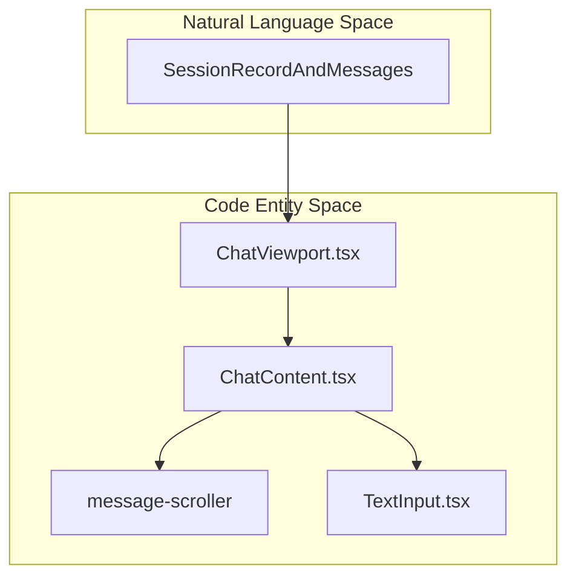
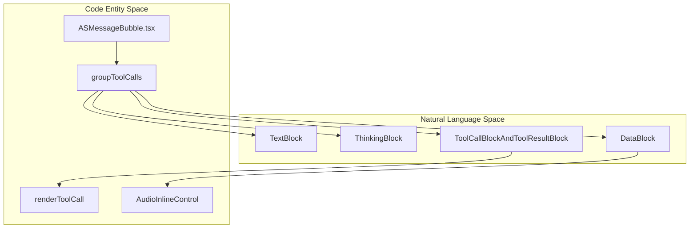
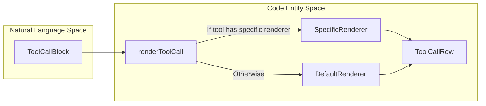

<!-- source: DeepWiki mcp.deepwiki.com · repo modelscope/agentscope · page 8.2 Chat Components and Tool Renderers · fetched 2026-10-27 -->

# Chat Components and Tool Renderers

Relevant source files

The following files were used as context for generating this wiki page:

- [examples/web_ui/frontend/index.html](examples/web_ui/frontend/index.html)
- [examples/web_ui/frontend/package.json](examples/web_ui/frontend/package.json)
- [examples/web_ui/frontend/src/assets/images/agentscope_mono.svg](examples/web_ui/frontend/src/assets/images/agentscope_mono.svg)
- [examples/web_ui/frontend/src/components/chat/ConfirmCard.tsx](examples/web_ui/frontend/src/components/chat/ConfirmCard.tsx)
- [examples/web_ui/frontend/src/components/chat/SubagentHitlCard.tsx](examples/web_ui/frontend/src/components/chat/SubagentHitlCard.tsx)
- [examples/web_ui/frontend/src/components/chat/TextInput.tsx](examples/web_ui/frontend/src/components/chat/TextInput.tsx)
- [examples/web_ui/frontend/src/components/chat/tool-renderers/BashRenderer.tsx](examples/web_ui/frontend/src/components/chat/tool-renderers/BashRenderer.tsx)
- [examples/web_ui/frontend/src/components/chat/tool-renderers/DefaultRenderer.tsx](examples/web_ui/frontend/src/components/chat/tool-renderers/DefaultRenderer.tsx)
- [examples/web_ui/frontend/src/components/chat/tool-renderers/EditRenderer.tsx](examples/web_ui/frontend/src/components/chat/tool-renderers/EditRenderer.tsx)
- [examples/web_ui/frontend/src/components/chat/tool-renderers/ReadRenderer.tsx](examples/web_ui/frontend/src/components/chat/tool-renderers/ReadRenderer.tsx)
- [examples/web_ui/frontend/src/components/chat/tool-renderers/WriteRenderer.tsx](examples/web_ui/frontend/src/components/chat/tool-renderers/WriteRenderer.tsx)
- [examples/web_ui/frontend/src/components/chat/tool-renderers/_shared.tsx](examples/web_ui/frontend/src/components/chat/tool-renderers/_shared.tsx)
- [examples/web_ui/frontend/src/components/layout/AppSidebar.tsx](examples/web_ui/frontend/src/components/layout/AppSidebar.tsx)
- [examples/web_ui/frontend/src/components/panel/McpPanel.tsx](examples/web_ui/frontend/src/components/panel/McpPanel.tsx)
- [examples/web_ui/frontend/src/components/panel/PanelDock.tsx](examples/web_ui/frontend/src/components/panel/PanelDock.tsx)
- [examples/web_ui/frontend/src/components/panel/PanelEmpty.tsx](examples/web_ui/frontend/src/components/panel/PanelEmpty.tsx)
- [examples/web_ui/frontend/src/components/panel/PermissionPanel.tsx](examples/web_ui/frontend/src/components/panel/PermissionPanel.tsx)
- [examples/web_ui/frontend/src/components/panel/SkillPanel.tsx](examples/web_ui/frontend/src/components/panel/SkillPanel.tsx)
- [examples/web_ui/frontend/src/components/panel/TaskPanel.tsx](examples/web_ui/frontend/src/components/panel/TaskPanel.tsx)
- [examples/web_ui/frontend/src/components/popover/ModelParametersPopover.tsx](examples/web_ui/frontend/src/components/popover/ModelParametersPopover.tsx)
- [examples/web_ui/frontend/src/components/select/EmbeddingSelect.tsx](examples/web_ui/frontend/src/components/select/EmbeddingSelect.tsx)
- [examples/web_ui/frontend/src/components/select/LlmSelect.tsx](examples/web_ui/frontend/src/components/select/LlmSelect.tsx)
- [examples/web_ui/frontend/src/components/ui/resizable.tsx](examples/web_ui/frontend/src/components/ui/resizable.tsx)
- [examples/web_ui/frontend/src/components/ui/toggle.tsx](examples/web_ui/frontend/src/components/ui/toggle.tsx)
- [examples/web_ui/frontend/src/index.css](examples/web_ui/frontend/src/index.css)
- [examples/web_ui/frontend/src/pages/channel/channel-form.tsx](examples/web_ui/frontend/src/pages/channel/channel-form.tsx)
- [examples/web_ui/frontend/src/pages/chat/ChatViewport.tsx](examples/web_ui/frontend/src/pages/chat/ChatViewport.tsx)
- [examples/web_ui/frontend/src/utils/common.ts](examples/web_ui/frontend/src/utils/common.ts)
- [examples/web_ui/pnpm-lock.yaml](examples/web_ui/pnpm-lock.yaml)
- [src/agentscope/app/_router/_model.py](src/agentscope/app/_router/_model.py)
- [src/agentscope/app/_service/_model.py](src/agentscope/app/_service/_model.py)
- [src/agentscope/app/storage/_model/_session.py](src/agentscope/app/storage/_model/_session.py)
- [tests/service_model_test.py](tests/service_model_test.py)
- [tests/session_auto_naming_test.py](tests/session_auto_naming_test.py)

This page documents the frontend components responsible for rendering agent messages, input composer flows, session viewports, and tool execution details in the AgentScope 2.0 Web UI. The system uses a specialized rendering pipeline to transform structured `Msg` objects and `AgentEvent` streams into interactive UI elements.

Sources: [examples/web_ui/frontend/src/components/chat/ConfirmCard.tsx:17-23](), [examples/web_ui/frontend/src/components/chat/SubagentHitlCard.tsx:23-33]()

---

## Chat Viewport, Chat Content, and Text Input

The main chat interface is structured around core layout and input components: `ChatViewport`, `ChatContent`, message scrollers, and `TextInput`.

### ChatViewport
`ChatViewport` serves as the primary container for a single session, hosting the model selector, permission mode selector, message stream, workspace drawer, and the team sidebar [examples/web_ui/frontend/src/pages/chat/ChatViewport.tsx:160-176](). It manages panel docking via `PanelDock` [examples/web_ui/frontend/src/pages/chat/ChatViewport.tsx:29]() and persists layout configurations in `localStorage` [examples/web_ui/frontend/src/pages/chat/ChatViewport.tsx:92-93]().

Sources: [examples/web_ui/frontend/src/pages/chat/ChatViewport.tsx:1-176]()

### Chat Content and Message Scroller
`ChatContent` orchestrates the message list, input area (`TextInput`), diff viewers, and loading indicators [examples/web_ui/frontend/src/components/chat/ChatContent.tsx:63-116](). It uses scroller mechanisms to manage smooth automatic scrolling while preventing visual flickering during fast loads via latency thresholds (`SPINNER_DELAY_MS`) [examples/web_ui/frontend/src/components/chat/ChatContent.tsx:36-159](). The `message-scroller` components handle overflow and auto-scrolling behavior [examples/web_ui/frontend/src/components/chat/ChatContent.tsx:189-189]().

Sources: [examples/web_ui/frontend/src/components/chat/ChatContent.tsx:1-189]()

### TextInput Component
`TextInput` provides a dynamic textarea input with auto-growing height bounds, file attachment processing, and phase-driven control buttons switching between send and stop actions [examples/web_ui/frontend/src/components/chat/TextInput.tsx:138-184](). It supports file attachments with `allowedInputTypes` and a `fileProcessor` callback [examples/web_ui/frontend/src/components/chat/TextInput.tsx:73-79](). The component also integrates with real-time voice functionality via `voiceState` and `onVoiceToggle` props [examples/web_ui/frontend/src/components/chat/TextInput.tsx:89-94]().

Sources: [examples/web_ui/frontend/src/components/chat/TextInput.tsx:1-186]()

**Chat Layout Data Flow**

Sources: [examples/web_ui/frontend/src/pages/chat/ChatViewport.tsx:160-176](), [examples/web_ui/frontend/src/components/chat/TextInput.tsx:138-154]()

---

## Message Bubbles and Tool Call Grouping

The `ASMessageBubble` component transforms a `Msg` object into a sequence of visual blocks, including Markdown text, thinking blocks, multimodal data, and tool interactions.

### Tool Call Grouping
To maintain a clean user experience, message pre-processing relies on `groupToolCalls`, which collapses consecutive `tool_call` blocks into a single `tool_call_group` container [examples/web_ui/frontend/src/components/chat/ASMessageBubble.tsx:61-80]().

- **Pairing Logic**: Because results may arrive out-of-order or concurrently (`[call_A, call_B, result_A, result_B]`), `groupToolCalls` matches calls and results by `id` in a first pass [examples/web_ui/frontend/src/components/chat/ASMessageBubble.tsx:81-99]().
- **Orphan Results**: Results lacking a matching call (e.g., from interrupted sessions) are surfaced as standalone synthetic groups to prevent data loss [examples/web_ui/frontend/src/components/chat/ASMessageBubble.tsx:121-140]().

Sources: [examples/web_ui/frontend/src/components/chat/ASMessageBubble.tsx:61-143]()

**Message Content to Bubble Mapping**

Sources: [examples/web_ui/frontend/src/components/chat/ASMessageBubble.tsx:61-220]()

---

## Human-in-the-Loop Cards

When tool execution requires user approval (`PermissionDecision` is `ASK`), the interface renders specialized confirmation components.

### ConfirmCard
`ConfirmCard` presents pending tool calls with argument previews and interactive controls [examples/web_ui/frontend/src/components/chat/ConfirmCard.tsx:17-23]().
- **Keyboard Navigation**: Supports Arrow keys (`ArrowUp`, `ArrowDown`) and `Enter` to select and confirm actions [examples/web_ui/frontend/src/components/chat/ConfirmCard.tsx:49-69]().
- **Rule Suggestion**: If `suggested_rules` are present, users can approve the call while simultaneously persisting a session-level rule [examples/web_ui/frontend/src/components/chat/ConfirmCard.tsx:25-28]().

Sources: [examples/web_ui/frontend/src/components/chat/ConfirmCard.tsx:17-74]()

### SubagentHitlCard
`SubagentHitlCard` surfaces pending HITL confirmations raised by team member (worker) sessions directly on the leader's view [examples/web_ui/frontend/src/components/chat/SubagentHitlCard.tsx:8-22](). It nests one or more `ConfirmCard` instances under a header identifying the requesting worker agent [examples/web_ui/frontend/src/components/chat/SubagentHitlCard.tsx:39-55]().

Sources: [examples/web_ui/frontend/src/components/chat/SubagentHitlCard.tsx:8-55]()

---

## Tool Renderers and Shared Utilities

Tool renderers implement specialized layouts for different tool types via a uniform rendering structure (`ToolCallRow` in `_shared.tsx`) [examples/web_ui/frontend/src/components/chat/tool-renderers/_shared.tsx:67-111]().

### Built-in Renderers

| Renderer | Tool Name | Specific Behavior | Source Citation |
| :--- | :--- | :--- | :--- |
| `BashRenderer` | `bash` | Renders shell commands in monospace font with JSON-formatted input/output previews. | [examples/web_ui/frontend/src/components/chat/tool-renderers/_shared.tsx:1-24]() |
| `ReadRenderer` | `read` | Synthesizes a unified diff from file contents to ensure consistent line-number gutters by building a context diff. | [examples/web_ui/frontend/src/components/chat/tool-renderers/_shared.tsx:1-50]() |
| `WriteRenderer`| `write` | Displays `+N -M` diff statistics using `DiffStats` and file previews utilizing `getResultDiff`. | [examples/web_ui/frontend/src/components/chat/tool-renderers/_shared.tsx:157-178]() |
| `EditRenderer` | `edit` | Calculates line changes between old and new strings via `unidiff` or backend metadata diffs. | [examples/web_ui/frontend/src/components/chat/tool-renderers/_shared.tsx:157-178]() |
| `DefaultRenderer`| *Any* | Fallback renderer for MCP and custom tools, displaying raw input and output text. | [examples/web_ui/frontend/src/components/chat/tool-renderers/_shared.tsx:1-125]() |

Sources: [examples/web_ui/frontend/src/components/chat/tool-renderers/_shared.tsx:67-109]()

**Tool Renderer Dispatch Flow**

Sources: [examples/web_ui/frontend/src/components/chat/ASMessageBubble.tsx:27-29](), [examples/web_ui/frontend/src/components/chat/tool-renderers/_shared.tsx:67-109]()

### Shared Components and Utilities
- **`ToolStateIcon`**: Renders an icon indicating the state of a tool call (`success`, `error`, `interrupted`, `denied`, or `running`) [examples/web_ui/frontend/src/components/chat/tool-renderers/_shared.tsx:11-24]().
- **`getResultText`**: Flattens a `ToolResultBlock`'s output into plain text [examples/web_ui/frontend/src/components/chat/tool-renderers/_shared.tsx:30-37]().
- **`toolLabelClass` / `toolArgClass`**: CSS classes for consistent styling of tool labels and primary arguments [examples/web_ui/frontend/src/components/chat/tool-renderers/_shared.tsx:46-55]().
- **`parseInput` / `tryGetFilePath` / `tryGetFileName`**: Utilities for parsing tool call input JSON and extracting file paths or names safely from partial JSON streams [examples/web_ui/frontend/src/components/chat/tool-renderers/_shared.tsx:118-152]().
- **`countDiffStats` / `getResultDiff`**: Functions to tally insertions and deletions from unified diff text and extract diffs from tool result metadata [examples/web_ui/frontend/src/components/chat/tool-renderers/_shared.tsx:157-177]().

Sources: [examples/web_ui/frontend/src/components/chat/tool-renderers/_shared.tsx:1-184]()

---

