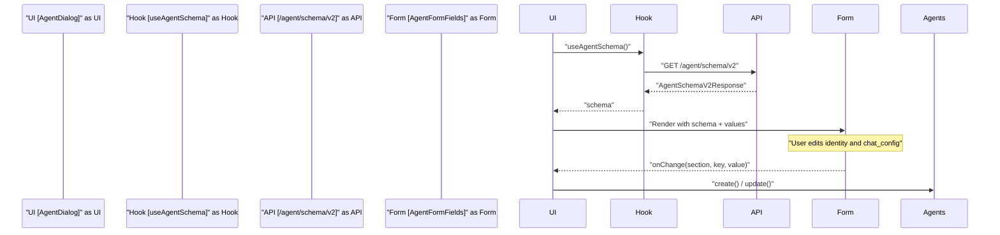
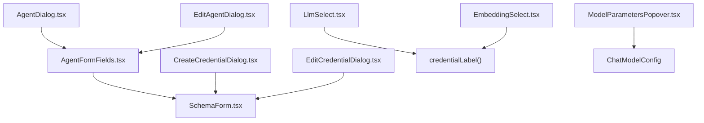
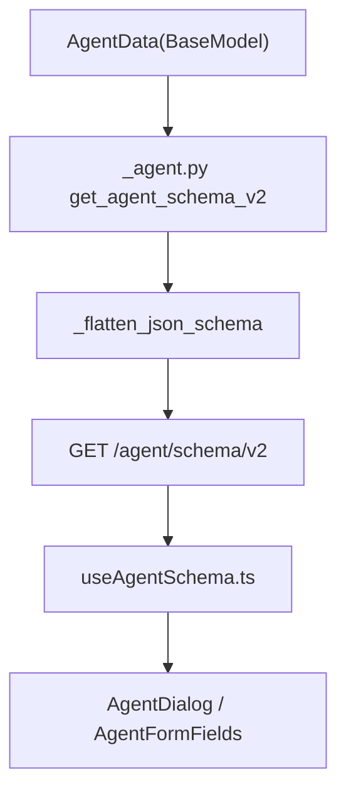

<!-- source: DeepWiki mcp.deepwiki.com · repo modelscope/agentscope · page 8.3 Agent and Credential Management UI · fetched 2026-10-27 -->

# Agent and Credential Management UI

Relevant source files

The following files were used as context for generating this wiki page:

- [examples/web_ui/frontend/src/components/dialog/AgentDialog.tsx](examples/web_ui/frontend/src/components/dialog/AgentDialog.tsx)
- [examples/web_ui/frontend/src/components/dialog/CreateCredentialDialog.tsx](examples/web_ui/frontend/src/components/dialog/CreateCredentialDialog.tsx)
- [examples/web_ui/frontend/src/components/dialog/EditAgentDialog.tsx](examples/web_ui/frontend/src/components/dialog/EditAgentDialog.tsx)
- [examples/web_ui/frontend/src/components/dialog/EditCredentialDialog.tsx](examples/web_ui/frontend/src/components/dialog/EditCredentialDialog.tsx)
- [examples/web_ui/frontend/src/components/dialog/RenameSessionDialog.tsx](examples/web_ui/frontend/src/components/dialog/RenameSessionDialog.tsx)
- [examples/web_ui/frontend/src/components/popover/ModelParametersPopover.tsx](examples/web_ui/frontend/src/components/popover/ModelParametersPopover.tsx)
- [examples/web_ui/frontend/src/components/select/EmbeddingSelect.tsx](examples/web_ui/frontend/src/components/select/EmbeddingSelect.tsx)
- [examples/web_ui/frontend/src/components/select/LlmSelect.tsx](examples/web_ui/frontend/src/components/select/LlmSelect.tsx)
- [examples/web_ui/frontend/src/components/select/RealtimeModelSelect.tsx](examples/web_ui/frontend/src/components/select/RealtimeModelSelect.tsx)
- [examples/web_ui/frontend/src/hooks/useAvailableRealtimeModels.ts](examples/web_ui/frontend/src/hooks/useAvailableRealtimeModels.ts)
- [examples/web_ui/frontend/src/pages/channel/channel-form.tsx](examples/web_ui/frontend/src/pages/channel/channel-form.tsx)
- [examples/web_ui/frontend/src/pages/chat/ChatViewport.tsx](examples/web_ui/frontend/src/pages/chat/ChatViewport.tsx)
- [examples/web_ui/frontend/src/utils/common.ts](examples/web_ui/frontend/src/utils/common.ts)
- [src/agentscope/app/_router/_model.py](src/agentscope/app/_router/_model.py)
- [src/agentscope/app/_service/_model.py](src/agentscope/app/_service/_model.py)
- [src/agentscope/app/storage/_model/_session.py](src/agentscope/app/storage/_model/_session.py)
- [src/agentscope/realtime/_dashscope/_audio_models/qwen-audio-3.1-realtime-plus.yaml](src/agentscope/realtime/_dashscope/_audio_models/qwen-audio-3.1-realtime-plus.yaml)
- [tests/service_model_test.py](tests/service_model_test.py)
- [tests/session_auto_naming_test.py](tests/session_auto_naming_test.py)

This page documents the user interface components and logic responsible for managing agents, sessions, and credentials within the AgentScope 2.0 Web UI. The subsystem relies on a schema-driven architecture where JSON Schemas generated from Pydantic models on the FastAPI backend dictate frontend form generation, field validation, and dynamic model configuration.

---

## Schema-Driven Architecture and Schema Fetching

The management UI avoids hardcoded form fields by fetching JSON Schemas dynamically from the backend [src/agentscope/app/_router/_agent.py:91-136]() and credential API endpoints [examples/web_ui/frontend/src/components/dialog/CreateCredentialDialog.tsx:45-55]().

- **`useAgentSchema`**: A React hook that retrieves the full `AgentData` JSON Schema via `GET /agent/schema/v2` [src/agentscope/app/_router/_agent.py:91-136]().
- **`_flatten_json_schema`**: A backend utility function called in router definitions that inlines `$ref` definitions so the frontend can render all properties directly without resolving nested references [src/agentscope/app/_router/_agent.py:126-136]().

Sources: `src/agentscope/app/_router/_agent.py:91-136]`, `examples/web_ui/frontend/src/components/dialog/CreateCredentialDialog.tsx:45-55]()`

---

## Agent Management UI

Agent creation and updates are managed by `AgentDialog` [examples/web_ui/frontend/src/components/dialog/AgentDialog.tsx:33-134]() and `EditAgentDialog` [examples/web_ui/frontend/src/components/dialog/EditAgentDialog.tsx:34-153]() acting as wrappers around `AgentFormFields`.

### Agent Configuration Data Flow

Sources: `examples/web_ui/frontend/src/components/dialog/AgentDialog.tsx:33-134]`, `src/agentscope/app/_router/_agent.py:91-136]()`

### AgentDialog and EditAgentDialog
- **`AgentDialog`**: Coordinates initial agent creation. It listens to the `open` state, initializes form values using `defaultAgentFormValues(schema)` [examples/web_ui/frontend/src/components/dialog/AgentDialog.tsx:42-50](), and submits payloads through hooks.
- **`EditAgentDialog`**: Handles partial updates to existing agent instances (`AgentView`). It merges schema defaults with the agent's current configuration and identity properties [examples/web_ui/frontend/src/components/dialog/EditAgentDialog.tsx:42-65]().

Sources: `examples/web_ui/frontend/src/components/dialog/AgentDialog.tsx:33-134]`, `examples/web_ui/frontend/src/components/dialog/EditAgentDialog.tsx:34-153]()`

---

## Credential Management UI

Credential dialogs allow users to securely store and configure API keys and provider-specific parameters via management hooks [examples/web_ui/frontend/src/components/dialog/CreateCredentialDialog.tsx:24-35]().

### CreateCredentialDialog & EditCredentialDialog
- **`CreateCredentialDialog`**: Fetches all available credential schemas from API endpoints [examples/web_ui/frontend/src/components/dialog/CreateCredentialDialog.tsx:45-55](). Users select a provider type via `Select`, rendering matching fields inside `SchemaForm` [examples/web_ui/frontend/src/components/dialog/CreateCredentialDialog.tsx:97-130]().
- **`EditCredentialDialog`**: Pre-fills values for existing credentials while explicitly ignoring `writeOnly` schema properties (such as `api_key`) to prevent leaking secrets into plain-text form states or rendering empty overridden values [examples/web_ui/frontend/src/components/dialog/EditCredentialDialog.tsx:46-58]().

Sources: `examples/web_ui/frontend/src/components/dialog/CreateCredentialDialog.tsx:34-152]`, `examples/web_ui/frontend/src/components/dialog/EditCredentialDialog.tsx:26-118]()`

---

## Form Engine and Specialized Inputs

### SchemaForm and ModelParametersPopover
`SchemaForm` maps JSON Schema types to atomic UI widgets (`Switch`, `Select`, numeric/text `Input`) [examples/web_ui/frontend/src/components/popover/ModelParametersPopover.tsx:107-222](). 

- **`resolveType`**: Helper function inspecting schema properties and `anyOf` variants to determine effective scalar types and enum options [examples/web_ui/frontend/src/components/popover/ModelParametersPopover.tsx:68-81]().
- **`extractDefaults`**: Parses default parameter values directly from model card schemas [examples/web_ui/frontend/src/components/popover/ModelParametersPopover.tsx:84-92]().
- **`ModelParametersPopover`**: Renders detailed popovers for tuning model parameters across LLMs, TTS, and embedding models [examples/web_ui/frontend/src/components/popover/ModelParametersPopover.tsx:1-223]().

### Specialized Selectors
- **`LlmSelect`**: Groups available language models by provider type and credential ID, supporting clear selections and quick credential creation prompts [examples/web_ui/frontend/src/components/select/LlmSelect.tsx:42-182]().
- **`EmbeddingSelect`**: Renders embedding model options for RAG knowledge bases, emitting a `SelectedEmbedding` object complete with provider metadata and model cards [examples/web_ui/frontend/src/components/select/EmbeddingSelect.tsx:21-67]().
- **`RealtimeModelSelect`**: Provides dropdown selection for real-time voice models with configuration and parameter defaults [examples/web_ui/frontend/src/components/select/RealtimeModelSelect.tsx:29-58]().

Sources: `examples/web_ui/frontend/src/components/popover/ModelParametersPopover.tsx:40-223]`, `examples/web_ui/frontend/src/components/select/LlmSelect.tsx:42-183]`, `examples/web_ui/frontend/src/components/select/EmbeddingSelect.tsx:21-146]`, `examples/web_ui/frontend/src/components/select/RealtimeModelSelect.tsx:29-135]()`

---

## UI to Code Entity Mapping

The following diagrams map the Web UI components to their underlying React modules, hooks, API schemas, and utility functions, bridging Natural Language Space to Code Entity Space.

**UI Component to Frontend Entity Mapping**

Sources: `examples/web_ui/frontend/src/components/dialog/AgentDialog.tsx:1-134]`, `examples/web_ui/frontend/src/components/select/LlmSelect.tsx:1-183]`, `examples/web_ui/frontend/src/utils/common.ts:4-6]()`

**Backend Schema to Frontend Form Mapping**

Sources: `src/agentscope/app/_router/_agent.py:91-136]`, `examples/web_ui/frontend/src/components/dialog/AgentDialog.tsx:25-50]()`

### Session Renaming and Common Utilities
- **`RenameSessionDialog`**: Provides a focused modal dialog for updating session display names with inline validation and keyboard event handling (`Enter` key confirmation) [examples/web_ui/frontend/src/components/dialog/RenameSessionDialog.tsx:24-82]().
- **`credentialLabel`**: Utility function returning a user-facing credential name or falling back to a truncated 8-character ID prefix [examples/web_ui/frontend/src/utils/common.ts:4-6]().
- **`get_model`**: Backend factory helper that constructs `ChatModelBase` instances from stored `ChatModelConfig` and credentials resolved via `ResourceAccessService` [src/agentscope/app/_service/_model.py:11-89]().

Sources: `examples/web_ui/frontend/src/components/dialog/RenameSessionDialog.tsx:24-82]`, `examples/web_ui/frontend/src/utils/common.ts:4-6]`, `src/agentscope/app/_service/_model.py:11-89]()`

---

