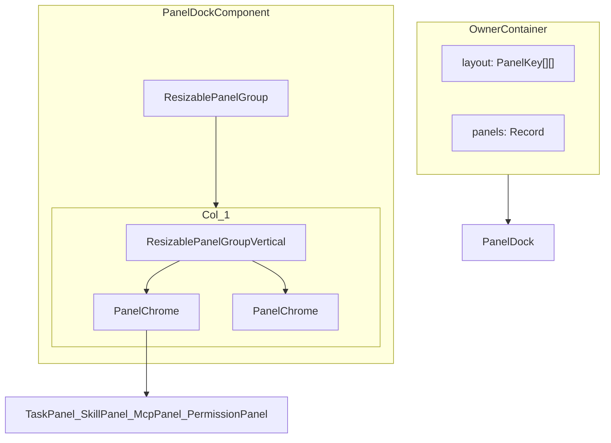
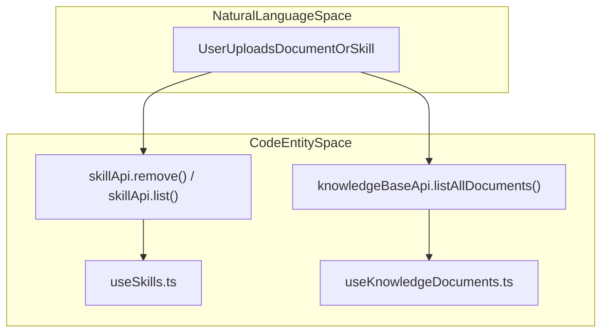
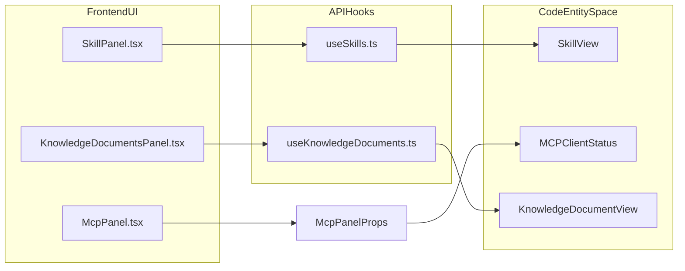

<!-- source: DeepWiki mcp.deepwiki.com · repo modelscope/agentscope · page 8.4 Panel System and Workspace UI · fetched 2026-10-27 -->

# Panel System and Workspace UI

Relevant source files

The following files were used as context for generating this wiki page:

- [examples/web_ui/frontend/package.json](examples/web_ui/frontend/package.json)
- [examples/web_ui/frontend/src/api/knowledgeBase.ts](examples/web_ui/frontend/src/api/knowledgeBase.ts)
- [examples/web_ui/frontend/src/components/chat/TextInput.tsx](examples/web_ui/frontend/src/components/chat/TextInput.tsx)
- [examples/web_ui/frontend/src/components/knowledge/DocumentDetailDrawer.tsx](examples/web_ui/frontend/src/components/knowledge/DocumentDetailDrawer.tsx)
- [examples/web_ui/frontend/src/components/knowledge/KnowledgeDocumentsPanel.tsx](examples/web_ui/frontend/src/components/knowledge/KnowledgeDocumentsPanel.tsx)
- [examples/web_ui/frontend/src/components/panel/McpPanel.tsx](examples/web_ui/frontend/src/components/panel/McpPanel.tsx)
- [examples/web_ui/frontend/src/components/panel/PanelDock.tsx](examples/web_ui/frontend/src/components/panel/PanelDock.tsx)
- [examples/web_ui/frontend/src/components/panel/PanelEmpty.tsx](examples/web_ui/frontend/src/components/panel/PanelEmpty.tsx)
- [examples/web_ui/frontend/src/components/panel/PermissionPanel.tsx](examples/web_ui/frontend/src/components/panel/PermissionPanel.tsx)
- [examples/web_ui/frontend/src/components/panel/SkillPanel.tsx](examples/web_ui/frontend/src/components/panel/SkillPanel.tsx)
- [examples/web_ui/frontend/src/components/panel/TaskPanel.tsx](examples/web_ui/frontend/src/components/panel/TaskPanel.tsx)
- [examples/web_ui/frontend/src/components/ui/calendar.tsx](examples/web_ui/frontend/src/components/ui/calendar.tsx)
- [examples/web_ui/frontend/src/components/ui/resizable.tsx](examples/web_ui/frontend/src/components/ui/resizable.tsx)
- [examples/web_ui/frontend/src/components/ui/toggle.tsx](examples/web_ui/frontend/src/components/ui/toggle.tsx)
- [examples/web_ui/frontend/src/hooks/useKnowledgeBases.ts](examples/web_ui/frontend/src/hooks/useKnowledgeBases.ts)
- [examples/web_ui/frontend/src/hooks/useKnowledgeDocuments.ts](examples/web_ui/frontend/src/hooks/useKnowledgeDocuments.ts)
- [examples/web_ui/frontend/src/hooks/useSkills.ts](examples/web_ui/frontend/src/hooks/useSkills.ts)
- [examples/web_ui/frontend/tsconfig.app.json](examples/web_ui/frontend/tsconfig.app.json)
- [examples/web_ui/pnpm-lock.yaml](examples/web_ui/pnpm-lock.yaml)

The Panel System in AgentScope 2.0 provides a modular, dockable layout for monitoring and managing the internal state of an agent and its workspace [examples/web_ui/frontend/src/components/panel/PanelDock.tsx:1-189](). It bridges the gap between the autonomous reasoning loop and human oversight by visualizing task progress, active permissions, and available resources like skills, MCP servers, and knowledge bases [examples/web_ui/frontend/src/components/panel/TaskPanel.tsx:1-163]().

Sources: [examples/web_ui/frontend/src/components/panel/PanelDock.tsx:1-189](), [examples/web_ui/frontend/src/components/panel/TaskPanel.tsx:1-163]()

## PanelDock Layout System

The `PanelDock` is a layout engine responsible for arranging various information panels into a grid of horizontally-resizable columns (`ResizablePanelGroup`), each containing up to two vertically-resizable rows [examples/web_ui/frontend/src/components/panel/PanelDock.tsx:126-189](). It utilizes a controlled layout state (`PanelKey[][]`) to manage visibility and positioning without holding internal business logic [examples/web_ui/frontend/src/components/panel/PanelDock.tsx:43-63]().

### Data Flow and Architecture

The system follows a presentation-only pattern where the dock itself is agnostic to domain data. The `PanelDescriptor` interface defines the chrome (header, title, icon, actions) and the pre-bound content node [examples/web_ui/frontend/src/components/panel/PanelDock.tsx:23-41]().

| Entity | Role |
| :--- | :--- |
| `PanelKey` | Enumeration of dockable types: `'plan'`, `'mcp'`, `'skill'`, `'permission'`, `'knowledge'`, `'team'` [examples/web_ui/frontend/src/components/panel/PanelDock.tsx:16-16]() |
| `PanelDescriptor` | Metadata and content for a panel, including custom header actions [examples/web_ui/frontend/src/components/panel/PanelDock.tsx:23-41]() |
| `PanelDock` | Top-level layout component that maps 2D arrays of keys to resizable columns and rows [examples/web_ui/frontend/src/components/panel/PanelDock.tsx:143-189]() |
| `Panel` | Visual wrapper providing the border, title bar, and close button [examples/web_ui/frontend/src/components/panel/PanelDock.tsx:99-123]() |

Title: "PanelDock Layout Structure"

Sources: [examples/web_ui/frontend/src/components/panel/PanelDock.tsx:1-189]()

## Workspace Management Panels

### TaskPanel (Agent Progress)
The `TaskPanel` visualizes task contexts from the agent's state, rendering tasks with their current states (`completed`, `in_progress`, or `pending`) and dependency mapping [examples/web_ui/frontend/src/components/panel/TaskPanel.tsx:11-35](). 
- **Ellipsis Collapse**: Completed tasks exceeding a threshold are collapsed behind an expandable ellipsis sentinel using `filterTasksWithEllipsis` [examples/web_ui/frontend/src/components/panel/TaskPanel.tsx:46-70]().
- **Progress Badges**: Displays completion statistics in header badges [examples/web_ui/frontend/src/components/panel/TaskPanel.tsx:107-115]().

Sources: [examples/web_ui/frontend/src/components/panel/TaskPanel.tsx:1-163]()

### Skill and MCP Panels
These panels manage the toolkit available to the agent within the current workspace.

- **SkillPanel**: Lists equipped skills (`Skill[]`), correlating local workspace skills with the user's global library via `useSkills` to display icons, descriptions, and authors [examples/web_ui/frontend/src/components/panel/SkillPanel.tsx:23-47](). It provides folder upload capabilities and library installation dialogs [examples/web_ui/frontend/src/components/panel/SkillPanel.tsx:167-176]().
- **McpPanel**: Manages Model Context Protocol (MCP) servers (`MCPClientStatus[]`) [examples/web_ui/frontend/src/components/panel/McpPanel.tsx:37-55](). It provides health status indicators, tool counts, and collapsible tool detail listings for connected servers, alongside error alert banners for unhealthy servers [examples/web_ui/frontend/src/components/panel/McpPanel.tsx:113-176]().

Sources: [examples/web_ui/frontend/src/components/panel/SkillPanel.tsx:1-192](), [examples/web_ui/frontend/src/components/panel/McpPanel.tsx:1-286]()

## Knowledge Base and Document Ingestion Pipeline

The knowledge base panels manage RAG configurations and document indexing for the workspace, leveraging `useKnowledgeDocuments` for tracking ingestion state [examples/web_ui/frontend/src/hooks/useKnowledgeDocuments.ts:16-54]().

- **Document Ingestion**: The `KnowledgeDocumentsPanel` handles multi-stage processing states (`queued`, `uploading`, `pending`, `parsing`, `chunking`, `indexing`, `ready`, `error`) with dynamic progress calculation based on file size and processing phases [examples/web_ui/frontend/src/components/knowledge/KnowledgeDocumentsPanel.tsx:36-150]().
- **Polling & Synchronization**: Document lists are periodically synced and refactored through `knowledgeBaseApi.listAllDocuments` [examples/web_ui/frontend/src/hooks/useKnowledgeDocuments.ts:38-38]().

Title: "Natural Language Space to Code Entity Space: Resource Integration"

Sources: [examples/web_ui/frontend/src/hooks/useKnowledgeDocuments.ts:1-54](), [examples/web_ui/frontend/src/hooks/useSkills.ts:1-45](), [examples/web_ui/frontend/src/components/knowledge/KnowledgeDocumentsPanel.tsx:1-525]()

## Channel Management and Resource Installation Dialogs

The UI facilitates resource discovery and installation through specialized dialogs and hub browsing interfaces.

### Resource Discovery and Dialogs
- **Skill Library Integration**: The `useSkills` hook provides the data layer for installed skill libraries, enabling deletion and refetching logic [examples/web_ui/frontend/src/hooks/useSkills.ts:13-45]().
- **MCP Management**: MCP servers are added via configuration inputs or library picks using `McpPanel` and associated modal dialogs [examples/web_ui/frontend/src/components/panel/McpPanel.tsx:13-14]().

| Functionality | Implementation |
| :--- | :--- |
| **Search Filtering** | Local string matching on name and description fields [examples/web_ui/frontend/src/components/panel/SkillPanel.tsx:81-84]() |
| **Deletion Confirmation** | `DeleteDialog` triggers `onRemove` callbacks to purge resources from the workspace [examples/web_ui/frontend/src/components/panel/SkillPanel.tsx:178-189]() |
| **Collapsible Tool View** | Uses `Collapsible` components to render tool signatures without cluttering panel dimensions [examples/web_ui/frontend/src/components/panel/McpPanel.tsx:131-144]() |

Title: "Frontend Component to Backend Entity Mapping"

Sources: [examples/web_ui/frontend/src/components/panel/SkillPanel.tsx:1-192](), [examples/web_ui/frontend/src/components/panel/McpPanel.tsx:1-286](), [examples/web_ui/frontend/src/hooks/useSkills.ts:1-45](), [examples/web_ui/frontend/src/hooks/useKnowledgeDocuments.ts:1-54]()

---

