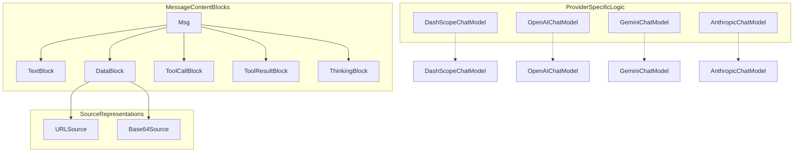
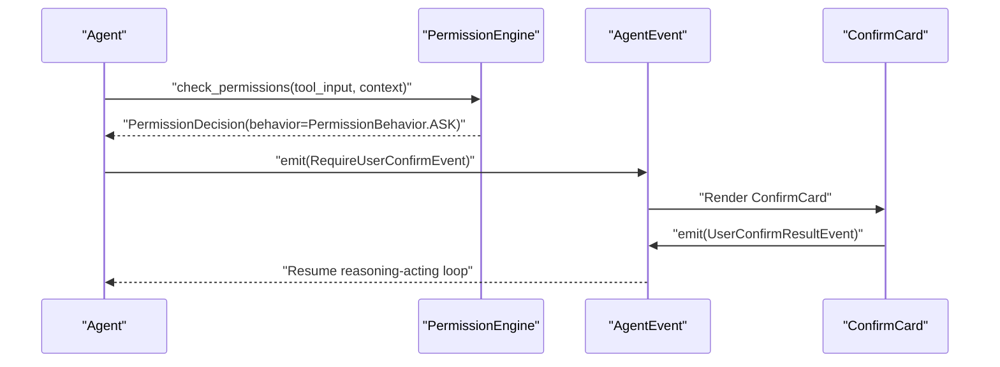
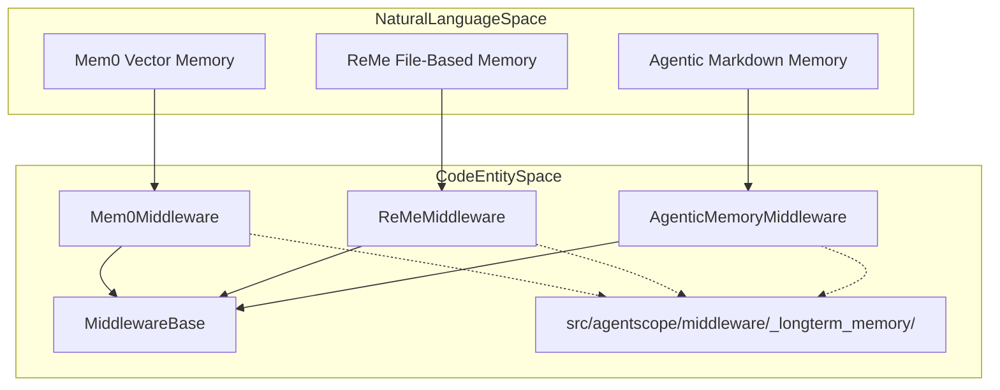
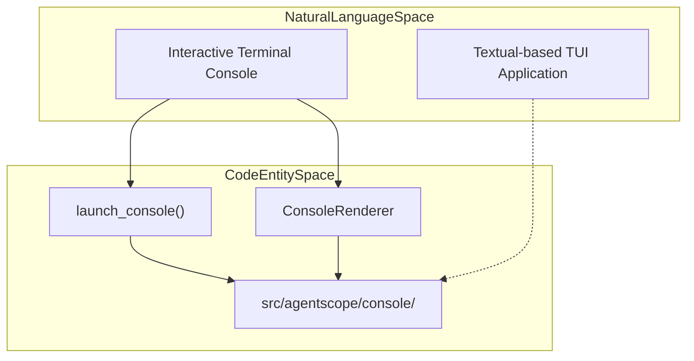

<!-- source: DeepWiki mcp.deepwiki.com · repo modelscope/agentscope · page 9 Advanced Topics · fetched 2026-10-27 -->

# Advanced Topics

Relevant source files

The following files were used as context for generating this wiki page:

- [.gemini/styleguide.md](.gemini/styleguide.md)
- [.github/copilot-instructions.md](.github/copilot-instructions.md)
- [README.md](README.md)
- [README_zh.md](README_zh.md)
- [assets/images/agentscope.png](assets/images/agentscope.png)
- [docs/NEWS.md](docs/NEWS.md)
- [docs/NEWS_zh.md](docs/NEWS_zh.md)
- [examples/agent_service/README.md](examples/agent_service/README.md)
- [src/agentscope/_version.py](src/agentscope/_version.py)
- [src/agentscope/middleware/__init__.py](src/agentscope/middleware/__init__.py)
- [src/agentscope/middleware/_longterm_memory/__init__.py](src/agentscope/middleware/_longterm_memory/__init__.py)
- [src/agentscope/middleware/_longterm_memory/_reme/__init__.py](src/agentscope/middleware/_longterm_memory/_reme/__init__.py)
- [src/agentscope/realtime/__init__.py](src/agentscope/realtime/__init__.py)
- [src/agentscope/realtime/_base.py](src/agentscope/realtime/_base.py)

This page serves as a high-level parent guide to advanced features and extension mechanisms in AgentScope 2.0 for power users. Topics span multimodal content handling, human-in-the-loop workflows, framework extension points, CI/CD pipelines, long-term memory integrations, and terminal/TUI interfaces.

For detailed technical references, refer to the child pages:
- [Multimodal Content Handling](#9.1) — Multimodal DataBlock (image/audio/video), URLSource vs Base64Source, media retrieval, streaming WAV headers, provider formatting, promote_tool_result_images.
- [Human-in-the-Loop and External Execution](#9.2) — REQUIRE_USER_CONFIRM events, RequireExternalExecutionEvent, result events, CustomEvent, HintBlockEvent, interrupt/resume pattern, and the ConfirmCard flow.
- [Extending AgentScope](#9.3) — Creating custom tools, middlewares, model providers, workspace backends, storage backends, hub providers, channels; lazy import and naming rules.
- [CI/CD and Development Workflow](#9.4) — GitHub Actions workflows, pre-commit hooks, conventional commits, issue/PR templates, issue triage scripts, and the scripts/model_examples provider test runner.
- [Long-term Memory](#9.5) — Overview of the three long-term memory middleware backends: Mem0, ReMe, and AgenticMemory. Links to child pages.
- [Terminal Console and TUI Interfaces](#9.6) — launch_console()/ConsoleRenderer and the Textual-based TUI package, plus the examples/tui and examples/console demos.

---

## 9.1 Multimodal Content Handling

AgentScope provides comprehensive support for multimodal content (images, audio, and video) via a unified content block model embedded in `Msg`. The framework automatically manages format conversion between internal representations (`DataBlock`) and provider-specific API expectations.

### Content Block Architecture

Messages accommodate diverse content types using specialized blocks, leveraging `URLSource` and `Base64Source` for media assets.

| Block Type | Purpose | Source Types | Provider Support |
|------------|---------|--------------|------------------|
| `TextBlock` | Plain text content | N/A | Universal |
| `DataBlock` | Media (image, audio, video) | `URLSource`, `Base64Source` | OpenAI, DashScope, Gemini, Anthropic |
| `ToolCallBlock`| Tool invocation records | N/A | All providers |
| `ToolResultBlock`| Tool execution outputs | N/A | All providers |
| `ThinkingBlock` | Reasoning traces | N/A | DeepSeek, DashScope, Gemini, Anthropic |

Diagram: Multimodal Message Handling Flow

Sources: [src/agentscope/message/__init__.py](), [src/agentscope/message/_message.py:75-90](), [src/agentscope/tool/_response.py:96-104]()

For details, see [Multimodal Content Handling](#9.1).

---

## 9.2 Human-in-the-Loop and External Execution

AgentScope supports interrupting agent reasoning-acting loops for human intervention and external authorization via structured event types and permission engines.

### Interruption and Confirmation Flow

When a tool call or action requires confirmation, the `PermissionEngine` evaluates policies and returns an `ASK` decision, emitting a `RequireUserConfirmEvent`. Results are transmitted back via `UserConfirmResultEvent` or `ExternalExecutionResultEvent`.

Diagram: Human-in-the-Loop Execution Flow

Sources: [src/agentscope/agent/_agent.py:55-58](), [src/agentscope/permission/_permission.py:101-102]()

For details, see [Human-in-the-Loop and External Execution](#9.2).

---

## 9.3 Extending AgentScope

AgentScope is built for modular extensibility. Custom components integrate seamlessly through standardized base classes while adhering to strict lazy-loading rules.

### Extension Points Overview

*   **Custom Tools**: Implement `ToolBase` or wrap functions via `FunctionTool`.
*   **Custom Middlewares**: Subclass `MiddlewareBase` to hook into execution points (`on_model_call`, `on_reply`, `on_acting`).
*   **Custom Models**: Implement `CredentialBase`, `ChatModelBase`, and `FormatterBase`.
*   **Custom Workspaces**: Subclass `WorkspaceBase` for sandboxed execution.
*   **Storage & Hubs & Channels**: Extend `StorageBase`, `MCPHubBase`, `SkillHubBase`, or `ChannelBase`.

### Lazy Import Principle
Any dependency not declared in core `pyproject.toml` requirements **must** be lazy-imported at the point of use to maintain a lightweight core package. This is a [MUST] requirement in the AgentScope code review guide [src/.gemini/styleguide.md:10-11]().

Sources: [pyproject.toml:21-50](), [src/agentscope/tool/_base.py:30](), [src/agentscope/tool/_adapters.py:36](), [src/agentscope/middleware/_base.py:30](), [src/agentscope/workspace/_base.py:30](), [src/.gemini/styleguide.md:10-11]()

For details, see [Extending AgentScope](#9.3).

---

## 9.4 CI/CD and Development Workflow

AgentScope relies on GitHub Actions, pre-commit hooks, and Conventional Commits to maintain high code quality across multi-OS test matrices.

### Development Standards
*   **Python Version**: Requires Python 3.11+ [README.md:102]().
*   **Commit Validation**: PR titles and commits must follow Conventional Commits format (`type(scope): description`) verified by automated workflows [src/.gemini/styleguide.md:93-97]().
*   **Pre-commit Hooks**: Enforce linting, formatting, and type checks [src/.gemini/styleguide.md:83-87]().

Sources: [pyproject.toml:20](), [README.md:102](), [src/.gemini/styleguide.md:83-87](), [src/.gemini/styleguide.md:93-97]()

For details, see [CI/CD and Development Workflow](#9.4).

---

## 9.5 Long-term Memory

AgentScope supports cross-session memory preservation through pluggable middleware backends integrated into the agent execution lifecycle. These middlewares are exposed via `src/agentscope/middleware/__init__.py` [src/agentscope/middleware/__init__.py:7-11]() and `src/agentscope/middleware/_longterm_memory/__init__.py` [src/agentscope/middleware/_longterm_memory/__init__.py:4-6]().

### 9.5.1 Mem0 Middleware
`Mem0Middleware` integrates with Mem0 vector backends for semantic memory retrieval and storage, targeting `mem0ai>=2.0.0` [pyproject.toml:150](). It supports custom construction paths, search/add memory tools, prompts, and fallback logic.

### 9.5.2 ReMeMiddleware
`ReMeMiddleware` provides file-based local memory capturing conversation histories via `on_reply` hooks and injecting hints, utilizing the embedded app package defined in `src/agentscope/middleware/_longterm_memory/_reme/__init__.py` [src/agentscope/middleware/_longterm_memory/_reme/__init__.py:1-16](). It requires `reme-ai>=0.4.0.6` [pyproject.toml:152]().

### 9.5.3 AgenticMemoryMiddleware
`AgenticMemoryMiddleware` implements agent-driven Markdown file memory managed directly through tools and workspace persistence (`MEMORY.md`), supporting topic frontmatter and agent-driven read/write operations.

Diagram: Long-term Memory Architecture and Code Entities

Sources: [src/agentscope/middleware/__init__.py:7-11](), [src/agentscope/middleware/_base.py:30](), [src/agentscope/middleware/_longterm_memory/__init__.py:4-6](), [src/agentscope/middleware/_longterm_memory/_reme/__init__.py:1-16](), [pyproject.toml:150](), [pyproject.toml:152]()

For details, see [Long-term Memory](#9.5).

---

## 9.6 Terminal Console and TUI Interfaces

For interactive local development and debugging without launching the full Web UI, AgentScope provides console utilities and a Textual-based TUI package.

### Interface Features
*   **`launch_console()` & `ConsoleRenderer`**: Powers stream rendering, tool confirmation prompts, and verbosity settings in standard terminals [src/agentscope/console/_renderer.py:78-120]().
*   **Signal Interruption**: Handles `Ctrl+C` (`SIGINT`) gracefully to emit user interruption events.
*   **Textual TUI Package**: The TUI functionality relies on `textual>=8.2,<9` [pyproject.toml:118-119]() and is demonstrated in `examples/tui/` and `examples/console/`.

Diagram: Terminal and Console Code Entity Architecture

Sources: [src/agentscope/console/_renderer.py:78-120](), [pyproject.toml:118-119]()

For details, see [Terminal Console and TUI Interfaces](#9.6).

---

