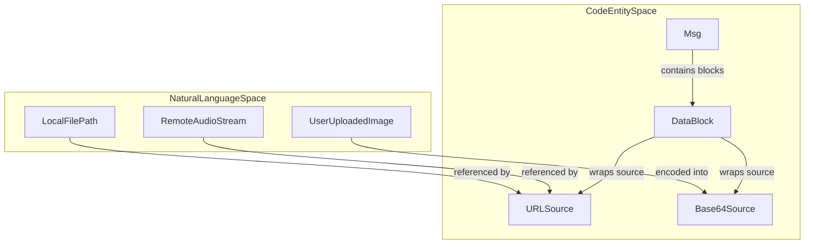
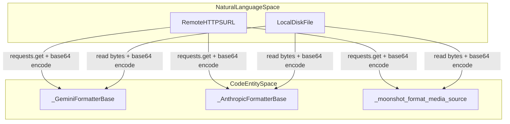
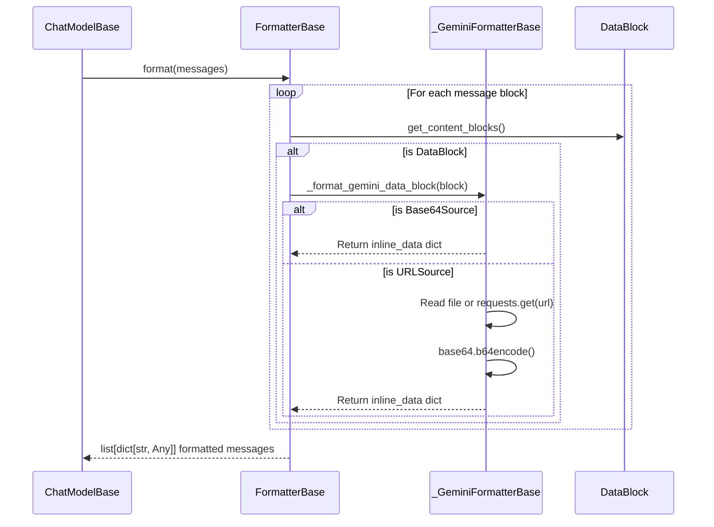
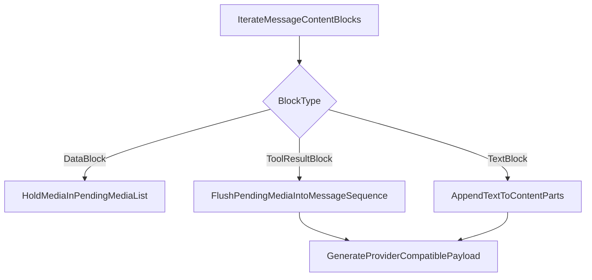

<!-- source: DeepWiki mcp.deepwiki.com · repo modelscope/agentscope · page 9.1 Multimodal Content Handling · fetched 2026-10-27 -->

# Multimodal Content Handling

Relevant source files

The following files were used as context for generating this wiki page:

- [src/agentscope/_utils/_audio.py](src/agentscope/_utils/_audio.py)
- [src/agentscope/formatter/_anthropic_formatter.py](src/agentscope/formatter/_anthropic_formatter.py)
- [src/agentscope/formatter/_dashscope_formatter.py](src/agentscope/formatter/_dashscope_formatter.py)
- [src/agentscope/formatter/_formatter_base.py](src/agentscope/formatter/_formatter_base.py)
- [src/agentscope/formatter/_gemini_formatter.py](src/agentscope/formatter/_gemini_formatter.py)
- [src/agentscope/formatter/_moonshot_formatter.py](src/agentscope/formatter/_moonshot_formatter.py)
- [src/agentscope/formatter/_openai_formatter.py](src/agentscope/formatter/_openai_formatter.py)
- [src/agentscope/formatter/_xai_formatter.py](src/agentscope/formatter/_xai_formatter.py)
- [src/agentscope/message/_block.py](src/agentscope/message/_block.py)
- [src/agentscope/model/_base.py](src/agentscope/model/_base.py)
- [src/agentscope/model/_openai_chat/_model.py](src/agentscope/model/_openai_chat/_model.py)
- [src/agentscope/model/_utils.py](src/agentscope/model/_utils.py)
- [tests/formatter_anthropic_test.py](tests/formatter_anthropic_test.py)
- [tests/formatter_dashscope_test.py](tests/formatter_dashscope_test.py)
- [tests/formatter_gemini_test.py](tests/formatter_gemini_test.py)
- [tests/formatter_moonshot_test.py](tests/formatter_moonshot_test.py)
- [tests/formatter_openai_chat_test.py](tests/formatter_openai_chat_test.py)
- [tests/formatter_xai_test.py](tests/formatter_xai_test.py)
- [tests/model_base_test.py](tests/model_base_test.py)
- [tests/model_openai_chat_test.py](tests/model_openai_chat_test.py)
- [tests/utils.py](tests/utils.py)

## Purpose and Scope

This document details multimodal content handling in AgentScope 2.0. The framework supports rich media inputs and outputs—including images, audio, video, and PDF documents—across diverse model providers such as Gemini, Anthropic, Ollama, DashScope, OpenAI, Moonshot, Volcengine, and xAI. The scope covers the block-based message protocol (`DataBlock`, `URLSource`, `Base64Source`), media retrieval and base64 encoding logic, streaming WAV headers for omni-style audio models, provider-specific formatting implementations, and tool result promotion (`promote_tool_result_images` and pending media handling).

Sources: [src/agentscope/message/_block.py:1-126](), [src/agentscope/formatter/_openai_formatter.py:26-198](), [src/agentscope/formatter/_dashscope_formatter.py:26-196](), [src/agentscope/formatter/_moonshot_formatter.py:24-81]()

---

## Content Block & Source Architecture

AgentScope represents multimodal data within messages via `DataBlock` instances embedded in a `Msg` object [src/agentscope/message/_block.py:83-92](). A `DataBlock` delegates actual payload management to source abstractions: `URLSource` for URIs or local file paths, and `Base64Source` for raw in-memory encoded strings [src/agentscope/message/_block.py:56-75]().

### Multimodal Content Entity Mapping

The following diagram bridges the conceptual multimodal domain to concrete Python classes and modules in the codebase.

Title: "Multimodal Content Entity Mapping"

Sources: [src/agentscope/message/_block.py:56-92]()

| Class | Purpose | Key Attributes |
| :--- | :--- | :--- |
| `DataBlock` | Represents a single piece of media (image, audio, video, PDF). | `source`, `type="data"`, `name` [src/agentscope/message/_block.py:83-94]() |
| `URLSource` | References media via a URI (Web URL or local path). | `url` (conforming to RFC 3986), `media_type` [src/agentscope/message/_block.py:67-75]() |
| `Base64Source` | Contains raw media data in-memory. | `data` (base64 string), `media_type` [src/agentscope/message/_block.py:56-64]() |

Sources: [src/agentscope/message/_block.py:56-94]()

---

## Media Retrieval, Base64 Encoding, and Streaming WAV Headers

Model providers frequently require media payloads to be transmitted as base64-encoded strings or specific data URI formats. AgentScope's formatter layer automates retrieval and transformation.

### Retrieval Logic and Provider Encoding Rules
1. **Local Files**: If a `URLSource` specifies a URI starting with `file://`, formatters strip the prefix, read the file bytes from the local filesystem, and encode them to base64 [src/agentscope/formatter/_gemini_formatter.py:86-90](), [src/agentscope/formatter/_openai_formatter.py:106-109](), [src/agentscope/formatter/_anthropic_formatter.py:190-194]().
2. **Remote URLs**: Standard `http(s)://` URLs are either passed through directly (for providers supporting remote HTTPS URLs like OpenAI and DashScope) [src/agentscope/formatter/_openai_formatter.py:110-112](), [src/agentscope/formatter/_dashscope_formatter.py:132-133]() or downloaded via `requests.get()` and converted to base64 data URIs (for stricter APIs like Gemini, Anthropic, and Moonshot) [src/agentscope/formatter/_gemini_formatter.py:97-100](), [src/agentscope/formatter/_anthropic_formatter.py:196-199](), [src/agentscope/formatter/_moonshot_formatter.py:49-52]().
3. **Streaming Audio & WAV Headers**: For omni-style audio models (e.g., in `OpenAIChatModel` and `DashScopeChatModel`), streaming audio chunks are processed with utility functions (`_build_streaming_wav_header`, `_build_wav_header`) to construct valid WAV headers on-the-fly [src/agentscope/model/_openai_chat/_model.py:10-13](), [src/agentscope/_utils/_audio.py:1-100]().

### Media Retrieval Entity Mapping

The following diagram bridges external media references to internal formatter and request generation code entities.

Title: "Media Retrieval Entity Mapping"

Sources: [src/agentscope/formatter/_gemini_formatter.py:71-108](), [src/agentscope/formatter/_anthropic_formatter.py:176-205](), [src/agentscope/formatter/_moonshot_formatter.py:27-54]()

### Media Encoding Pipeline

Title: "Media Encoding Flow in Model Call"

Sources: [src/agentscope/formatter/_gemini_formatter.py:31-61]()

---

## Provider-Specific Multimodal Formatting

Different model backends require distinct JSON payloads for multimodal content. AgentScope encapsulates this variance inside provider-specific formatters.

### Gemini Formatter (`_GeminiFormatterBase`)
- Formats `DataBlock` into Gemini's `inline_data` format, which includes `data` (base64 string) and `mime_type` [src/agentscope/formatter/_gemini_formatter.py:76-82]().
- Supports `image/*`, `audio/*`, `video/*`, and `application/pdf` media types [src/agentscope/formatter/_gemini_formatter.py:117-124]().
- Handles `file://` URLs by reading local files and `http(s)://` URLs by downloading and base64 encoding [src/agentscope/formatter/_gemini_formatter.py:86-100]().

Sources: [src/agentscope/formatter/_gemini_formatter.py:31-124]()

### Anthropic Formatter (`_AnthropicFormatterBase`)
- Formats `DataBlock` into Anthropic's `image` or `source` content types, with `media_type` and `data` (base64 string) [src/agentscope/formatter/_anthropic_formatter.py:176-182]().
- Supports `image/*`, `audio/*`, `video/*`, and `application/pdf` media types [src/agentscope/formatter/_anthropic_formatter.py:210-217]().
- Downloads remote URLs and converts local files to base64 [src/agentscope/formatter/_anthropic_formatter.py:190-199]().

Sources: [src/agentscope/formatter/_anthropic_formatter.py:158-217]()

### OpenAI Formatter (`_OpenAIFormatterBase`)
- Maps image blocks to `{"type": "image_url", "image_url": {"url": ...}}` [src/agentscope/formatter/_openai_formatter.py:117-120]().
- Maps audio blocks to `{"type": "input_audio", "input_audio": {"data": ..., "format": ...}}` (supporting WAV and MP3) [src/agentscope/formatter/_openai_formatter.py:139-159]().
- Maps PDF files to OpenAI file content parts [src/agentscope/formatter/_openai_formatter.py:185-198]().

Sources: [src/agentscope/formatter/_openai_formatter.py:30-198]()

### DashScope Formatter (`_DashScopeFormatterBase`)
- Inherits OpenAI-compatible multimodal patterns and adds explicit support for video data blocks via `{"type": "video_url", "video_url": {"url": ...}}` [src/agentscope/formatter/_dashscope_formatter.py:143-169]().
- Supports `application/x-thinking` in `input_types` to pass `reasoning_content` back in conversation history [src/agentscope/formatter/_dashscope_formatter.py:30-61]().

Sources: [src/agentscope/formatter/_dashscope_formatter.py:63-169]()

### Moonshot Formatter (`MoonshotChatFormatter`)
- Extends OpenAI base format but enforces local downloading and base64 data URI inlining for remote image URLs via `_moonshot_format_media_source()` because Moonshot's vision API rejects raw HTTPS URLs [src/agentscope/formatter/_moonshot_formatter.py:24-56]().
- Preserves `reasoning_content` fields in assistant turns for thinking models (`kimi-k2.6`, `kimi-k2-thinking`) [src/agentscope/formatter/_moonshot_formatter.py:59-67]().

Sources: [src/agentscope/formatter/_moonshot_formatter.py:24-81]()

### xAI Formatter (`XAIChatFormatter`)
- Formats `DataBlock` instances into `xai_sdk.chat.image` objects, which are then passed as positional arguments to `xai_sdk.chat.user()` [src/agentscope/formatter/_xai_formatter.py:58-97]().
- Only supports `image/jpeg` and `image/png` media types for `DataBlock` [src/agentscope/formatter/_xai_formatter.py:113-116]().
- Downloads remote URLs and converts local files to base64 data URIs for image content [src/agentscope/formatter/_xai_formatter.py:76-97]().

Sources: [src/agentscope/formatter/_xai_formatter.py:32-97](), [src/agentscope/formatter/_xai_formatter.py:113-116]()

---

## Tool Result and Pending Media Handling (`promote_tool_result_images`)

Tools executing in multimodal environments may return images, charts, or files inside a `ToolResultBlock`. Because many LLM APIs enforce strict role-based content restrictions (e.g., requiring tool role messages to be text-only or ordered in specific sequences), formatters implement pending media accumulation and promotion logic.

### Pending Media Promotion Flow

Title: "Pending Media Promotion and Tool Result Handling"

Sources: [src/agentscope/formatter/_moonshot_formatter.py:137-140](), [src/agentscope/formatter/_gemini_formatter.py:190-196](), [src/agentscope/formatter/_anthropic_formatter.py:60-72]()

- **Pending Media Buffer**: Formatters across Moonshot, Gemini, and Anthropic maintain a `pending_media` accumulator during block iteration, flushing promoted media elements before processing subsequent non-tool blocks or tool messages [src/agentscope/formatter/_moonshot_formatter.py:137-140](), [src/agentscope/formatter/_gemini_formatter.py:190-196](), [src/agentscope/formatter/_anthropic_formatter.py:60-72]().
- **HintBlock Injection**: `HintBlock` instances allow injecting multimodal reference hints or user feedback directly into the agent reasoning context, which formatters translate into appropriate `user` role turns [src/agentscope/message/_block.py:101-115](), [src/agentscope/formatter/_gemini_formatter.py:171-196](), [src/agentscope/formatter/_anthropic_formatter.py:124-157](), [src/agentscope/formatter/_moonshot_formatter.py:179-183](), [src/agentscope/formatter/_xai_formatter.py:167-181]().

Sources: [src/agentscope/message/_block.py:101-115](), [src/agentscope/formatter/_moonshot_formatter.py:137-183](), [src/agentscope/formatter/_gemini_formatter.py:171-196](), [src/agentscope/formatter/_anthropic_formatter.py:60-157](), [src/agentscope/formatter/_xai_formatter.py:167-181]()

---

