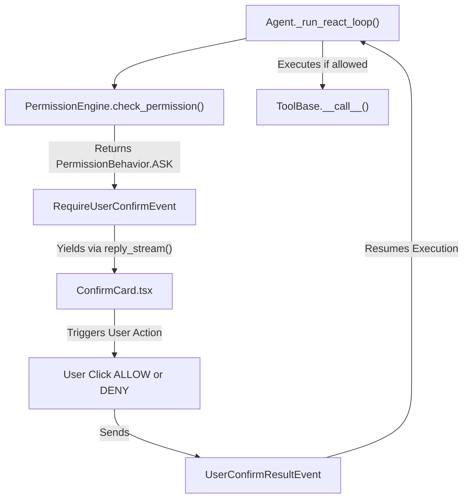
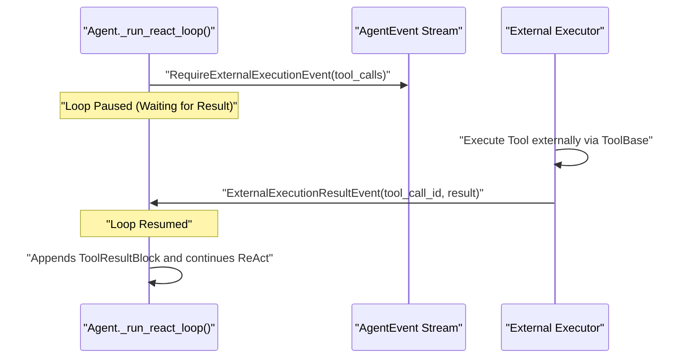

<!-- source: DeepWiki mcp.deepwiki.com · repo modelscope/agentscope · page 9.2 Human-in-the-Loop and External Execution · fetched 2026-10-27 -->

# Human-in-the-Loop and External Execution

Relevant source files

The following files were used as context for generating this wiki page:

- [.pre-commit-config.yaml](.pre-commit-config.yaml)
- [src/agentscope/agent/_agent.py](src/agentscope/agent/_agent.py)
- [src/agentscope/agent/_config.py](src/agentscope/agent/_config.py)
- [src/agentscope/event/_event.py](src/agentscope/event/_event.py)
- [src/agentscope/message/_base.py](src/agentscope/message/_base.py)
- [src/agentscope/middleware/_base.py](src/agentscope/middleware/_base.py)
- [src/agentscope/tool/__init__.py](src/agentscope/tool/__init__.py)
- [src/agentscope/tool/_base.py](src/agentscope/tool/_base.py)
- [src/agentscope/tool/_builtin/__init__.py](src/agentscope/tool/_builtin/__init__.py)
- [src/agentscope/tool/_builtin/_ask_user.py](src/agentscope/tool/_builtin/_ask_user.py)
- [src/agentscope/tool/_builtin/_meta.py](src/agentscope/tool/_builtin/_meta.py)
- [src/agentscope/tool/_builtin/_skill.py](src/agentscope/tool/_builtin/_skill.py)
- [tests/agent_basic_test.py](tests/agent_basic_test.py)
- [tests/agent_injection_test.py](tests/agent_injection_test.py)
- [tests/agent_interrupt_test.py](tests/agent_interrupt_test.py)
- [tests/ask_user_tool_test.py](tests/ask_user_tool_test.py)
- [tests/compress_context_test.py](tests/compress_context_test.py)
- [tests/event_test.py](tests/event_test.py)
- [tests/event_to_message_test.py](tests/event_to_message_test.py)
- [tests/hitl_external_execution_test.py](tests/hitl_external_execution_test.py)
- [tests/hitl_user_confirmation_test.py](tests/hitl_user_confirmation_test.py)
- [tests/message_test.py](tests/message_test.py)
- [tests/middleware_test.py](tests/middleware_test.py)
- [tests/permission_engine_test.py](tests/permission_engine_test.py)

This page details AgentScope 2.0's Human-in-the-Loop (HITL) and external execution architecture. It covers permission-based interruption via `RequireUserConfirmEvent` (`REQUIRE_USER_CONFIRM`), the protocol for `RequireExternalExecutionEvent`, out-of-band notification events like `CustomEvent` and `HintBlockEvent`, the interrupt/resume pattern driven by `UserInterruptEvent`, and the `ConfirmCard` flow.

Sources: [src/agentscope/event/_event.py:25-67](), [tests/hitl_user_confirmation_test.py:29-103](), [tests/agent_interrupt_test.py:20-42]()

---

## Overview

AgentScope 2.0 implements a stateful interruption and resume pattern inside the agent's core reasoning-acting (`ReAct`) execution loop. This architecture allows an `Agent` instance [tests/agent_basic_test.py:109]() to pause execution when encountering sensitive operations or external dependencies, yield structured event streams via `reply_stream()`, and resume upon receiving user authorization or external task completion.

The primary triggers are:
1. **Permission Decisions (`PermissionBehavior.ASK`)**: Evaluated via `PermissionEngine`, yielding a `RequireUserConfirmEvent` [src/agentscope/event/_event.py:59]().
2. **External Execution (`is_external_tool = True`)**: Configured on tools [tests/agent_basic_test.py:43](), yielding a `RequireExternalExecutionEvent` [src/agentscope/event/_event.py:60]() when execution must happen outside the local Python runtime.

Sources: [tests/agent_basic_test.py:43](), [tests/agent_basic_test.py:109](), [src/agentscope/event/_event.py:59-60]()

---

## Permission-Based Confirmation (`REQUIRE_USER_CONFIRM`)

When an agent invokes a tool, the `PermissionEngine` checks the tool call against the active `PermissionContext` [tests/agent_basic_test.py:18](). If the rule returns `PermissionBehavior.ASK`, the agent suspends execution and yields a `RequireUserConfirmEvent` [src/agentscope/event/_event.py:59](). The application layer responds with a `UserConfirmResultEvent` [src/agentscope/event/_event.py:62]() carrying a `ConfirmResult` response before the ReAct loop resumes.

### Confirmation Data Flow and Code Entity Mapping

The following diagram bridges system concepts to concrete code entities involved in user confirmation.

Title: "User Confirmation System Mapping"

Sources: [tests/agent_basic_test.py:18](), [src/agentscope/event/_event.py:59](), [src/agentscope/event/_event.py:62](), [tests/hitl_user_confirmation_test.py:52-56]()

---

## External Tool Execution (`REQUIRE_EXTERNAL_EXECUTION`)

Tools configured with `is_external_tool = True` [tests/agent_basic_test.py:43]() do not execute locally through `Toolkit.call_tool()`. Instead, the agent emits a `RequireExternalExecutionEvent` [src/agentscope/event/_event.py:60](), serializes the `ToolCallBlock` [src/agentscope/message/_base.py:16](), and pauses until an external executor yields an `ExternalExecutionResultEvent` [src/agentscope/event/_event.py:64]().

### External Execution Sequence and Code Mapping

Title: "External Execution Sequence Mapping"

Sources: [tests/agent_basic_test.py:43](), [src/agentscope/event/_event.py:60](), [src/agentscope/event/_event.py:64](), [src/agentscope/message/_base.py:16]()

---

## Notification and Inbox Events (`CustomEvent` and `HintBlockEvent`)

AgentScope supports asynchronous event injection outside the synchronous model-call loop via specialized event types:
* **`CustomEvent`**: Encapsulates custom application metadata, session updates, or multi-agent messaging events [src/agentscope/event/_event.py:66]().
* **`HintBlockEvent`**: Wraps a `HintBlock` [src/agentscope/message/_base.py:12](), injecting system-level instructions, guidance, or inbox reminders directly into the agent's context or event stream prior to the next reasoning step [src/agentscope/event/_event.py:46]().

Sources: [src/agentscope/event/_event.py:46](), [src/agentscope/event/_event.py:66](), [src/agentscope/message/_base.py:12]()

---

## Interrupt/Resume Pattern and Cancellation

Agent execution state is preserved across interruption boundaries to support graceful recovery or cancellation:
* **`UserInterruptEvent`**: Delivered to a parked or waiting reply to abort pending HITL tool calls without executing further reasoning-acting iterations [src/agentscope/event/_event.py:63](), [tests/agent_interrupt_test.py:9-13]().
* **`ReplyFinishedReason.INTERRUPTED`**: When an active task is cancelled mid-execution via `task.cancel()`, the agent finalizes all pending tool calls with an `INTERRUPTED` result state and terminates the reply stream with `ReplyFinishedReason.INTERRUPTED` [src/agentscope/event/_event.py:107](), [tests/agent_interrupt_test.py:5-8]().
* **Concurrency (`is_concurrency_safe`)**: Tools marked with `is_concurrency_safe = True` can process multiple parallel external executions or confirmations within a single ReAct iteration [tests/agent_basic_test.py:78](), [src/agentscope/tool/_base.py:109]().

Sources: [src/agentscope/event/_event.py:63](), [src/agentscope/event/_event.py:107](), [src/agentscope/tool/_base.py:109](), [tests/agent_basic_test.py:78](), [tests/agent_interrupt_test.py:5-13]()

---

## UI Components and Renderers (`ConfirmCard`)

In the Web UI companion, `REQUIRE_USER_CONFIRM` events are rendered using the `ConfirmCard` component to present tool parameters and authorization choices [tests/hitl_user_confirmation_test.py:52-56]().

### ConfirmCard Decision Actions
The `ConfirmCard` renders buttons mapped to three decision behaviors:
1. **`ALLOW`**: Permits the current execution instance to proceed.
2. **`DENY`**: Rejects the tool call; the agent receives an interrupted error result [tests/agent_interrupt_test.py:210-225]().
3. **`ALLOW_ALWAYS`**: Registers a permanent rule in the `PermissionEngine` for the tool pattern, permitting current and future calls.

### Team HITL Projection (`SubagentHitlCard`)
In multi-agent teams, HITL requests initiated by worker agents are projected onto the team leader's session via `SubagentHitlCard`. This wrapper component hosts one or more `ConfirmCard` instances with a header indicating which subagent requested authorization.

Sources: [tests/agent_interrupt_test.py:210-225](), [tests/hitl_user_confirmation_test.py:52-56]()

---

