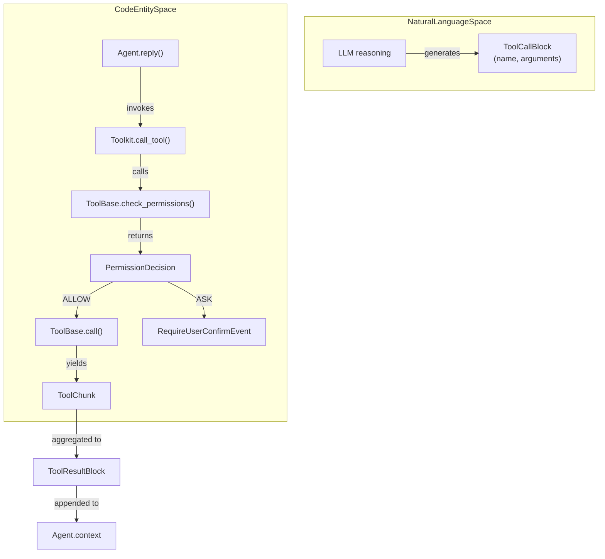
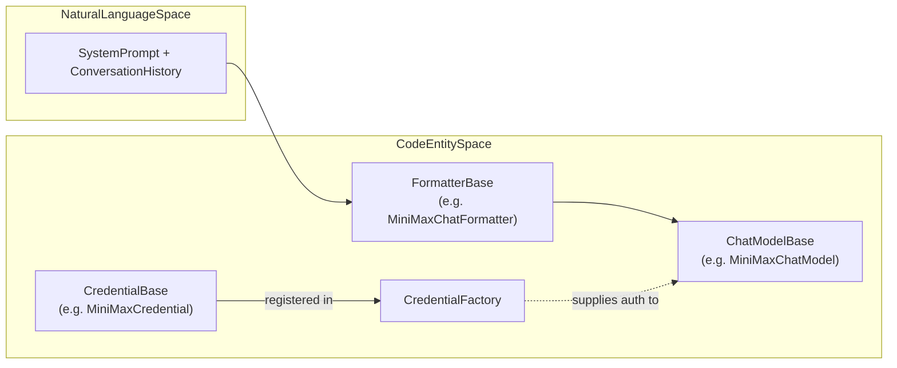
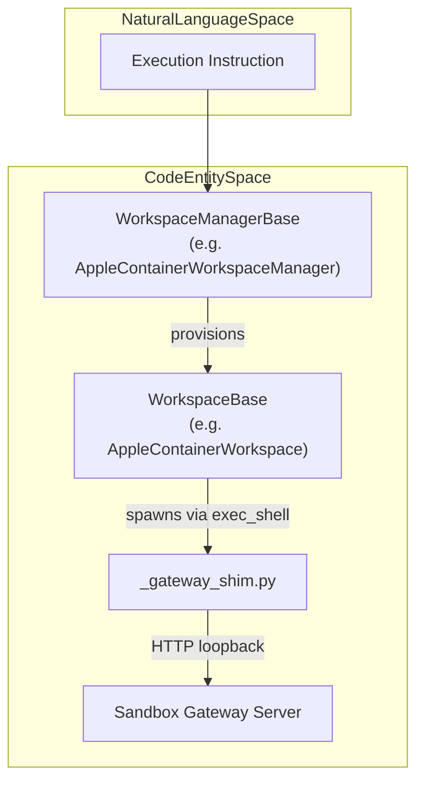

<!-- source: DeepWiki mcp.deepwiki.com · repo modelscope/agentscope · page 9.3 Extending AgentScope · fetched 2026-10-27 -->

# Extending AgentScope

Relevant source files

The following files were used as context for generating this wiki page:

- [scripts/model_examples/README.md](scripts/model_examples/README.md)
- [scripts/model_examples/minimax_call.py](scripts/model_examples/minimax_call.py)
- [scripts/model_examples/minimax_multiagent.py](scripts/model_examples/minimax_multiagent.py)
- [scripts/model_examples/minimax_multiagent_multimodal.py](scripts/model_examples/minimax_multiagent_multimodal.py)
- [scripts/model_examples/minimax_multimodal.py](scripts/model_examples/minimax_multimodal.py)
- [scripts/model_examples/run_tests.py](scripts/model_examples/run_tests.py)
- [src/agentscope/__init__.py](src/agentscope/__init__.py)
- [src/agentscope/app/workspace_manager/__init__.py](src/agentscope/app/workspace_manager/__init__.py)
- [src/agentscope/credential/__init__.py](src/agentscope/credential/__init__.py)
- [src/agentscope/credential/_factory.py](src/agentscope/credential/_factory.py)
- [src/agentscope/credential/_minimax.py](src/agentscope/credential/_minimax.py)
- [src/agentscope/formatter/__init__.py](src/agentscope/formatter/__init__.py)
- [src/agentscope/formatter/_minimax_formatter.py](src/agentscope/formatter/_minimax_formatter.py)
- [src/agentscope/model/__init__.py](src/agentscope/model/__init__.py)
- [src/agentscope/workspace/__init__.py](src/agentscope/workspace/__init__.py)
- [src/agentscope/workspace/_gateway_shim.py](src/agentscope/workspace/_gateway_shim.py)
- [tests/workspace_manager_applecontainer_test.py](tests/workspace_manager_applecontainer_test.py)

## Purpose and Scope

This document provides a comprehensive developer guide for extending AgentScope. The framework is designed with a modular architecture that allows developers to customize core components including tools, middlewares, model providers, workspace backends, storage backends, hub providers, and channels.

Sources: `[src/agentscope/__init__.py:1-22]()`

---

## Extension Principles and Guidelines

To maintain a lightweight core and ensure high quality, all extensions must follow these fundamental principles:

1.  **Lazy Import Principle**: Third-party dependencies not included in the base dependencies (e.g., provider-specific SDKs or database drivers) **must** be imported at the point of use within methods rather than at module top-level. For base classes and factories, use registry patterns (e.g., `CredentialFactory`) to defer loading.
2.  **Encapsulation Standards**: All Python files under `src/agentscope` should be named with a leading underscore (`_`), and public exposure must be explicitly controlled through package `__init__.py` files. Internal classes and helper methods must also be prefixed with an underscore.

Sources: `[src/agentscope/__init__.py:1-22]()`, `[src/agentscope/credential/_factory.py:20-120]()`

---

## Custom Tools (`ToolBase`)

Creating a custom tool involves subclassing `ToolBase`. Unlike simple function adapters, `ToolBase` subclasses allow for complex state management, custom argument validation, and fine-grained permission logic.

### Implementation Requirements
-   **`check_permissions`**: Evaluates whether a tool call is safe to run under the active `PermissionEngine` rules.
-   **`call`**: The main execution logic override. It yields or returns `ToolChunk` or `ToolResponse` objects.
-   **State Injection**: If `is_state_injected` is enabled, the tool receives live agent context during execution.

Title: "Tool Execution and Permission Flow"

Sources: `[scripts/model_examples/README.md:1-194]()`

---

## Custom Middlewares (`MiddlewareBase`)

Middlewares provide interception mechanisms at key execution points in the agent lifecycle using the onion pattern.

### Agent Middleware Hooks
-   **`on_reply`**: Intercepts the entire reply process.
-   **`on_reasoning`**: Intercepts the reasoning and model call phase.
-   **`on_acting`**: Intercepts individual tool call execution.
-   **`on_model_call`**: Intercepts the raw model API call.
-   **`on_system_prompt`**: Transforms the system prompt string.
-   **`on_check_permission`**: Intercepts permission evaluation for tool calls.
-   **`on_compress_context`**: Intercepts context compression workflows.

Sources: `[src/agentscope/__init__.py:1-22]()`

---

## Custom Model Providers

Adding a new LLM provider requires implementing a credential model, a chat model client, and a message formatter. Custom credentials are registered via `CredentialFactory`.

### Components to Implement
1.  **`CredentialBase` Subclass**: Carries authentication details, API keys, and base URLs (e.g., `MiniMaxCredential`) `[src/agentscope/credential/_minimax.py:17-42]()`.
2.  **`CredentialFactory` Registration**: Register custom credentials using `CredentialFactory.register_credential()` so they appear in dynamic UI schemas `[src/agentscope/credential/_factory.py:63-76]()`.
3.  **`ChatModelBase` Subclass**: Implements the provider API client wrapper, managing streaming and tool calling `[src/agentscope/model/__init__.py:4-38]()`.
4.  **`FormatterBase` Subclass**: Converts framework-standard `Msg` blocks into provider-specific request structures `[src/agentscope/formatter/__init__.py:4-51]()`.

Title: "Model Provider Entity Association"

Sources: `[src/agentscope/credential/_factory.py:20-121]`, `[src/agentscope/credential/_minimax.py:17-43]`, `[src/agentscope/model/__init__.py:4-38]`, `[src/agentscope/formatter/__init__.py:4-51]`

---

## Custom Workspace Backends (`WorkspaceBase`)

Workspaces provide sandboxed execution environments for running tools and interpreting code safely. AgentScope supports backends such as Local, Docker, Kubernetes, Daytona, OpenSandbox, AppleContainer, and Bubblewrap.

### Core Architecture and Gateway Shims
Sandboxed workspaces rely on a container-side gateway shim (`_gateway_shim.py`) that communicates over loopback pipes using standard JSON envelopes, allowing host-side workspace managers (e.g., `AppleContainerWorkspaceManager`, `DockerWorkspaceManager`) to execute commands and manage lifecycles securely `[src/agentscope/workspace/_gateway_shim.py:1-96]`, `[src/agentscope/app/workspace_manager/__init__.py:5-30]`.

Title: "Workspace Management and Gateway Architecture"

Sources: `[src/agentscope/workspace/__init__.py:5-35]`, `[src/agentscope/workspace/_gateway_shim.py:1-96]`, `[src/agentscope/app/workspace_manager/__init__.py:5-30]`, `[tests/workspace_manager_applecontainer_test.py:38-195]`

---

## Custom Storage Backends (`StorageBase`)

Storage backends handle persistence for the multi-tenant agent service layer.

### Implementation Requirements
-   **`StorageBase` Interface**: Custom storage backends must implement asynchronous CRUD operations for agent records, sessions, teams, and scheduler logs.
-   **Dependency Isolation**: Database drivers (such as `redis` or `sqlalchemy`) must be imported lazily inside storage methods or connection factories to avoid mandatory dependencies in lightweight client installations.

Sources: `[src/agentscope/__init__.py:1-22]()`

---

## Custom Hub Providers (`HubBase`)

The Hub subsystem supports browsing and installing remote resources.

### Interface Extension
-   **`MCPHubBase`**: Implemented for custom Model Context Protocol (MCP) registries.
-   **`SkillHubBase`**: Implemented for custom skill and tool repositories.
-   **Installation Flow**: Installed packages are registered in the user resource registry and bound to active `Workspace` sessions.

Sources: `[src/agentscope/__init__.py:1-22]()`

---

## Custom Channels (`ChannelBase`)

Channels enable bi-directional integration with external messaging platforms (e.g., Feishu, Discord, DingTalk).

### Implementation Requirements
-   **`ChannelBase` Subclass**: Implement message ingestion and transmission methods.
-   **Event Handling**: Process `ChannelEvent` messages and interface with the `ChannelGateway`.
-   **Routing Configuration**: Utilize `RoutingConfig` and `ChannelBinding` structures to map incoming platform events to target agent sessions.
-   **Worker Isolation**: Channels run within out-of-process workers to handle persistent WebSocket connections or webhook callbacks reliably.

Sources: `[src/agentscope/__init__.py:1-22]()`

---

