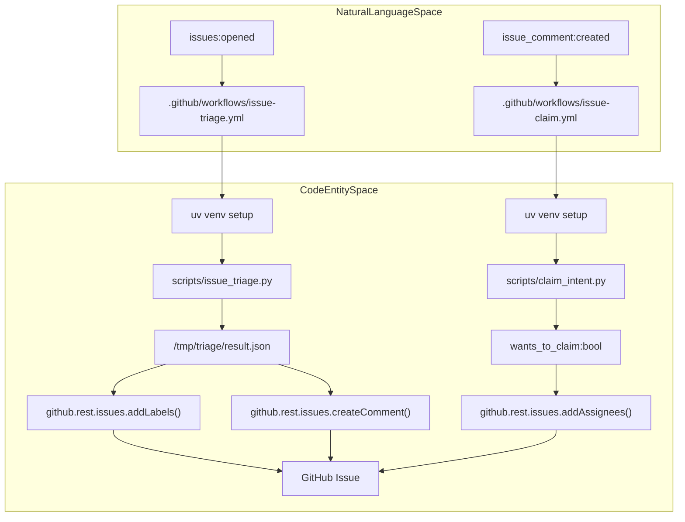
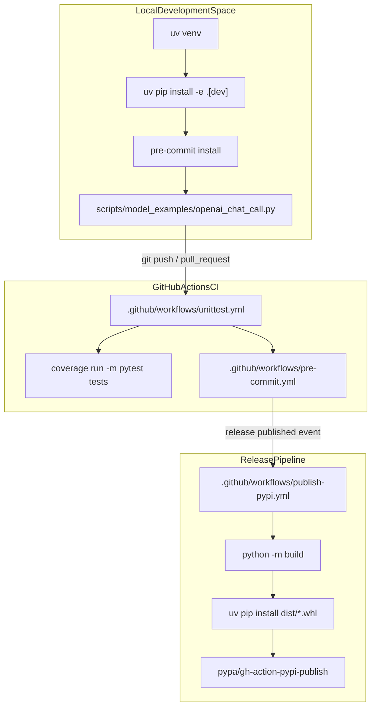

<!-- source: DeepWiki mcp.deepwiki.com · repo modelscope/agentscope · page 9.4 CI/CD and Development Workflow · fetched 2026-10-27 -->

# CI/CD and Development Workflow

Relevant source files

The following files were used as context for generating this wiki page:

- [.github/PULL_REQUEST_TEMPLATE.md](.github/PULL_REQUEST_TEMPLATE.md)
- [.github/workflows/github-monitor.yml](.github/workflows/github-monitor.yml)
- [.github/workflows/issue-claim.yml](.github/workflows/issue-claim.yml)
- [.github/workflows/issue-triage.yml](.github/workflows/issue-triage.yml)
- [.github/workflows/pr-title-check.yml](.github/workflows/pr-title-check.yml)
- [.github/workflows/pre-commit.yml](.github/workflows/pre-commit.yml)
- [.github/workflows/publish-pypi.yml](.github/workflows/publish-pypi.yml)
- [.github/workflows/stale.yml](.github/workflows/stale.yml)
- [.github/workflows/unittest.yml](.github/workflows/unittest.yml)
- [.github/workflows/web-ui.yml](.github/workflows/web-ui.yml)
- [CONTRIBUTING.md](CONTRIBUTING.md)
- [CONTRIBUTING_zh.md](CONTRIBUTING_zh.md)
- [scripts/model_examples/anthropic_call.py](scripts/model_examples/anthropic_call.py)
- [scripts/model_examples/dashscope_call.py](scripts/model_examples/dashscope_call.py)
- [scripts/model_examples/deepseek_call.py](scripts/model_examples/deepseek_call.py)
- [scripts/model_examples/gemini_call.py](scripts/model_examples/gemini_call.py)
- [scripts/model_examples/moonshot_call.py](scripts/model_examples/moonshot_call.py)
- [scripts/model_examples/ollama_call.py](scripts/model_examples/ollama_call.py)
- [scripts/model_examples/openai_chat_call.py](scripts/model_examples/openai_chat_call.py)
- [scripts/model_examples/openai_response_call.py](scripts/model_examples/openai_response_call.py)
- [scripts/model_examples/xai_call.py](scripts/model_examples/xai_call.py)
- [src/agentscope/workspace/_bubblewrap/_bubblewrap_workspace.py](src/agentscope/workspace/_bubblewrap/_bubblewrap_workspace.py)

This page documents the automated pipelines, development environment setup, contribution standards, responsible AI guidelines, automated issue triage scripts, and model example test runners for AgentScope 2.0. The framework utilizes modern tooling like `uv` for high-performance dependency management and GitHub Actions for continuous integration, automated issue triage, security gating, and package publishing.

Sources: [CONTRIBUTING.md:1-15](), [.github/workflows/unittest.yml:1-15]()

---

## 1. Development Environment Setup

AgentScope relies on `uv` as its primary package and environment manager to ensure fast, reproducible builds and strict dependency resolution [CONTRIBUTING.md:123-130]().

### Dependency Management with `uv`
The project defines several dependency groups in `pyproject.toml`. For local development, the `[dev]` extra is required, which pulls in testing utilities (`pytest`), linting tools, documentation builders, and the `full` extra (including `models`, `service`, and `storage`) [CONTRIBUTING.md:136-139]().

**Standard setup commands:**
1. Install `uv` via the official installer [CONTRIBUTING.md:123]().
2. Create an isolated virtual environment: `uv venv` [CONTRIBUTING.md:124]().
3. Activate the environment: `source .venv/bin/activate` [CONTRIBUTING.md:125]().
4. Install AgentScope in editable mode with dev dependencies: `uv pip install -e ".[dev]"` [CONTRIBUTING.md:127-130]().
5. Enable pre-commit hooks: `pre-commit install` [CONTRIBUTING.md:132-135]().

Sources: [CONTRIBUTING.md:118-140](), [.github/workflows/unittest.yml:17-29]()

### Pre-commit Hooks
AgentScope enforces code quality and formatting through `pre-commit` hooks [CONTRIBUTING.md:132-135](). These checks must pass before any code review [CONTRIBUTING.md:198]().

- **Enforced Checks**: AST validation, YAML linting, `mypy` strict type checking, code formatting, and error code verification [.github/workflows/pre-commit.yml:33-38]().
- **Manual Execution**: Run `pre-commit run --all-files` to format and inspect all repository files locally [.github/workflows/pre-commit.yml:37-38]().

Sources: [CONTRIBUTING.md:118-135](), [.github/workflows/pre-commit.yml:1-38]()

---

## 2. Contribution Standards and Responsible AI Guidelines

Contributions to AgentScope must adhere to structural, stylistic, and governance constraints.

### Responsible Use of AI
AgentScope permits contributors to use AI coding assistants (such as Claude Code, Cursor, Copilot, or Codex), provided they are used responsibly [CONTRIBUTING.md:46-51]().
- **Human Accountability**: The human contributor, not the AI, is the author [CONTRIBUTING.md:55](). Contributors must inspect diffs line by line and understand every change before pushing [CONTRIBUTING.md:55-60](). PRs whose authors cannot explain their code will be closed [CONTRIBUTING.md:59-60]().
- **Atomic PRs**: Monolithic PRs exceeding thousands of lines produced by LLMs in a single shot are unreviewable and will be rejected [CONTRIBUTING.md:66-70](). Work must be broken into focused, single-purpose PRs [CONTRIBUTING.md:68-70]().
- **Adherence to Conventions**: AI-generated code must comply with all project rules, including modularity, lazy imports for optional dependencies, and test coverage [CONTRIBUTING.md:71-75]().

### Conventional Commits and PR Title Validation
Commit messages and PR titles must follow the **Conventional Commits** specification (`<type>(<scope>): <description>`) [CONTRIBUTING.md:128-132]().
- **Allowed Types**: `feat`, `fix`, `docs`, `ci`, `refactor`, `test`, `chore`, `perf`, `style`, `build`, `revert` [CONTRIBUTING.md:135-144]().
- **Scope Rules**: Scope is optional but must be lowercase (only lowercase letters, numbers, hyphens, and underscores) [CONTRIBUTING.md:156-163]().
- **Issue and Claim Quotas**: To maintain tracker quality, individual contributors are restricted to a maximum of 5 open issues and 5 active claims simultaneously [CONTRIBUTING.md:95-98]().

Sources: [CONTRIBUTING.md:46-188](), [.github/PULL_REQUEST_TEMPLATE.md:1-25]()

---

## 3. GitHub Actions Workflows

Continuous integration and repository automation are driven by a suite of specialized GitHub Actions workflows.

### 1. Python Unittest Coverage (`unittest.yml`)
Executes the pytest test suite across a multi-OS matrix to verify core and tool functionalities [.github/workflows/unittest.yml:1-15]().
- **Matrix**: Runs on `ubuntu-latest`, `windows-latest`, and `macos-26` using Python 3.11 [.github/workflows/unittest.yml:11-12]().
- **Conditions**: Triggers on `push` and `pull_request`, skipping runs if the PR title contains `WIP` [.github/workflows/unittest.yml:3-7]().
- **Execution**: Uses `coverage run -m pytest tests -v` to measure code coverage [.github/workflows/unittest.yml:31-35]().
- **Platform Dependencies**: On Linux runners, `bubblewrap` is installed to support sandboxed workspace backends [.github/workflows/unittest.yml:22-26]().

Sources: [.github/workflows/unittest.yml:1-38]()

### 2. Pre-commit (`pre-commit.yml`)
Validates repository formatting, linting, and type checking on every push and pull request by running `pre-commit run --all-files` [.github/workflows/pre-commit.yml:1-38]().

Sources: [.github/workflows/pre-commit.yml:1-38]()

### 3. Automated Issue Triage & Claim Workflows (`issue-triage.yml`, `issue-claim.yml`)
- **`issue-triage.yml`**: Triggers when a new issue is opened [.github/workflows/issue-triage.yml:10-13](). It checks author quotas (max 5 open issues per user) [.github/workflows/issue-triage.yml:19-72]() and executes `scripts/issue_triage.py` using `TRIAGE_MODEL: qwen3.8-max` inside a sandboxed runner with `persist-credentials: false` to verify bug reports against `main` without exposing write tokens [.github/workflows/issue-triage.yml:18-153](). Results are written to JSON and mapped to GitHub labels (`triage/confirmed`, `triage/suggest-close`, etc.) [.github/workflows/issue-triage.yml:154-178]().
- **`issue-claim.yml`**: Intercepts issue comments where contributors request to take an issue [.github/workflows/issue-claim.yml:10-54](). It invokes `scripts/claim_intent.py` to evaluate user intent and securely assigns eligible contributors [.github/workflows/issue-claim.yml:70-173]().

Sources: [.github/workflows/issue-triage.yml:1-178](), [.github/workflows/issue-claim.yml:1-172]()

### 4. Release and Monitoring Workflows
- **`publish-pypi.yml`**: Builds Python source distributions and wheels using `build` and publishes them to PyPI via `pypa/gh-action-pypi-publish` upon publication of a GitHub release [.github/workflows/publish-pypi.yml:9-45]().
- **`github-monitor.yml`**: Forwards repository events (issues, comments, PR updates) to a centralized monitoring repository and notifies DingTalk webhooks [.github/workflows/github-monitor.yml:11-66]().
- **`web-ui.yml`**: Builds and tests the Web UI companion under `examples/web_ui` using pnpm [.github/workflows/web-ui.yml:1-46]().
- **`stale.yml`**: Automatically flags and closes inactive issues and pull requests after 60 days of inactivity [.github/workflows/stale.yml:6-35]().

Sources: [.github/workflows/publish-pypi.yml:1-45](), [.github/workflows/github-monitor.yml:1-66](), [.github/workflows/web-ui.yml:1-46](), [.github/workflows/stale.yml:1-35]()

---

## 4. Model Integration Verification (`scripts/model_examples/`)

The `scripts/model_examples/` directory houses executable example scripts that serve as functional integration tests for chat model providers [scripts/model_examples/openai_chat_call.py:1-191]().

### Provider Test Scripts
Developers integrating or updating model providers must use these scripts to verify core capabilities:
- **Simple Text Calls**: Non-streaming and streaming generation via `ChatModelBase` subclasses [scripts/model_examples/openai_chat_call.py:27-52]().
- **Tool Calling**: Integration with `Toolkit`, `FunctionTool`, schema serialization via `Toolkit.get_tool_schemas()`, and multi-round execution [scripts/model_examples/openai_chat_call.py:71-134]().
- **Structured Output**: Forcing typed outputs using Pydantic `BaseModel` schemas via `generate_structured_output()` [scripts/model_examples/openai_chat_call.py:140-186]().

**Key Example Runners:**
- `openai_chat_call.py`: Tests `OpenAIChatModel` and `OpenAICredential` [scripts/model_examples/openai_chat_call.py:17-191]().
- Additional provider runners include `openai_response_call.py`, `xai_call.py`, `dashscope_call.py`, `anthropic_call.py`, `gemini_call.py`, `deepseek_call.py`, `moonshot_call.py`, and `ollama_call.py`.

Sources: [scripts/model_examples/openai_chat_call.py:1-191]()

---

## 5. Technical Implementation Details

### Issue Triage and Claim Data Flow
This diagram illustrates how GitHub events invoke sandboxed Python scripts (`scripts/issue_triage.py` and `scripts/claim_intent.py`) to process natural language inputs safely without compromising repository write tokens.

Diagram: "Issue Triage and Claim Data Flow"

Sources: [.github/workflows/issue-triage.yml:10-178](), [.github/workflows/issue-claim.yml:10-172](), [.github/workflows/unittest.yml:1-38]()

### Development to Release Pipeline
This diagram associates local workspace development tasks and model verification scripts with remote GitHub Actions continuous integration and PyPI deployment workflows.

Diagram: "Code to Deployment Flow"

Sources: [CONTRIBUTING.md:118-140](), [.github/workflows/unittest.yml:1-38](), [.github/workflows/publish-pypi.yml:1-45](), [.github/workflows/pre-commit.yml:1-38](), [scripts/model_examples/openai_chat_call.py:27-191]()

---

